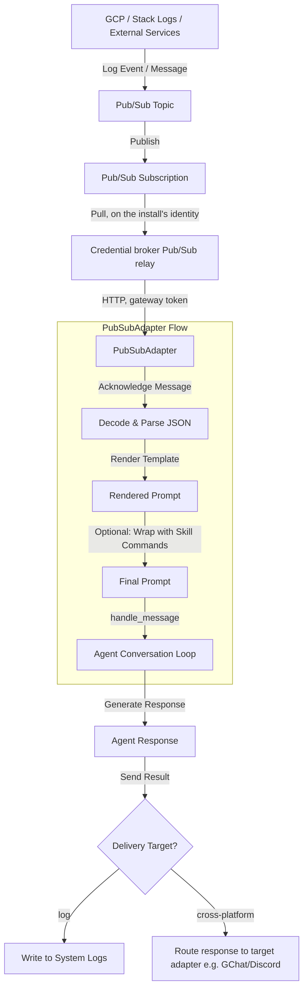

# Google Cloud Pub/Sub Platform Plugin

The Google Cloud Pub/Sub platform plugin connects the Kubernetes Agentic Harness (`kube-agents`) to GCP Pub/Sub pull subscriptions. It acts as an event receiver that pulls messages (such as log-based alerts from Cloud Logging sinks or notification events), parses them, and injects them as prompts into the agent's core conversation loop.

It also supports response routing, allowing the agent to post responses back to other chat platforms (cross-platform delivery) or write replies directly to the system logs.

## Architecture & Message Flow

The following diagram illustrates how the Pub/Sub plugin receives messages, processes them through the adapter, and routes agent responses back:



## Key Features

1. **Credential-free pulls**: The adapter runs in the gateway Pod, which holds no Google credential. It reads its subscriptions through the credential broker's Pub/Sub relay (`PUBSUB_RELAY_URL`), which the operator fills once at least one route names a subscription it can qualify (and renders empty otherwise, so the adapter does not connect); a short route name is qualified with `PUBSUB_RELAY_PROJECT`, the project the operator composed the broker's set with. The broker pulls on the install's identity, confined to those subscriptions. A subscription outside that set is refused by the broker and the adapter logs the refusal with its rule. On connect the adapter reads each subscription through the relay and logs clearly if it is missing; the read is announced before it runs and bounded at 30 seconds (`PREFLIGHT_RPC_TIMEOUT_SECONDS` in `adapter.py`), and a read that times out or errors logs a warning and startup continues. Topics and log sinks are not checked: the broker relays no topic or Logging read.
2. **Programmatic Payload Validation**: Allows setups to provide custom Python code (`validation_code`) to programmatically validate message payloads before spawning agent prompts.
3. **Dynamic Prompt Rendering**: Supports template syntax (e.g. `{incident.summary}`) to format raw JSON message payloads into readable, context-rich prompts.
4. **Skill Wrapping**: Directly routes incoming alerts to specific agent skills by mapping route paths to skill names (e.g. wrapping stockout alerts with `/gke-stockout-investigator`).
5. **Cross-Platform Response Delivery**: Agents can respond to other messaging channels (e.g., Google Chat space or a specific thread) from incoming alert logs.

## Installation

An installation shell script is provided to apply the `AgentPlugin` CRD and deploy the chart:

```bash
bash agentplugins/pubsub-platform/install.sh --context <your-kubectl-context> --namespace kubeagents-system
```

## Configuration Guide

The Pub/Sub plugin configures route subscriptions in your agent's `config.yaml` under `platforms.pubsub.extra.subscriptions`.

### Example Configuration

```yaml
platforms:
  pubsub:
    enabled: true
    extra:
      subscriptions:
        gke_alerts:
          topic: "gke-alerts"
          subscription: "gke-alerts-sub"

          # Optional programmatic validation snippet
          validation_code: |
            def validate(payload, config):
                # Custom validation logic returning True (process) or False (skip)
                return payload.get("severity") in ["WARNING", "ERROR", "CRITICAL"]

          # Template for formatting incoming message payload
          prompt: |
            Alert policy triggered: {incident.summary}
            Resource: {incident.resource_name}
            URL: {incident.url}

            Full incident details:
            {__raw__}

          # Optionally trigger specific agent skill commands with the alert details
          skills:
            - gke-stockout-investigator

          # Where to deliver the agent's response
          deliver: "google_chat"
          deliver_extra:
            chat_id: "spaces/AAAA12345"
            thread_id: "{incident.summary}" # Dynamically template the destination thread
```

### Configuration Parameters

| Parameter         | Type           | Required | Description                                                                                                                                                            |
| :---------------- | :------------- | :------- | :--------------------------------------------------------------------------------------------------------------------------------------------------------------------- |
| `topic`           | `string`       | No       | Simple topic name or full GCP resource path (`projects/<project>/topics/<name>`).                                                                                      |
| `subscription`    | `string`       | No       | Simple subscription name or full GCP path (`projects/<project>/subscriptions/<name>`). Defaults to `<topic>-sub` when only `topic` is set; one of the two is required. |
| `query`           | `string`       | No       | GCP Cloud Logging filter query. Recorded only; the adapter reads no Logging API.                                                                                       |
| `sink`            | `string`       | No       | Name of the Cloud Logging sink exporting to this topic. Recorded but **not read**: there is no sink check, and one would need a broker route for the Logging API.      |
| `validation_code` | `string`       | No       | Python code snippet to programmatically validate payload. Can define `validate(payload, config)` returning boolean `True` or `False`.                                  |
| `prompt`          | `string`       | Yes      | Markdown template. Supports placeholder substitution using dot-notation (e.g., `{incident.summary}`). Use `{__raw__}` for a raw JSON payload string.                   |
| `skills`          | `list[string]` | No       | List of skill command aliases (without leading `/`) that the agent should execute with the rendered prompt.                                                            |
| `deliver`         | `string`       | Yes      | Destination platform for the response. Can be `log` (default) or any active platform adapter name (e.g., `google_chat`, `discord`).                                    |
| `deliver_extra`   | `dict`         | No       | Extra configuration variables for the target delivery adapter (e.g., `chat_id`, `thread_id`). Values support placeholder rendering.                                    |
