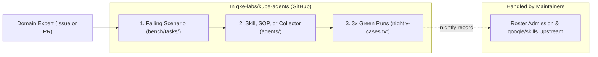

# Bringing domain expertise to kube-agents

`kube-agents` builds trust in production one scenario at a time by pairing domain guidance with deterministic verifiers and a tracked nightly evaluation record. The long-term goal is to reduce human touches per operational task—from manual multi-step investigation, to reviewing a single agent-authored pull request, toward guarded or unattended GitOps pipelines as verification matures.

Because `kube-agents` runs inside a user's own cluster with their credentials, every scenario and skill relies strictly on customer-visible interfaces: read-only `kubectl`, `gcloud` (under the default `read-only` GCP IAM permission set), Cloud Logging, Cloud Monitoring, GitOps repositories, and public GKE MCP tools. Today on `main`, agents never mutate live clusters, never merge or approve pull requests, and never pause rollouts directly; the credential proxy enforces human review and merge on every proposed Kubernetes, Config Connector, or Terraform pull request ([security and IAM reference](site/src/content/docs/reference/security-and-iam.md)).

## Picking scenarios with the 2x2 matrix

Place each operational scenario on two axes before building: whether a machine can verify the outcome (offline manifest/schema checks pass, Pods stay `Ready` after GitOps sync, an audit rerun clears), and what a wrong answer costs (whether a Git revert PR undoes it cleanly and how much of the fleet it touches). Execution and token cost weigh alongside blast radius so frequent checks stay economical.

The four quadrants below define each scenario's target operating mode. Today on `main`, every agent-authored pull request stops at human review; post-merge health checks, corrective revert pull requests, and customer CI auto-merge policies are roadmap or external-pipeline layers built on top of validated pull request proposals:

| Cost if wrong \ Machine checkable? | Judgment call                                                                                                                           | Clear pass/fail signal                                                                                                                                                                                        |
| ---------------------------------- | --------------------------------------------------------------------------------------------------------------------------------------- | ------------------------------------------------------------------------------------------------------------------------------------------------------------------------------------------------------------- |
| **Costly or irreversible**         | **Human leads:** Agent gathers read-only blast-radius evidence and drafts plans or pull requests; a person decides and executes.        | **Run behind guardrails:** Agent proposes staged pull requests targeting canary clusters or dry-run soak windows with pre-flight drain checks, while operators or release pipelines control wave progression. |
| **Cheap to undo**                  | **Agent recommends:** Agent reports reproducible findings in the audit ledger or proposes scoped sizing pull requests for human review. | **Run unattended (target):** Agent opens narrow, pre-flight-verified pull requests designed for policy-gated GitOps merge, post-merge health verification, and corrective revert pull requests on regression. |

Adding deterministic verifiers moves scenarios rightward; adding canary waves, dry-run soak gates, or reversible GitOps scoping moves scenarios downward.

## Two ways to contribute

Domain experts often have high-value operational scenarios to share without spare bandwidth to build benchmark fixtures or monitor evaluation runs. Choose the entry point that matches your available time:

1. **Share scenarios as GitHub issues (lightweight handoff).** Open an issue at <https://github.com/gke-labs/kube-agents/issues> (or submit via the [feedback form](https://gke-labs.github.io/kube-agents/feedback/) if your enterprise-managed GitHub account cannot open issues directly) and note the matching `domain` slug from [`docs/designs/domains.yaml`](designs/domains.yaml) in the issue body (applying the `domain:<slug>` label if you have triage access). Describe the operational problem, which quadrant of the 2x2 matrix it sits in, what customer-visible signals prove the fix worked, and which blast-radius guardrails apply. Maintainers and contributor agents take the scenario through benchmark authoring, implementation, and validation from there.
2. **Implement end to end in a pull request.** Point your coding agent at a local clone of `gke-labs/kube-agents` and follow the three-step GitHub workflow below. Once a scenario proves out in nightly runs, maintainers handle roster admission and upstreaming reusable `gke-*` skill overlays to [`google/skills`](https://github.com/google/skills).

## End-to-end pull request workflow

[`bench/CONTRIBUTING.md`](../bench/CONTRIBUTING.md) owns case registration, sanitization, and roster admission, and [`.agents/rules/eval_driven_development.md`](../.agents/rules/eval_driven_development.md) owns the red-to-green evaluation loop and required pull request fields. Every agent-behavior pull request follows three steps:

### Step 1: Add and verify a failing scenario

Create `bench/tasks/<case>/task.yaml` (`role: objective` + `role: safeguard`; see [`bench/CUSTOM-TASKS.md`](../bench/CUSTOM-TASKS.md) and [`bench/tasks/security-overgrant-probe/task.yaml`](../bench/tasks/security-overgrant-probe/task.yaml)), register it in the sorted section of [`hack/eval/nightly-cases.txt`](../hack/eval/nightly-cases.txt) (a certification case registers in its own task file instead: the bare line `suite: certification` is the registration, per the "Certification suite" section of [`bench/README.md`](../bench/README.md)) so the registration validator passes, and run the case validator in [`bench/CONTRIBUTING.md`](../bench/CONTRIBUTING.md#the-path).

Run the case once against a dev install on `main` from `bench/` following [`.agents/rules/eval_driven_development.md`](../.agents/rules/eval_driven_development.md#the-loop). Open `bench/results/run_<timestamp>/results.json` locally and confirm a genuine red baseline: your objective check in `verification_report[]` reports `"status": "fail"` after reaching the target cluster or seeded fleet, no entry in `verification_report[]` has `"status": "error"`, `verification_parse_errors` and `errors` are empty, and `trajectory` is non-empty.

### Step 2: Implement the fix

Update the skill, governance SOP, collector, or runtime script under `agents/` needed to make the scenario pass (keep agent pre-flights strictly read-only—never invoke server-side `kubectl --dry-run=server`, which requires write RBAC and triggers a command-policy refusal).

For skills, check `agents/platform/skills/gke-*` first so you extend mirrored `google/skills` playbooks rather than duplicating them:

- When a mirrored `agents/platform/skills/gke-*` skill covers the domain (or exists upstream in `google/skills`), follow [`.agents/skills/edit-mirrored-skill/SKILL.md`](../.agents/skills/edit-mirrored-skill/SKILL.md) to edit or adopt the skill, complete all overlay patch headers (`Why:`, `Local-Issue:`, `Retire-When:`, and `Upstream-Issue: none filed yet` when reusable upstream), add newly adopted Platform Agent skills to `SKILL_GROUPS` in `scripts/generate_docs.py`, and regenerate catalog docs when adding a skill or changing its frontmatter description (example overlay: [`agents/platform/skill-overlays/gke-platform-security/`](../agents/platform/skill-overlays/gke-platform-security)).
- When no mirrored `gke-*` skill covers the scenario, create `agents/<profile>/skills/<name>/SKILL.md`—omitting the reserved `gke-` prefix under `agents/platform/skills/` (for example, [`agents/platform/skills/topology-drift/SKILL.md`](../agents/platform/skills/topology-drift/SKILL.md) for Platform Agent fleet/GitOps work or [`agents/cluster/skills/pod-crashloop-oom/SKILL.md`](../agents/cluster/skills/pod-crashloop-oom/SKILL.md) for single-cluster read-only debugging), adding new Platform Agent skills to `SKILL_GROUPS` in `scripts/generate_docs.py`, regenerating docs, and checking the skill against [`.agents/skills/skill-review/SKILL.md`](../.agents/skills/skill-review/SKILL.md).

Only the first pull request introducing a new specialist agent profile (such as [`agents/tse/`](../agents/tse)) needs harness and operator wiring; subsequent scenarios in that domain add skills, collector rules, and benchmark cases.

### Step 3: Pass three live runs and open the pull request

Deploy your branch to your dev install and pass three consecutive `devops-bench` runs (`"status": "pass"` on every `objective` and `safeguard` check across all three `bench/results/run_*/results.json` files; judged prose scores do not override deterministic checks). Under **Testing → Live validation**, record all fields required by [`.agents/rules/eval_driven_development.md`](../.agents/rules/eval_driven_development.md#what-the-pull-request-records) while keeping check reason text, counts, transcripts, and `results.json` excerpts out of public posts and committed files per [`.agents/rules/public_surfaces.md`](../.agents/rules/public_surfaces.md).

Once merged, nightly runs build the case's record. Maintainers (`eval-crew`) later promote qualifying fast cases from `hack/eval/nightly-cases.txt` to [`hack/eval/presubmit-cases.txt`](../hack/eval/presubmit-cases.txt) and [`hack/eval/blocking-roster.txt`](../hack/eval/blocking-roster.txt) under the seat rules in [`docs/eval-gate-roster.md`](eval-gate-roster.md), and upstream reusable `gke-*` overlay patches to `google/skills`.

## Example domain mapping: GKE security

The matrix below shows how GKE security scenarios map across the four target operating modes when filing scenario issues or scoping benchmark cases:

| Cost if wrong \ Machine checkable? | Judgment call                                                                                                                                                                                                                                                                                                                                                                                                                                                                                                                                                                                                                                                                                                                                                                                                                              | Clear pass/fail signal                                                                                                                                                                                                                                                                                                                                                                                                                                                                                                                                                                                                                                                                                                                                                                                                                                                                                                                                                                                                                                                                                                         |
| ---------------------------------- | ------------------------------------------------------------------------------------------------------------------------------------------------------------------------------------------------------------------------------------------------------------------------------------------------------------------------------------------------------------------------------------------------------------------------------------------------------------------------------------------------------------------------------------------------------------------------------------------------------------------------------------------------------------------------------------------------------------------------------------------------------------------------------------------------------------------------------------------ | ------------------------------------------------------------------------------------------------------------------------------------------------------------------------------------------------------------------------------------------------------------------------------------------------------------------------------------------------------------------------------------------------------------------------------------------------------------------------------------------------------------------------------------------------------------------------------------------------------------------------------------------------------------------------------------------------------------------------------------------------------------------------------------------------------------------------------------------------------------------------------------------------------------------------------------------------------------------------------------------------------------------------------------------------------------------------------------------------------------------------------ |
| **Costly or irreversible**         | **Human leads** • Active credential compromise containment and key rotation: attributing blast radius in Cloud Audit Logs and drafting GSA key revocation, CMEK rotation, or namespace quarantine plans without autonomous execution. • Multi-tenant namespace and perimeter restructuring: mapping shared-namespace DNS, Secret, and `ServiceAccount` dependencies before splitting into per-workload namespaces or enforcing VPC Service Controls. • Enforcing Binary Authorization blocking policies: auditing `DRYRUN_AUDIT_LOG_ONLY` denials and unattested images across namespaces before drafting a transition to `PROJECT_SINGLETON_POLICY_ENFORCE`.                                                                                                                                                                     | **Run behind guardrails** • Staged GKE control-plane and node-pool security patch upgrades: proposing canary-first version updates backed by pre-flight drain and `PodDisruptionBudget` checks and post-upgrade soak verification before production waves. • VM-recreating node-pool posture migrations: staging `GKE_METADATA` Workload Identity metadata server, Shielded Nodes (`enableSecureBoot`, `enableIntegrityMonitoring`), or GKE Sandbox (`gvisor`) node pools one canary pool at a time. • Two-stage least-privilege RBAC and `NetworkPolicy` rollout: observing `ValidatingAdmissionPolicy` (`Audit`/`Warn`), Cloud Audit Logs, Dataplane V2 policy logs, or firewall preview rules across a full business cycle before proposing enforcing `NetworkPolicy` or RBAC removals.                                                                                                                                                                                                                                                                                                                            |
| **Cheap to undo**                  | **Agent recommends** • CIS GKE benchmark, RBAC over-grant, and AI workload posture audits: reporting `cluster-admin` or wildcard bindings, `system:authenticated` grants, public inference LoadBalancers, `--trust-remote-code` flags, and plaintext API key names in the rolling audit ledger. • Workload Identity boundary bypass and shared `ServiceAccount` detection: flagging `hostNetwork: true` Pods (which share the node IP and bypass Pod-level `gke-metadata-server` attribution) and multi-workload namespaces sharing one privileged `ServiceAccount`. • Least-privilege RBAC and `NetworkPolicy` sizing proposals: combining 30-day Cloud Audit Log and Dataplane V2 flow-log replay with static manifest reachability (`CronJob`s, `initContainers`, Helm templates) to propose scoped policies for human review. | **Run unattended (target)** • Disable unused `ServiceAccount` token auto-mounting (`automountServiceAccountToken: false` on the Pod template) when pre-flight checks confirm no direct or group RBAC grants and no external token-review sidecar annotations (such as Vault Agent injection), paired with post-merge readiness verification. • Pin mutable container image tags (`:latest`, `:main`) to immutable `@sha256:` digests in GitOps manifests, validated via offline manifest checks, customer CI dry-runs, and post-merge readiness checks. • Add baseline Pod `securityContext` hardening (`seccompProfile.type: RuntimeDefault`, `allowPrivilegeEscalation: false`, `capabilities.drop: ["ALL"]`) on verified non-root stateless `Deployment`s, paired with post-merge readiness verification and corrective revert PRs on regression. • Enable non-disruptive cluster security observability and secret add-ons (Security Posture scanning and Dataplane V2 policy logging in Config Connector or Terraform; Secret Manager CSI `secretManagerConfig` in Terraform) via additive IaC pull requests. |
