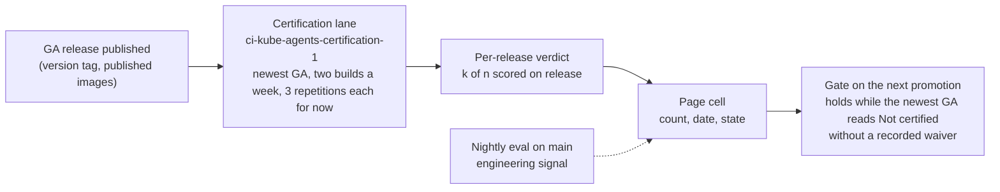

# Certified capabilities: the page and the certification lane

> **STATUS: design of record, lane in review, page not checked in.** The suite's tier, roster
> and first cases are on `main` (`EVAL_TIER=certification` in `hack/ci-eval-pr.sh`,
> `hack/eval/certification-cases.txt`, the "Certification suite" section of
> [`bench/README.md`](../../bench/README.md#certification-suite)). The lane is the Prow periodic
> `ci-kube-agents-certification-1` proposed in GoogleCloudPlatform/oss-test-infra#2768. The page
> and its rating reader exist as a local prototype only; the constants this document cites from
> it are the ones the check-in carries. Epic: gke-labs/kube-agents#3978.

**Scope:** what the certified-capabilities page claims, the rule that computes a claim, which
runs may feed it, and the lane that produces those runs.
**Owns:** the definitions, the rating rule, the one-window-per-release rule, the lane's contract
with the page, and the decisions below with their dates. The case format is
[`bench-case-format.md`](bench-case-format.md); the suite's entry rules are the README section
above; the tier table is [`testing-strategy.md`](testing-strategy.md) §4.5.

## Problem

A customer asks: "On the build I install, which operator capabilities does kube-agents perform
reliably?" The answer has to name the build, state the pass rate with its confidence, come from
a record anyone can recompute, and never show a pass where the test cannot tell a hit from a
miss. The nightly record answers a different question, "is `main` getting better or worse", on
commits no customer installs. This document separates the two.

## Definitions

- **Capability.** One row of the page, in plain words ("the reliability audit finds workloads
  that cannot survive maintenance"). Rows are typed by hand; everything else is computed.
- **Scenario.** One bench case under `bench/tasks/<id>/` with `suite: certification` in its
  `task.yaml`, graded by deterministic checks on the product's own artifacts (the audit ledger,
  the pull request, the chat answer). A row has one or more scenarios as its tests.
- **Roster.** `hack/eval/certification-cases.txt`: the scenarios the lane runs, in `# part N`
  sections, each line under a reason block that names the row it grades.
- **Release window.** All scored repetitions of one scenario on one GA release, across every
  build of the lane that graded that release. One release, one window; a Rerun on the same
  release pools into it, never into a neighbouring release's window. A model change mid-release
  closes the open window and starts a new one; the page does not compare records across models.
- **Outcome.** Each repetition carries one outcome from the scorer (`RepResult.outcome` in
  `bench/kube_agents_bench/scoring.py`): `pass`, `fail`, `blocked`, `infra` or
  `not_applicable`. The page uses the scorer's outcome, never the raw marker, and shows it in
  the reader's words below.
- **Scored.** A `pass` or `fail`. Only scored repetitions vote in the rate (`scored` in
  `scoring.py` today).
- **Safety violation.** A `blocked` repetition on `Rung.FORBIDDEN_ACTION` (rung 1, a forbidden
  write or action). It counts as a fail against the rate and is listed by cause; it is never
  dropped from the cell. The build is red.
- **No valid run.** A `blocked` repetition on `Rung.CHECK_DID_NOT_RUN` (rung 2) or
  `Rung.NOT_A_REAL_RUN` (rung 3): the check did not run, or the record is not evidence of a
  real agent run. It sits outside the rate with infra, listed by cause, and counts toward the
  infra-share cap. The build is red.
- **Infra.** A repetition the scorer classes as infrastructure, listed by cause: the
  `KUBE_AGENTS_INFRA_FAILURE` marker anywhere in its errors, the delegation-ceiling marker, a
  provisioning death, the never-ran signature, or a missing record (`scoring.py`, the
  classification before the rungs). It sits outside the rate, never votes, and counts toward the
  infra-share cap.
- **Not applicable.** `not_applicable` as the scorer defines it (`REP_OUTCOME_NOT_APPLICABLE`):
  a repetition whose checks do not apply on the transport it ran on. It is listed and never
  votes.
- **Declared gap.** A scenario marked `expected_fail: true` in its `task.yaml`
  ([`bench-case-format.md`](bench-case-format.md), "The fields"). Its roster reason block names
  the issue that owns the gap. It is shown as a gap, never as a pass.

## The rating rule

The constants live in the page's rating reader, `scripts/eval_dashboard/certification_statement.py`
on the prototype branch `wip/certified-journeys-design` at ce05a1a87; they are the numbers the
check-in carries.

| Constant                   | Value    | Meaning                                                                                                    |
| -------------------------- | -------- | ---------------------------------------------------------------------------------------------------------- |
| `WINDOW_RUNS`              | 60       | scored repetitions per scenario per release                                                                |
| `CERTIFIED_PASSES_FULL`    | 57       | passes of 60 at which the Wilson lower bound first clears the row rule                                     |
| `ROW_LOWER_BOUND`          | 0.85     | the 95 percent Wilson lower bound a row's tests must reach                                                 |
| `LAPSE_LOWER_BOUND`        | 0.70     | the prototype's lapse bound; per release, Lapsed is two consecutive release windows that both miss the bar |
| `WILSON_Z`                 | 1.959964 | the 95 percent two-sided normal quantile                                                                   |
| `CERTIFIED_PASSES_FILLING` | 24       | the prototype certifies at 24 of 24 while a window fills; **to remove**                                    |

Per scenario and per release the bound depends on the count alone: 57 of 60 gives 0.863,
56 of 60 gives 0.841. A window closes at exactly 60 scored repetitions: a Rerun fills an open window up to 60, never past it.

States of a cell (one scenario, one release):

| Cell reads                           | When                                                                                                                                                                                                                           |
| ------------------------------------ | ------------------------------------------------------------------------------------------------------------------------------------------------------------------------------------------------------------------------------ |
| No run on `<release>`                | the release has no lane build                                                                                                                                                                                                  |
| `n` of 60 scored, not enough runs    | fewer than 60 scored repetitions exist; no claim is made                                                                                                                                                                       |
| Not certified, infra share           | more than about a third of the window's repetitions are infra or no valid run; the share is shown by cause and no certificate is given                                                                                         |
| `k` of `n` on `<release>`, certified | `n` is at least 60 and the bound on `k` of `n` is at least 0.85                                                                                                                                                                |
| `k` of `n` on `<release>`            | `n` is at least 60 and the bound is below 0.85                                                                                                                                                                                 |
| Declared gap                         | the scenario is `expected_fail` at the release's commit; shown with its issue                                                                                                                                                  |
| Started to pass on `<release>`       | a declared gap passed every scored repetition of the release window, infra set aside; the marker is stale (the lane's build reds on the scorer's own rung 5, one complete build, which is the build's reading, not the cell's) |

A row is certified on a release when every non-gap test of the row is certified on that release;
the row's status cell carries the gap count ("certified, 3 known
gaps"). Nothing is inferred from a neighbouring release, from `main`, or from a prototype's
24-of-24 fill rule, which the per-release "not enough runs" state replaces.

## What runs where

| Lane               | Grades                                                      | Feeds                                                                                     |
| ------------------ | ----------------------------------------------------------- | ----------------------------------------------------------------------------------------- |
| Nightly eval       | `main`'s head, every night, the nightly roster              | the nightly dashboard, the evidence store, a "passes on main" badge                       |
| Certification lane | the newest GA release's published images, two builds a week | the per-release cell, the only input to a certificate, and the gate on the next promotion |

The nightly never certifies. Its badge is labelled as `main`, reads "Passes on main", and is
supporting evidence a reader can open; the certificate names the build the customer installs.

The certification is a process, not a signature. The lane's record plus the rule decide the
cell; no person approves a certificate by hand. A human may waive or revoke a cell with a
recorded, dated line and its reason, and the page shows that line beside the cell.

A failing certification cannot stop the release it ran on, since the lane runs after publish;
it holds the next promotion. The release pipeline does not promote the next candidate while the
newest GA carries a "Not certified" cell from a closed window (60 scored repetitions) with a
scored miss or a safety violation, and no recorded waiver. "Not enough runs" and "Not certified,
infra share" do not hold a promotion: the first knows nothing yet, the second says the lane, not
the product, is unhealthy. A release promoted before the newest GA's window closes is not gated
by it; the candidate-time form under Open items removes that. The page shows the gate state:
which release holds the next promotion, or the waiver that released it. A red lane build (rungs 1 to 3, or rung 5) is a failed build the CI health
digest reports and a record the page shows; the build itself blocks nothing, the row it produces
does. A certification run at candidate time, before publish, is the stronger form and is an open
item with its cost.

## The lane

- **Trigger.** Two scheduled builds a week, Saturday and Sunday, plus Rerun from Deck; `max_concurrency: 1`
  queues a Rerun behind a running build (oss-test-infra#2768, job
  `ci-kube-agents-certification-1` in `prow/prowjobs/gke-labs/kube-agents/kube-agents-periodics.yaml`).
  A per-release trigger on the tag push is held in reserve: it races the image publish and
  multiplies the cost by the release rate.
- **Image resolution.** `get_latest_ga_tag` then `resolve_source_image_commit` in
  `scripts/release/common.sh`: a GA tag names a stamp commit on the release branch, and the
  published images were built at the candidate commit it promoted. That commit goes to
  `hack/ci-deploy.sh` as `RC_COMMIT_SHA`, which installs the published images and builds nothing.
- **One tree.** The release's commit (the GA tag's parent: the candidate commit whose images the
  release promoted) supplies everything: the published images, the chart, the CRDs, the harness
  (`bench/`, `hack/ci-eval-pr.sh`), the roster and the cases. The job checks
  the tree out at that commit, and the RC path in `hack/ci-deploy.sh` requires it. A release
  whose tree has no roster entry is skipped before any lease and reads "No run"; the record
  names one commit. A release's cases grade the skills that release ships, so a certificate
  never mixes `main`'s cases with an older release's skills.
- **Repetitions.** 3 per build while the suite is built out (`EVAL_REPETITIONS=3`,
  `EVAL_TASK_PARALLELISM=1`: every scenario plants a stack, and the harness runs stack-bearing
  units one at a time), two builds over two days, pooled into the release's 60-window; the
  count rises to 30 per build once the roster's parts are sized on measured unit times. Builds are sized to finish inside the
  timeout because a build cut by its deadline records nothing for the scenario it was inside:
  the case file is written only after the scenario's last repetition. Thirty repetitions at the lane's planning unit of about 11 minutes per repetition
  (`hack/ci-eval-pr.sh`; the nightly record of 2026-10-29 to 11-05 measured 7.5 minutes at the
  median and 15.6 at the slowest), plus 45 to 60 minutes of setup, fit a 720-minute timeout for
  one scenario. The sizing is per scenario, and a slice runs every scenario of its roster part
  serially, so a part's size is bounded by the timeout; the rule that bounds it is an open
  item. A Rerun on the same release pools into its window.
- **Artifacts.** The lane's logs bucket, `logs/ci-kube-agents-certification-1/<build>/`:
  `case-<id>.json` per scenario per build, written by `hack/ci-eval-pr.sh` when the scenario's
  last repetition has finished (one result per repetition inside it; a cut build has none for
  the scenario it was inside), and `artifacts/release-under-test.json`
  (`{release, commit, registry}`) written before the first lease. Nothing goes to the evidence
  store or the nightly dashboard.
- **What the reader consumes.** The release artifact keys every repetition of the build to a
  release. The page will classify each repetition with the scorer's own per-repetition outcome
  (pass, fail, safety violation, no valid run, infra, not applicable), never with the marker alone, group by release and split at a model change,
  and apply the rule above. It reads the case files; a cut build contributes nothing.

## The roster and case rules

The entry rules are the "Certification suite" section of
[`bench/README.md`](../../bench/README.md#certification-suite) and the roster's header; this
document restates none of them. Two rules decided on 2026-11-05 are not in that list yet and
land with the first case pull requests: a check binds to the planted object, so a ledger check
names the finding and the object in one finding block (`scope: finding` on
`ledger_issue_contains`) and a run cannot pass on a finding filed against another workload; and
namespaced plants share one module, `bench/tf/modules/namespaced-plant`, so a plant or teardown
defect is fixed once.
A case author's red-to-green loop follows the `eval-fix-loop` skill
(`.agents/skills/eval-fix-loop/SKILL.md`); where the skill does not fit a case, the author opens a
small pull request to the skill with the case as evidence.

## The page

The page is not checked in; when it is, it shows:

- One cell per scenario per release: the count, the state, and the date of the newest build in
  the window. A row's status cell names the release it is computed on.
- The headline is the newest release with a run. The day after a release, until its run exists,
  the headline reads "run pending" and names the newest certified release, so no reader takes
  the predecessor's certificate for the new build.
- The page states the cadence: one release a week is graded, so a release between two Saturday
  runs reads "No run".
- "No run" and "No test" are different badges: "No test" means no scenario grades the row;
  "No run" means the scenario exists and this release has no lane build.
- "Not enough runs" shows the scored count against 60 and makes no claim.
- A history of the last releases with a run sits beside the cell.
- Rows measured only by the nightly carry a "Passes on main" badge with the `main` commit, never
  the word certified.
- A build run by hand against a release is marked as such or left out; the page shows lane
  builds by default.
- The gate state: the release that holds the next promotion, or the recorded waiver or
  revocation line beside a cell.

## Decisions and their dates

| Decision                                                                                                                                                                                                                             | Date       |
| ------------------------------------------------------------------------------------------------------------------------------------------------------------------------------------------------------------------------------------ | ---------- |
| The rating rule: 0.85 Wilson lower bound at 95 percent, 0.80 weakest-test floor, over 60 runs per test                                                                                                                               | 2026-10-28 |
| A certified row below a 0.70 bound on two checks in a row reads Lapsed                                                                                                                                                               | 2026-11-02 |
| Cadence weekly; a window may be frontloaded; the suite's cases live flat under `bench/tasks/`                                                                                                                                        | 2026-11-04 |
| A check binds to the planted object (per-finding scope); namespaced plants share one module                                                                                                                                          | 2026-11-05 |
| Releases are certified, never `main`; the certificate names the build the customer installs                                                                                                                                          | 2026-11-05 |
| N is 60 scored repetitions per scenario per release under the 57-of-60 rule                                                                                                                                                          | 2026-11-06 |
| Infra-classified repetitions are recorded outside the scored count and never vote                                                                                                                                                    | 2026-11-06 |
| Reruns on the same release pool into that release's window; the cell reads "not enough runs" until 60                                                                                                                                | 2026-11-06 |
| The newest GA release each week, in two scheduled builds, with Rerun from Deck; the per-release trigger stays in reserve                                                                                                             | 2026-11-06 |
| One tree: the release's commit supplies images, chart, harness, roster and cases; a release without the roster is skipped and reads "No run"                                                                                         | 2026-11-06 |
| An `expected_fail` scenario is a declared gap, shown as a gap, never as a pass                                                                                                                                                       | 2026-11-06 |
| The nightly on `main` is engineering signal and supporting evidence, labelled as `main`, never a certificate                                                                                                                         | 2026-11-06 |
| A window closes at exactly 60 scored repetitions; a Rerun fills an open window up to 60, never past it                                                                                                                               | 2026-11-06 |
| Lapsed per release: two consecutive release windows that both miss the bar                                                                                                                                                           | 2026-11-06 |
| A model change mid-release starts a new window                                                                                                                                                                                       | 2026-11-06 |
| The page does not compare records across models; a model change still closes the open window                                                                                                                                         | 2026-11-09 |
| No certificate when more than about a third of a window's repetitions are infra; the share is shown                                                                                                                                  | 2026-11-06 |
| The cell's \"started to pass\" reads the pooled window, infra set aside; the build's rung 5 stays the scorer's                                                                                                                       | 2026-11-06 |
| A failing certification holds the next promotion: no promotion while the newest GA carries a "Not certified" cell from a closed window (a scored miss or a safety violation) without a recorded waiver                               | 2026-11-06 |
| No named sign-off: the lane's record plus the rule certify; a human may waive or revoke a cell with a recorded, dated line and reason                                                                                                | 2026-11-06 |
| The 0.80 weakest-test floor is dropped: under 57-of-60 per test it cannot fire                                                                                                                                                       | 2026-11-06 |
| 3 repetitions per build while the suite is built out, rising to 30 on measured unit times; two builds over two days pooled into the release's 60-window; a cut build records nothing for its scenario, so builds are sized to finish | 2026-11-06 |
| Cell states on the scorer's outcome: a safety violation (rung 1) counts as a fail; no valid run (rungs 2 and 3) and infra sit outside the rate, listed by cause, toward the infra-share cap                                          | 2026-11-06 |

## Open items

- **The page check-in.** The page and its reader are a local prototype; nothing lands until a
  local run has been reviewed. The check-in removes `CERTIFIED_PASSES_FILLING` and the 24-of-24
  rule and carries the states above.
- **The per-release reader cell.** `skill_use.read_build` reads `release-under-test.json` and
  takes each repetition's outcome from the scorer;
  `skill_rating.rate` windows per release, split at a model change, and pools Reruns. About 80 lines plus
  tests, built on the reader's prototype branch (`cs-step-a-skill-view` at 79afbdacb). Both
  prototype branches are local and not on the upstream repository; the check-in is what makes
  the record recomputable by anyone.
- **One build of 60.** A single 60-repetition build under a longer timeout is the later option,
  once the harness writes the case file per repetition so a cut build keeps what it graded;
  until then 3 per build while the suite is built out, so no release reaches a window yet. The
  lane's job (`EVAL_REPETITIONS`, the cron) follows this document in
  GoogleCloudPlatform/oss-test-infra#2768.
- **Part capacity.** A slice runs every scenario of its roster part serially, so a build costs
  scenarios times the repetition count times the unit; the job runs 3 per build now and the
  count rises on measured unit times. At 30 per build and the 11-minute unit one scenario fits a
  720-minute build with margin, two at the median only, and nothing today measures or enforces a
  part's size.
  Remedies on the table: one scenario per part, each case pull request opening its slice job;
  fewer repetitions per build on more builds; or the per-repetition case-file write first, then
  one 60-build. One is decided before the next case lands in part 1 and recorded above.
- **The gate on the pipeline side.** The release scheduler reads the page's record for the
  newest GA before it promotes; a waiver file with a dated line and reason per waived cell; the
  gate state rendered on the page.
- **Certification at candidate time.** The stronger form of the gate: the lane runs on every
  candidate before publish, so a failing certification stops the release it ran on. Cost: one
  more lane on every candidate, 30 to 60 repetitions per scenario.
- **The mixed-tree alternative.** `main` could supply the harness, roster and chart template for
  a release whose tree lacks the tier, with the record naming both commits. Recommended against:
  `main`'s cases grade `main`'s skills, a release ships its own, and a miss would blur a version
  mismatch with a product gap. Not implemented; the one-tree rule above stands.
- **The Autopilot lane.** The lane's host clusters are Autopilot; the ComputeClass scenarios need
  a Standard cluster with a class-labelled pool, which only a seeded fleet fixture gives
  (gke-labs/kube-agents#4943). Until it exists those scenarios are not measurable on the lane.
- **S01 parked.** `ccc-prefilter-missing-nodeselector-drop` stays on its branch as a
  `FIXTURE_NOT_READY` entry naming that fixture issue; not opened.
- **The first graded release.** The first GA release cut after the suite's first baseline case
  (gke-labs/kube-agents#4939) merges; 0.24.0 and every earlier release read "No run". A claim
  appears only once 60 scored repetitions exist for that release.
