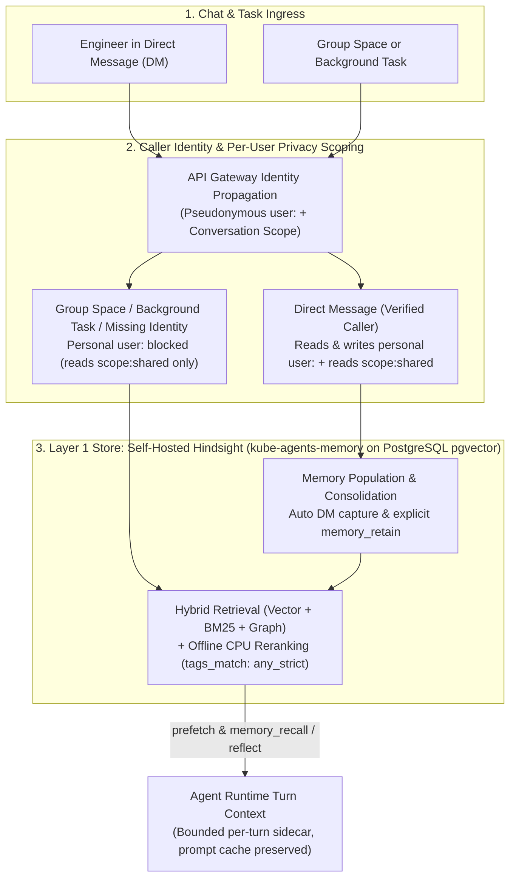
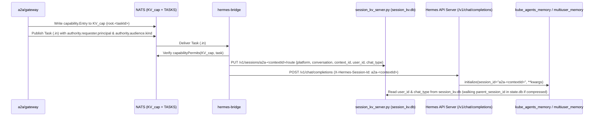
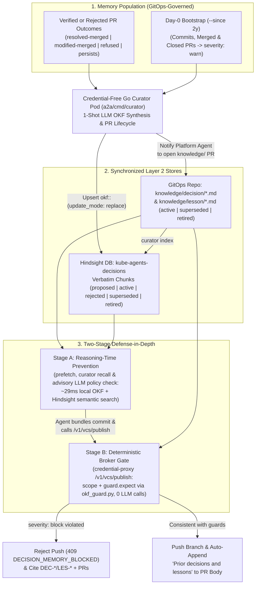
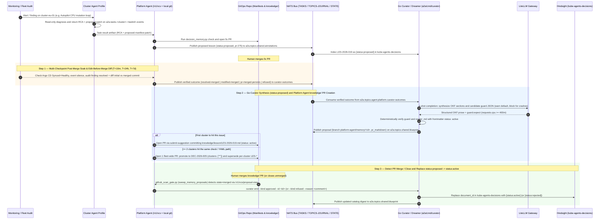
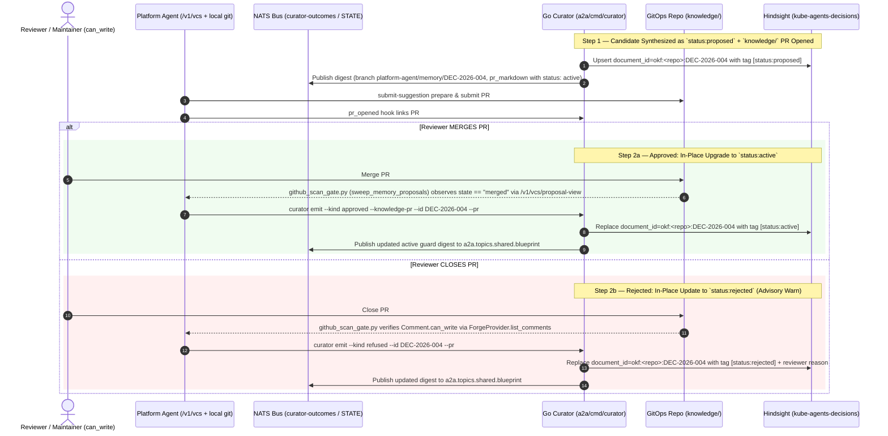

# Memory

## Summary

An AI platform agent that operates a Kubernetes fleet needs two distinct kinds of long-term memory:

1. **Conversational and personal memory (`kube-agents-memory` and `multiuser_memory`)**: Remembers who owns which service or control, how each engineer prefers to work in direct messages, and informal conversational context stated in chat.
2. **Decision and lesson memory (`knowledge/decision/*.md`, `knowledge/lesson/*.md`, and `kube-agents-decisions`)**: Remembers why a workload setting or cluster policy exists, which incident or pull request established it, which proposed fixes failed or were rejected, and which machine-checked guard prevents a repeat outage.

Without these two layers, a fleet agent fails in three ways as an organization grows:

- **Flat memory files overflow or truncate.** Loading an entire Markdown memory file into the system prompt on every turn consumes $110,907$ tokens at $1,414$ records, while capping the file at $2,200$ characters retains only about seven records.
- **Chat-only memory misses operational history.** An agent that learns only from chat conversations ignores the GitOps operational loop (`troubleshoot -> pull request -> merge -> verified resolution`). Furthermore, LLM-based memory summarization rewrites prose and strips exact record IDs in $11$ of $12$ recall misses, and vector similarity ranks superseded policies alongside active ones ($40.7\%$ contamination).
- **Stateless runs repeat rejected changes and undo protective fixes.** When each run starts with no memory of past pull requests, an agent or engineer can lower a memory request that prevented an out-of-memory crash, or repeatedly propose a namespace quota increase that reviewers already rejected.

This document defines the unified two-layer memory architecture for `kube-agents`:

| Layer                                                                          | Baseline on `main` (Already Shipped)                                                                                                                                                | Added by This Design                                                                                                                                                                                                                                                                                                                                                                                                                                                                                   |
| :----------------------------------------------------------------------------- | :---------------------------------------------------------------------------------------------------------------------------------------------------------------------------------- | :----------------------------------------------------------------------------------------------------------------------------------------------------------------------------------------------------------------------------------------------------------------------------------------------------------------------------------------------------------------------------------------------------------------------------------------------------------------------------------------------------- |
| **Layer 1: Conversational & Personal Memory (`kube-agents-memory`)**           | Self-hosted Hindsight (`pgvector`) with egress/PostgreSQL `NetworkPolicy` and `PodMonitoring`, per-user (`user:<id>`) and `scope:shared` tagging across fail-closed session states. | Narrowing intra-namespace `hindsight-api` port `8888` ingress from `podSelector: {}` strictly to gateway (`app: <agent>-gateway`, `kubeagents.x-k8s.io/a2a-component: gateway`) and credential-free `curator` (`kubeagents.x-k8s.io/component: curator`) pods (preserving `gke-gmp-system`), iteration-budget handoff checkpoints (`kind:handoff`), `since_hours` recall, and cross-layer Layer 2 recall.                                                                                              |
| **Layer 2: Decision & Lesson Memory (`knowledge/` + `kube-agents-decisions`)** | Baseline OKF file convention (`knowledge/<type>/*.md`, `.kube-agents/intent.yaml`, and 6 baseline types with `declares:` posture exceptions + `expires` in `06` §5).                | **Entire closed-loop Layer 2 system:** `decision` and `lesson` OKF types with `scope` and `guard.expect`, `kube-agents-decisions` verbatim bank (`proposed`, `active`, `rejected`, `superseded`, `retired`), credential-free Go Curator Pod (`a2a/cmd/curator`), PR outcome harvesting (`T+10m`/`T+24h`/`T+7d` soak, `edit-before-merge`, `refused`), Day-0 2-year bootstrap, nightly `dream` promotion, and deterministic Stage B `/v1/vcs/publish` guard checks against `_default_branch_of_remote`. |

- **Layer 1 (Baseline on `main` + Targeted Enhancements) — Conversational Memory (`kube-agents-memory` and `multiuser_memory`)**:
  - Uses self-hosted Hindsight (`kube-agents-memory`) to retrieve only the memories relevant to the current turn, keeping context usage flat ($\approx 3.2\text{K}$ recalled payload tokens / $4,264$ total context tokens at $1,414$ shared records). Small installations can select the zero-database file provider (`multiuser_memory`).
  - Propagates gateway-verified caller identity (`hmac:<32-hex>` on A2A `spec.mode: next`) and conversation audience (`"dm"` or `"group"`) from the task envelope (`authority.requester.principal` and `authority.audience.kind`), and proposes narrowing intra-namespace `hindsight-api` port `8888` ingress from `podSelector: {}` strictly to the gateway (`app: <agent>-gateway`, `kubeagents.x-k8s.io/a2a-component: gateway`) and credential-free `curator` (`kubeagents.x-k8s.io/component: curator`) pods while preserving `gke-gmp-system` Prometheus scraping.
  - Enforces fail-closed session states in `kube_agents_memory` (`attributed`, `unattributable` across group vs. missing-identity interactive sessions, `unattended`, and `read-only`) so personal memories stay private per user and missing identity never falls back to a shared `"default"` bucket.
- **Layer 2 (New in This Design) — Decision and Lesson Memory (`knowledge/` + `kube-agents-decisions` + Go Curator Pod + VCS Publish Guard)**:
  - Builds directly on the Operational Knowledge Framework (OKF) `knowledge/` contract in [`docs/architecture/06-api-and-data-contracts.md` §3, §5, and §6](../architecture/06-api-and-data-contracts.md#5-okf-knowledge-contract), which establishes `knowledge/<type>/*.md` in the organization's GitOps repository as the pull-request-governed ("curate-as-code") source of truth for durable operational knowledge while keeping per-user conversational state in Hindsight.
  - Extends OKF with architectural decisions (`knowledge/decision/DEC-*.md`, also accepting `decisions/`) and operational lessons (`knowledge/lesson/LES-*.md`, also accepting `lessons/`) carrying structured `scope` selectors and machine-checked `guard.expect` predicates (separate from `06` §5 `declares:` posture exceptions), indexed verbatim in Hindsight (`kube-agents-decisions`) across all five lifecycle states (`proposed`, `active`, `rejected`, `superseded`, `retired`) when `--memory=hindsight` is enabled.
  - Populates records from two GitOps sources—verified pull request outcomes across multi-checkpoint post-merge soak checks (`resolved-merged` and `pr-merged-persists` at `T+10m`, `T+24h`, and `T+7d`), human `edit-before-merge` diffs (`modified-merged`), and closed unmerged pull requests (`refused`); and a 2-hour day-0 bootstrap across 2 years of repository history (GitHub, GitLab, and Bitbucket)—and reconciles active guards against `HEAD` via nightly `dream` jobs in a dedicated credential-free `curator` Pod (`Deployment/<agent>-curator`).
  - Evaluates deterministic YAML and regex invariants (`scope` and `guard.expect` via `okf_guard.py`, with zero LLM calls and zero Hindsight calls) out of sandbox inside `credential-proxy` (`/v1/vcs/publish`) against the repository's pinned `repositories[].baseBranch` or resolved remote default branch (`_default_branch_of_remote`, explicitly fetching `<base>` from `origin` when `<base>` differs from `target`) before pushing a branch and during CI review of human pull requests, treating any Curator LLM policy check from Stage A strictly as advisory input.

| Component                                    | Status on `main`                         | Repository location                                                                                                                                                                                                                                                                 |
| -------------------------------------------- | ---------------------------------------- | ----------------------------------------------------------------------------------------------------------------------------------------------------------------------------------------------------------------------------------------------------------------------------------- |
| Hindsight conversational provider            | Shipped (+ cross-layer/handoff proposed) | [`agents/chat/plugins/memory/kube_agents_memory/`](../../agents/chat/plugins/memory/kube_agents_memory/)                                                                                                                                                                            |
| File-based conversational provider           | Shipped                                  | [`agents/chat/plugins/memory/multiuser_memory/`](../../agents/chat/plugins/memory/multiuser_memory/)                                                                                                                                                                                |
| Credential-free Go Curator / Dreamer Pod/CLI | Proposed in this design                  | `a2a/cmd/curator/` (`main.go`), `a2a/memory/` (`curator.go`), `Deployment/<agent>-curator`                                                                                                                                                                                          |
| Proposal PR reconciliation sweep             | Proposed in this design                  | [`agents/platform/scripts/github_scan_gate.py`](../../agents/platform/scripts/github_scan_gate.py) (`sweep_memory_proposals`)                                                                                                                                                       |
| Session route store                          | Shipped                                  | [`a2a/hermes-bridge/route.go`](../../a2a/hermes-bridge/route.go), [`agents/platform/scripts/session_kv_server.py`](../../agents/platform/scripts/session_kv_server.py)                                                                                                              |
| Decision memory CLI and skill                | Proposed in this design                  | `agents/platform/skills/decision-memory/` (`SKILL.md`, `scripts/decision_memory.py`)                                                                                                                                                                                                |
| Deterministic pre-push VCS broker guard      | Proposed in this design                  | [`agents/platform/scripts/vcs_broker.py`](../../agents/platform/scripts/vcs_broker.py) + `okf_guard.py` (`/v1/vcs/publish`), [`agents/platform/skills/submit-suggestion/scripts/submit_suggestion.py`](../../agents/platform/skills/submit-suggestion/scripts/submit_suggestion.py) |
| Installer flag and CRD field                 | Shipped (+ opt-out env var proposed)     | `install.sh --memory=file\|hindsight\|off`, stored on `PlatformAgent` as `spec.harness.memory.provider`; `DECISION_MEMORY_GITOPS_PRS` (`true` default) controls automatic `knowledge/` PR creation                                                                                  |
| Hindsight recall configuration               | Shipped                                  | [`agents/chat/defaults/hindsight/config.json`](../../agents/chat/defaults/hindsight/config.json)                                                                                                                                                                                    |
| Hindsight in-cluster manifests               | Shipped (+ port `8888` ingress proposed) | [`k8s-operator/config/integrations/hindsight/`](../../k8s-operator/config/integrations/hindsight/README.md)                                                                                                                                                                         |
| Conversational scope rules                   | Shipped                                  | [`agents/chat/SOUL.md`](../../agents/chat/SOUL.md) §1.6                                                                                                                                                                                                                             |
| Conversational scale experiment suite        | External experiment branch               | [`tests/memory-scale/`](https://github.com/dshnayder/kube-agents/blob/experiment/memory-scale-ab/tests/memory-scale/README.md)                                                                                                                                                      |

---

## How to read this document

Each section adds technical depth so readers can stop as soon as they have the level of detail they need.

| Section                           | Audience                                               | What you will learn                                                                                                      |
| --------------------------------- | ------------------------------------------------------ | ------------------------------------------------------------------------------------------------------------------------ |
| [Why](#why)                       | Engineering leads, product managers, prospective users | How memory helps platform teams prevent repeat outages, onboard existing repositories, and keep user context isolated    |
| [Background](#background)         | Platform engineers evaluating `kube-agents`            | Why fleet agents need both conversational and GitOps decision memory, and why Hindsight was selected for self-hosting    |
| [The decision](#the-decision)     | Architects and tech leads                              | Why retrieval replaces full-file prompt injection, and why architectural decisions belong in Git with verbatim indexing  |
| [The design](#the-design)         | Implementers and AI agents                             | Scoping, identity propagation, the 4 session states, OKF decision/lesson schemas, guard checks, and nightly `dream` jobs |
| [The experiment](#the-experiment) | Evaluators and operators                               | Benchmarks on a 1,664-record corpus and a 500-cluster GitOps repository across 10 real-world outage scenarios            |

---

## Why

### What platform teams need from agent memory

When an enterprise platform team manages dozens or hundreds of Kubernetes clusters through GitOps, institutional knowledge is scattered across chat threads, merged pull requests, closed pull requests, incident tickets, and architecture docs. Platform teams evaluating `kube-agents` consistently highlight three operational pain points:

1. **Personal context and shared team knowledge get mixed up or lost.** An engineer wants the agent to remember their personal test cluster and output preferences in direct messages, keep those personal notes out of shared group channels, and share team-wide ownership facts (such as who approves production changes) across everyone.
2. **Cost-tuning or cleanup changes undo past incident fixes.** Six months after an incident, an engineer or automated agent lowers a container memory request, tightens a `PodDisruptionBudget`, or enables Spot VMs to save money. Because nothing in the manifest explains that the existing setting prevented a production outage, the change merges and repeats the outage.
3. **Teams and agents repeat fixes that were already rejected or failed.** When a deployment fails because of a namespace `ResourceQuota` limit, a stateless agent repeatedly proposes raising the namespace quota—even when platform reviewers already rejected that exact pull request four times because the real fix was right-sizing a runaway indexing job in another folder.

To solve these problems, this design pairs shipped Layer 1 conversational isolation with six proposed Layer 2 capabilities (`#2903`):

| Team need                              | Status on `main` | Target capability                                                                                                                                                                                                           |
| -------------------------------------- | ---------------- | --------------------------------------------------------------------------------------------------------------------------------------------------------------------------------------------------------------------------- |
| **Isolate personal vs. shared memory** | Shipped          | Keeps personal preferences strictly private per user in direct messages, and fails closed whenever speaker identity is absent or shared.                                                                                    |
| **Explain past rationale ("Why?")**    | Proposed         | Answers _"Why is this workload configured this way?"_ with the exact decision or lesson ID, the pull request URL, the incident link, and the approver.                                                                      |
| **Onboard 2 years of history in 2h**   | Proposed         | Scans the past 2 years of pull requests, issues, and `/docs` within 2 hours of installation to generate a reviewable `STATE_OF_BEING.md` baseline.                                                                          |
| **Triage history at scale**            | Proposed         | Separates active rules from superseded policies, rejected pull requests, and obsolete clusters across thousands of historical commits.                                                                                      |
| **Resolve contradictory history**      | Proposed         | Applies deterministic precedence rules when a newer pull request supersedes or reverts an earlier decision, instead of relying on vector similarity.                                                                        |
| **Learn from verified outcomes**       | Proposed         | Drafts a reusable lesson automatically when an agent fix pull request passes post-merge soak checks, when a reviewer edits an agent pull request before merging, or when a fix fails post-merge verification or is refused. |
| **Block regressions before merge**     | Proposed         | Checks proposed YAML and Terraform changes against active guards in under $100\text{ ms}$, blocking repeat-outage changes before a pull request is opened.                                                                  |

### Operational impact at a glance

The table below summarizes what each capability targets alongside observations from our synthetic scale and prototype evaluations (see [The experiment](#the-experiment) and [What is still unproven](#what-is-still-unproven) for evaluation scope and caveats):

| Capability                                                   | Without unified memory                                                                                                                        | With unified memory (`kube-agents-memory` + proposed `decision-memory`)                                                                                          | Prototype observation / design target                                                                                      |
| ------------------------------------------------------------ | --------------------------------------------------------------------------------------------------------------------------------------------- | ---------------------------------------------------------------------------------------------------------------------------------------------------------------- | -------------------------------------------------------------------------------------------------------------------------- |
| **1. Per-user privacy in chat** _(shipped)_                  | HTTP turns lack user identity; file memory falls back to a shared `"default"` file, or DMs are treated as unattended background runs.         | `hermes-bridge` records gateway-verified `user_id` and `chat_type`; `kube_agents_memory` enforces fail-closed session states (`multiuser_memory` isolates IDs).  | $0$ cross-user memory leaks across the $1,664$-record synthetic probe suite; explicit refusal when identity is absent.     |
| **2. Learning from failed, human-edited, or rejected fixes** | Every troubleshooting run starts stateless; when a namespace hits a quota error, the agent proposes the same rejected quota raise repeatedly. | Verified outcomes (`resolved-merged`, `modified-merged`, `pr-merged-persists`, `refused`) generate scoped lesson records (`LES-*`) with machine-checked guards.  | Target: prevent repeat proposals after a collaborator-rejected, human-corrected, or failed attempt is recorded.            |
| **3. Preventing repeat outages on pull requests**            | Neither CI nor the agent checks diffs against past incident postmortems; engineers or agents accidentally revert protective settings.         | Out-of-sandbox `okf_guard.py` in `/v1/vcs/publish` (plus shift-left `decision_memory.py check` in sandbox and CI) blocks active `severity: block` violations.    | $9/9$ repeat-outage traps blocked in the 10-scenario synthetic prototype with links to the breaking PR and incident issue. |
| **4. Day-one onboarding of existing repos**                  | A newly installed agent has zero historical context until engineers manually restate every rule in chat.                                      | Credential-free Curator Pod (`bootstrap --since 2y`) triages 2 years of pull requests and docs within 2 hours into `STATE_OF_BEING.md` and initial `warn` files. | Target: answer architectural rationale questions and surface past incident rules after onboarding PR review.               |
| **5. Verifiable citations**                                  | LLM observation synthesis rewrites text and drops record IDs in $11$ of $12$ retrieval misses on the $1,414$-record synthetic corpus.         | Decision and lesson records live in Git and index into Hindsight as verbatim chunks (`enable_observations: false`), preserving every ID and PR URL.              | $10/10$ historical PR and record ID citations in the 10-scenario prototype ($97.7\%$ Layer 1 content recall at batch $1$). |
| **6. Drift detection and policy graduation**                 | Outdated rules remain mixed with active ones ($40.7\%$ contamination in Layer 1), and manual commits can silently break a past decision.      | Nightly `dream` runs flag `at_risk` records the morning after an unguarded commit and propose admission policies (`policy/`) for recurring incident patterns.    | Deterministic `status: active` filtering excludes `superseded` rules; recurring lessons graduate via reviewed GitOps PRs.  |

### Why store decisions in memory instead of scanning Git and pull requests on every task?

A common question from engineering teams is: _"All of our commits and pull requests are already in Git and GitHub/GitLab—why not have the agent run `git log` and search pull requests live whenever it makes a change?"_

We tested this directly on a 500-cluster GitOps repository across 10 real-world outage scenarios (see [Part 2 of The experiment](#part-2--decision-memory-evaluation-on-10-real-world-kubernetes-outage-scenarios)). Pre-analyzing history into structured decision memory outperforms live per-request repository scanning across accuracy, token cost, and speed:

| Dimension                  | Scan Git and pull requests live on every task                                                                                                                                                                                            | Store decisions and lessons in long-term memory                                                                                                                                                                                                                                             | Measured advantage of decision memory                                                                                   |
| -------------------------- | ---------------------------------------------------------------------------------------------------------------------------------------------------------------------------------------------------------------------------------------- | ------------------------------------------------------------------------------------------------------------------------------------------------------------------------------------------------------------------------------------------------------------------------------------------- | ----------------------------------------------------------------------------------------------------------------------- |
| **Accuracy on edge cases** | **Misses rejected unmerged PRs and cross-file fixes ($9/10$ scenario classes covered).** A closed, unmerged PR leaves zero commits in `git log <file>`, and forge CLI list commands default to open items and cap pagination at 30 rows. | **Captures the full causal chain ($10/10$ scenario classes covered).** Bootstrap indexes closed/rejected PRs, cross-file fixes, and `supersedes` chains once, and `/v1/vcs/publish` enforces guards deterministically.                                                                      | **$10/10$ vs $9/10$ scenario coverage** ($0$ vs $1$ repeat-outage PR opened); scales to repositories with $2,000+$ PRs. |
| **LLM token consumption**  | **Per-PR request:** $130,519$ median ($233,348$ max) uncached input tokens; **Bootstrap:** $0$; **Nightly `dream`:** $0$.                                                                                                                | **Per-PR request:** $66,734$ median uncached input tokens; **Bootstrap & outcomes:** $\approx 2\text{K}$ tokens per synthesized record; **Nightly `dream`:** $0$ tokens on unchanged nights ($\approx 2\text{K–}3\text{K}$ tokens only when promoting a recurring pattern across clusters). | **Saves $\approx 64\text{K}$ tokens ($-41\%$ to $-49\%$) on every PR**; breaks even after $3\text{–}6$ PRs.             |
| **Latency and API load**   | **Slow ($15\text{–}35\text{ s}$ network scan, $4\text{–}8$ forge API calls per task).** Every change task queries remote GitHub, GitLab, or Bitbucket endpoints over the network.                                                        | **Sub-second local check ($< 100\text{ ms}$, $0$ forge API calls).** `decision_memory.py check` evaluates YAML and regex invariants directly against the local Git checkout before pushing a branch.                                                                                        | **$< 100\text{ ms}$ local check vs $15\text{–}35\text{ s}$ network scan**; zero forge API rate-limit usage.             |

We also evaluated the hybrid variant (**Alternative 3a: Live `git log` scanning for merged history plus indexing closed pull requests only**). Indexing closed pull requests fixes the single scenario miss in the benchmark, yet we rejected Alternative 3a for four reasons:

1. **Unchanged token and latency cost**: Commit subjects rarely state incident root causes, so reading merged history still costs $\approx 131\text{K}$ median tokens and $15\text{–}35\text{ s}$ per task.
2. **Cross-store supersession complexity**: Matching newer merged commits in `git log` against older closed PRs in Hindsight adds more code than one unified schema.
3. **No deterministic pre-push guards**: Raw `git log` lacks structured `guard.expect` predicates (`file`, `path`, `op`, `value`), leaving enforcement dependent on prompt reading.
4. **Shared ingestion pipeline**: Indexing closed PRs already requires outcome polling, permission checks, and LLM synthesis; routing merged outcomes through the same pipeline halves per-task tokens.

---

## Background

### Two types of knowledge in a Kubernetes fleet

An enterprise fleet agent handles two very different kinds of information:

1. **Conversational context**: Statements made by engineers in chat, such as _"My scratch cluster is `dev-alice-01`"_, _"Always show me `kubectl diff` before applying"_, or _"The payments team owns `clusters/prod-eu/payments`."_ These facts arrive informally during chat turns, need per-user privacy for personal preferences, and benefit from semantic retrieval.
2. **Infrastructure decisions and incident lessons**: Rules that govern production manifests in Git, such as _"Keep the `checkout` container memory request at or above `256Mi` because JVM off-heap buffers caused an `OOMKilled` outage below that threshold in PR #31"_ or _"Do not raise the `kyber-ledger` namespace quota above `32Gi`; right-size the `audit-indexer` deployment instead."_ These rules require human review, exact resource paths, verifiable links to pull requests and incidents, deterministic precedence when policies change, and enforcement in both agent workflows and CI pipelines.

Because both memory banks run as cluster-side services (`hindsight-api` and `curator`) rather than inside a single chat client or local workstation cache, every operational surface shares the same institutional memory: developer and SRE chat channels (Google Chat, Slack, Microsoft Teams), the Web UI, local coding harnesses connected over MCP (such as Claude Code or Gemini CLI), external platform copilot agents chaining requests over A2A, and unattended out-of-hours `fleet-audit` cron jobs.

### Building on the existing GitOps OKF knowledge contract

Why store operational decisions and lessons in the GitOps repository in the first place? The baseline `kube-agents` architecture ([`docs/architecture/06-api-and-data-contracts.md` §3, §5, and §6](../architecture/06-api-and-data-contracts.md#5-okf-knowledge-contract)) already establishes this boundary:

- **GitOps `knowledge/` as the curate-as-code source of truth (§3 & §5)**: Section 3 and Section 5 define the top-level `knowledge/<type>/*.md` directory in the organization's GitOps repository using the **Operational Knowledge Framework (OKF)** (Markdown with YAML frontmatter). Because `knowledge/` sits outside the paths that Argo CD or Flux apply (`clusters/<cluster>/`, `fleet/`), it is never deployed as a Kubernetes resource; instead, agents read `knowledge/` for context and propose updates via pull requests (_curate-as-code_) that human reviewers approve.
- **Separation of session state from durable OKF knowledge (§6)**: Section 6 specifies that per-user conversational memory stays in Hindsight (`kube_agents_memory`, isolated by `user:<id>` tags), while durable operational observations graduate to OKF (`knowledge/`) via a human-reviewed pull request. Furthermore, the open type convention in §5 explicitly states that new OKF `type` values are added by pull request as needs arise.
- **What this design adds on top of the baseline OKF contract**: While `06-api-and-data-contracts.md` §5 defined passive prose types (`cluster-blueprint`, `tenancy-model`, `runbook`, `observation`) and `declares:` posture exceptions (`{check, namespace, object, cluster, expires}`), it did not define how agents learn from merged or rejected pull requests, how unmerged or rejected proposals are recalled before landing on `main`, or how past outage fixes are deterministically enforced before `git push`. This design extends the OKF contract with two structured types (`decision` / `DEC-YYYY-NNN` and `lesson` / `LES-YYYY-NNN`), structured `scope` and `guard.expect` manifest assertions enforced deterministically out of sandbox in [`vcs_broker.py`](../../agents/platform/scripts/vcs_broker.py) + `okf_guard.py` (`/v1/vcs/publish`), an optional synchronized verbatim Hindsight index (`kube-agents-decisions`) covering all five lifecycle states (`proposed`, `active`, `rejected`, `superseded`, `retired`), and automated population via a credential-free Go Curator Pod (`Deployment/<agent>-curator`) and 2-hour day-0 bootstrap.

### What the underlying agent framework provides

The `kube-agents` runtime builds on Hermes, which includes a simple built-in file memory (`tools/memory_tool.py`): two Markdown files (`MEMORY.md` and `USER.md`) that are loaded in full into the system prompt at session start. That built-in store has two limitations for an enterprise platform team:

- **Single-user only**: It has no concept of `user_id`, so all users share one `USER.md`.
- **Fixed size vs. context window trade-off**: Hermes caps `MEMORY.md` at $2,200$ characters (about seven records). If that cap is removed so the file can hold two years of fleet knowledge ($1,414$ records, or $443,196$ characters), the file consumes **$110,907$ tokens on every turn**—more than half of a $200,000$-token context window before the user even asks a question.

### Evaluating external conversational memory providers

Hermes supports external memory provider plugins (`agent/memory_provider.py`). We evaluated the eight available providers against three enterprise requirements:

1. **Self-hostable inside the organization's Kubernetes cluster** so internal fleet topology, ownership maps, and incident history never leave the cluster boundary.
2. **In-cluster embeddings without extra model infrastructure** so organizations using Anthropic Claude, Vertex AI, Bedrock, or Azure do not have to deploy a separate embedding inference server.
3. **Both per-user private scope and organization-wide shared scope** in a single store so engineers have private DM preferences while specialist subagents and team members can read shared organizational facts.

| Provider      | Deployment model                            | Multi-user and shared scope support              | Embedding requirement                       |
| ------------- | ------------------------------------------- | ------------------------------------------------ | ------------------------------------------- |
| `hindsight`   | Self-hosted in-cluster (`api` + `pgvector`) | Tag scoping (`user:<id>` and `scope:shared`)     | Baked into container image (offline CPU)    |
| `honcho`      | Self-hosted (4 workloads, AGPL-3.0)         | Peer-scoped perspectives only (no shared bucket) | Requires external OpenAI or Gemini embedder |
| `mem0`        | Cloud or self-hosted                        | `user_id` only (no shared organizational scope)  | Requires external OpenAI or Ollama embedder |
| `retaindb`    | Hosted SaaS                                 | `user_id`                                        | Hosted                                      |
| `openviking`  | Hosted SaaS                                 | Tenant and namespace scopes                      | Hosted                                      |
| `byterover`   | Hosted SaaS                                 | Minimal                                          | Hosted                                      |
| `supermemory` | Hosted SaaS                                 | Minimal                                          | Hosted                                      |
| `holographic` | Local experimental store                    | None                                             | Local                                       |

**Hindsight** (MIT license) is the only provider that self-hosts inside the cluster, supports both per-user and shared scopes via tags, and embeds and reranks queries offline inside its own pod (`HF_HUB_OFFLINE=1`) using the existing LiteLLM gateway for fact extraction.

We also benchmarked a self-hosted `honcho` deployment head-to-head against Hindsight on the same 1,664-record fleet corpus ([full comparison results](https://github.com/dshnayder/kube-agents/blob/experiment/memory-honcho-ab/tests/memory-scale/honcho/RESULTS.md)). On queries where a runbook had been retired and replaced, `honcho` returned the retired runbook on **100% of procedural probes** (contamination $1.000$ vs Hindsight's $0.000$) because its message search still matches superseded messages verbatim.

### Retaining `multiuser_memory` for small installations

For small clusters or personal evaluation environments that do not want to run a PostgreSQL database for memory, `kube-agents` also includes [`multiuser_memory`](../../agents/chat/plugins/memory/multiuser_memory/): a lightweight Markdown file provider that stores one file per user (`memories/users/<id>.md`) plus one shared file (`memories/MEMORY.md`). Operators select between `file` (`multiuser_memory`), `hindsight` (`kube_agents_memory`), and `off` (`none`) at installation time.

---

## The decision

### 1. Use retrieval-backed Hindsight for conversational memory at fleet scale

Instead of injecting the entire memory store into the system prompt on every turn, `kube_agents_memory` stores conversational facts in Hindsight and retrieves a budget-bounded set of relevant observations for each user turn:

| Provider                            | Shared records in store | Gold recall | Superseded/irrelevant contamination | Current policy ranked first | Context tokens per turn |
| ----------------------------------- | ----------------------: | ----------: | ----------------------------------: | --------------------------: | ----------------------: |
| Hindsight (`kube_agents_memory`)    |                     100 |       0.718 |                               0.407 |                       83.3% |                   4,588 |
| Hindsight (`kube_agents_memory`)    |                     200 |       0.718 |                               0.407 |                       83.3% |                   4,544 |
| Hindsight (`kube_agents_memory`)    |                     400 |       0.718 |                               0.407 |                       83.3% |                   4,468 |
| Hindsight (`kube_agents_memory`)    |                     800 |       0.718 |                               0.407 |                       83.3% |                   4,322 |
| Hindsight (`kube_agents_memory`)    |                   1,414 |       0.702 |                               0.407 |                       83.3% |               **4,264** |
| Unbounded file (`multiuser_memory`) |                     100 |       1.000 |                               0.722 |                       42.9% |                  13,780 |
| Unbounded file (`multiuser_memory`) |                     200 |       1.000 |                               0.722 |                       42.9% |                  24,661 |
| Unbounded file (`multiuser_memory`) |                     400 |       1.000 |                               0.722 |                       42.9% |                  46,633 |
| Unbounded file (`multiuser_memory`) |                     800 |       1.000 |                               0.722 |                       42.9% |                  79,616 |
| Unbounded file (`multiuser_memory`) |                   1,414 |       1.000 |                               0.722 |                       42.9% |             **110,907** |

As the shared corpus grows $14\times$ (from $100$ to $1,414$ records), the file store's prompt footprint grows $8\times$ to $110,907$ tokens per turn, whereas Hindsight's per-turn context stays flat at **$\approx 3.2\text{K}$ recalled payload tokens ($4,264$ total context tokens including prompt wrapper)**, achieves **$97.7\%$ content recall** when seeded one record per call (`--batch 1`), and ranks the current version of contested policies first **$83.3\%$** of the time (compared to **$42.9\%$** for the flat file).

### 2. Add a Git-backed Decision and Lesson Memory layer for infrastructure history

While Hindsight's observation synthesis works well for chat preferences and ownership notes, six empirical findings show why infrastructure decisions and incident lessons need a dedicated, Git-backed layer:

| Empirical finding                                                       | Measured effect in chat-only memory                                                               | How Decision and Lesson Memory solves it                                                                                       |
| ----------------------------------------------------------------------- | ------------------------------------------------------------------------------------------------- | ------------------------------------------------------------------------------------------------------------------------------ |
| **1. LLM observation synthesis strips record IDs**                      | $11$ of $12$ recall misses at $1,414$ records kept the prose gist but dropped the record ID.      | Stores records as Markdown files in Git (`knowledge/`) and indexes them into Hindsight as verbatim chunks (`chunks` mode).     |
| **2. Batching multiple records per retain call merges document labels** | Retaining 5 records per call collapsed $1,664$ records into $335$ documents and hid $156$ IDs.    | Indexes exactly one record per document (`document_id = okf:<repo>:<id>`) with `update_mode: replace`.                         |
| **3. Superseded policies appear alongside active policies**             | $40.7\%$ of retrieved context on contested policies contained superseded rules.                   | Tracks explicit `status: active \| superseded` frontmatter and `supersedes` links, filtering active queries deterministically. |
| **4. CPU cross-encoder reranking takes $\approx 7\text{ s}$ per query** | Scoring $300$ candidates on CPU takes $14.2\text{ s}$ ($7\text{ s}$ with length-bucket batching). | Matches changed files and Kubernetes resources locally in Git in $< 100\text{ ms}$ before running any semantic query.          |
| **5. Subagents without memory access build unsafe local caches**        | A specialist subagent without memory access wrote a $79\text{ KB}$ private copy into its skill.   | Gives specialist workers sanctioned, read-only access to shared memory and `decision_memory.py` CLI / MCP tools.               |
| **6. Prompt advice alone does not stop repeat bad fixes**               | Without a hard check in the submission tool, an agent repeated a rejected quota raise 4 times.    | Evaluates `guard.expect` rules inside `submit-suggestion` before `git push` and exits with code `2` on any `block` violation.  |

---

## The design

### Architecture overview: two memory layers

`kube-agents` separates **conversational and personal memory** (`kube-agents-memory`) from **pull-request-governed decision and lesson memory** (`knowledge/` + `kube-agents-decisions`):

- **Layer 1 — Conversational and personal memory (`kube-agents-memory` and `multiuser_memory`)**: Stores each engineer's private direct-message preferences (`user:<id>`) alongside informal shared conversational context (`scope:shared`) in the self-hosted Hindsight `kube-agents-memory` bank (`hindsight-api` + PostgreSQL `pgvector`; or `memories/users/<id>.md` in `--memory=file` mode). Memories are populated automatically at the end of direct-message turns via background LLM fact extraction and observation synthesis, or explicitly via `memory_retain`, governed by gateway-verified identity and fail-closed session states in `kube_agents_memory` (`attributed`, `unattributable`, `unattended`, and `read-only`). At turn start (`prefetch`) and on demand (`memory_recall`, `memory_reflect`), Hindsight retrieves a budget-bounded block ($\approx 3.2\text{K}$ recalled payload tokens / $4,264$ total context tokens at $1,414$ records) with strict tag isolation (`recall_tags_match: "any_strict"`). Conversational chat consumes Layer 2 records for reasoning context and never writes directly into Layer 2.
- **Layer 2 — Decision and lesson memory (`knowledge/` in GitOps + `kube-agents-decisions` in Hindsight + credential-free Go Curator Pod + deterministic VCS guard)**: Extends the GitOps Operational Knowledge Framework (OKF) contract ([`docs/architecture/06-api-and-data-contracts.md` §3, §5, and §6](../architecture/06-api-and-data-contracts.md#5-okf-knowledge-contract)) across two synchronized stores. First, the GitOps repository (`knowledge/decision/` and `knowledge/lesson/` on the default base branch, also accepting `decisions/` and `lessons/`) holds approved (`status: active`), `superseded`, and `retired` OKF Markdown files with YAML `scope` selectors and `guard.expect` invariants ("curate-as-code" via human-reviewed pull requests). Second, when `--memory=hindsight` is enabled, the Hindsight `kube-agents-decisions` bank indexes every record as a single verbatim chunk (`document_id = okf:<repo>:<id>`, `retain_extraction_mode: chunks`, `enable_observations: false`, `update_mode: replace`) across all five lifecycle states (`status:proposed`, `status:active`, `status:rejected`, `status:superseded`, and `status:retired`). Running in its own credential-free Pod (`Deployment/<agent>-curator`, holding zero cluster or forge credentials), the Go Curator (`a2a/cmd/curator`) populates Layer 2 via a single-shot LLM call from verified GitOps pull request outcomes (`resolved-merged`, `modified-merged`, `pr-merged-persists`, and `refused`) and a 2-hour day-0 bootstrap across 2 years of repository history. Layer 2 prevents bad changes through a **two-stage defense-in-depth**:
  1. **Reasoning-time prevention (Stage A, during the agentic loop)**: At turn start (`prefetch`) and during investigation (`memory_recall` / `curator recall`), the Curator scores local OKF records in $\approx 29\text{ ms}$ and, when Hindsight is enabled, falls back to semantic, BM25, and graph search on `kube-agents-decisions`. This injects `[ACTIVE]`, `[PROPOSED]`, and `[REJECTED]` rules (including unmerged or rejected proposals that do not exist as `.md` files on the base branch) into the agent's context while it plans a fix; any LLM policy evaluation by the Curator runs inside the credential-free `curator` Pod and is treated strictly as **advisory input**.
  2. **Final out-of-sandbox deterministic guard at publish time (Stage B, `credential-proxy` `/v1/vcs/publish` and PR CI)**: When an agent calls `/v1/vcs/publish`, `VcsBroker._check_decision_memory_on_publish` resolves `<base>` from the repository's operator-pinned `repositories[].baseBranch` or remote default branch (`_default_branch_of_remote` via `git ls-remote --symref origin HEAD`, never trusting `_default_branch(root)` or a caller-supplied `target` branch), explicitly runs `git fetch --quiet --no-tags origin <base>` when `<base>` differs from `target`, and runs **only deterministic `scope` and `guard.expect` checks** (`okf_guard.py`) in-process with zero LLM calls, zero Curator subprocesses, and zero Hindsight calls. The broker accepts no sandbox-supplied override flag (`overrideDecision`), so a worker cannot self-bypass a `409` refusal using the returned record ID. If any `severity: block` guard fails, `/v1/vcs/publish` returns `409 DECISION_MEMORY_BLOCKED`; if the check passes on governed files, `/v1/vcs/proposal-create` and `proposal-update` append a `### Prior decisions and lessons` citation section to the pull request description.

| Dimension                      | Layer 1: Conversational & personal memory (`kube-agents-memory`)                                                   | Layer 2: Shared decision, convention, and lesson memory (`knowledge/` + `kube-agents-decisions`)                                                                                                              |
| ------------------------------ | ------------------------------------------------------------------------------------------------------------------ | ------------------------------------------------------------------------------------------------------------------------------------------------------------------------------------------------------------- |
| **Primary source of truth**    | Hindsight PostgreSQL database (or `users/<id>.md` and `MEMORY.md` in `file` mode).                                 | GitOps repository `knowledge/decision/*.md` and `knowledge/lesson/*.md` (`decisions/` and `lessons/` also accepted).                                                                                          |
| **Role of Hindsight**          | Primary store using LLM fact extraction and background observation synthesis.                                      | Optional rebuildable semantic index using verbatim chunk mode (`retain_extraction_mode: chunks`).                                                                                                             |
| **What it stores**             | Each engineer's private DM preferences (`user:<id>`) plus informal shared conversational context (`scope:shared`). | All PR-governed team conventions, ownership rules, architectural decisions (`DEC-*`), incident lessons (`LES-*`), and guards.                                                                                 |
| **Lifecycle states**           | Active per-user (`user:<id>`) and informal shared (`scope:shared`) conversational observations.                    | Single `document_id` (`okf:<repo>:<id>`) transitioning in-place: `status:proposed` $\to$ `status:active` \| `status:rejected` \| `status:superseded` \| `status:retired`.                                     |
| **How memories are written**   | Automatic personal capture in DMs; explicit `memory_retain(scope="personal" \| "shared")` in chat.                 | Synthesized as `status:proposed` from GitOps PR outcomes; upgraded to `status:active` only when a `knowledge/` PR merges (or `status:rejected` on technical close).                                           |
| **How memories enter context** | Per-turn semantic prefetch injected into the user message sidecar (`api_content`).                                 | Per-turn Curator prefetch (local IPC on `today`; NATS `a2a.memory.query` on `next`) in `KubeAgentsMemoryProvider.prefetch` plus deterministic file/resource matching during drafting and `submit-suggestion`. |
| **How agents query on demand** | `memory_recall` and `memory_reflect` tools (`user:<id>` and `scope:shared`).                                       | Built-in `memory_recall` (`scope="shared"` \| `"both"`), `curator recall` / `why` / `check` CLI commands, and NATS `a2a.topics.shared.blueprint`.                                                             |
| **How contradictions resolve** | Background observation consolidation per `user:<id>` / `scope:shared`.                                             | Five deterministic precedence rules, explicit `supersedes` chains, and `status:active` vs `status:proposed` filtering.                                                                                        |
| **Background maintenance**     | Bounded by per-turn retrieval budget (`memory_ttl_curator.py` is shelved and unscheduled).                         | Go Curator / Dreamer (`a2a/cmd/curator`) checking guards against Git `HEAD`, flagging drift, and federating across clusters.                                                                                  |

### Provider modes (`--memory=hindsight|file|off`) and database boundary

Layer 2's Git-backed guard enforcement works regardless of whether Hindsight is deployed:

- **`--memory=hindsight` (recommended for enterprise fleets)**: Deploys `hindsight-api` and `hindsight-postgresql` (`pgvector`, confined by `NetworkPolicy` exclusively to `hindsight-api` because the local database runs with `POSTGRES_HOST_AUTH_METHOD=trust`). Layer 1 stores conversational observations in `kube-agents-memory`, while Layer 2 indexes `knowledge/` plus pending (`status:proposed`) and rejected (`status:rejected`) proposals verbatim into `kube-agents-decisions`. Operational findings (`findings_queue.py`), session route metadata (`session_kv.db`), and A2A task/topic streams (`NATS JetStream`) remain in their dedicated SQLite and NATS stores and never connect directly to `hindsight-postgresql`.
- **`--memory=file` (default) or `--memory=off` (zero database pods)**: Neither `hindsight-api` nor `hindsight-postgresql` is deployed. Layer 2 degrades cleanly to **Git-only deterministic mode**: the Go Curator persists pending (`status:proposed`) and rejected (`status:rejected`) outcome records in its local state ledger (`$DATA_DIR/memory/decisions_state.json` on the `curator` Pod), and local OKF scoring in `curator recall`, `decision_memory.py why` / `check`, and the deterministic `/v1/vcs/publish` guard in `credential-proxy` (`okf_guard.py`) evaluate `knowledge/decision/*.md` and `knowledge/lesson/*.md` directly from Git with zero database dependency.

### Storage sizing and cost model at enterprise scale

Decision and lesson memory stores curated architectural rules and deduplicated incident lessons rather than raw pod logs or per-poll telemetry. When an issue recurs across hundreds of clusters, federated learning (Phase 5 of `dream`) consolidates the pattern into one fleet-wide `DEC-*` record (`clusters: ["*"]`) instead of writing a separate copy per cluster. As a result, storage grows sub-linearly with cluster and workload count:

- **Per-record size in Git**: One OKF Markdown file (`DEC-*` or `LES-*`) averages **$2.5\text{ KB}$** ($40\text{–}70$ lines of YAML frontmatter and prose).
- **Per-record size in PostgreSQL (`pgvector`)**: One verbatim chunk unit (384-dimensional `float32` embedding, HNSW graph links, metadata, and text) plus one conversational observation averages **$3.5\text{ KB}$** including index overhead.

| Fleet tier               | Clusters | Workloads | Active + historical OKF records | Conversational memory units | Git repository size (`knowledge/`) | PostgreSQL `pgvector` size (data + HNSW index) | Fits in default `8Gi` PVC? |
| ------------------------ | -------: | --------: | ------------------------------: | --------------------------: | ---------------------------------: | ---------------------------------------------: | -------------------------- |
| **Small / Evaluation**   |       10 |       200 |                             250 |                       1,500 |           $\approx 0.6\text{ MiB}$ |                         $\approx 6\text{ MiB}$ | Yes ($< 0.1\%$)            |
| **Medium Enterprise**    |       50 |     3,000 |                           1,500 |                      10,000 |           $\approx 3.8\text{ MiB}$ |                        $\approx 40\text{ MiB}$ | Yes ($0.5\%$)              |
| **Large Enterprise**     |    1,000 |     5,000 |                           5,000 |                      50,000 |          $\approx 12.5\text{ MiB}$ |                       $\approx 195\text{ MiB}$ | Yes ($2.4\%$)              |
| **Hyperscale Fleet**     |   10,000 |    25,000 |                          15,000 |                     150,000 |          $\approx 37.5\text{ MiB}$ |                       $\approx 580\text{ MiB}$ | Yes ($7.1\%$)              |
| **Maximum Target Scale** |   30,000 |    60,000 |                          35,000 |                     350,000 |          $\approx 87.5\text{ MiB}$ |                      $\approx 1.35\text{ GiB}$ | Yes ($16.9\%$)             |

Even at **30,000 clusters and 60,000 workloads**, the entire Git knowledge base stays under **$90\text{ MiB}$** and the PostgreSQL `pgvector` index stays under **$1.4\text{ GiB}$**—fitting inside the default $8\text{ GiB}$ PersistentVolumeClaim with zero external cloud logging or vector-database billing.

---

### Layer 1 — Conversational memory (`kube-agents-memory` and `multiuser_memory`)



#### Choosing a provider

Operators select the conversational memory provider at install time via `install.sh --memory=file|hindsight|off`:

- **`file` (`multiuser_memory`, default for backward compatibility)**: Stores per-user and shared Markdown files on the agent pod's persistent volume. Requires zero extra pods or databases and suits small clusters or personal test environments.
- **`hindsight` (`kube_agents_memory`, recommended for enterprise fleets)**: Deploys the self-hosted Hindsight API server and PostgreSQL `pgvector` database in the cluster. Keeps per-turn token usage small and constant regardless of how many memories accumulate.
- **`off` (`none`)**: Disables conversational memory completely.

Four configuration surfaces carry this choice from the installer to the running container:

| Surface                                    | Value stored                                                                                    |
| ------------------------------------------ | ----------------------------------------------------------------------------------------------- |
| `install.sh --memory=file\|hindsight\|off` | Installer flag or interactive prompt selection                                                  |
| `MEMORY` in `install.env`                  | Saved installer mode, mapped to a provider name by `memory_provider_from_mode`                  |
| `spec.harness.memory.provider`             | Field on the `PlatformAgent` custom resource (`multiuser_memory`, `kube_agents_memory`, `none`) |
| `MEMORY_PROVIDER` pod environment variable | Passed to the container entrypoint (`docker-entrypoint.sh`) before `config.yaml` is rendered    |

To change the provider on an existing installation, set `MEMORY=hindsight|file|off` in `install.env` and re-run `install.sh` (or `terraform apply`; `upgrade.sh` carries no `--memory` flag). All external providers keep Hermes's built-in `MEMORY_ENABLED=false`; in the operator (`platformagent_manifests.go`), `resolveMemoryProvider` maps `"none"` to `""` and blanks non-Hindsight providers on specialist pods so file-backed personal stores never mount into worker containers. When an installation switches from `file` to `hindsight`, [`agents/chat/scripts/memory_file_import.py`](../../agents/chat/scripts/memory_file_import.py) runs once at pod startup: it imports `MEMORY.md` and `memories/users/<id>.md` under their matching scope tags, verifies each unit in the bank, writes a receipt under `$HERMES_HOME/hindsight/imported/`, and removes the plaintext Markdown file only after verification succeeds.

#### The two Hindsight pods and recall performance

When `--memory=hindsight` is enabled, the Helm chart and operator deploy two workloads in the agent namespace ([`k8s-operator/config/integrations/hindsight/`](../../k8s-operator/config/integrations/hindsight/README.md)):

1. **`hindsight-api` (`Deployment`, port `8888`) — the `hindsight-api` component entry**:
   - Runs `ghcr.io/vectorize-io/hindsight-api:0.10.2` (pinned by digest in `images.json`) as a non-root container (`RuntimeDefault` seccomp profile, all Linux capabilities dropped).
   - Requests `500m` CPU / `2Gi` memory with limits `4` CPU / `4Gi` memory (`k8s-operator/config/integrations/hindsight/api.yaml` and `charts/kube-agents/values.yaml`): steady-state idle CPU is $\approx 9\text{m}$, the `4`-core CPU limit absorbs burst cross-encoder reranking (`~7 s`, and raising CPU limits above `4` on `e2-standard-4` nodes yields no single-pod speedup), and `2Gi`–`4Gi` memory holds the `1.4 GB` baked-in model weights without OOM under GKE Autopilot's non-bursting request/limit clamp.
   - Exposes Prometheus metrics (`/metrics`, including `hindsight_operation_duration_seconds`) on port `8888`, scraped by GKE Managed Prometheus via [`podmonitoring.yaml`](../../k8s-operator/config/integrations/hindsight/podmonitoring.yaml).
   - Sets `HF_HUB_OFFLINE=1` and `TRANSFORMERS_OFFLINE=1` so the baked-in embedding model (`BAAI/bge-small-en-v1.5`) and cross-encoder reranker (`cross-encoder/ms-marco-MiniLM-L-6-v2`) run completely offline without internet egress.
   - Routes LLM fact extraction and observation consolidation through the cluster's existing LiteLLM inference gateway (`HINDSIGHT_API_LLM_BASE_URL=http://inference-gateway/v1`, model `model-default`) with `HINDSIGHT_API_LLM_TEMPERATURE=none` so models that reject explicit temperature parameters do not fail extraction.
   - Connects to the namespace-local service URL injected by [`platformagent_manifests.go`](../../k8s-operator/internal/controller/platformagent_manifests.go): `http://hindsight-api.<namespace>.svc.cluster.local:8888` (`agents/chat/defaults/hindsight/config.json` and `agents/platform/hindsight/config.json` intentionally omit `api_url` so `HINDSIGHT_API_URL` governs endpoint selection).
2. **`hindsight-postgresql` (`StatefulSet`, single replica, port `5432`)**:
   - Runs a single-replica `pgvector/pgvector` pod (PostgreSQL 15 with HNSW vector indexing and `hnsw.iterative_scan` enabled) backed by an `8Gi` `ReadWriteOnce` PersistentVolumeClaim (`data-hindsight-postgresql-0`). At $\approx 1.8\text{ KB}$ per memory unit (384-dimensional embedding plus text), an $8\text{ GiB}$ volume holds roughly one million memory units.
3. **`NetworkPolicy` isolation (shipped baseline + proposed port `8888` narrowing)**:
   - Shipped on `main` ([`networkpolicy.yaml`](../../k8s-operator/config/integrations/hindsight/networkpolicy.yaml) and `charts/kube-agents/templates/hindsight.yaml`): `hindsight-postgresql` restricts port `5432` ingress exclusively to `hindsight-api`, `hindsight-api` confines egress strictly to DNS (`53`), `hindsight-postgresql:5432`, and the `litellm` / `standalone-replay` inference pods, and port `8888` currently admits intra-namespace `podSelector: {}` alongside `gke-gmp-system` Prometheus scrapes.
   - Proposed by this design: because `hindsight-api` serves unauthenticated REST across `kube-agents-memory` on port `8888`, narrow intra-namespace port `8888` ingress from `podSelector: {}` **exclusively to the trusted memory-client Deployments** while preserving `gke-gmp-system` `PodMonitoring` scrapes:
     - the gateway Deployment (`app: <agent>-gateway` in the Helm chart / operator; in the static Kustomize [`networkpolicy.yaml`](../../k8s-operator/config/integrations/hindsight/networkpolicy.yaml) where `<agent>` is unparameterized, `app.kubernetes.io/name: platform-agent` and `app.kubernetes.io/part-of: kube-agents` paired with `statefulset.kubernetes.io/pod-name DoesNotExist` — excluding `StatefulSet/<agent>-shell` — and `kubeagents.x-k8s.io/component NotIn [kube-proxy, credential-proxy]`),
     - the A2A chat gateway Deployment on `spec.mode: next` (`kubeagents.x-k8s.io/a2a-component: gateway`), and
     - the standalone credential-free Curator Deployment (`kubeagents.x-k8s.io/component: curator`, `app: <agent>-curator`).
       Neither `credential-proxy` (`kubeagents.x-k8s.io/component: credential-proxy`) nor any pod that executes model-chosen commands (`StatefulSet/<agent>-shell`, `a2a-session`, and `AgentProfile` worker pods) is permitted to dial `hindsight-api:8888`.

##### Recall reads observations, not facts

In `kube-agents-memory` (Layer 1), Hindsight retains raw extracted statements (`world` / `experience` units) and asynchronously consolidates them into scoped `observation` summaries (`observation_scopes = [[scope_tag]]`). Per-turn `prefetch` and `memory_recall` query `types=["observation"]` rather than raw `world` facts so superseded statements consolidated by Hindsight do not reappear alongside current observations (whereas Layer 2 `kube-agents-decisions` sets `enable_observations: false` and queries `chunks` verbatim so record IDs and YAML predicates are never rewritten).

##### What a recall costs

A Hindsight recall runs in two phases:

1. **Candidate retrieval ($\approx 0.4\text{ s}$)**: Parallel semantic vector search, BM25 keyword search, and graph traversal fetch up to $300$ candidate observations (`recall_budget: mid`).
2. **Cross-encoder reranking ($\approx 7\text{ s}$ on CPU)**: The cross-encoder scores each `(query, candidate)` pair on CPU. Because `api.yaml` enables length-sorted bucket batching (`HINDSIGHT_API_RERANKER_LOCAL_BUCKET_BATCHING=true`), short candidates are not padded to the length of the longest candidate in the batch, cutting CPU rerank latency in half compared to the upstream default ($7\text{ s}$ vs $14.2\text{ s}$) with identical ranking results.

For high-concurrency environments, scaling `hindsight-api` from $1$ to $2$ replicas on separate nodes nearly doubles concurrent recall throughput (from $0.089\text{ rps}$ to $0.162\text{ rps}$ at concurrency $4$, cutting median latency from $44.1\text{ s}$ to $22.8\text{ s}$); before raising replicas above `1`, lower `HINDSIGHT_API_DB_POOL_MAX_SIZE` (upstream default `100` per pod against `hindsight-postgresql` `max_connections=100`) and add pod anti-affinity so both replicas do not schedule onto the same node.

##### Bounding the bank — built, deferred, and not urgent

Because per-turn context size is bounded by `recall_budget` ($\approx 3.2\text{K}$ recalled payload tokens at $1,414$ records) and an `8Gi` `pgvector` volume holds roughly one million units, database growth does not bloat prompt tokens. [`agents/chat/scripts/memory_ttl_curator.py`](../../agents/chat/scripts/memory_ttl_curator.py) implements an experimental checkpoint-and-retire script, and it is intentionally **shelved and on no schedule** (`--commit` / `MEMORY_TTL_COMMIT=1` disabled by default): in a 3-cycle test on an isolated 300-fact scratch bank, retiring underlying evidence while recall reads the observation layer alone collapsed $295$ observations down to $32$, lost $112$ of $162$ identifiers, and opened a zero-observation blackout window between deletion and reconsolidation (while `verbatim` LLM extraction hit a $5\%$ `10/207` `JSONDecodeError` rate, unlike LLM-free `chunks`). Do not enable `--commit` in production unless Hindsight adds atomic observation-preserving compaction.

#### One bank, two scopes

All conversational memories live in a single Hindsight bank (`kube-agents-memory`) partitioned by strict scope tags rather than one bank per user: a single bank allows each turn to recall `[user:<id>, scope:shared]` in one reranked query without proliferating per-user Hindsight bank configurations, and `ensure_bank()` lazily provisions the bank and its three retain strategies (`personal`, `shared`, and `checkpoint` in `config_schema.py`) on first connect:

| Scope    | Tag format     | How memories are written                                 | Who can read them  |
| -------- | -------------- | -------------------------------------------------------- | ------------------ |
| Personal | `user:<id>`    | Automatic capture from DM turns, and `memory_retain`     | Only that user     |
| Shared   | `scope:shared` | Explicit `memory_retain(scope="shared")` tool calls only | All users & agents |

Here `<id>` is produced by `sanitize_user_id(raw_id)`, which formats the caller's identity as `<readable>_<sha256[:12]>`. The 12-character SHA-256 suffix guarantees that two distinct identities that normalize to the same readable stem (such as `alice.smith@example.com` and `alice-smith@example.com`) never collide on the same tag or file.

To guarantee zero cross-user leakage inside a single bank, [`kube_agents_memory`](../../agents/chat/plugins/memory/kube_agents_memory/__init__.py) pins four settings in code (`apply_scoping`):

1. **`recall_tags_match = "any_strict"`**: Excludes untagged records from recall results. Every query requests `[user:<id>, scope:shared]` (or `[scope:shared]` when personal memory is disabled).
2. **`observation_scopes = [[scope_tag]]`**: Scopes background observation consolidation by the single scope tag (`["user:<id>"]` or `["scope:shared"]`) rather than by session ID, so a user's facts consolidate across sessions without ever merging into another user's observations.
3. **Scoped `memory_reflect` and `recall`-mode prefetch**: Re-implements `memory_reflect` against the Hindsight client with explicit `tags`, `tags_match="any_strict"`, and `exclude_mental_models=True`, and pins per-turn prefetch to `recall` mode so every read path honors tag isolation.
4. **Isolated shared writes**: When `memory_retain(scope="shared")` is called in chat, `_retain()` writes the item with `tags=["scope:shared"]` and `strategy="shared"` directly into the Layer 1 conversational bank (`kube-agents-memory`) via `aretain_batch`, ensuring the caller's personal `user:<id>` tag is never attached to a shared conversational note and chat never writes unreviewed rules into Layer 2 (`kube-agents-decisions`).

#### Harness-independent architecture and identity propagation

Both memory layers are designed to be independent of the underlying agent execution harness:

- **Harness-independent services and protocols**: Self-hosted Hindsight (`hindsight-api` + `hindsight-postgresql` over REST and MCP), the Go Curator/Dreamer (`a2a/cmd/curator` and `a2a/memory` over NATS JetStream `a2a.topics.*` and `a2a.memory.query`), `decision_memory.py` (standard-library Python + `PyYAML`), and the out-of-sandbox `/v1/vcs/publish` gate in `credential-proxy` have zero dependency on Hermes.
- **How identity and recall work when Hermes is removed**: On the native A2A runtime (`a2a/`), `a2a/gateway` is the sole principal granted publish on `a2a.tasks.*.*.in` (`platformagent_a2a_identities.go`), while `KV_cap` (`root.<taskId>`) verifies the task's capability `{tier, scope, delegate, profile, parent}`. Runner pods read the gateway-attested `authority.requester.principal` (`hmac:<32-hex>`) and `authority.audience.kind` (`"dm"` or `"group"`), read the latest decision digest from `a2a.topics.shared.blueprint` (`TOPICS-STATE`), and call the out-of-sandbox gateway/curator memory endpoint over NATS (`a2a.memory.query`)—eliminating `session_kv_server.py`, `hermes-bridge`, and direct Hindsight HTTP access from session or worker pods.
- **How identity propagation works on the current Hermes bridge**: While the Chat Agent runs on the Hermes HTTP API server (`POST /v1/chat/completions` with `X-Hermes-Session-Id: a2a-<contextId>`), `hermes-bridge` and `session_kv_server.py` propagate the gateway-verified speaker identity and conversation audience out-of-band:



Four security invariants govern this path:

1. **Gateway-attested identity**: `a2a/gateway` is the only principal permitted to publish tasks to `a2a.tasks.*.*.in` (enforced by [`tests/conformance/test_A_authority.py`](../../tests/conformance/test_A_authority.py)). Using `SESSION_KV_SALT` ([`a2a/gateway/config.go`](../../a2a/gateway/config.go)), `Pseudonymizer.Hash` ([`a2a/gateway/principal.go`](../../a2a/gateway/principal.go)) and `BuildAuthority` ([`a2a/gateway/authority.go`](../../a2a/gateway/authority.go)) hash the authenticated user's identity into a pseudonymous `hmac:<32-hex>` principal and populate `authority.audience.kind` (`"dm"` or `"group"`) from the chat ingress adapters (`gchat.go` and `slack.go`).
2. **Memory-only scoping after capability check**: In [`a2a/hermes-bridge/bridge.go`](../../a2a/hermes-bridge/bridge.go), after `capabilityPermits` verifies `{tier, scope, delegate, profile}` against `KV_cap`, [`a2a/hermes-bridge/route.go`](../../a2a/hermes-bridge/route.go) extracts gateway-attested `user_id` and `chat_type` from the `.in` task's `authority` block solely to scope conversational memory and stores them in `session_kv.db`. Shared-credential doors (`hasSharedPrincipal`: `console:` and `inject:` prefixes, backends `"console"`, `"inject"`, and `"a2a"`, and `verifiedBy` in `"nats-grant"`, `"inject-bearer"`, `"a2a-bearer"`) clear `user_id` so multiple operators never share one personal memory store.
3. **Lineage resolution across session compression**: When Hermes compresses a long conversation into a new session ID, it records `parent_session_id` in `state.db`. Both memory providers walk `parent_session_id` up to the root `a2a-<contextId>` so compressed sessions retain their caller identity and audience type.
4. **Pseudonymous storage on A2A turns**: On A2A (`spec.mode: next`) turns, plaintext user emails never appear on NATS streams, in `session_kv.db`, or in Hindsight tags (`user:hmac-<32-hex>_<sha12>`; on legacy `spec.mode: today` direct turns, `sanitize_user_id` normalizes the gateway `user_id` into `user:<sanitized>_<sha12>`).

#### Failing closed across session states

Whenever the speaker cannot be attributed to a single human in a direct message, personal memory switches off automatically. [`kube_agents_memory/session.py`](../../agents/chat/plugins/memory/kube_agents_memory/session.py) classifies every session into four runtime states (`attributed`, `unattributable` — split by prompt notice between shared group threads and missing-identity interactive sessions — `unattended`, and `read-only`) using `session_is_shared` (`bool(chat_type and chat_type != "dm")` on `a2a-*` sessions, and `bool(chat_type and chat_type != "dm" and thread_id and not thread_sessions_are_per_user())` on non-`a2a-*` sessions):

| `kube_agents_memory` state          | Condition at `initialize()`                                                         | Personal memory (`user:<id>`) | Shared memory (`scope:shared`)        | Unqualified `memory_retain`                       | System prompt instruction (`prompts.py`)                                                                             |
| ----------------------------------- | ----------------------------------------------------------------------------------- | ----------------------------- | ------------------------------------- | ------------------------------------------------- | -------------------------------------------------------------------------------------------------------------------- |
| `attributed` (DM / per-user)        | `user_id` non-empty (not `"default"`) and `not session_is_shared`                   | Enabled (read & write)        | Enabled (read & write)                | Writes to personal `user:<id>`                    | Normal personal + shared memory guidance                                                                             |
| `unattributable` (shared space)     | `session_is_shared` is `True` (e.g. `a2a-*` with `chat_type != "dm"` and non-empty) | Disabled                      | Enabled (read & write)                | Refused (`SHARED_SESSION_NOTICE`)                 | `SYSTEM_PROMPT_SHARED_ONLY` + `SHARED_SESSION_NOTICE` (refuses personal `"Remember: ..."` requests in group spaces)  |
| `unattributable` (missing identity) | Interactive / `a2a-*` session with empty `user_id` and `not session_is_shared`      | Disabled                      | Enabled (read & write)                | Refused (`NO_IDENTITY_NOTICE`)                    | `SYSTEM_PROMPT_SHARED_ONLY` + `NO_IDENTITY_NOTICE` (refuses personal `"Remember: ..."` requests; never silent no-op) |
| `unattended` (cron / watcher)       | Non-`a2a-*` session with empty `user_id` and `not session_is_shared`                | Disabled                      | Enabled (read & write)                | Writes to `scope:shared` (`unattended=True` tool) | `SYSTEM_PROMPT_SHARED_ONLY` + `NO_IDENTITY_NOTICE` with `tool_schemas(..., unattended=True)`                         |
| `read-only` (delegated specialist)  | Delegated specialist worker (`read_only: true`)                                     | Disabled                      | Read-only (`recall` & `reflect` only) | `memory_retain` tool omitted                      | Read-only shared memory guidance                                                                                     |

The lightweight file provider (`multiuser_memory`, tool `multiuser_memory` with `target` required in `MEMORY_TOOL_SCHEMA`) isolates `memories/users/<id>.md` per sanitized `user_id`, disables personal `target="user"` reads and writes whenever `user_id` is empty or `session_is_shared` is `True`, and routes `target="memory"` to `memories/MEMORY.md` without a separate `read_only` or `unattended` mode.

This design guarantees three safety properties in `kube_agents_memory`:

- **No shared `"default"` bucket**: Neither provider ever falls back to `"default"` when `user_id` is empty.
- **No accidental leak from DMs or group chats into shared memory**: In `unattributable` interactive sessions, a human is speaking, so an unqualified `memory_retain` call is refused with a clear explanation instead of writing the user's statement to `scope:shared`. Only genuine background cron/watcher runs (`unattended`) default unqualified `memory_retain` calls to `scope:shared`.
- **No silent fake confirmations**: When personal memory is disabled in an interactive session, the system prompt explicitly forbids the model from replying _"Noted"_ or _"I'll remember that"_ and instructs it to explain why personal memory is unavailable.

#### How conversational memories are captured, recalled, and reported

- **Population**:
  - **Automatic capture (personal only)**: After each completed DM turn (`sync_turn`) and at session end (`on_session_end`), Hindsight extracts durable personal preferences under `user:<id>`. Automatic capture never writes to `scope:shared`.
  - **Explicit writes (`memory_retain`)**: Shared organizational facts (such as team ownership, on-call rotation, or approval authority, governed by [`agents/chat/SOUL.md`](../../agents/chat/SOUL.md) §1.6) enter `scope:shared` only when the agent explicitly calls `memory_retain(scope="shared")` and states in chat what it recorded.
- **Per-turn injection without prefix-cache churn**:
  - The system prompt block (`system_prompt_block()`) contains **static instructions only**—never recalled facts—so the system prompt prefix cache stays valid across turns.
  - Before the tool loop on each turn, `prefetch_all(user_message)` retrieves relevant observations within `recall_budget` and attaches them to the current turn's ephemeral `api_content` sidecar. After the turn finishes, `queue_prefetch_all()` warms the cache in the background for the next turn.
- **Explicit read outcomes (`found`, `no_match`, `unreachable`)**:
  - Every `memory_recall` and `memory_reflect` call returns a structured `status` (`found`, `no_match`, or `unreachable`) plus a `searched` metadata envelope (bank, scope tags, query, and layer).
  - Distinguishing `no_match` (_"the store answered, and this query matched nothing"_) from `unreachable` (_"the memory service did not respond"_) prevents the agent from claiming that a record does not exist when a query missed or the database was unreachable.
- **Proposed iteration-budget handoff checkpoints (`kind:handoff`) and `since_hours` shift-handover recall**:
  - When a long troubleshooting or audit run approaches its iteration limit (the 90% warning checkpoint), this design proposes emitting a structured `handoff_checkpoint` summary (hypotheses ruled out, resources inspected, and remaining next steps) in the task card / completion metadata, which the gateway/delegator retains under `tags=["scope:shared", "kind:handoff"]` (`checkpoint` strategy) without granting `memory_retain` write access to `read_only: true` specialist workers.
  - Because Hindsight records `occurred_start` and `mentioned_at` timestamps on every retained observation and decision chunk, this design adds an optional `since_hours` filter to `memory_recall` so engineers starting an on-call shift can query recent findings, pull request outcomes, and `kind:handoff` checkpoints across a bounded time window.

#### Communication style, verbosity, and scheduled report preferences

Engineers on the same team often want different levels of detail from the agent: some prefer a concise three-bullet summary, while others want full step-by-step explanations with command outputs and citations. Layer 1 supports both per-user and team-wide communication preferences without static installer flags:

| Preference scope                                    | Tag in `kube-agents-memory` | How it is set or updated                                                                                                                                                  | Where it applies                                                                                                                                |
| --------------------------------------------------- | --------------------------- | ------------------------------------------------------------------------------------------------------------------------------------------------------------------------- | ----------------------------------------------------------------------------------------------------------------------------------------------- |
| **Per-user response style & verbosity**             | `user:<id>`                 | Direct request in DM (_"Keep replies short and lead with a summary"_) or conversational feedback (_"Too verbose"_) in an attributed DM session.                           | Every attributed direct-message turn with that user across chat surfaces (`console:` Web UI sessions are shared-credential and omit `user_id`). |
| **Team-wide channel & scheduled digest formatting** | `scope:shared`              | Explicit team instruction in chat (`memory_retain(scope="shared")`, e.g., _"Format scheduled audit and cron digests as concise executive summaries, not walls of text"_). | Shared group channels and unattended background runs (`unattended` cron jobs and event watchers) that retrieve `scope:shared` before posting.   |

#### Read-only shared memory and finding nominations for specialist subagents

Delegated specialist workers (`agents/platform/config.yaml` and `agents/platform/hindsight/config.json`) run with no human `user_id` and set `memory.read_only: true` with `recall_budget: low`:

- **Read access**: Specialists receive per-turn shared memory prefetch and can call `memory_recall` and `memory_reflect` against `scope:shared`. Giving specialists sanctioned read access prevents them from improvising unsanctioned local caches.
- **Write prohibition**: `memory_retain` is omitted from tool schemas, refused by `handle_tool_call` with `status: read_only`, and disabled on automatic turn hooks.
- **Finding nomination**: When a specialist discovers a durable operational fact during a task, it includes a `**Worth remembering**` block in its task result and attaches the candidate sentence in structured completion metadata (`memory_candidates`). The human in chat sees the nomination in the reply and can ask the Chat Agent to save it to `scope:shared`.

---

### Layer 2 — Decision and lesson memory (`knowledge/` and `kube-agents-decisions`)

While Layer 1 handles conversational context, **Layer 2** turns the GitOps repository (`knowledge/decision/*.md` and `knowledge/lesson/*.md`, also accepting `decisions/` and `lessons/`) into the version-controlled source of truth for architectural decisions and operational lessons, backed by an optional rebuildable Hindsight chunk index (`kube-agents-decisions`), a compiled Go Curator (`a2a/cmd/curator`) running in its own credential-free Pod (`Deployment/<agent>-curator`, holding zero cluster or forge credentials), a zero-network local/CI CLI (`decision_memory.py`), and a strictly deterministic out-of-sandbox enforcement guard in [`vcs_broker.py`](../../agents/platform/scripts/vcs_broker.py) + `okf_guard.py` (`/v1/vcs/publish`).



#### Operational Knowledge Framework (OKF) schema (`scope` and `guard.expect`)

[Architecture 06 §5](../architecture/06-api-and-data-contracts.md#5-okf-knowledge-contract) defines the base Operational Knowledge Framework (OKF) as Markdown files with YAML frontmatter under `knowledge/<type>/*.md` (discovered via `.kube-agents/intent.yaml`), where `type` is an open convention starting with six baseline types (`cluster-blueprint`, `tenancy-model`, `runbook`, `metric-definition`, `escalation`, and `observation`) and `declares:` is a list of `{check, namespace, object}` items (plus optional `cluster` and `expires`, a `YYYY-MM-DD` UTC date) that `audit_report.py` reads to suppress intentional posture choices into `declared`.

Layer 2 extends the open OKF `type` convention with two types (`decision` and `lesson`) using dedicated **`scope`** and **`guard`** frontmatter keys rather than overloading `declares:`. Keeping `scope` and `guard` separate from `declares:` preserves opposite operational semantics: `declares:` suppresses matching live cluster posture findings until `expires`, whereas `scope` + `guard.expect` enforce pre-push manifest and Terraform invariants without suppressing live `fleet-audit` findings or emitting `parse_declarations` warnings on fault checks (such as `oom-kill`) or `.tf` files:

- **`decision` (`DEC-YYYY-NNN`)**: A forward-looking architectural choice and the trade-offs behind it (for example, capping a multi-tenant namespace quota at `32Gi`).
- **`lesson` (`LES-YYYY-NNN`)**: A backward-looking operational rule learned from a real incident or pull request outcome (for example, keeping a JVM service's memory request at or above `256Mi` after an off-heap `OOMKilled` outage).

```yaml
---
type: lesson # decision | lesson | runbook | cluster-blueprint | tenancy-model | metric-definition | escalation | observation
id: LES-2026-001 # DEC-YYYY-NNN | LES-YYYY-NNN
title: checkout OOM-kills below 256Mi under JVM off-heap growth
status: active # proposed | active | rejected | superseded | retired
date: 2026-09-10
scope: # file globs, K8s resources, clusters, and check slugs governed by this record
  paths:
    - "clusters/*/payments/checkout.yaml"
  resources:
    - "Deployment/payments/checkout"
  clusters:
    - "prod-eu" # empty list or ["*"] applies fleet-wide
  checks:
    - "oom-kill"
guard: # deterministic pre-push manifest or regex assertion evaluated by curator / decision_memory.py
  rule: Keep checkout memory request at or above 256Mi.
  severity: block # warn (default) | block | info
  expect:
    - file: "clusters/*/payments/checkout.yaml"
      path: "spec.template.spec.containers[name=app].resources.requests.memory"
      op: ">=" # == | != | >= | > | <= | < | present | absent | regex
      value: 256Mi # parses Kubernetes quantities (Ki, Mi, Gi, m)
evidence: # pull_request is mandatory for type: lesson
  pull_request: https://github.com/acme/gitops/pull/31
  breaking_pr: https://github.com/acme/gitops/pull/29
  incident: https://github.com/acme/gitops/issues/30
  commit: 1a2b3c4
  merged_by: alice
  finding_id: oom-kill.prod-eu.payments.checkout
  outcome: resolved-merged # resolved-merged | modified-merged | pr-merged-persists | refused
  resolution:
    verified_by: fleet-audit
    at: 2026-09-11T02:00:00Z
supersedes: [] # record IDs replaced by this record
superseded_by: null # record ID that replaced this record
---
## What happened
Lowering the `checkout` memory request to 224Mi in PR #29 caused JVM off-heap DirectByteBuffer allocations to exceed container limits under peak load (Issue #30).

## What fixed it
PR #31 restored the memory request to 512Mi (minimum safe floor 256Mi).

## How we know it worked
Argo CD reported `Synced` and `Healthy` after PR #31 merged, `fleet-audit` cleared `oom-kill.prod-eu.payments.checkout`, and zero `OOMKilled` events occurred across the 24-hour post-merge soak window.

## Prevent it next time
Block any pull request that lowers `requests.memory` below 256Mi on `Deployment/payments/checkout`.
```

Each frontmatter field serves a specific operational purpose:

| Field                            | Purpose                                                                                                                                                                               |
| -------------------------------- | ------------------------------------------------------------------------------------------------------------------------------------------------------------------------------------- |
| `id` (`DEC-YYYY-NNN`, `LES-...`) | Stable identifier used in citations, PR comments, `supersedes` links, and human override tracking.                                                                                    |
| `status` and `supersedes`        | Tracks whether a rule is `proposed`, `active`, `rejected`, `superseded`, or `retired` so obsolete or rejected rules never block valid upgrades.                                       |
| `scope` and `guard` (`expect`)   | Targets files (`paths`), Kubernetes objects (`Kind/namespace/name`), and clusters (`clusters`), and evaluates deterministic pre-push YAML/HCL assertions (`op`, `value`, `severity`). |
| `evidence` (`pull_request`, ...) | Links the record to the exact pull requests, incident issues, and commits so the agent can cite verifiable provenance.                                                                |

#### 1. How the agent learns across three core operational scenarios

All shared team rules, conventions, architectural decisions (`DEC-*`), and incident lessons (`LES-*`) live in a single shared memory bank (`kube-agents-decisions`) backed by the GitOps repository (`knowledge/`). Each shared record carries one deterministic `document_id` (`okf:<repo>:<id>`) and moves in-place through five lifecycle states (`status:proposed` $\to$ `status:active`, `status:rejected`, `status:superseded`, or `status:retired`), eliminating any split-brain between chat and Git:

| Scenario                                                                                                                                           | Example trigger                                                                                                           | What happens immediately (`status:proposed` in Hindsight, `status: active` in PR `.md`)                                                                                                                                                                                                                                                                                                                                                                                                                                                                                                                                                                                                                  | How it resolves when the PR is merged or rejected                                                                                                                                                                                                                                                                                                                                                                                                                                                                                                                                                                                                  |
| :------------------------------------------------------------------------------------------------------------------------------------------------- | :------------------------------------------------------------------------------------------------------------------------ | :------------------------------------------------------------------------------------------------------------------------------------------------------------------------------------------------------------------------------------------------------------------------------------------------------------------------------------------------------------------------------------------------------------------------------------------------------------------------------------------------------------------------------------------------------------------------------------------------------------------------------------------------------------------------------------------------------- | :------------------------------------------------------------------------------------------------------------------------------------------------------------------------------------------------------------------------------------------------------------------------------------------------------------------------------------------------------------------------------------------------------------------------------------------------------------------------------------------------------------------------------------------------------------------------------------------------------------------------------------------------- |
| **Scenario 1: Explicit `knowledge/` decision PR** (e.g., an engineer asks the Platform Agent to codify a team convention as a `knowledge/` PR)     | An engineer asks the Platform Agent to propose a GitOps decision record (or opens a `knowledge/` PR directly).            | The Platform Agent proposes `knowledge/decision/DEC-2026-004.md` on branch `platform-agent/memory/DEC-2026-004` via `submit-suggestion`, and the Go Curator indexes `document_id=okf:<repo>:DEC-2026-004` into `kube-agents-decisions` with tag **`status:proposed`** (`severity: warn`). (Informal chat notes via `memory_retain` stay strictly in Layer 1 `kube-agents-memory`.)                                                                                                                                                                                                                                                                                                                       | **Merged unchanged (`approved`) or human-edited (`modified-merged`)**: `github_scan_gate.py` (`sweep_memory_proposals`) sees `state == "merged"` via `forge.call("proposal-view")` and emits `approved` (or `modified-merged --knowledge-pr`) on `a2a.topics.agent.platform.curator-outcomes` (or local `curator emit` on `today`). The Curator replaces `document_id=okf:<repo>:DEC-2026-004` in-place with tag **`status:active`**.<br/>**Rejected (closed unmerged)**: `sweep_memory_proposals` checks `Comment.can_write` via `ForgeProvider.list_comments`, filters situational closes, and emits `refused` (`status:rejected`) or `retired`. |
| **Scenario 2: Learning from troubleshooting & monitoring** (e.g., a Cluster Agent diagnoses an outage and a fix PR is submitted to the infra repo) | An event watcher, fleet audit check, or troubleshooting run diagnoses a cluster failure and proposes a remediation patch. | The Cluster Agent returns its grounded RCA and proposed patch in its task `result` artifact on `a2a.tasks.<profile>.<taskId>.events` (`TASKS` stream), and the Platform Agent opens the fix PR via `submit-suggestion` and publishes the proposed lesson (`status:proposed`) to `a2a.topics.shared.annotations`. The Go Curator indexes `LES-YYYY-NNN` as **`status:proposed`** in `kube-agents-decisions`. After the fix PR merges, a scheduled post-merge soak watcher evaluates Argo CD/Flux health, workload event silence, and the fleet-audit ledger at `T+10m`, `T+24h`, and `T+7d` (and diffs the agent's initial commit against the merged commit if a reviewer edited the fix before merging). | The verified outcome (`resolved-merged`, `modified-merged`, `pr-merged-persists`, or `refused`) is published on `a2a.topics.agent.platform.curator-outcomes` (`TOPICS-JOURNAL`; local `curator emit` on `today`). The Go Curator synthesizes the `LES-*` record (or promotes a recurring $\ge 2$-cluster pattern into a fleet-wide `DEC-*` rule) in **`status:proposed`**, notifies the Platform Agent (`sweep_memory_proposals`) to open the `knowledge/` PR on `platform-agent/memory/<id>`, and promotes to **`status:active`** only when that `knowledge/` PR merges.                                                                          |
| **Scenario 3: Learning on Day-0 installation** (scanning an existing GitOps repo when the agent is first installed)                                | A GitOps repository is registered on a new installation and `knowledge/STATE_OF_BEING.md` does not yet exist.             | The onboarding job automatically launches `bootstrap --since 2y --budget-minutes 120`. Stage 1 scans 2 years of commits, merged/closed PRs, review comments, and issues in $0\text{–}15\text{ min}$ with zero LLM calls, and Stage 2 prunes deleted workloads (`anachronistic`) and noise against `HEAD`.                                                                                                                                                                                                                                                                                                                                                                                                | Stage 3 diffs YAML/HCL ASTs, calls LiteLLM (`POST /v1/chat/completions`) to write OKF sections with exact PR/issue links, and verifies every candidate guard against `HEAD`. Stage 4 uses the Platform Agent's `submit-suggestion` (`/v1/vcs/*` + local `git`) to open one onboarding PR (`STATE_OF_BEING.md` + `DEC-*`/`LES-*` files) and indexes the corpus into `kube-agents-decisions` within 2 hours of installation.                                                                                                                                                                                                                         |

##### Path W1 — Learn automatically from troubleshooting, monitoring, and pull request outcomes



1. **Propose a lesson alongside the fix**: When a Cluster Agent diagnoses an issue from monitoring alerts or fleet-audit findings, it returns its grounded RCA and proposed manifest patch in its task `result` artifact on `a2a.tasks.<profile>.<taskId>.events` ([`spec-subagent-profiles.md`](spec-subagent-profiles.md#worked-profile-a-cluster-agent)). When the Platform Agent opens the remediation pull request, it publishes a `status:proposed` lesson candidate to `a2a.topics.shared.annotations` so `kube-agents-decisions` immediately tracks the pending fix.
2. **Verify post-merge soak health across scheduled checkpoints (`resolved-merged` at `T+10m`, `T+24h`, and `T+7d`)**: Merging a remediation pull request does not immediately prove that the fix kept the workload healthy. Instead of promoting a lesson immediately at merge time, a scheduled post-merge soak watcher in `github_scan_gate.py` tracks merged remediation pull requests at `T+10m`, `T+24h`, and `T+7d` and checks four deterministic signals (from strongest to weakest) before emitting `resolved-merged`:
   - **Fleet audit verification**: `audit_report.py finish` confirms that the next complete audit run no longer reproduces the finding ([`fleet-audit-issue-ledger.md` §4](fleet-audit-issue-ledger.md#4-finding-lifecycle)).
   - **Cluster event silence**: `intercepted_events` records zero occurrences of the workload failure reason across the post-merge soak window ($24\text{ hours}$ for standard remediation; $7\text{ days}$ for recurring or capacity-sensitive findings).
   - **GitOps sync and health**: Argo CD or Flux reports `Synced` at or after the merge commit SHA and `Healthy`.
   - **Findings queue closure**: `findings_queue.py` confirms `pr_state=merged` and verifies that the finding has cleared.
3. **Capture human `edit-before-merge` corrections (`modified-merged`)**:
   - Reviewers frequently edit an agent's pull request before merging (for example, raising a proposed `256Mi` memory request to `512Mi` or tightening a selector) rather than closing the pull request unmerged.
   - When an agent-authored remediation pull request merges, `github_scan_gate.py` diffs the agent's initial proposed commit tree against the final merged commit tree. If a human modified the manifest before merge, the watcher emits `modified-merged` on the dedicated Curator outcome subject (`a2a.topics.agent.platform.curator-outcomes` on `TOPICS-JOURNAL`, where `ownsAgentTopic` denies worker profiles publish access; on `spec.mode: today` where NATS is not deployed, `github_scan_gate.py` invokes the `curator` service endpoint) so the Curator synthesizes the `LES-*`/`DEC-*` record in Hindsight as `status:proposed` (`severity: warn`) from the human's final merged values, records the agent's superseded initial value in `evidence.rejected_proposals`, and publishes the proposal so `sweep_memory_proposals` files a task card for the Platform Agent to open a `knowledge/` pull request for human review. During synthesis, the LLM classifies the proposed guard severity as **`warn` by default** for reviewer edits and general preferences, reserving **`block` strictly for verified crash or outage root-cause fixes** that passed post-merge soak. Only when a human reviewer merges that `knowledge/` pull request (`approved`) does the record transition to `status:active`.
4. **Learn from failed or rejected fixes (`pr-merged-persists` and `refused`)**:
   - If a merged PR fails post-merge soak verification (`pr-merged-persists`), or if a human reviewer closes the agent's PR unmerged (`refused`), the watcher resolves comment author permissions via `ForgeProvider.list_comments(repo, pr)` (`pr: PullRequest`, setting `Comment.can_write` and `Comment.can_write_known`), filters out administrative or situational closes (such as freezes, stale branches, uncommented closes, or forges where `can_write_known` is `False` and `can_write` is `False` from `identity.canWrite: null` on Bitbucket Cloud without repository admin scope, which transition cleanly to `status:retired`), and updates the `document_id` in `kube-agents-decisions` to a **negative lesson** (_"Approach X does not resolve Y; see rejected PR #N"_) with `status:rejected` (advisory `severity: warn` reasoning context rather than a permanent hard block, automatically superseded when a later PR merges on that path or retired when `HEAD` triage / nightly `dream` detects the target resource has changed) and appends the PR to `evidence.rejected_proposals`. On the very next run, the agent sees the negative lesson and avoids repeating the rejected approach.
   - Out-of-sandbox in the credential-free `curator` Pod (`Deployment/<agent>-curator`, `a2a/cmd/curator`; or standalone `decision_memory.py from-outcome` in local/CI tooling when `LITELLM_BASE_URL` / `--llm-url` is reachable), synthesis makes a single-shot OpenAI-compatible completion call (`http://inference-gateway.<namespace>.svc.cluster.local/v1`, model `model-default`) to produce clean OKF sections (`What happened`, `What fixed it`, `How we know it worked`, `Prevent it next time`) and a candidate `guard`, then deterministically verifies that the proposed guard passes against `HEAD` before writing the file.

##### Path W2 — Day-0 repository onboarding: bounded history bootstrap ("midterm" vs. multi-year)

Enterprise Infrastructure-as-Code repositories often span four to five years of commits, where much of the oldest history refers to retired clusters or superseded architectures. When `kube-agents` is first installed and a GitOps repository has no `knowledge/STATE_OF_BEING.md`, the onboarding job automatically runs a bounded bootstrap (`--since 2y --budget-minutes 120`, configurable to `--since 90d` or `180d`):

| History window                                 | Typical PRs & issues scanned | Processing time & compute cost                                            | Harvested records (`DEC` + `LES`) | Storage footprint (Git + Hindsight `pgvector`)             | When to choose                                                                                                     |
| ---------------------------------------------- | ---------------------------: | ------------------------------------------------------------------------- | --------------------------------: | ---------------------------------------------------------- | ------------------------------------------------------------------------------------------------------------------ |
| **3 months ("Midterm memory", `--since 90d`)** |             $150\text{–}400$ | $< 3\text{ min}$ (deterministic pre-filter; $0$ LLM calls on routine PRs) |                    $15\text{–}35$ | $\approx 50\text{ KB}$ in Git; $< 100\text{ KB}$ in DB     | Fast initial rollout focused on recent change-management decisions and active incident fixes.                      |
| **6 months (`--since 180d`)**                  |             $400\text{–}900$ | $5\text{–}12\text{ min}$                                                  |                    $30\text{–}70$ | $\approx 120\text{ KB}$ in Git; $\approx 250\text{ KB}$ DB | Balanced onboarding covering two quarterly release cycles and seasonal traffic patterns.                           |
| **2 years (`--since 2y`, default ceiling)**    |         $1,500\text{–}4,000$ | $30\text{–}120\text{ min}$ (bounded by `--budget-minutes 120`)            |                  $100\text{–}250$ | $\approx 450\text{ KB}$ in Git; $< 1\text{ MB}$ in DB      | Full historical backfill for mature fleets ($< 0.02\%$ of the default $8\text{ GiB}$ Hindsight PostgreSQL volume). |

Running `bootstrap --since 2y --budget-minutes 120` executes four stages:

| Stage                                  | Time window                | What happens                                                                                                                                                                                                                                                                                                                                                                                                                                                            | Output                                                                        |
| -------------------------------------- | -------------------------- | ----------------------------------------------------------------------------------------------------------------------------------------------------------------------------------------------------------------------------------------------------------------------------------------------------------------------------------------------------------------------------------------------------------------------------------------------------------------------- | ----------------------------------------------------------------------------- |
| **1. Fast Git & PR metadata scan**     | $0\text{–}15\text{ min}$   | Scans commit history and closed/merged PR and issue metadata within the `--since` window without LLM calls. Identifies revert chains, closed unmerged PRs on governed files, and high-churn resource fields.                                                                                                                                                                                                                                                            | Ranked list of $50\text{–}150$ high-signal pull requests out of thousands.    |
| **2. Five-way deterministic triage**   | $15\text{–}30\text{ min}$  | Compares each candidate's diff against the current `HEAD` tree and classifies it into `current`, `superseded`, `rejected`, `anachronistic` (deleted cluster/workload), or `noise` (formatting/version bumps).                                                                                                                                                                                                                                                           | Filtered set of `current`, `superseded`, and `rejected` candidates at `HEAD`. |
| **3. Hybrid guard & record synthesis** | $30\text{–}90\text{ min}$  | Diffs pre-revert and post-revert YAML/HCL ASTs to infer `guard.expect` rules, calls the LiteLLM inference gateway concurrently to synthesize clean OKF descriptions and fallback guards from unstructured PR/issue text, verifies every candidate guard against `HEAD`, and writes `DEC-YYYY-NNN.md` and `LES-YYYY-NNN.md` files defaulted to **`severity: warn`** (so reviewers can selectively promote critical crash invariants to `severity: block` during review). | Scoped decision and lesson files with verifiable PR and issue links.          |
| **4. Baseline "State of Being" PR**    | $90\text{–}120\text{ min}$ | Opens a single onboarding pull request containing `knowledge/STATE_OF_BEING.md` (a descriptive summary of fleet topology and discovered Argo CD `Application` / Flux `Kustomization` targets for reasoning context, alongside active guards, superseded policies, and uncovered areas) plus the initial `knowledge/decision/` and `lesson/` files.                                                                                                                      | Day-one institutional memory ready for team review within 2 hours.            |

`knowledge/STATE_OF_BEING.md` is strictly descriptive reasoning context so the agent understands which clusters and namespaces the repository manages; hard repository and namespace write boundaries live in operator / `credential-proxy` configuration that the agent cannot edit (and OKF `guard.expect` rules are evaluated deterministically by `/v1/vcs/publish` from the repository's operator-pinned `repositories[].baseBranch` or resolved remote default branch `_default_branch_of_remote`, explicitly fetched from `origin` when `<base>` differs from `target`, never from a caller-supplied `target` or the agent's working tree).

For repositories with 4–5 years of history, commits older than the `--since` cutoff are not bulk-indexed into active memory; instead, `anachronistic` and `superseded` pruning keeps obsolete changes out of the bank, and teams can start with a 3-month (`--since 90d`) or 6-month (`--since 180d`) midterm window and backfill older slices incrementally. After the initial bootstrap merges, the harvester records a commit/PR watermark and runs incrementally on new merges.

##### Path W3 — Proposal PR lifecycle: `status:proposed` $\to$ `status:active`, `status:rejected`, or `status:retired` in `kube-agents-decisions`



Every Layer 2 proposal—whether synthesized from a post-merge remediation outcome, graduated from multi-cluster recurrence, or drafted when an engineer asks the Platform Agent to open a `knowledge/` PR—follows an explicit GitOps proposal lifecycle with zero direct sandbox/VCS coupling inside `curator` (while conversational chat `memory_retain` writes stay strictly in Layer 1 `kube-agents-memory`):

1. **Immediate indexing as `status:proposed` and PR creation by the Platform Agent**:
   - The Go Curator deduplicates proposals by record ID or normalized title (`matchExistingProposedOrActive`). If no matching proposal exists, it allocates `DEC-2026-004`, renders the PR Markdown (`pr_markdown`) with **`status: active` in its YAML frontmatter** and its classified severity (`warn` default, or `block` for verified crash root causes), and immediately indexes `document_id = okf:<repo>:DEC-2026-004` into `kube-agents-decisions` with tags `["scope:shared", "kind:decision", "status:proposed", "id:DEC-2026-004"]`.
   - `sweep_memory_proposals` files an idempotent task card (`idempotency_key = "memory-pr-<repo>-DEC-2026-004"`, assigned to `platform`) containing the target path (`knowledge/decision/DEC-2026-004-<slug>.md`), branch (`platform-agent/memory/DEC-2026-004`), and `pr_markdown`.
   - The Platform Agent runs `submit_suggestion.py prepare --branch platform-agent/memory/DEC-2026-004` and `submit_suggestion.py submit` in the sandbox using `/v1/vcs/*` (`clone`, `publish`, `proposal-create`) and local `/opt/vcs/bin/git` ([`version-control-support.md`](version-control-support.md)). When `proposal-create` succeeds, the `pr_opened` plugin hook runs `curator emit --kind proposed --id DEC-2026-004 --pr <url>` so `DEC-2026-004` immediately links to `PR #280` while preserving its `status:proposed` state.
   - While `PR #280` is open, any agent that queries `kube-agents-decisions` sees that `DEC-2026-004` carries **`[STATUS: PROPOSED — awaiting pull request review in <PR>; not yet active policy]`** and reports it as a pending proposal rather than an active policy.
2. **How `kube-agents` detects that the PR was merged, edited before merge, or rejected (`sweep_memory_proposals` in `github_scan_gate.py`)**:
   - The existing `github-repo-watcher` cron job runs `github_scan_gate.py` in `platform-agent-gateway`. Its `memory_proposals` sweep (`sweep_memory_proposals`) calls `curator pending` to list all `status:proposed` records and checks proposal state via `forge.call("proposal-view", {"number": pr_number}, repo)` (`/v1/vcs/proposal-view`, which normalizes GitHub, GitLab, and Bitbucket states into `"open"`, `"merged"`, or `"closed"`):
   - **If `state == "merged"`**: `sweep_memory_proposals` compares the agent's initial branch commit against the final merged commit. When a `knowledge/` proposal PR (`platform-agent/memory/<ID>`) merges, `sweep_memory_proposals` emits `approved` (or `modified-merged --knowledge-pr` if the reviewer edited the `knowledge/` file before merging) on `a2a.topics.agent.platform.curator-outcomes` (or local `curator emit` on `today`), and the Curator replaces `document_id = okf:<repo>:<ID>` in `kube-agents-decisions` in-place (`update_mode: replace`) with **`status:active`**, enforcing its declared `guard.severity` (`severity: warn` advisory check or `severity: block` pre-push refusal), and updates `a2a.topics.shared.blueprint`. (For merged operational remediation PRs, `sweep_memory_proposals` waits for the `T+10m`, `T+24h`, and `T+7d` post-merge soak checks, synthesizes the resulting `LES-*` record as `status:proposed`, and opens the `knowledge/` PR so that only merging the `knowledge/` PR promotes the record to `status:active`.)
   - **If `state == "closed"` (closed unmerged)**: `sweep_memory_proposals` fetches PR comments via `ForgeProvider.list_comments(repo, pr)` (`pr: PullRequest`, which checks `commentsTruncated` and resolves per-author write access through `/v1/vcs/identity` into `Comment.can_write` and `Comment.can_write_known`). When a comment from a verified write-access reviewer (`can_write is True`) states a non-situational technical rejection, it runs `curator emit --kind refused --id DEC-2026-004 --pr <url> --reason <reviewer_comment>`, replacing `document_id = okf:<repo>:DEC-2026-004` in-place with **`status:rejected`**. When `can_write_known` is `False` (`can_write is False` mapped from `identity.canWrite: null`, as on Bitbucket Cloud without repository admin scope) or the PR was closed without a technical rationale, `sweep_memory_proposals` emits `retired` (`status:retired`) rather than recording an unverified policy rejection.
3. **Opting out of automatic GitOps pull request creation (`DECISION_MEMORY_GITOPS_PRS=false`)**:
   - `DECISION_MEMORY_GITOPS_PRS` does not control Layer 1 conversational (`chat`) memory; it controls whether Layer 2 lessons and decisions synthesized by the Curator are stored in **both Hindsight and a GitOps `knowledge/` pull request** (`DECISION_MEMORY_GITOPS_PRS=true`, default) or in **Hindsight only** (`DECISION_MEMORY_GITOPS_PRS=false`, or `memory.gitops_prs: false` in `config.yaml`).
   - Operators who want to disable automatic `knowledge/` pull request creation or whose GitOps repository structure does not match the `knowledge/` layout can set `DECISION_MEMORY_GITOPS_PRS=false`.
   - Because a lesson or decision becomes `status:active` (and eligible for `severity: block` enforcement) **only** when it is committed to the GitOps repository and merged by a human reviewer, setting `DECISION_MEMORY_GITOPS_PRS=false` keeps all Curator-learned lessons and decisions in **`status:proposed`** (`severity: warn`, advisory only) in Hindsight `kube-agents-decisions`, while still enforcing any `status:active` records that humans commit directly to Git.

##### Path W4 — Synchronize Git records into the Hindsight `kube-agents-decisions` bank

Whenever `knowledge/` changes on the default branch (or during Phase 1 of the nightly `dream`), out-of-sandbox `curator index` syncs Git-backed Markdown files into the `kube-agents-decisions` Hindsight bank:

- **One document per record (preserving unmerged lifecycle states)**: Retains each Git file individually with `document_id = okf:<repo>:<id>` and `update_mode: replace`, and prunes only removed `status:active` / `status:superseded` Git records so pending `status:proposed` and closed `status:rejected` records are never wiped during reconciliation.
- **Verbatim chunks (`enable_observations: false`)**: Configures `retain_extraction_mode: chunks` on the `kube-agents-decisions` bank so Hindsight embeds the exact Markdown and YAML frontmatter without LLM paraphrasing or ID stripping.
- **Structured tags**: Tags each document with `scope:shared`, `kind:<decision|lesson|runbook|cluster-blueprint|tenancy-model|metric-definition|escalation|observation>`, `status:<status>`, `id:<id>`, `cluster:<cluster>`, and `check:<check>`.
- **Generalized OKF and read-only knowledge repository ingestion**: In addition to `knowledge/decision/*.md` (`DEC-*`) and `knowledge/lesson/*.md` (`LES-*`), `LoadExternalDocRecords` (`curator index`) ingests all standard OKF record types defined in [Architecture 06 §5](../architecture/06-api-and-data-contracts.md#5-okf-knowledge-contract) (`knowledge/runbook/*.md` [`RUN-*`], `knowledge/cluster-blueprint/*.md` [`BP-*`], `knowledge/tenancy-model/*.md` [`TEN-*`], `knowledge/metric-definition/*.md` [`MET-*`], `knowledge/escalation/*.md` [`ESC-*`], `knowledge/observation/*.md` [`OBS-*`], plus plural `<type>s/` aliases on existing repositories) as well as Markdown ADRs (`docs/adr/*.md`, `ADR-*`), RFCs (`docs/rfcs/*.md`, `RFC-*`), and runbooks (`docs/runbooks/*.md`, `docs/playbooks/*.md`) from both the primary GitOps repository and any configured read-only (`role: context`) repositories in the `context_repos` key of `$GITOPS_STATE_CONFIGMAP` (`<agent-name>-gitops-state`, read via `gitops_workspace.py`, or `DECISION_MEMORY_EXTRA_REPOS`). Every record is retained as a verbatim chunk (`document_id = okf:<repo>:<id>`), preserving document identifiers and headings for citation without requiring manual pod seeding or write permissions.

#### 2. How decision memory enters context and blocks regressions

Layer 2 prevents bad changes through two complementary stages—**reasoning-time prevention during the agentic loop** and a **final deterministic guard at publish time**:

1. **Stage A — Reasoning-time prevention and advisory Curator review (during the agentic loop)**:
   - Before an agent picks a file to edit—or when an engineer asks a conceptual policy question in chat—there is no Git diff yet to evaluate `scope.paths` against, and pending (`status:proposed`) or rejected (`status:rejected`) proposals do not exist as `.md` files on the base branch in Git.
   - At turn start and during investigation (via `curator recall` over HTTP/IPC on `today` or NATS `a2a.memory.query` on `next`), the credential-free `curator` Pod (`Deployment/<agent>-curator`, holding zero cluster or forge credentials) first scores local OKF records in memory ($\approx 29\text{ ms}$) and, when Hindsight is enabled, falls back to hybrid semantic, BM25, and graph search on `kube-agents-decisions`. Matching `DEC-*` and `LES-*` records (with explicit `[ACTIVE]`, `[PROPOSED]`, or `[REJECTED]` status badges) enter the agent's context so the agent avoids designing a rejected approach in the first place. When the Curator evaluates natural-language `DEC-*`/`LES-*` prose against a candidate change via LiteLLM, that evaluation runs strictly inside the credential-free `curator` Pod and its verdict is treated as **advisory input**.
2. **Stage B — Out-of-sandbox deterministic guard in the VCS publish broker (`/v1/vcs/publish` in `credential-proxy`)**:
   - Even if the LLM overlooks a recalled rule during a long multi-step investigation, the worker agent never grades its own homework inside the sandbox, and `credential-proxy` never evaluates model-written diffs with an LLM ([`credential-isolation-design.md`](../credential-isolation-design.md)). When a worker calls `/v1/vcs/publish` in `credential-proxy`, `VcsBroker` resolves `<base>` strictly from the repository's operator-pinned `repositories[].baseBranch` or `_default_branch_of_remote` (`git ls-remote --symref origin HEAD`, never calling `_default_branch(root)` in `publish()`'s `git init` scratch repo and never trusting the caller-supplied `target` branch). Whenever `<base>` differs from `target`, `publish()` runs `git fetch --quiet --no-tags origin <base>` before reading `knowledge/` so `<base>`'s tree is materialized via `git archive` without checkout.
   - `VcsBroker._check_decision_memory_on_publish` runs **only deterministic `scope` and `guard.expect` checks** (`okf_guard.py`) in-process in $< 100\text{ ms}$ with $0$ LLM calls, $0$ Curator subprocesses, and $0$ Hindsight calls. `/v1/vcs/publish` accepts no sandbox-supplied override flag. If any active `severity: block` guard fails, `/v1/vcs/publish` rejects the push with `409 DECISION_MEMORY_BLOCKED` before pushing the branch to the forge, returning the violating `DEC-*`/`LES-*` ID, guard rule, and historical PR/incident links.
   - If the check passes on governed files, `/v1/vcs/proposal-create` and `/v1/vcs/proposal-update` automatically append a `### Prior decisions and lessons` citation section to the pull request description so human reviewers see which governing records apply.

| Workflow stage                                                                       | What is injected                                                                                                                                                                           | How it runs                                                                                                                                                                                                                                                                                                        | Latency & token cost                                                                             |
| ------------------------------------------------------------------------------------ | ------------------------------------------------------------------------------------------------------------------------------------------------------------------------------------------ | ------------------------------------------------------------------------------------------------------------------------------------------------------------------------------------------------------------------------------------------------------------------------------------------------------------------ | ------------------------------------------------------------------------------------------------ |
| **1. Interactive chat & task turn** (Reasoning time)                                 | Conversational facts from `kube-agents-memory` plus up to $4$ matching `DEC-*`/`LES-*` records (with explicit `PROPOSED`, `ACTIVE`, or `REJECTED` status headers) from `recall_decisions`. | At turn start, the agent runtime calls `curator recall <query>` (`Deployment/<agent>-curator` via HTTP/IPC on `today`; NATS `a2a.memory.query` on `next`) alongside Layer-1 recall and attaches both blocks to the turn context.                                                                                   | $\approx 29\text{ ms}$ for local OKF match; `recall_budget: mid` ($\approx 4.3\text{k}$ tokens). |
| **2. Change drafting** (`gke-manifest-generation`, `gke-golden-path`, `fleet-audit`) | Active `DEC` and `LES` records whose `scope.paths`, `scope.resources`, `scope.clusters`, or `scope.checks` match the target workload (plus optional advisory Curator LLM feedback).        | The skill runs local `decision_memory.py check --files <targets>` inside the sandbox as a fast shift-left pre-check before editing and returns matching records to the agent.                                                                                                                                      | $1\text{–}5$ records ($< 500$ tokens, $< 100\text{ ms}$, $0$ LLM calls for deterministic check). |
| **3. Out-of-sandbox VCS publish guard** (`credential-proxy` `/v1/vcs/publish`)       | Deterministic `scope` and `guard.expect` verdicts (`violates`, `consistent`, `related`) against base-branch `knowledge/` plus `supersedes` history.                                        | `/v1/vcs/publish` resolves `<base>` via `repositories[].baseBranch` or `_default_branch_of_remote` (fetching `<base>` when `<base> != target`) and runs deterministic `okf_guard.py` in-process before pushing to the forge. If any `severity: block` guard fails, it returns `409`; otherwise appends provenance. | $< 100\text{ ms}$ locally in-process ($0$ LLM calls, $0$ Hindsight calls).                       |
| **4. Human pull request review** (CI job or review worker)                           | Guard verdicts and governing records for all files modified in `BASE..HEAD`.                                                                                                               | Runs `decision_memory.py check --base $BASE --head $HEAD --markdown` (loading `knowledge/` strictly from `$BASE`) and posts a single sticky comment on the pull request.                                                                                                                                           | Deterministic; $0$ LLM tokens in CI mode.                                                        |

Serving matching OKF records directly from the Curator's local store before falling back to Hindsight HTTP keeps per-turn decision recall under $30\text{ ms}$—avoiding a second $\approx 7\text{ s}$ CPU cross-encoder rerank on chat questions.

#### 3. How agents retrieve decision memory on demand

When an engineer asks _"Why is `checkout` configured with `256Mi`?"_, _"What is our team policy on staging Ingress annotations?"_, or _"Which namespaces have quota exceptions?"_, agents query decision memory through three interfaces:

1. **Out-of-sandbox Curator query interface (`curator recall` / `kube-agents.memory.query/v1`)**:
   - On `spec.mode: today`, `KubeAgentsMemoryProvider` queries the standalone `curator` service (`Deployment/<agent>-curator`); on `spec.mode: next`, `agent`, `session`, and `AgentProfile` pods query the `curator` Pod over `a2a.memory.query` paired with a caller-scoped reply inbox `a2a.memory.reply.<caller>.>` in `a2a/authcallout` (parallel to `a2a.cap.verify.*` / `a2a.cap.reply.<pod>.>`, avoiding wildcard `_INBOX.>` grants).
   - `Curator.HandleQuery` first scores local OKF records against the query in memory (`scoreRecordQueryMatch`, $\approx 29\text{ ms}$) and calls Hindsight HTTP recall ($4\text{ s}$ timeout, when `--memory=hindsight` is enabled) only when local OKF records have no direct match.
   - The Curator caches query responses in memory and invalidates the cache whenever a new event arrives on `a2a.topics.shared.annotations` or `a2a.topics.agent.platform.curator-outcomes` (or `curator emit`).
2. **Zero-network local CLI (`decision_memory.py why <path>` and `check`)**:
   - Inside `platform-agent-shell` (where `NetworkPolicy` restricts egress to DNS) and in external CI runners, `why <path>` returns all active and superseded records governing `<path>`, recent `git log` commits on that path, `history_without_record` (commits not yet covered by any decision record), and an explicit `status` (`found` or `no_match`). When no record governs a path, the tool instructs the agent to state _"No recorded decision governs this path"_ rather than guessing from commit subjects.
3. **Gateway- and Curator-proxied read-only Hindsight MCP (`/mcp/kube-agents-decisions/`)**:
   - Under the proposed port `8888` `NetworkPolicy` narrowing (`main` currently admits `podSelector: {}`), only the gateway pods (`app: <agent>-gateway`, `kubeagents.x-k8s.io/a2a-component: gateway`) and the credential-free `curator` pod (`kubeagents.x-k8s.io/component: curator`) may dial `hindsight-api:8888`. Inside those trusted pods, the Curator/gateway can query Hindsight's per-bank MCP endpoint `/mcp/kube-agents-decisions/`, restricted via `mcp_enabled_tools` to read-only operations (`recall`, `reflect`, `list`, `get`), and expose only scoped `kube-agents-decisions` queries to callers without exposing `hindsight-api:8888` REST directly to `credential-proxy`, sandbox, or worker pods. Active queries filter on `tags: ["scope:shared", "status:active"]` with `match: "all_strict"`.

#### 4. Precedence rules for contradictory history and nightly `dream` jobs

##### Five deterministic precedence rules

When multiple pull requests or records touch the same workload or setting over time, `curator` and `decision_memory.py` resolve which rule applies using five deterministic rules in strict order:

1. **Explicit `supersedes` link wins**: If active record `DEC-2026-002` declares `supersedes: [LES-2026-009]`, then `LES-2026-009` is marked `status: superseded` (`superseded_by: DEC-2026-002`). It is excluded from active guard blocks and attached as historical context showing why the old rule was lifted.
2. **Git `HEAD` verification detects unrecorded drift (`at_risk`)**: If an active record's guard no longer holds at `HEAD` (because someone merged a direct commit without updating `knowledge/`), the record is not silently ignored—the nightly `dream` flags it `at_risk` with the breaking commit SHA so the team can either revert the unintended change or supersede the record.
3. **Merged outranks rejected, and newer beats older**: For unlinked records on the same field, a merged pull request outranks a closed unmerged pull request, and a newer merge outranks an older merge. Closed pull requests with a collaborator's technical rejection remain in `status:rejected` (advisory `severity: warn`) as negative lessons (_"do not repeat rejected approach X"_) until superseded by a later merged pull request or retired.
4. **Narrower scope outranks broader scope**: A cluster-specific exception (`clusters: [prod-eu]`) overrides a fleet-wide default (`clusters: []`) for workloads in `prod-eu`.
5. **Unresolved ties surface as explicit conflicts**: If two active records guard the same file and YAML path with incompatible expectations and rules 1–4 do not separate them, `dream` reports an explicit conflict and proposes superseding the older ID.

**Human override on a pull request**: Because `/v1/vcs/publish` accepts no sandbox override parameter, an intentional change to a `severity: block`-guarded setting is authorized either by merging a human-reviewed `knowledge/` PR that updates or supersedes `<RECORD-ID>` on the default base branch, or by a human reviewer applying the label `decision-override:<RECORD-ID>` on a human-opened PR on forges that support PR labels (GitHub and GitLab; Bitbucket Cloud lacks PR labels and uses a `knowledge/` supersession PR, while `/v1/vcs/label-ensure`, `issue-update`, `proposal-create`, and `proposal-update` all reject `decision-override:*` labels from agent sandboxes). After an overridden PR merges, the nightly `dream` detects the change and opens a pull request to supersede `<RECORD-ID>`.

##### Nightly `dream` reconciliation (`curator dream` / `decision_memory.py dream`)

A scheduled job runs out-of-sandbox `curator dream` in the credential-free `curator` Pod (`Deployment/<agent>-curator`) nightly (and after merges to `knowledge/`) to keep memory synchronized with the repository:

| Phase                       | Operation                                                                                                                                                               | Uses LLM? | Result                                                                                      |
| --------------------------- | ----------------------------------------------------------------------------------------------------------------------------------------------------------------------- | --------- | ------------------------------------------------------------------------------------------- |
| **1. Reconcile index**      | Upserts `knowledge/` files into `kube-agents-decisions` by `document_id` and removes deleted `active`/`superseded` files (preserving `proposed` and `rejected` chunks). | No        | Keeps Git-backed chunks in exact sync with `HEAD` without wiping unmerged/rejected records. |
| **2. Verify against Git**   | Checks every active record against `HEAD`: verifies governed files exist (`obsolete`), evaluates guards (`at_risk`), and checks for `Revert` commits (`reverted`).      | No        | Flags unguarded regressions the morning after they merge.                                   |
| **3. Verify live clusters** | Optional read-only check comparing live cluster resources against active guards.                                                                                        | No        | Emits live drift findings to the fleet audit ledger.                                        |
| **4. Supersession & ties**  | Mirrors `supersedes` into `superseded_by` and detects conflicting active guards on the same YAML path.                                                                  | No        | Opens a `knowledge:dream` maintenance PR when `--apply` is set.                             |
| **5. Policy graduation**    | Detects $\ge 2$ active lessons sharing the same `check` ID or guarded YAML path across clusters.                                                                        | No        | Proposes a fleet-wide `DEC` record and a `policy/` admission rule.                          |
| **6. Coverage scan**        | Finds recent commits to governed paths (`clusters/`, `apps/`, `base/`, `infrastructure/`, `manifests/`) that have no governing record, plus `decision-override` merges. | No        | Queues uncovered commits for harvesting and proposes supersession for overrides.            |
| **7. Summary refresh**      | Refreshes tag-scoped Hindsight summary views (`[scope:shared, kind:decision, area:<name>]`).                                                                            | Yes       | Keeps human-readable area overviews up to date.                                             |
| **8. Dream report**         | Posts a summary to the platform chat space only when `at_risk`, `conflicts`, `obsolete`, `recurrences`, or `uncovered_changes` are non-empty (`silent: true` if clean). | No        | Zero chat noise on clean nights; immediate alert when drift occurs.                         |

##### Cross-cluster federated learning and the Go Curator/Dreamer on NATS (`spec.mode: next`)

In a multi-cluster fleet running `spec.mode: next`, Cluster Agent profiles operate in parallel across clusters and communicate over the NATS JetStream bus ([`a2a/lib/topics.go`](../../a2a/lib/topics.go), [`spec-a2a-payloads.md`](spec-a2a-payloads.md#topics), [`spec-nats-deployment.md`](spec-nats-deployment.md#streams-and-retention)) without depending on Kanban or Hermes.

Rather than running an open-ended LLM agent loop for background curation, the **Curator/Dreamer (`a2a/cmd/curator` + `a2a/memory`)** is a compiled **Go service and CLI** (`~15\text{–}25\text{ MiB}` RSS, $< 5\text{ ms}$ CLI startup) that combines deterministic Go code with targeted single-shot LiteLLM calls (`POST /v1/chat/completions`):

| Responsibility in `a2a/cmd/curator`                              | Execution engine                                                          | Why Go + single-shot LiteLLM                                                                                                                                                                                                                         |
| :--------------------------------------------------------------- | :------------------------------------------------------------------------ | :--------------------------------------------------------------------------------------------------------------------------------------------------------------------------------------------------------------------------------------------------- |
| **1. NATS outcome ingestion & blueprint publishing**             | **100% Go** (`github.com/nats-io/nats.go/jetstream`, `a2a/lib/topics.go`) | Consumes durable Curator outcomes on `a2a.topics.agent.platform.curator-outcomes` (`TOPICS-JOURNAL`, single-writer `ownsAgentTopic`; local `curator emit` on `today`) and publishes `a2a.topics.shared.blueprint` on `TOPICS-STATE`.                 |
| **2. YAML AST walking, K8s quantity math & `HEAD` guard checks** | **100% Go** (`gopkg.in/yaml.v3`, `k8s.io/apimachinery/pkg/api/resource`)  | Evaluates 35,000+ OKF guards across a 30,000-cluster Git tree in parallel goroutines (`errgroup`) without Python GIL overhead.                                                                                                                       |
| **3. Cross-cluster recurrence detection** ($\ge 2$ clusters)     | **100% Go**                                                               | Groups active `LES-*` records by `(check_id, kind, yaml_path, op)` across clusters deterministically.                                                                                                                                                |
| **4. Synthesizing OKF prose & candidate guards from PR diffs**   | **1-shot LiteLLM call** + **Go `HEAD` verification**                      | Requests a strict JSON object from LiteLLM (with prompt-JSON fallback for Claude proxies), then deterministically verifies that the candidate guard holds at `HEAD`.                                                                                 |
| **5. Consolidating multi-cluster lessons & candidate skills**    | **1-shot LiteLLM call** + **Platform Agent PR**                           | Merges $N$ verified cluster lessons or candidate skill diffs into one fleet-wide `DEC-YYYY-NNN.md` (`clusters: ["*"]`, `status: active`) or shared `SKILL.md` and notifies the Platform Agent to open a single pull request via `submit-suggestion`. |

**Why the design uses fixed journal/state subjects instead of per-cluster streams**:
Per [`spec-nats-deployment.md`](spec-nats-deployment.md#streams-and-retention), `TOPICS-JOURNAL` and `TOPICS-STATE` enumerate disjoint concrete subject lists (`TOPICS-JOURNAL` binds `a2a.topics.shared.annotations` today), stream provisioning is create-only (`stream info X || stream add X`, denied `$JS.API.STREAM.UPDATE`), and Cluster `AgentProfile` CRs are added and removed dynamically at runtime (reloading NATS permissions in place without rolling the bus). This design adds `a2a.topics.agent.platform.curator-outcomes` once to `TOPICS-JOURNAL` and the `provision`/`seed`/`agent` bus identity grants in `platformagent_a2a_identities.go` (existing `spec.mode: next` clusters require a one-time `nats stream edit` or stream recreate on upgrade), plus the scoped `a2a.memory.query` / `a2a.memory.reply.<caller>.>` `authcallout` grant; thereafter, dynamic cluster join/leave requires zero stream edits because Cluster Agents write only task events and `a2a.topics.shared.annotations`.

The federated learning loop runs in three steps over NATS:

1. **Return cluster diagnoses on `TASKS` and publish PR outcomes on `a2a.topics.agent.platform.curator-outcomes`**: A Cluster Agent returns its read-only RCA and proposed manifest patch in its task `result` artifact on `a2a.tasks.<profile>.<taskId>.events`. When `github_scan_gate.py` in `platform-agent-gateway` verifies post-merge soak resolution (`resolved-merged` or `pr-merged-persists`), detects a human edit before merge (`modified-merged`), observes a closed PR with a write-access reviewer's rationale (`refused`), or observes a merged `knowledge/` PR (`approved`), it publishes the outcome to `a2a.topics.agent.platform.curator-outcomes` (`TOPICS-JOURNAL`; local `curator emit` on `spec.mode: today`), which `authcallout` restricts to `platform` / `agent` (refusing session and worker profiles, while `a2a.topics.shared.annotations` accepts only `proposed` candidates).
2. **Central curation and fleet-wide graduation (`a2a/cmd/curator`)**: The Go Curator consumes outcomes from `a2a.topics.agent.platform.curator-outcomes` and runs Phase 5 policy graduation (`dream`). Newly synthesized lessons (`resolved-merged`) and graduated multi-cluster decisions (`DEC-*`, `clusters: ["*"]`, `supersedes: [LES-...]`) start in `status:proposed` and publish proposals for `sweep_memory_proposals` to file Platform Agent `knowledge/` pull request cards; only merging that `knowledge/` pull request promotes the record to `status:active`.
3. **Index and broadcast to `TOPICS-STATE` (`a2a.topics.shared.blueprint`)**: Once the curated record or skill merges, the Curator upserts the verbatim chunk into Hindsight (`kube-agents-decisions`) and publishes an updated environment and decision catalog digest to `a2a.topics.shared.blueprint` so every agent can read the latest fleet state in $< 1\text{ ms}$ via `ReadTopicLatest` (`a2a topics read blueprint`) and enforce active guards before `git push`.

NATS JetStream subjects, publishers, subscribers, and persistence used by the memory system (`spec.mode: next`, backed by the `40Gi` `data-platform-agent-a2a-nats-0` PVC in [`k8s-operator/internal/controller/platformagent_a2a_manifests.go`](../../k8s-operator/internal/controller/platformagent_a2a_manifests.go)):

| NATS subject / KV bucket                                     | JetStream stream & persistence (`--storage=file`)                                                                           | Publisher                                                                                                       | Subscriber / reader                                                                          | Role in the memory architecture                                                                                                                                                                                                                                                                                                             |
| :----------------------------------------------------------- | :-------------------------------------------------------------------------------------------------------------------------- | :-------------------------------------------------------------------------------------------------------------- | :------------------------------------------------------------------------------------------- | :------------------------------------------------------------------------------------------------------------------------------------------------------------------------------------------------------------------------------------------------------------------------------------------------------------------------------------------ |
| `a2a.tasks.<profile>.<taskId>.events`                        | **`TASKS`** (`--retention=limits`, `--max-age=72h`, `--max-msgs-per-subject=4096`, `--max-bytes=20 GiB`)                    | Cluster Agent (`cluster-*`) and specialist `AgentProfile` pods                                                  | Platform Agent (`platform`) / delegating session                                             | **Read-only cluster diagnosis handoff**: Carries the Cluster Agent's grounded RCA and proposed manifest patch as the task `result` artifact ([`spec-subagent-profiles.md`](spec-subagent-profiles.md#worked-profile-a-cluster-agent)).                                                                                                      |
| `a2a.topics.shared.annotations`                              | **`TOPICS-JOURNAL`** (`--retention=limits`, `--max-age=720h`, `--max-bytes=5 GiB`)                                          | Platform Agent / `AgentProfile` pods (proposed candidates only)                                                 | Go Curator (`a2a/cmd/curator`)                                                               | **Unprivileged candidate channel**: Accepts `status:proposed` lesson candidates linked to newly opened remediation PRs; rejects privileged lifecycle transitions (`approved`, `refused`, `active`).                                                                                                                                         |
| `a2a.topics.agent.platform.curator-outcomes`                 | **`TOPICS-JOURNAL`** (proposed subject addition; `--retention=limits`, `--max-age=720h`, `--max-bytes=5 GiB`)               | `platform-agent-gateway` (`github_scan_gate.py` / `curator emit`; worker/session pods refused by `authcallout`) | Go Curator (`a2a/cmd/curator`)                                                               | **Durable privileged PR outcome channel**: Persists verified incident outcomes (`resolved-merged`, `modified-merged`, `pr-merged-persists`) and `knowledge/` PR transitions (`approved`, `refused`, `retired`) across Curator restarts without exposing promotion to worker profiles.                                                       |
| `a2a.topics.shared.blueprint`                                | **`TOPICS-STATE`** (`--retention=limits`, `--max-msgs-per-subject=8`, `--max-bytes=1 GiB`, `--allow-direct`, no age expiry) | Go Curator (`a2a/cmd/curator`) / Platform Agent                                                                 | All agent profiles via `ReadTopicLatest` (`$JS.API.DIRECT.GET`, `a2a topics read blueprint`) | **Latest-state environment & decision digest**: Publishes the shared environment model plus the active `knowledge/` Git `HEAD` SHA, active/proposed record counts, and latest graduated `DEC-*`/`LES-*` IDs so agents see updates in $O(1)$.                                                                                                |
| `a2a.tasks.<agent>.<taskId>.in` & `KV_cap` (`root.<taskId>`) | **`TASKS`** (`20 GiB` file store) & **`KV_cap`** (`256 MiB` file-backed KV bucket, `$KV.cap.root.<taskId>`)                 | `a2a/gateway` (sole `.in` publisher)                                                                            | `hermes-bridge` sidecar / native A2A runner on the target pod                                | **Capability check & gateway-attested attribution**: `KV_cap` (`root.<taskId>`) verifies `{tier, scope, delegate, profile, parent}`, while single-writer `.in` carries gateway-attested `authority.requester.principal` (`hmac:<32-hex>`) and `authority.audience.kind` (`"dm"` \| `"group"`) so `kube-agents-memory` isolates `user:<id>`. |

#### 5. Local / CI CLI vs. out-of-sandbox Curator Pod (`decision_memory.py` and `a2a/cmd/curator`)

Inside the cluster, LiteLLM synthesis, Hindsight `kube-agents-decisions` indexing, and advisory natural-language policy evaluation run out of sandbox in the standalone **credential-free Go Curator Pod (`Deployment/<agent>-curator`, `a2a/cmd/curator`)**, which holds zero cluster or forge credentials and carries network egress only to DNS, NATS, `inference-gateway`, and `hindsight-api:8888`. By contrast, Stage B `/v1/vcs/publish` inside `credential-proxy` runs **only deterministic `scope` and `guard.expect` checks** (`okf_guard.py`) in-process with zero LLM calls and zero egress to `inference-gateway` or `hindsight-api:8888`, preserving `credential-proxy`'s credential-isolation boundary. Complementing the Go daemon and broker guard, `agents/platform/skills/decision-memory/scripts/decision_memory.py` is written in standard-library Python plus `PyYAML` so zero-network subcommands (`check`, `why`, `validate`) run inside the DNS-only `platform-agent-shell` sandbox as a fast shift-left pre-check and inside external GitHub/GitLab CI runners (while `bootstrap`, `from-outcome`, `dream`, and `index` support standalone local/CI workflows where LiteLLM or Hindsight endpoints are configured):

| Subcommand     | Calls LLM?               | Calls Hindsight?                       | How it works                                                                                                                                                                                                                                           |
| -------------- | ------------------------ | -------------------------------------- | ------------------------------------------------------------------------------------------------------------------------------------------------------------------------------------------------------------------------------------------------------ |
| `check`        | No                       | Optional (`--semantic`)                | Diffs modified files, loads active `knowledge/` records strictly from `--base`, matches `scope.paths` and `scope.resources` (`Kind/namespace/name`), evaluates `guard.expect` rules on `<head>`, and exits `2` on `block`.                             |
| `bootstrap`    | LiteLLM (`--no-llm` off) | Optional (`--hindsight-url`)           | Pre-filters commit, PR, and issue history deterministically, diffs pre/post-revert ASTs, calls the LiteLLM inference gateway to synthesize OKF descriptions and fallback guards (verified against `HEAD`), and writes `STATE_OF_BEING.md`.             |
| `why`          | No                       | No                                     | Returns active and superseded records governing a file path alongside recent `git log` history and `history_without_record`.                                                                                                                           |
| `dream`        | No                       | Optional (Phase 1 if URL is provided)  | Verifies all active records against `HEAD` (`obsolete`, `at_risk`), repairs asymmetric `supersedes` links, detects guard conflicts, and lists uncovered commits.                                                                                       |
| `from-outcome` | LiteLLM (`--no-llm` off) | No                                     | Converts a verified outcome payload (`resolved-merged`, `modified-merged`, `pr-merged-persists`, or `refused`) into a scoped `LES-YYYY-NNN.md` draft, calling the LiteLLM inference gateway to synthesize structured OKF sections and verified guards. |
| `validate`     | No                       | No                                     | Validates YAML frontmatter fields, ID syntax (`DEC-YYYY-NNN`, `LES-YYYY-NNN`), guard operators, mandatory lesson PR URLs, and `supersedes` integrity.                                                                                                  |
| `index`        | No                       | Yes (REST `POST /memories` & `DELETE`) | Reconciles `knowledge/` files into `kube-agents-decisions` (`retain_extraction_mode: chunks`, `update_mode: replace`), pruning only removed `active`/`superseded` Git records.                                                                         |

When `submit_suggestion.py` (as an in-sandbox shift-left pre-check) or a CI workflow runs `decision_memory.py check --repo <clone> --base <base-ref> --head HEAD`, it performs five deterministic steps in under $100\text{ ms}$:

1. **Collect changed files**: Runs `git diff --name-status <base>...<head>` and reads the proposed file content at `<head>`.
2. **Load active records strictly from `<base>`**: Reads `knowledge/decision/*.md` and `knowledge/lesson/*.md` (`decisions/` and `lessons/` also accepted) at `<base>` (never `<head>`, so a pull request cannot delete or weaken an active guard in the same diff that violates it), skipping `superseded` and `retired` files.
3. **Match by file glob and Kubernetes resource identity**: Matches each changed file against `scope.paths` (glob match) and `scope.resources` (`Kind/namespace/name` parsed from the YAML document), so renaming or moving a manifest file never bypasses a resource guard.
4. **Evaluate `guard.expect` assertions**: Walks dot-separated YAML paths (including list selectors such as `containers[name=checkout]` and escaped dots such as `spec.hard.requests\.memory`), normalizes Kubernetes resource quantities (`m`, `Ki`, `Mi`, `Gi`, `Ti`) into canonical floating-point numbers before comparing (`==`, `!=`, `>=`, `>`, `<=`, `<`, `present`, `absent`), or runs `regex` assertions against raw text for non-YAML files such as Terraform `.tf` files.
5. **Attach `supersedes` context and enforce the verdict**: Attaches any superseded records so the agent sees why an older freeze was lifted. If any active guard fails with `severity: block`, `check` exits with code `2` and prints the violation report (`id`, `rule`, failed assertion, and links to the original breaking PR, incident issue, and revert PR), causing `submit_suggestion.py` to abort the branch push before a bad pull request can be opened.

---

## The experiment

We evaluated both memory layers in two synthetic prototype experiments:

- **Part 1** tests Layer 1 (Conversational Memory) as the shared knowledge store scales from $100$ to $1,414$ records across a synthetic 500-cluster corpus ([`tests/memory-scale/`](https://github.com/dshnayder/kube-agents/blob/experiment/memory-scale-ab/tests/memory-scale/README.md)).
- **Part 2** tests the deterministic Python Layer 2 prototype (`decision_memory.py` + `submit_suggestion.py` pre-push guard, without `kube-agents-decisions` or the Go Curator pod) on a single GKE test cluster against 10 synthetic Kubernetes outage scenarios in a 500-cluster GitOps repository.

---

### Part 1 — Conversational memory scale evaluation (1,664 records across 500 clusters)

#### What we tested

We generated a reproducible synthetic enterprise corpus (`gen_fleet_corpus.py`, seed `20260731`) representing two years of operational notes for a 500-cluster platform team: **$1,664$ records across $11$ categories** (architecture decisions, runbooks, postmortems, conventions, deprecations, ownership, exceptions, gotchas, capacity, migrations, and inventory), of which **$1,414$ are shared organizational records** and **$250$ are personal user memories**.

To mirror real organizational history, six policies exist in three dated versions each (`2024`, `2025`, and `2026`), $55$ exception records override the general rule for specific clusters, and $26$ scored evaluation queries test retrieval recall, superseded policy ranking, user isolation, and citation accuracy at corpus sizes of $100$, $200$, $400$, $800$, and $1,414$ shared records.

#### Key findings from Part 1

1. **Zero cross-user leaks at any scale**: Neither `kube_agents_memory` (Hindsight) nor `multiuser_memory` (file-based) ever leaked a personal `user:<id>` memory to another user across any rung of the test.
2. **Flat token cost vs. linear context exhaustion**: At $1,414$ shared records, the unbounded file provider injected **$110,907$ tokens** on every turn, whereas Hindsight injected **$\approx 3.2\text{K}$ recalled payload tokens ($4,264$ total context tokens including prompt wrapper; $96\%$ fewer tokens)** and ranked the current version of contested policies first **$83.3\%$** of the time vs **$42.9\%$** for the flat file.
3. **Why Hindsight's $0.702$ exact-ID recall ($97.7\%$ content recall with `--batch 1`) missed citations, and how Layer 2 fixes it**:
   - Out of $34$ gold documents across the $26$ queries at rung $1,414$, Hindsight missed $12$ exact document IDs. Inspecting the retrieved text with `diagnose_miss()` showed that **$11$ of the $12$ misses ($92\%$) were `id_stripped`**: Hindsight retrieved the correct policy content ($97.1\%$ content recall at `--batch 5`), but its LLM observation synthesizer rewrote the sentence and dropped the `EXC-*`, `OWN-*`, or `CONV-*` identifier.
   - The single content miss (`ADR-2026-052`) was caused by seeding $5$ records per `retain` call (`--batch 5`), which caused Hindsight to pack $5$ records under a single document label. When seeded one record per call (`--batch 1`), `ADR-2026-052` was retrieved and cited accurately (**$97.7\%$ content recall**).
   - In head-to-head live agent answers ([full transcript](https://github.com/dshnayder/kube-agents/blob/experiment/memory-scale-ab/tests/memory-scale/transcript/README.md)), both providers answered all $10$ live questions accurately, and Hindsight produced **$1.74\times$ more verifiable citations** ($59$ vs $34$) because it preserves metadata identifiers that flat Markdown comments strip.
   - These two findings directly shaped Layer 2: `decision_memory.py index` retains **one record per document** (`--batch 1` equivalent) and disables observation synthesis (`retain_extraction_mode: chunks`, `enable_observations: false`) so decision and lesson IDs are never stripped.
4. **Why specialist subagents need read-only memory access**:
   - When specialist subagents ran with memory completely disabled, they did not answer _"I don't know."_ Instead, across four probes, the specialist improvised unsanctioned ways to find the data—including querying PostgreSQL directly and writing a **$79,815$-byte private copy of the shared corpus into its own skill file** (`SKILL.md`). Giving the Platform Agent profile `read_only: true` access to shared memory is designed to remove the incentive to build unreviewed local caches (a behavioural claim tracked under [What is still unproven](#what-is-still-unproven)).

---

### Part 2 — Decision memory evaluation on 10 real-world Kubernetes outage scenarios

#### Methodology

To test whether `kube-agents` prevents repeat outages and remembers past architectural decisions in realistic day-to-day GitOps work, we built a 500-cluster enterprise GitOps repository (`big-bang`, organized across 4 regional fleet sectors) containing $33$ historical pull requests and incident issues across **10 realistic Kubernetes scenarios** (`BB-01` through `BB-10`):

- **Scenarios `BB-01` through `BB-09` (Repeat-outage traps — expected action: `REJECT` the dangerous change)**:
  Each scenario has a realistic history in the repository: an engineer previously merged a change (for example, lowering a memory request, adding a CPU limit, or moving a stateful consumer to Spot VMs), that change caused a `SEV-1` or `SEV-2` production outage documented in an issue, and a follow-up pull request reverted or fixed the problem. In the evaluation, a new prompt asks the agent to make that same dangerous change again under a plausible new FinOps or performance request. A passing agent must **refuse to open the dangerous pull request**, explain the exact failure mechanism, and cite the historical breaking PR, incident issue, and revert/fix PR.
- **Scenario `BB-10` (Superseded policy check — expected action: `PROCEED` with the upgrade)**:
  Earlier in the repository's history, upgrading a Valkey cache cluster to `8.0` (PR `#30`) triggered a client parser panic (Issue `#31`) and was reverted (PR `#32`) with a temporary upgrade freeze. Later, PR `#33` upgraded the client library to `rueidis v1.0.50` and lifted the freeze. The evaluation prompt asks the agent to upgrade the cache to Valkey `8.0.2`. A passing agent must recognize that the old freeze was **superseded** by PR `#33`, **proceed to open the upgrade PR**, and cite the supersession chain (`#30`–`#33`).

We compared three configurations on a live GKE cluster:

1. **Conversational Memory Only (Baseline)**: The agent runs with standard `kube_agents_memory` and `submit-suggestion`, without `decision-memory` or special Git forensics instructions.
2. **Live Git & Pull Request Scan on Every Task (No Decision Memory)**: The `knowledge/` directory is removed, and every task prompt explicitly instructs the agent to scan commit history on the target file and search pull requests and issues before proposing any change.
3. **Decision and Lesson Memory (`decision-memory`)**: `decision_memory.py bootstrap` harvested $11$ records ($2$ `DEC` and $9$ `LES`, with the old Valkey freeze `LES-2026-009` marked `status: superseded` by `DEC-2026-002`) from the repository's history in $< 2\text{ s}$, and `submit_suggestion.py` enforced `decision_memory.py check` before pushing any branch.

#### Summary results

| Metric                                                                  | 1. Conversational Memory Only | 2. Live Git & PR Scan on Every Task                  | 3. Decision & Lesson Memory (`decision-memory`)                                    | Advantage of Decision Memory (3 vs 1 / 3 vs 2)               |
| ----------------------------------------------------------------------- | ----------------------------- | ---------------------------------------------------- | ---------------------------------------------------------------------------------- | ------------------------------------------------------------ |
| **Correct action taken** (`REJECT` on `BB-01`..`09`, `PROCEED` on `10`) | $1 / 10$ ($10\%$)             | $9 / 10$ ($90\%$)                                    | **$10 / 10$ ($100\%$)**                                                            | $+90\text{ pp}$ / $+10\text{ pp}$                            |
| **Repeat-outage PRs opened** (`BB-01`..`BB-09`, lower is better)        | $9 / 9$ ($100\%$)             | $1 / 9$ ($11.1\%$ — failed `BB-02`)                  | **$0 / 9$ ($0\%$)**                                                                | $-100\text{ pp}$ / $-11.1\text{ pp}$                         |
| **Superseded freeze (`BB-10`) handled with full provenance**            | $1 / 1$ (no PR citations)     | $1 / 1$ (cited `#30`–`#33`)                          | **$1 / 1$ (cited `#30`–`#33` & `DEC-2026-002`)**                                   | $+100\text{ pp}$ citation rate vs Baseline                   |
| **Mean root-cause explanation score**                                   | $15.0\%$                      | $90.0\%$                                             | **$100.0\%$**                                                                      | $+85.0\text{ pp}$ / $+10.0\text{ pp}$                        |
| **Historical PR & incident citation rate**                              | $0 / 10$ ($0\%$)              | $9 / 10$ ($90\%$)                                    | **$10 / 10$ ($100\%$)**                                                            | $+100\text{ pp}$ / $+10\text{ pp}$                           |
| **Median worker uncached input tokens per task**                        | $54,611$                      | $130,519$ ($2.39\times$ baseline; max $233\text{k}$) | **$66,734$ on `BB-01`..`09` ($76,795$ all $10$; $-41\%$ to $-49\%$ vs Live Scan)** | $-53,724$ to $-63,785$ uncached tokens per task vs Live Scan |
| **Extra GitHub/GitLab API calls per task**                              | $0$ calls                     | $4\text{–}8$ network CLI calls                       | **$0$ calls** ($< 100\text{ ms}$ local check)                                      | Zero forge API rate-limit load                               |

#### Why scanning Git live on every task failed on `BB-02` (the rejected quota increase)

Scanning `git log` live on every task worked for simple single-file reverts (`BB-01`, `BB-03`–`BB-09`) in a small 33-PR repository because `git log <file>` showed a `Revert "..."` commit subject directly on the file being edited. However, live scanning **failed completely on `BB-02`** and opened repeat-outage pull request `#55` (raising `namespaces/kyber-ledger/resourcequota.yaml` from `32Gi` to `64Gi`) for three reasons that occur constantly in real enterprise repositories:

1. **Rejected unmerged pull requests leave zero commits in `git log`**: In scenario `BB-02`, when the `kyber-ledger` namespace previously hit its `32Gi` memory quota (Issue `#6`), an engineer opened PR `#7` to raise `namespaces/kyber-ledger/resourcequota.yaml` to `64Gi`. The platform lead **closed PR `#7` unmerged** because the `32Gi` cap enforces multi-tenant blast-radius isolation, and instead merged PR `#8` to fix the memory leak in a completely different file (`apps/kyber-ledger/audit-indexer/deployment.yaml`). Because PR `#7` was never merged and PR `#8` touched a different file, `git log namespaces/kyber-ledger/resourcequota.yaml` showed only the initial commit.
2. **Forge pull request list APIs cannot filter closed pull requests by modified file path**: While `git log <file>` is fast because Git indexes commits on `main` by file path, a closed unmerged pull request is not on `main`. Even when querying closed pull requests (`state: "closed"`), GitHub, GitLab, and Bitbucket list APIs (`/v1/vcs/proposal-list`) return repository-wide pull request metadata without modified file paths or review comments. In a two-year enterprise repository with thousands of closed pull requests, finding which closed pull request touched `namespaces/kyber-ledger/resourcequota.yaml` (and reading its closing comment pointing to a fix in another directory) requires paginating across repository-wide pull requests and fetching per-PR diffs and comments (`proposal-view`).
3. **Decision Memory captures rejected PRs and cross-file fixes once during bootstrap**: `decision_memory.py bootstrap` scanned closed and merged PRs during onboarding and created `DEC-2026-001` scoping `namespaces/kyber-ledger/resourcequota.yaml` with `guard.expect: {path: "spec.hard.requests\\.memory", op: "==", value: "32Gi"}`. When the agent attempted to raise the quota, `decision_memory.py check` blocked the change in $< 100\text{ ms}$ and surfaced Issue `#6`, rejected PR `#7`, and the `audit-indexer` fix in PR `#8`.

#### All 10 evaluation scenarios in detail

| Scenario | Operational scenario & target file                                                                                                                | Repository history                                                            | Expected action | 1. Conversational Memory Only                                            | 2. Live Git & PR Scan on Every Task                                                  | 3. Decision & Lesson Memory (`decision-memory`)                                                                                  |
| -------- | ------------------------------------------------------------------------------------------------------------------------------------------------- | ----------------------------------------------------------------------------- | --------------- | ------------------------------------------------------------------------ | ------------------------------------------------------------------------------------ | -------------------------------------------------------------------------------------------------------------------------------- |
| `BB-01`  | **JVM off-heap memory floor**: Request to lower `checkout` memory from `512Mi` to `224Mi` (`apps/kyber-ledger/checkout/deployment.yaml`)          | PR `#3` lowered to `224Mi` $\to$ `OOMKilled` Issue `#4` $\to$ Revert PR `#5`  | `REJECT`        | **FAIL** — opened PR `#37` lowering memory to `224Mi` (no citations)     | **PASS** — found Revert `#5` via `git log`; cited `#3`, `#4`, `#5`                   | **PASS** — blocked by `LES-2026-001` (`>= 256Mi`); explained off-heap `DirectByteBuffer` ceiling and cited `#3`–`#5`             |
| `BB-02`  | **Multi-tenant namespace quota cap**: Request to double `kyber-ledger` quota from `32Gi` to `64Gi` (`namespaces/kyber-ledger/resourcequota.yaml`) | Issue `#6` $\to$ Rejected PR `#7` (`64Gi`) $\to$ Right-sized indexer PR `#8`  | `REJECT`        | **FAIL** — opened PR `#34` raising quota to `64Gi` (no citations)        | **FAIL** — opened PR `#55` raising quota to `64Gi` (`git log` had 0 commits on file) | **PASS** — blocked by `DEC-2026-001` (`== 32Gi`); explained multi-tenant cap and cited `#6`, rejected `#7`, and `#8`             |
| `BB-03`  | **HSM license quorum during node upgrades**: Request to set `max_surge = 4` (`infrastructure/terraform/kuat-use1/node_pools.tf`)                  | PR `#9` set `max_surge = 4` $\to$ HSM quorum loss `#10` $\to$ Revert `#11`    | `REJECT`        | **FAIL** — opened PR `#35` setting `max_surge = 4` (no citations)        | **PASS** — found Revert `#11` via `git log`; cited `#9`, `#10`, `#11`                | **PASS** — blocked by `LES-2026-002` (`max_surge = 1`); explained 3-node HSM quorum and cited `#9`–`#11`                         |
| `BB-04`  | **Latency-critical Envoy CPU throttling**: Request to set `limits.cpu: 2000m` (`apps/holonet-gateway/envoy/deployment.yaml`)                      | PR `#12` added CPU limit $\to$ $480\text{ ms}$ tail latency `#13` $\to$ `#14` | `REJECT`        | **FAIL** — opened PR `#36` adding `limits.cpu: 2000m` (no citations)     | **PASS** — found Fix `#14` via `git log`; cited `#12`, `#13`, `#14`                  | **PASS** — blocked by `LES-2026-003` (`limits.cpu absent`); explained CFS throttling and cited `#12`–`#14`                       |
| `BB-05`  | **CoreDNS conntrack exhaustion**: Request to remove custom `ndots: 2` `dnsConfig` (`apps/astro-nav/telemetry-egress/deployment.yaml`)             | PR `#15` removed `dnsConfig` $\to$ conntrack drop storm `#16` $\to$ `#17`     | `REJECT`        | **FAIL** — opened PR `#38` deleting `dnsConfig` (no citations)           | **PASS** — found Revert `#17` via `git log`; cited `#15`, `#16`, `#17`               | **PASS** — blocked by `LES-2026-004` (`dnsConfig present`); explained `ndots: 5` amplification and cited `#15`–`#17`             |
| `BB-06`  | **GKE `/22` Pod CIDR exhaustion**: Request to raise HPA `maxReplicas` from `60` to `200` (`apps/hyperdrive-telemetry/ingest/hpa.yaml`)            | PR `#18` set `200` $\to$ `IP_SPACE_EXHAUSTED` `#19` $\to$ Fix PR `#20` (`60`) | `REJECT`        | **FAIL** — opened PR `#39` raising `maxReplicas` to `200` (no citations) | **PASS** — found Fix `#20` via `git log`; cited `#18`, `#19`, `#20`                  | **PASS** — blocked by `LES-2026-005` (`<= 60`); explained `/22` subnet IP exhaustion and cited `#18`–`#20`                       |
| `BB-07`  | **Node drain deadlock from 100% PDB**: Request to set `minAvailable: 100%` (`apps/kyber-ledger/settlement/pdb.yaml`)                              | PR `#21` set `100%` $\to$ `CannotEvictPod` drain hang `#22` $\to$ Fix `#23`   | `REJECT`        | **FAIL** — opened PR `#41` setting `minAvailable: 100%` (no citations)   | **PASS** — found Fix `#23` via `git log`; cited `#21`, `#22`, `#23`                  | **PASS** — blocked by `LES-2026-006` (`!= 100%`); explained node upgrade drain deadlock and cited `#21`–`#23`                    |
| `BB-08`  | **LoadBalancer health-check blackhole**: Request to set `externalTrafficPolicy: Local` (`apps/holonet-gateway/public-lb/service.yaml`)            | PR `#24` set `Local` $\to$ `502` blackhole Issue `#25` $\to$ Revert `#26`     | `REJECT`        | **FAIL** — opened PR `#40` setting `Local` (no citations)                | **PASS** — found Revert `#26` via `git log`; cited `#24`, `#25`, `#26`               | **PASS** — blocked by `LES-2026-007` (`== Cluster`); explained L4 health-check asymmetry and cited `#24`–`#26`                   |
| `BB-09`  | **Stateful Kafka RocksDB rebalance storm**: Request to move consumer to Spot VMs (`apps/kyber-ledger/kafka-consumer/deployment.yaml`)             | PR `#27` enabled Spot $\to$ $47\text{-min}$ lag `#28` $\to$ Revert PR `#29`   | `REJECT`        | **FAIL** — opened PR `#42` moving consumer to Spot VMs (no citations)    | **PASS** — found Revert `#29` via `git log`; cited `#27`, `#28`, `#29`               | **PASS** — blocked by `LES-2026-008` (`cloud.google.com/gke-spot absent`); explained RocksDB state rebuild and cited `#27`–`#29` |
| `BB-10`  | **Superseded Valkey 8.0 upgrade freeze**: Request to upgrade route-cache to `valkey:8.0.2` (`apps/astro-nav/route-cache/statefulset.yaml`)        | Break `#30` $\to$ Issue `#31` $\to$ Freeze `#32` $\to$ Unblocked in PR `#33`  | `PROCEED`       | **PARTIAL** — opened PR `#43`, but failed to check or cite `#30`–`#33`   | **PASS** — opened PR `#56` and cited `#30`–`#33`                                     | **PASS** — opened PR `#46`; verified `DEC-2026-002` superseded `LES-2026-009` and cited `#30`, `#31`, `#32`, `#33`               |

---

### How to read the numbers

Four properties of the Part 1 setup qualify the figures above. Each is load-bearing, and a number quoted without them means something different:

- **Seed one record per retain call.** `seed_fleet.py` defaults to `--batch 5`, and Hindsight collapses a multi-item retain into **one document keeping one item's `context` as the label**. Under that default the $1,664$ records become **$335$ documents** ($156$ carry a title identifier absent from their own body, $278$ hold no identifier at all, and $156$ can never be returned as a citation by any recall). **Always seed with `--batch 1`**, which yields $1,664$ documents and $4,400$ memory units (and is why Layer 2's `index` retains one record per document).
- **The retrieval ladder understates Hindsight; the answer-quality comparison does not.** The ladder was scored against a bank seeded at the `--batch 5` default, so its one `absent` miss (`ADR-2026-052`) is an artifact of multi-item packing rather than a retrieval property—on a `--batch 1` bank that record is returned and cited by name, which is what the head-to-head answer comparison ran against.
- **The file arm is measured unbounded.** `measure_file_based.py` writes `MEMORY.md` and `users/*.md` directly in the on-disk format without per-entry admission caps, measuring the unbounded file store (`1.000` recall / `110,907` tokens) alongside what a `2,200`-character cap holds (`~7` records).
- **An answer counts as an error only after re-querying the corpus.** Five replies across the two arms looked wrong at first glance and matched verbatim source phrasing or shared family clauses when checked against the corpus.

### What is still unproven

- **Per-unit provenance on Layer 1 conversational memory.** Provenance marking on shared conversational observations in `kube-agents-memory` is not built; Layer 2 (`knowledge/` + `kube-agents-decisions`) addresses provenance only for Git-backed OKF records.
- **Recall returns what it searched.** Explicit read outcomes (`found`, `no_match`, `unreachable`) and search envelopes are unit-tested, and live behavioural validation that a model stops inferring non-existence from a missed query awaits replay measurement.
- **Specialists get shared-scope read access.** `read_only: true` shared access is built and unit-tested, while whether a specialist with a sanctioned read stops improvising an unsanctioned cache is a behavioural claim that only live delegated runs settle. The `low` recall budget on specialist profiles is likewise an initial estimate until measured under load.
- **The near-duplicate hypothesis.** $52$ of $55$ deprecation records in Part 1 share a boilerplate sentence, which could defeat individuation; it did not cause the observed misses and remains untested rather than disproven.
- **Part 2 Layer 2 prototype scope.** Part 2 evaluated the deterministic Python `decision_memory.py` CLI (`bootstrap` and `check` wired into `submit_suggestion.py`) on a 10-scenario synthetic repository (`33` historical PRs/issues) without the `kube-agents-decisions` Hindsight bank, the standalone Go Curator pod (`a2a/cmd/curator`), `/v1/vcs/publish` broker enforcement, or live multi-day post-merge soak runs (`T+10m`, `T+24h`, `T+7d`).
- **Scope of the evidence.** Both Part 1 and Part 2 ran on synthetic corpora, one model family, small hand-scored probe sets ($10$ live probes per arm), and one operator scoring them—enough to decide architectural direction, not a benchmark, and they should not be quoted as one.

---

## Related

- [`tests/memory-scale/`](https://github.com/dshnayder/kube-agents/blob/experiment/memory-scale-ab/tests/memory-scale/README.md) — Benchmark harness, synthetic corpus generator, Kubernetes Job manifests, and raw scorer outputs for the Part 1 conversational scale evaluation.
- [`tests/memory-scale/honcho/`](https://github.com/dshnayder/kube-agents/blob/experiment/memory-honcho-ab/tests/memory-scale/honcho/RESULTS.md) — Head-to-head evaluation results and manifests comparing self-hosted `honcho` against Hindsight on the 1,664-record corpus.
- [`tests/memory-scale/transcript/`](https://github.com/dshnayder/kube-agents/blob/experiment/memory-scale-ab/tests/memory-scale/transcript/README.md) — Verbatim probe transcripts and scoring details for the Part 1 evaluation.
- [`k8s-operator/config/integrations/hindsight/`](../../k8s-operator/config/integrations/hindsight/README.md) — Kubernetes manifests and operational guide for the `hindsight-api` and `hindsight-postgresql` workloads.
- [`agents/chat/SOUL.md`](../../agents/chat/SOUL.md) §1.6 — Persona rules governing personal vs. shared conversational memory writes.
- `agents/platform/skills/decision-memory/SKILL.md` (proposed) — Platform Agent skill and CLI reference for `decision_memory.py`.
- [`spec-a2a-payloads.md`](spec-a2a-payloads.md) — A2A task envelope specification and capability verification rules.
- [`fleet-audit-issue-ledger.md`](fleet-audit-issue-ledger.md) — Finding lifecycle states (`resolved-merged`, `pr-merged-persists`, `refused`).
- [`gitops-fix-cycle.md`](gitops-fix-cycle.md) — Post-merge verification predicates for GitOps remediation pull requests.
- [`pr-comment-conversation.md`](pr-comment-conversation.md) — Pull request comment handling and review loop design.
- [`capability-delivery-vehicle.md`](capability-delivery-vehicle.md) — Self-learning safety boundaries (`apply` vs `propose`).
- [`a2a/docs/hermes-bridge.md`](../../a2a/docs/hermes-bridge.md) — `hermes-bridge` session route and HTTP dispatch architecture.
- [Architecture 02 §2.3](../architecture/02-agent-personas.md) and [06 §3, §5, and §6](../architecture/06-api-and-data-contracts.md) — Operational Knowledge Framework (OKF) specification.
