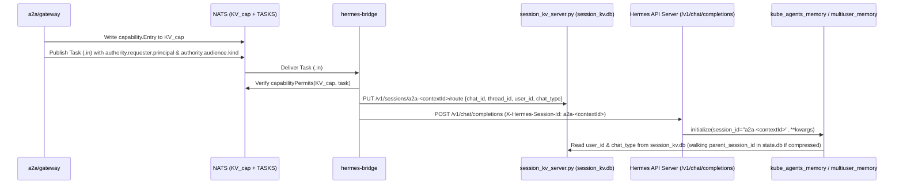
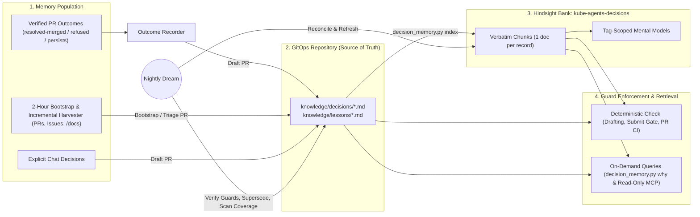
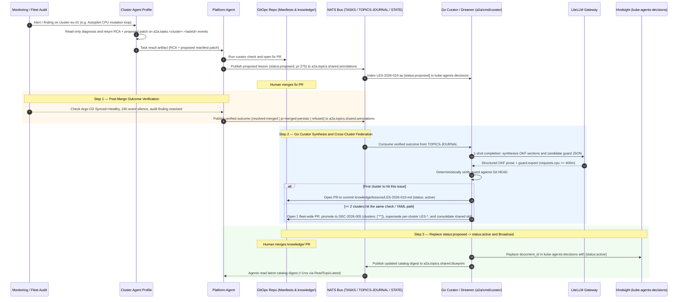
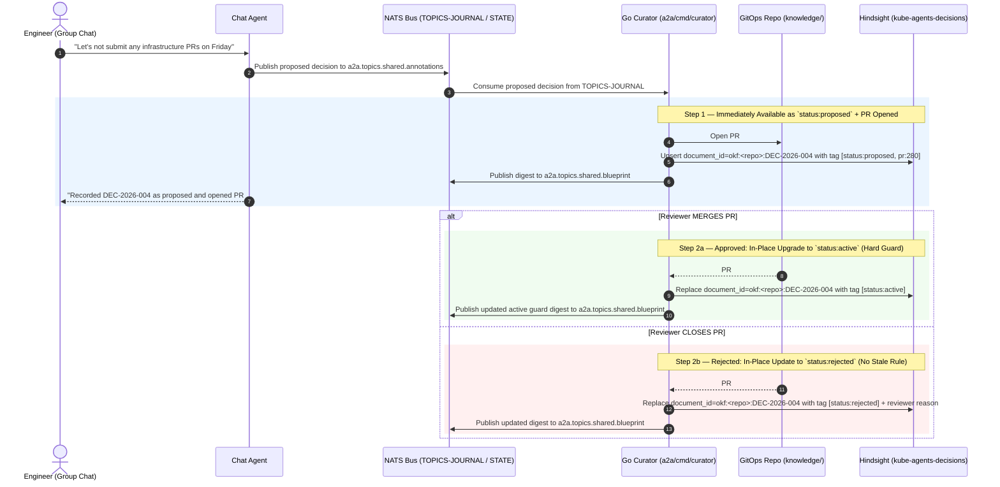

# Memory

## Summary

An AI platform agent that operates a Kubernetes fleet needs two distinct kinds of long-term memory:

1. **Conversational and organizational memory (`kube-agents-memory` and `multiuser_memory`)**: Remembers who owns which service or control, how each engineer prefers to work in direct messages, and which operational conventions the team has stated in chat.
2. **Decision and lesson memory (`knowledge/decisions/*.md`, `knowledge/lessons/*.md`, and `kube-agents-decisions`)**: Remembers why a workload setting or cluster policy exists, which incident or pull request established it, which proposed fixes failed or were rejected, and which machine-checked guard prevents a repeat outage.

Without these two layers, a fleet agent fails in three ways as an organization grows:

- **Flat memory files overflow or truncate.** Loading an entire Markdown memory file into the system prompt on every turn consumes $110,907$ tokens at $1,414$ records, while capping the file at $2,200$ characters retains only about seven records.
- **Chat-only memory misses operational history.** An agent that learns only from chat conversations ignores the GitOps operational loop (`troubleshoot -> pull request -> merge -> verified resolution`). Furthermore, LLM-based memory summarization rewrites prose and strips exact record IDs in $11$ of $12$ recall misses, and vector similarity ranks superseded policies alongside active ones ($40.7\%$ contamination).
- **Stateless runs repeat rejected changes and undo protective fixes.** When each run starts with no memory of past pull requests, an agent or engineer can lower a memory request that prevented an out-of-memory crash, or repeatedly propose a namespace quota increase that reviewers already rejected.

This document defines the unified two-layer memory architecture for `kube-agents`:

- **Layer 1 — Conversational Memory (`kube-agents-memory` and `multiuser_memory`)**:
  - Uses self-hosted Hindsight (`kube-agents-memory`) to retrieve only the memories relevant to the current turn, keeping context usage flat ($\approx 4,264$ tokens at $1,414$ records). Small installations can select the zero-database file provider (`multiuser_memory`).
  - Propagates gateway-verified caller identity (`hmac:<32-hex>`) and conversation audience (`"dm"` or `"group"`) through `hermes-bridge` and `session_kv_server.py`.
  - Enforces five explicit session states (`attributed-dm`, `unattributable-shared`, `unattributable-interactive`, `unattended`, and `read-only`) so personal memories stay strictly private per user and missing identity always fails closed.
- **Layer 2 — Decision and Lesson Memory (`knowledge/` + `kube-agents-decisions` + `decision_memory.py`)**:
  - Stores architectural decisions (`knowledge/decisions/DEC-*.md`) and operational lessons (`knowledge/lessons/LES-*.md`) as human-reviewed Operational Knowledge Format (OKF) files in the GitOps repository, indexed verbatim in Hindsight (`kube-agents-decisions`) for semantic search.
  - Populates records from four sources: verified pull request outcomes (`resolved-merged`, `pr-merged-persists`, and `refused`), a 2-hour day-one bootstrap across 2 years of repository history (GitHub, GitLab, and Bitbucket), explicit decisions stated in chat, and nightly `dream` reconciliation.
  - Evaluates machine-checked YAML and regex invariants (`decision_memory.py check`) deterministically in $< 100\text{ ms}$ with zero LLM calls before the agent opens a pull request and during CI review of human pull requests.

| Component                             | Repository location                                                                                                                                                    |
| ------------------------------------- | ---------------------------------------------------------------------------------------------------------------------------------------------------------------------- |
| Hindsight conversational provider     | [`agents/chat/plugins/memory/kube_agents_memory/`](../../agents/chat/plugins/memory/kube_agents_memory/)                                                               |
| File-based conversational provider    | [`agents/chat/plugins/memory/multiuser_memory/`](../../agents/chat/plugins/memory/multiuser_memory/)                                                                   |
| Session route store                   | [`a2a/hermes-bridge/route.go`](../../a2a/hermes-bridge/route.go), [`agents/platform/scripts/session_kv_server.py`](../../agents/platform/scripts/session_kv_server.py) |
| Decision memory CLI and skill         | [`agents/platform/skills/decision-memory/`](../../agents/platform/skills/decision-memory/SKILL.md) (`scripts/decision_memory.py`)                                      |
| Pre-PR submission guard               | [`agents/platform/skills/submit-suggestion/scripts/submit_suggestion.py`](../../agents/platform/skills/submit-suggestion/scripts/submit_suggestion.py)                 |
| Installer flag and CRD field          | `install.sh --memory=file\|hindsight\|off`, stored on `PlatformAgent` as `spec.harness.memory.provider`                                                                |
| Hindsight recall configuration        | [`agents/chat/defaults/hindsight/config.json`](../../agents/chat/defaults/hindsight/config.json)                                                                       |
| Hindsight in-cluster manifests        | [`k8s-operator/config/integrations/hindsight/`](../../k8s-operator/config/integrations/hindsight/README.md)                                                            |
| Conversational scope rules            | [`agents/chat/SOUL.md`](../../agents/chat/SOUL.md) §1.6                                                                                                                |
| Conversational scale experiment suite | [`tests/memory-scale/`](https://github.com/dshnayder/kube-agents/blob/experiment/memory-scale-ab/tests/memory-scale/README.md)                                         |

---

## How to read this document

Each section adds technical depth so readers can stop as soon as they have the level of detail they need.

| Section                           | Audience                                               | What you will learn                                                                                                      |
| --------------------------------- | ------------------------------------------------------ | ------------------------------------------------------------------------------------------------------------------------ |
| [Why](#why)                       | Engineering leads, product managers, prospective users | How memory helps platform teams prevent repeat outages, onboard existing repositories, and keep user context isolated    |
| [Background](#background)         | Platform engineers evaluating `kube-agents`            | Why fleet agents need both conversational and GitOps decision memory, and why Hindsight was selected for self-hosting    |
| [The decision](#the-decision)     | Architects and tech leads                              | Why retrieval replaces full-file prompt injection, and why architectural decisions belong in Git with verbatim indexing  |
| [The design](#the-design)         | Implementers and AI agents                             | Scoping, identity propagation, the 5 session states, OKF decision/lesson schemas, guard checks, and nightly `dream` jobs |
| [The experiment](#the-experiment) | Evaluators and operators                               | Benchmarks on a 1,664-record corpus and a 500-cluster GitOps repository across 10 real-world outage scenarios            |

---

## Why

### What platform teams need from agent memory

When an enterprise platform team manages dozens or hundreds of Kubernetes clusters through GitOps, institutional knowledge is scattered across chat threads, merged pull requests, closed pull requests, incident tickets, and architecture docs. Platform teams evaluating `kube-agents` consistently highlight three operational pain points:

1. **Personal context and shared team knowledge get mixed up or lost.** An engineer wants the agent to remember their personal test cluster and output preferences in direct messages, keep those personal notes out of shared group channels, and share team-wide ownership facts (such as who approves production changes) across everyone.
2. **Cost-tuning or cleanup changes undo past incident fixes.** Six months after an incident, an engineer or automated agent lowers a container memory request, tightens a `PodDisruptionBudget`, or enables Spot VMs to save money. Because nothing in the manifest explains that the existing setting prevented a production outage, the change merges and repeats the outage.
3. **Teams and agents repeat fixes that were already rejected or failed.** When a deployment fails because of a namespace `ResourceQuota` limit, a stateless agent repeatedly proposes raising the namespace quota—even when platform reviewers already rejected that exact pull request four times because the real fix was right-sizing a runaway indexing job in another folder.

To solve these problems, `kube-agents` provides seven core capabilities:

| Team need                              | What `kube-agents` does                                                                                                                                          |
| -------------------------------------- | ---------------------------------------------------------------------------------------------------------------------------------------------------------------- |
| **Isolate personal vs. shared memory** | Keeps personal preferences strictly private per user in direct messages, and fails closed whenever speaker identity is absent or shared.                         |
| **Explain past rationale ("Why?")**    | Answers _"Why is this workload configured this way?"_ with the exact decision or lesson ID, the pull request URL, the incident link, and the approver.           |
| **Onboard 2 years of history in 2h**   | Scans the past 2 years of pull requests, issues, and `/docs` within 2 hours of installation to generate a reviewable `STATE_OF_BEING.md` baseline.               |
| **Triage history at scale**            | Separates active rules from superseded policies, rejected pull requests, and obsolete clusters across thousands of historical commits.                           |
| **Resolve contradictory history**      | Applies deterministic precedence rules when a newer pull request supersedes or reverts an earlier decision, instead of relying on vector similarity.             |
| **Learn from verified outcomes**       | Drafts a reusable lesson automatically when an agent fix pull request merges and resolves an incident—or when a fix fails post-merge verification or is refused. |
| **Block regressions before merge**     | Checks proposed YAML and Terraform changes against active guards in under $100\text{ ms}$, blocking repeat-outage changes before a pull request is opened.       |

### Operational impact at a glance

| Capability                                        | Without unified memory                                                                                                                        | With unified memory (`kube-agents-memory` + `decision-memory`)                                                                                                | Measured impact                                                                                                      |
| ------------------------------------------------- | --------------------------------------------------------------------------------------------------------------------------------------------- | ------------------------------------------------------------------------------------------------------------------------------------------------------------- | -------------------------------------------------------------------------------------------------------------------- |
| **1. Per-user privacy in chat**                   | HTTP turns lack user identity; file memory falls back to a shared `"default"` file, or DMs are treated as unattended background runs.         | `hermes-bridge` records gateway-verified `user_id` and `chat_type`; memory providers enforce 5 explicit session states.                                       | $0$ cross-user memory leaks; $0$ silent drops when a user asks the agent to remember a preference.                   |
| **2. Learning from failed or rejected fixes**     | Every troubleshooting run starts stateless; when a namespace hits a quota error, the agent proposes the same rejected quota raise repeatedly. | Verified outcomes (`resolved-merged`, `pr-merged-persists`, `refused`) generate scoped lesson records (`LES-*`) with machine-checked guards.                  | Repeat bad proposals drop to $0$ after the first rejected or failed attempt is recorded.                             |
| **3. Preventing repeat outages on pull requests** | Neither CI nor the agent checks diffs against past incident postmortems; engineers or agents accidentally revert protective settings.         | `decision_memory.py check` runs before the agent pushes a branch and in pull request CI, blocking any change that violates an active guard.                   | $100\%$ of guarded outage regressions are blocked before merge with links to the original incident and revert PR.    |
| **4. Day-one onboarding of existing repos**       | A newly installed agent has zero historical context until engineers manually restate every rule in chat.                                      | `decision_memory.py bootstrap --since 2y` triages 2 years of pull requests and docs in under 2 hours into `STATE_OF_BEING.md` and initial records.            | The agent answers architectural rationale questions and enforces past incident guards immediately after onboarding.  |
| **5. Verifiable citations**                       | LLM observation synthesis rewrites text and drops record IDs in $11$ of $12$ retrieval misses.                                                | Decision and lesson records live in Git and index into Hindsight as verbatim chunks (`enable_observations: false`), preserving every ID and PR URL.           | $100\%$ citation accuracy across historical pull requests, issues, and decision IDs.                                 |
| **6. Drift detection and policy graduation**      | Outdated rules remain mixed with active ones ($40.7\%$ contamination), and manual commits can silently break a past architectural decision.   | Nightly `dream` runs flag `at_risk` records the morning after an unguarded commit and propose admission policies (`policy/`) for recurring incident patterns. | $0\%$ superseded policy contamination on active queries; recurring lessons graduate into cluster-wide policy checks. |

### Why store decisions in memory instead of scanning Git and pull requests on every task?

A common question from engineering teams is: _"All of our commits and pull requests are already in Git and GitHub/GitLab—why not have the agent run `git log` and search pull requests live whenever it makes a change?"_

We tested this directly on a 500-cluster GitOps repository across 10 real-world outage scenarios (see [Part 2 of The experiment](#part-2-decision-memory-evaluation-on-10-real-world-kubernetes-outage-scenarios)). Pre-analyzing history into structured decision memory outperforms live per-request repository scanning across accuracy, token cost, and speed:

| Dimension                  | Scan Git and pull requests live on every task                                                                                                                                                                            | Store decisions and lessons in long-term memory                                                                                                                                                          | Measured advantage of decision memory                                                                          |
| -------------------------- | ------------------------------------------------------------------------------------------------------------------------------------------------------------------------------------------------------------------------ | -------------------------------------------------------------------------------------------------------------------------------------------------------------------------------------------------------- | -------------------------------------------------------------------------------------------------------------- |
| **Accuracy on edge cases** | **Misses rejected unmerged PRs and cross-file fixes ($90\%$ accuracy).** A closed, unmerged PR leaves zero commits in `git log <file>`, and forge CLI list commands default to open items and cap pagination at 30 rows. | **Captures the full causal chain ($100\%$ accuracy).** Bootstrap indexes closed/rejected PRs, cross-file fixes, and `supersedes` chains once, and `submit-suggestion` enforces guards deterministically. | **$100\%$ vs $90\%$ accuracy** ($0$ vs $1$ repeat-outage PR opened); scales to repositories with $2,000+$ PRs. |
| **LLM token consumption**  | **High ($130,519$ median / $233,348$ max uncached input tokens per task).** Dumping `git log` and pull request JSON into the prompt on every task re-bills those tokens on every turn of the agent loop.                 | **Low and constant ($66,734$ median uncached input tokens on the standard path).** Local Python evaluates the guard at $0$ LLM token cost and injects only the matching record ($\approx 500$ tokens).   | **$-41\%$ to $-49\%$ uncached input tokens** per task.                                                         |
| **Latency and API load**   | **Slow ($15\text{–}35\text{ s}$ network scan, $4\text{–}8$ forge API calls per task).** Every change task queries remote GitHub, GitLab, or Bitbucket endpoints over the network.                                        | **Sub-second local check ($< 100\text{ ms}$, $0$ forge API calls).** `decision_memory.py check` evaluates YAML and regex invariants directly against the local Git checkout before pushing a branch.     | **$< 100\text{ ms}$ local check vs $15\text{–}35\text{ s}$ network scan**; zero forge API rate-limit usage.    |

---

## Background

### Two types of knowledge in a Kubernetes fleet

An enterprise fleet agent handles two very different kinds of information:

1. **Conversational context**: Statements made by engineers in chat, such as _"My scratch cluster is `dev-alice-01`"_, _"Always show me `kubectl diff` before applying"_, or _"The payments team owns `clusters/prod-eu/payments`."_ These facts arrive informally during chat turns, need per-user privacy for personal preferences, and benefit from semantic retrieval.
2. **Infrastructure decisions and incident lessons**: Rules that govern production manifests in Git, such as _"Keep the `checkout` container memory request at or above `256Mi` because JVM off-heap buffers caused an `OOMKilled` outage below that threshold in PR #31"_ or _"Do not raise the `kyber-ledger` namespace quota above `32Gi`; right-size the `audit-indexer` deployment instead."_ These rules require human review, exact resource paths, verifiable links to pull requests and incidents, deterministic precedence when policies change, and enforcement in both agent workflows and CI pipelines.

### What the underlying agent framework provides

The `kube-agents` runtime builds on Hermes, which includes a simple built-in file memory (`tools/memory_tool.py`): two Markdown files (`MEMORY.md` and `USER.md`) that are loaded in full into the system prompt at session start. That built-in store has two limitations for an enterprise platform team:

- **Single-user only**: It has no concept of `user_id`, so all users share one `USER.md`.
- **Fixed size vs. context window trade-off**: Hermes caps `MEMORY.md` at $2,200$ characters (about seven records). If that cap is removed so the file can hold two years of fleet knowledge ($1,414$ records, or $443,196$ characters), the file consumes **$110,907$ tokens on every turn**—more than half of a $200,000$-token context window before the user even asks a question.

### Evaluating external conversational memory providers

Hermes supports external memory provider plugins (`agent/memory_provider.py`). We evaluated the eight available providers against three enterprise requirements:

1. **Self-hostable inside the organization's Kubernetes cluster** so internal fleet topology, ownership maps, and incident history never leave the cluster boundary.
2. **In-cluster embeddings without extra model infrastructure** so organizations using Anthropic Claude, Vertex AI, Bedrock, or Azure do not have to deploy a separate embedding inference server.
3. **Both per-user private scope and organization-wide shared scope** in a single store so engineers have private DM preferences while specialist subagents and team members can read shared organizational facts.

| Provider      | Deployment model                            | Multi-user and shared scope support              | Embedding requirement                       |
| ------------- | ------------------------------------------- | ------------------------------------------------ | ------------------------------------------- |
| `hindsight`   | Self-hosted in-cluster (`api` + `pgvector`) | Tag scoping (`user:<id>` and `scope:shared`)     | Baked into container image (offline CPU)    |
| `honcho`      | Self-hosted (4 workloads, AGPL-3.0)         | Peer-scoped perspectives only (no shared bucket) | Requires external OpenAI or Gemini embedder |
| `mem0`        | Cloud or self-hosted                        | `user_id` only (no shared organizational scope)  | Requires external OpenAI or Ollama embedder |
| `retaindb`    | Hosted SaaS                                 | `user_id`                                        | Hosted                                      |
| `openviking`  | Hosted SaaS                                 | Tenant and namespace scopes                      | Hosted                                      |
| `byterover`   | Hosted SaaS                                 | Minimal                                          | Hosted                                      |
| `supermemory` | Hosted SaaS                                 | Minimal                                          | Hosted                                      |
| `holographic` | Local experimental store                    | None                                             | Local                                       |

**Hindsight** (MIT license) is the only provider that self-hosts inside the cluster, supports both per-user and shared scopes via tags, and embeds and reranks queries offline inside its own pod (`HF_HUB_OFFLINE=1`) using the existing LiteLLM gateway for fact extraction.

We also benchmarked a self-hosted `honcho` deployment head-to-head against Hindsight on the same 1,664-record fleet corpus ([full comparison results](https://github.com/dshnayder/kube-agents/blob/experiment/memory-honcho-ab/tests/memory-scale/honcho/RESULTS.md)). On queries where a runbook had been retired and replaced, `honcho` returned the retired runbook on **100% of procedural probes** (contamination $1.000$ vs Hindsight's $0.000$) because its message search still matches superseded messages verbatim.

### Retaining `multiuser_memory` for small installations

For small clusters or personal evaluation environments that do not want to run a PostgreSQL database for memory, `kube-agents` also includes [`multiuser_memory`](../../agents/chat/plugins/memory/multiuser_memory/): a lightweight Markdown file provider that stores one file per user (`memories/users/<id>.md`) plus one shared file (`memories/MEMORY.md`). Operators select between `file` (`multiuser_memory`), `hindsight` (`kube_agents_memory`), and `off` (`none`) at installation time.

---

## The decision

### 1. Use retrieval-backed Hindsight for conversational memory at fleet scale

Instead of injecting the entire memory store into the system prompt on every turn, `kube_agents_memory` stores conversational facts in Hindsight and retrieves a budget-bounded set of relevant observations for each user turn:

| Provider                            | Shared records in store | Gold recall | Superseded/irrelevant contamination | Current policy ranked first | Context tokens per turn |
| ----------------------------------- | ----------------------: | ----------: | ----------------------------------: | --------------------------: | ----------------------: |
| Hindsight (`kube_agents_memory`)    |                     100 |       0.718 |                               0.407 |                       83.3% |                   4,588 |
| Hindsight (`kube_agents_memory`)    |                     200 |       0.718 |                               0.407 |                       83.3% |                   4,544 |
| Hindsight (`kube_agents_memory`)    |                     400 |       0.718 |                               0.407 |                       83.3% |                   4,468 |
| Hindsight (`kube_agents_memory`)    |                     800 |       0.718 |                               0.407 |                       83.3% |                   4,322 |
| Hindsight (`kube_agents_memory`)    |                   1,414 |       0.702 |                               0.407 |                       83.3% |               **4,264** |
| Unbounded file (`multiuser_memory`) |                     100 |       1.000 |                               0.722 |                       42.9% |                  13,780 |
| Unbounded file (`multiuser_memory`) |                     200 |       1.000 |                               0.722 |                       42.9% |                  24,661 |
| Unbounded file (`multiuser_memory`) |                     400 |       1.000 |                               0.722 |                       42.9% |                  46,633 |
| Unbounded file (`multiuser_memory`) |                     800 |       1.000 |                               0.722 |                       42.9% |                  79,616 |
| Unbounded file (`multiuser_memory`) |                   1,414 |       1.000 |                               0.722 |                       42.9% |             **110,907** |

As the shared corpus grows $14\times$ (from $100$ to $1,414$ records), the file store's prompt footprint grows $8\times$ to $110,907$ tokens per turn, whereas Hindsight's per-turn context stays flat at **$4,264$ tokens** and ranks the current version of contested policies first **$83.3\%$** of the time (compared to **$42.9\%$** for the flat file).

### 2. Add a Git-backed Decision and Lesson Memory layer for infrastructure history

While Hindsight's observation synthesis works well for chat preferences and ownership notes, six empirical findings show why infrastructure decisions and incident lessons need a dedicated, Git-backed layer:

| Empirical finding                                                       | Measured effect in chat-only memory                                                               | How Decision and Lesson Memory solves it                                                                                       |
| ----------------------------------------------------------------------- | ------------------------------------------------------------------------------------------------- | ------------------------------------------------------------------------------------------------------------------------------ |
| **1. LLM observation synthesis strips record IDs**                      | $11$ of $12$ recall misses at $1,414$ records kept the prose gist but dropped the record ID.      | Stores records as Markdown files in Git (`knowledge/`) and indexes them into Hindsight as verbatim chunks (`chunks` mode).     |
| **2. Batching multiple records per retain call merges document labels** | Retaining 5 records per call collapsed $1,664$ records into $335$ documents and hid $156$ IDs.    | Indexes exactly one record per document (`document_id = okf:<repo>:<path>`) with `update_mode: replace`.                       |
| **3. Superseded policies appear alongside active policies**             | $40.7\%$ of retrieved context on contested policies contained superseded rules.                   | Tracks explicit `status: active \| superseded` frontmatter and `supersedes` links, filtering active queries deterministically. |
| **4. CPU cross-encoder reranking takes $\approx 7\text{ s}$ per query** | Scoring $300$ candidates on CPU takes $14.2\text{ s}$ ($7\text{ s}$ with length-bucket batching). | Matches changed files and Kubernetes resources locally in Git in $< 100\text{ ms}$ before running any semantic query.          |
| **5. Subagents without memory access build unsafe local caches**        | A specialist subagent without memory access wrote a $79\text{ KB}$ private copy into its skill.   | Gives specialist workers sanctioned, read-only access to shared memory and `decision_memory.py` CLI / MCP tools.               |
| **6. Prompt advice alone does not stop repeat bad fixes**               | Without a hard check in the submission tool, an agent repeated a rejected quota raise 4 times.    | Evaluates `guard.expect` rules inside `submit-suggestion` before `git push` and exits with code `2` on any `block` violation.  |

---

## The design

### Architecture overview: two memory layers

`kube-agents` separates **per-user personal memory** (`kube-agents-memory`) from **shared organizational, decision, and lesson memory** (`knowledge/` + `kube-agents-decisions`), so there is only one shared store for team rules and decisions:

| Dimension                      | Layer 1: Personal user memory (`kube-agents-memory`)                                  | Layer 2: Shared decision, convention, and lesson memory (`knowledge/` + `kube-agents-decisions`)                                                      |
| ------------------------------ | ------------------------------------------------------------------------------------- | ----------------------------------------------------------------------------------------------------------------------------------------------------- |
| **Primary source of truth**    | Hindsight PostgreSQL database (or `users/<id>.md` in `file` mode).                    | GitOps repository `knowledge/decisions/*.md` and `knowledge/lessons/*.md` (versioned in Git).                                                         |
| **Role of Hindsight**          | Primary store using LLM fact extraction and background observation synthesis.         | Rebuildable semantic index using verbatim chunk mode (`retain_extraction_mode: chunks`).                                                              |
| **What it stores**             | Each engineer's private DM preferences, response verbosity, and scratch cluster name. | All shared team conventions, ownership rules, architectural decisions (`DEC-*`), incident lessons (`LES-*`), and guards.                              |
| **Lifecycle states**           | Active per-user observations (`user:<id>`).                                           | Single `document_id` (`okf:<repo>:<id>`) transitioning in-place: `status:proposed` $\to$ `status:active` \| `status:rejected` \| `status:superseded`. |
| **How memories are written**   | Automatic personal capture in DMs; explicit `memory_retain(scope="personal")`.        | Immediately indexed as `status:proposed` when a PR opens or `memory_retain(scope="shared")` emits over NATS; upgraded to `status:active` on merge or `status:rejected` on close. |
| **How memories enter context** | Per-turn semantic prefetch injected into the user message sidecar (`api_content`).    | Automatic per-turn NATS prefetch (`_INBOX.agent.memory.query`) in `KubeAgentsMemoryProvider.prefetch` plus deterministic file/resource matching during manifest drafting and PR submission (`submit-suggestion`). |
| **How agents query on demand** | `memory_recall` and `memory_reflect` tools (`user:<id>`).                             | Built-in `memory_recall` (`scope="shared"` \| `"both"`) over NATS `_INBOX.agent.memory.query`, `curator recall` / `why` / `check` CLI commands, and NATS `a2a.topics.shared.blueprint`. |
| **How contradictions resolve** | Background observation consolidation per `user:<id>`.                                 | Five deterministic precedence rules, explicit `supersedes` chains, and `status:active` vs `status:proposed` filtering.                                |
| **Background maintenance**     | Optional TTL checkpoint curator (`memory_ttl_curator.py`).                            | Go Curator / Dreamer (`a2a/cmd/curator`) checking guards against Git `HEAD`, flagging drift, and federating across clusters.                          |

### Shared database footprint and operational state boundary

An enterprise fleet platform tracks two different classes of state:

1. **Operational state and observability cache**: Mutable cluster inventory, profile assignments, scan checkpoints, and open findings that back the NATS event bus and the Web UI so agents do not repeat `kubectl` queries across thousands of clusters.
2. **Long-term conversational and decision memory**: Durable user preferences, team ownership (`kube-agents-memory`), and pull-request-governed architectural decisions and incident lessons (`knowledge/` + `kube-agents-decisions`).

To avoid deploying separate database engines for each subsystem, `kube-agents` consolidates all in-cluster relational and vector state into **one PostgreSQL deployment** alongside the GitOps repository:

| State domain                                   | Authoritative store                                    | PostgreSQL schema / index                                     | NATS bus integration (`spec.mode: next`)                                                                                  |
| ---------------------------------------------- | ------------------------------------------------------ | ------------------------------------------------------------- | ------------------------------------------------------------------------------------------------------------------------- |
| **Operational state & observability cache**    | In-cluster PostgreSQL                                  | `ops_state` schema (clusters, scan checkpoints, findings)     | Cluster and scanner profiles publish scan deltas and checkpoint updates on NATS; the Web UI reads from `ops_state`.       |
| **Layer 1: Conversational memory**             | In-cluster PostgreSQL (`hindsight` mode) or local PVC  | `hindsight` schema (`kube-agents-memory` bank, `pgvector`)    | `a2a/gateway` and `hermes-bridge` propagate verified caller identity (`user_id`, `chat_type`) on NATS task envelopes.     |
| **Layer 2: Architectural decisions & lessons** | GitOps repository (`knowledge/decisions/`, `lessons/`) | `hindsight` schema (`kube-agents-decisions` bank, `pgvector`) | Outcome and `dream` profiles subscribe to PR/audit outcomes on NATS and broadcast newly indexed rules and curated skills. |

### Storage sizing and cost model at enterprise scale

Decision and lesson memory stores curated architectural rules and deduplicated incident lessons rather than raw pod logs or per-poll telemetry. When an issue recurs across hundreds of clusters, federated learning (Phase 5 of `dream`) consolidates the pattern into one fleet-wide `DEC-*` record (`clusters: ["*"]`) instead of writing a separate copy per cluster. As a result, storage grows sub-linearly with cluster and workload count:

- **Per-record size in Git**: One OKF Markdown file (`DEC-*` or `LES-*`) averages **$2.5\text{ KB}$** ($40\text{–}70$ lines of YAML frontmatter and prose).
- **Per-record size in PostgreSQL (`pgvector`)**: One verbatim chunk unit (384-dimensional `float32` embedding, HNSW graph links, metadata, and text) plus one conversational observation averages **$3.5\text{ KB}$** including index overhead.

| Fleet tier               | Clusters | Workloads | Active + historical OKF records | Conversational memory units | Git repository size (`knowledge/`) | PostgreSQL `pgvector` size (data + HNSW index) | Fits in default `8Gi` PVC? |
| ------------------------ | -------: | --------: | ------------------------------: | --------------------------: | ---------------------------------: | ---------------------------------------------: | -------------------------- |
| **Small / Evaluation**   |       10 |       200 |                             250 |                       1,500 |           $\approx 0.6\text{ MiB}$ |                         $\approx 6\text{ MiB}$ | Yes ($< 0.1\%$)            |
| **Medium Enterprise**    |       50 |     3,000 |                           1,500 |                      10,000 |           $\approx 3.8\text{ MiB}$ |                        $\approx 40\text{ MiB}$ | Yes ($0.5\%$)              |
| **Large Enterprise**     |    1,000 |     5,000 |                           5,000 |                      50,000 |          $\approx 12.5\text{ MiB}$ |                       $\approx 195\text{ MiB}$ | Yes ($2.4\%$)              |
| **Hyperscale Fleet**     |   10,000 |    25,000 |                          15,000 |                     150,000 |          $\approx 37.5\text{ MiB}$ |                       $\approx 580\text{ MiB}$ | Yes ($7.1\%$)              |
| **Maximum Target Scale** |   30,000 |    60,000 |                          35,000 |                     350,000 |          $\approx 87.5\text{ MiB}$ |                      $\approx 1.35\text{ GiB}$ | Yes ($16.9\%$)             |

Even at **30,000 clusters and 60,000 workloads**, the entire Git knowledge base stays under **$90\text{ MiB}$** and the PostgreSQL `pgvector` index stays under **$1.4\text{ GiB}$**—fitting inside the default $8\text{ GiB}$ PersistentVolumeClaim with zero external cloud logging or vector-database billing.

---

### Layer 1 — Conversational memory (`kube-agents-memory` and `multiuser_memory`)

#### Choosing a provider

Operators select the conversational memory provider at install time via `install.sh --memory=file|hindsight|off`:

- **`file` (`multiuser_memory`, default for backward compatibility)**: Stores per-user and shared Markdown files on the agent pod's persistent volume. Requires zero extra pods or databases and suits small clusters or personal test environments.
- **`hindsight` (`kube_agents_memory`, recommended for enterprise fleets)**: Deploys the self-hosted Hindsight API server and PostgreSQL `pgvector` database in the cluster. Keeps per-turn token usage small and constant regardless of how many memories accumulate.
- **`off` (`none`)**: Disables conversational memory completely.

Four configuration surfaces carry this choice from the installer to the running container:

| Surface                                    | Value stored                                                                                    |
| ------------------------------------------ | ----------------------------------------------------------------------------------------------- |
| `install.sh --memory=file\|hindsight\|off` | Installer flag or interactive prompt selection                                                  |
| `MEMORY` in `install.env`                  | Saved installer mode, mapped to a provider name by `memory_provider_from_mode`                  |
| `spec.harness.memory.provider`             | Field on the `PlatformAgent` custom resource (`multiuser_memory`, `kube_agents_memory`, `none`) |
| `MEMORY_PROVIDER` pod environment variable | Passed to the container entrypoint (`docker-entrypoint.sh`) before `config.yaml` is rendered    |

When an existing installation upgrades from `file` to `hindsight`, [`agents/chat/scripts/memory_file_import.py`](../../agents/chat/scripts/memory_file_import.py) runs once at pod startup. It imports existing `MEMORY.md` and `memories/users/<id>.md` entries into Hindsight under their matching scope tags, verifies that each unit exists in the bank, writes an audit receipt under `$HERMES_HOME/hindsight/imported/`, and removes the plaintext Markdown file only after verification succeeds.

#### The two Hindsight pods and recall performance

When `--memory=hindsight` is enabled, the Helm chart and operator deploy two workloads in the agent namespace ([`k8s-operator/config/integrations/hindsight/`](../../k8s-operator/config/integrations/hindsight/README.md)):

1. **`hindsight-api` (`Deployment`, port `8888`)**:
   - Runs `ghcr.io/vectorize-io/hindsight-api:0.10.2` (pinned by digest in `images.json`) as a non-root container (`RuntimeDefault` seccomp profile, all Linux capabilities dropped).
   - Sets `HF_HUB_OFFLINE=1` and `TRANSFORMERS_OFFLINE=1` so the baked-in embedding model (`BAAI/bge-small-en-v1.5`) and cross-encoder reranker (`cross-encoder/ms-marco-MiniLM-L-6-v2`) run completely offline without internet egress.
   - Routes LLM fact extraction and observation consolidation through the cluster's existing LiteLLM inference gateway (`HINDSIGHT_API_LLM_BASE_URL=http://inference-gateway/v1`, model `model-default`) with `HINDSIGHT_API_LLM_TEMPERATURE=none` so models that reject explicit temperature parameters do not fail extraction.
   - Connects to the namespace-local service URL injected by [`platformagent_manifests.go`](../../k8s-operator/internal/controller/platformagent_manifests.go): `http://hindsight-api.<namespace>.svc.cluster.local:8888`.
2. **`hindsight-postgresql` (`StatefulSet`, port `5432`)**:
   - Runs `pgvector/pgvector` (PostgreSQL 15 with HNSW vector indexing and `hnsw.iterative_scan` enabled) backed by an `8Gi` `ReadWriteOnce` PersistentVolumeClaim (`data-hindsight-postgresql-0`). At $\approx 1.8\text{ KB}$ per memory unit (384-dimensional embedding plus text), an $8\text{ GiB}$ volume holds roughly one million memory units.
   - Enforces a `NetworkPolicy` (`networkpolicy.yaml`) that restricts port `5432` ingress exclusively to the `hindsight-api` pod.

##### What a recall costs

A Hindsight recall runs in two phases:

1. **Candidate retrieval ($\approx 0.4\text{ s}$)**: Parallel semantic vector search, BM25 keyword search, and graph traversal fetch up to $300$ candidate observations (`recall_budget: mid`).
2. **Cross-encoder reranking ($\approx 7\text{ s}$ on CPU)**: The cross-encoder scores each `(query, candidate)` pair on CPU. Because `api.yaml` enables length-sorted bucket batching (`HINDSIGHT_API_RERANKER_LOCAL_BUCKET_BATCHING=true`), short candidates are not padded to the length of the longest candidate in the batch, cutting CPU rerank latency in half compared to the upstream default ($7\text{ s}$ vs $14.2\text{ s}$) with identical ranking results.

For high-concurrency environments, scaling `hindsight-api` from $1$ to $2$ replicas on separate nodes nearly doubles concurrent recall throughput (from $0.089\text{ rps}$ to $0.162\text{ rps}$ at concurrency $4$, cutting median latency from $44.1\text{ s}$ to $22.8\text{ s}$).

#### One bank, two scopes

All conversational memories live in a single Hindsight bank (`kube-agents-memory`) partitioned by strict scope tags:

| Scope    | Tag format     | How memories are written                                 | Who can read them  |
| -------- | -------------- | -------------------------------------------------------- | ------------------ |
| Personal | `user:<id>`    | Automatic capture from DM turns, and `memory_retain`     | Only that user     |
| Shared   | `scope:shared` | Explicit `memory_retain(scope="shared")` tool calls only | All users & agents |

Here `<id>` is produced by `sanitize_user_id(raw_id)`, which formats the caller's identity as `<readable>_<sha256[:12]>`. The 12-character SHA-256 suffix guarantees that two distinct identities that normalize to the same readable prefix (such as `alice.smith@example.com` and `alice+dev@example.com`) never collide on the same tag or file.

To guarantee zero cross-user leakage inside a single bank, [`kube_agents_memory`](../../agents/chat/plugins/memory/kube_agents_memory/__init__.py) pins four settings in code (`apply_scoping`):

1. **`recall_tags_match = "any_strict"`**: Excludes untagged records from recall results. Every query requests `[user:<id>, scope:shared]` (or `[scope:shared]` when personal memory is disabled).
2. **`observation_scopes = [[scope_tag]]`**: Scopes background observation consolidation by the single scope tag (`["user:<id>"]` or `["scope:shared"]`) rather than by session ID, so a user's facts consolidate across sessions without ever merging into another user's observations.
3. **Scoped `memory_reflect` and `recall`-mode prefetch**: Re-implements `memory_reflect` against the Hindsight client with explicit `tags`, `tags_match="any_strict"`, and `exclude_mental_models=True`, and pins per-turn prefetch to `recall` mode so every read path honors tag isolation.
4. **Isolated shared writes**: When `memory_retain(scope="shared")` is called, `_retain()` writes the item with `tags=["scope:shared"]` and `strategy="shared"` directly via `aretain_batch`, ensuring the caller's personal `user:<id>` tag is never attached to a shared organizational fact.

#### Identity propagation through `hermes-bridge` and `session_kv`

When a user messages the Chat Agent, the request travels through `a2a/gateway` over NATS to `hermes-bridge`, which invokes the Hermes HTTP API server (`POST /v1/chat/completions`) using `X-Hermes-Session-Id: a2a-<contextId>`. Because the Hermes HTTP server does not accept user identity headers, `hermes-bridge` and `session_kv_server.py` propagate the verified speaker identity and conversation audience out-of-band:



Four security invariants govern this path:

1. **Gateway-attested identity**: `a2a/gateway` is the only principal permitted to publish tasks to `a2a.tasks.*.*.in` (enforced by [`tests/conformance/test_A_authority.py`](../../tests/conformance/test_A_authority.py)). It hashes the authenticated user's email with `SESSION_KV_SALT` into a pseudonymous `hmac:<32-hex>` identifier and sets `authority.audience.kind` to `"dm"` or `"group"` ([`a2a/gateway/a2adoor.go`](../../a2a/gateway/a2adoor.go)).
2. **Memory-only scoping after capability check**: In [`a2a/hermes-bridge/bridge.go`](../../a2a/hermes-bridge/bridge.go), after `capabilityPermits` verifies the task against `KV_cap`, [`a2a/hermes-bridge/route.go`](../../a2a/hermes-bridge/route.go) extracts `user_id` and `chat_type` from the task's `authority` block solely to scope conversational memory and stores them in `session_kv.db`. Shared-credential doors (`console:` and `verified_by == "nats-grant"`) clear `user_id` so multiple operators never share one personal memory store.
3. **Lineage resolution across session compression**: When Hermes compresses a long conversation into a new session ID, it records `parent_session_id` in `state.db`. Both memory providers walk `parent_session_id` up to the root `a2a-<contextId>` so compressed sessions retain their caller identity and audience type.
4. **Pseudonymous storage**: Plaintext user emails never appear on NATS streams, in `session_kv.db`, or in Hindsight tags (`user:hmac-<32-hex>_<sha12>`).

#### Failing closed across the five session states

Whenever the speaker cannot be attributed to a single human in a direct message, personal memory switches off automatically. Both `kube_agents_memory` and `multiuser_memory` classify every session into one of five explicit states at `initialize()`:

| Session state                | Condition at `initialize()`                                                   | Personal memory (`user:<id>` / `users/<id>.md`) | Shared memory (`scope:shared` / `MEMORY.md`) | Unqualified `memory_retain` / `memory(target="user")` | System prompt instruction                                                                                                 |
| ---------------------------- | ----------------------------------------------------------------------------- | ----------------------------------------------- | -------------------------------------------- | ----------------------------------------------------- | ------------------------------------------------------------------------------------------------------------------------- |
| `attributed-dm`              | `user_id` non-empty and not `"default"`, `chat_type == "dm"`                  | Enabled (read & write)                          | Enabled (read & write)                       | Writes to personal memory                             | Normal personal + shared memory guidance                                                                                  |
| `unattributable-shared`      | `chat_type == "group"` or (`chat_type != "dm"` and `thread_id` non-empty)     | Disabled                                        | Enabled (read & write)                       | Refused (`SHARED_SESSION_NOTICE`)                     | Instructs the model to refuse personal `"Remember: ..."` requests in group spaces and explain that DMs are required       |
| `unattributable-interactive` | Interactive / `a2a-*` session with empty `user_id` or missing `session_kv.db` | Disabled                                        | Enabled (read & write)                       | Refused (`NO_IDENTITY_NOTICE`)                        | Instructs the model to refuse personal `"Remember: ..."` requests when caller identity is unavailable; never silent no-op |
| `unattended`                 | Non-`a2a-*` background cron or event-watcher session with no `user_id`        | Disabled                                        | Enabled (read & write)                       | Writes to `scope:shared`                              | Background operational mode (`UNATTENDED_NOTICE`)                                                                         |
| `read-only`                  | Delegated specialist worker (`read_only: true`)                               | Disabled                                        | Read-only (`recall` & `reflect` only)        | Write tool not registered                             | Read-only shared memory guidance                                                                                          |

This state table guarantees three safety properties:

- **No shared `"default"` bucket**: Neither provider ever falls back to `"default"` when `user_id` is empty.
- **No accidental leak from DMs or group chats into shared memory**: In `unattributable-shared` and `unattributable-interactive` sessions, a human is speaking, so an unqualified write (or `target="user"`) is refused with a clear explanation instead of writing the user's statement to `scope:shared`. Only genuine background cron/watcher runs (`unattended`) default unqualified writes to `scope:shared`.
- **No silent fake confirmations**: When personal memory is disabled in an interactive session, the system prompt explicitly forbids the model from replying _"Noted"_ or _"I'll remember that"_ and instructs it to explain why personal memory is unavailable.

#### How conversational memories are captured, recalled, and reported

- **Population**:
  - **Automatic capture (personal only)**: After each completed DM turn (`sync_turn`) and at session end (`on_session_end`), Hindsight extracts durable personal preferences under `user:<id>`. Automatic capture never writes to `scope:shared`.
  - **Explicit writes (`memory_retain`)**: Shared organizational facts (such as team ownership, on-call rotation, or approval authority, governed by [`agents/chat/SOUL.md`](../../agents/chat/SOUL.md) §1.6) enter `scope:shared` only when the agent explicitly calls `memory_retain(scope="shared")` and states in chat what it recorded.
- **Per-turn injection without prefix-cache churn**:
  - The system prompt block (`system_prompt_block()`) contains **static instructions only**—never recalled facts—so the system prompt prefix cache stays valid across turns.
  - Before the tool loop on each turn, `prefetch_all(user_message)` retrieves relevant observations within `recall_budget` and attaches them to the current turn's ephemeral `api_content` sidecar. After the turn finishes, `queue_prefetch_all()` warms the cache in the background for the next turn.
- **Explicit read outcomes (`found`, `no_match`, `unreachable`)**:
  - Every `memory_recall` and `memory_reflect` call returns a structured `status` (`found`, `no_match`, or `unreachable`) plus a `searched` metadata envelope (bank, scope tags, query, and layer).
  - Distinguishing `no_match` (_"the store answered, and this query matched nothing"_) from `unreachable` (_"the memory service did not respond"_) prevents the agent from claiming that a record does not exist when a query simply missed or the database was unreachable.

#### Communication style, verbosity, and scheduled report preferences

Engineers on the same team often want different levels of detail from the agent: some prefer a concise three-bullet summary, while others want full step-by-step explanations with command outputs and citations. Layer 1 supports both per-user and team-wide communication preferences without static installer flags:

| Preference scope                                    | Tag in `kube-agents-memory` | How it is set or updated                                                                                                                                                                           | Where it applies                                                                                                                              |
| --------------------------------------------------- | --------------------------- | -------------------------------------------------------------------------------------------------------------------------------------------------------------------------------------------------- | --------------------------------------------------------------------------------------------------------------------------------------------- |
| **Per-user response style & verbosity**             | `user:<id>`                 | Direct request in DM (_"Keep replies short and lead with a summary"_), conversational feedback (_"Too verbose"_), or Web UI verbosity/tone controls writing to the user's personal memory profile. | Every direct message turn with that user across chat surfaces and the Web UI.                                                                 |
| **Team-wide channel & scheduled digest formatting** | `scope:shared`              | Explicit team instruction in chat (`memory_retain(scope="shared")`, e.g., _"Format scheduled audit and cron digests as concise executive summaries, not walls of text"_).                          | Shared group channels and unattended background runs (`unattended` cron jobs and event watchers) that retrieve `scope:shared` before posting. |

#### Read-only shared memory and finding nominations for specialist subagents

Delegated specialist workers (`agents/platform/config.yaml`) run with no human `user_id` and set `memory.read_only: true` with `recall_budget: low`:

- **Read access**: Specialists receive per-turn shared memory prefetch and can call `memory_recall` and `memory_reflect` against `scope:shared`. Giving specialists sanctioned read access prevents them from improvising unsanctioned local caches.
- **Write prohibition**: `memory_retain` is omitted from tool schemas, refused by `handle_tool_call` with `status: read_only`, and disabled on automatic turn hooks.
- **Finding nomination**: When a specialist discovers a durable operational fact during a task, it includes a `**Worth remembering**` block in its task result and attaches the candidate sentence in structured completion metadata (`memory_candidates`). The human in chat sees the nomination in the reply and can ask the Chat Agent to save it to `scope:shared`.

---

### Layer 2 — Decision and lesson memory (`knowledge/` and `kube-agents-decisions`)

While Layer 1 handles conversational context, **Layer 2** turns the GitOps repository (`knowledge/decisions/*.md` and `knowledge/lessons/*.md`) into the version-controlled source of truth for architectural decisions and operational lessons, backed by a rebuildable Hindsight chunk index (`kube-agents-decisions`) and a zero-LLM deterministic enforcement CLI ([`decision_memory.py`](../../agents/platform/skills/decision-memory/scripts/decision_memory.py)).



#### Operational Knowledge Format (OKF) schema for decisions and lessons

[Architecture 06 §5](../architecture/06-api-and-data-contracts.md#5-okf-knowledge-contract) defines the base Operational Knowledge Format (OKF) as Markdown files with YAML frontmatter under `knowledge/<type>/*.md`. Decision memory defines two record types:

- **`decision` (`DEC-YYYY-NNN`)**: A forward-looking architectural choice and the trade-offs behind it (for example, capping a multi-tenant namespace quota at `32Gi`).
- **`lesson` (`LES-YYYY-NNN`)**: A backward-looking operational rule learned from a real incident or pull request outcome (for example, keeping a JVM service's memory request at or above `256Mi` after an off-heap `OOMKilled` outage).

```yaml
---
type: lesson # decision | lesson
id: LES-2026-001 # DEC-YYYY-NNN | LES-YYYY-NNN
title: checkout OOM-kills below 256Mi under JVM off-heap growth
status: active # proposed | active | superseded | retired
date: 2026-09-10
scope: # required; at least one key must be non-empty
  paths: ["clusters/*/payments/checkout.yaml"]
  resources: ["Deployment/payments/checkout"] # kind/namespace/name (globs allowed)
  clusters: [prod-eu]
  checks: [oom-kill] # fleet-audit check identifiers
guard: # optional machine-checked invariant
  rule: Keep checkout memory request at or above 256Mi.
  severity: block # block | warn | info
  expect:
    file: "clusters/*/payments/checkout.yaml"
    path: "spec.template.spec.containers[name=app].resources.requests.memory"
    op: ">=" # == | != | >= | > | <= | < | present | absent | regex
    value: 256Mi # parses Kubernetes quantities (Ki, Mi, Gi, m)
evidence: # pull_request is mandatory for type: lesson
  pull_request: https://github.com/acme/gitops/pull/31
  breaking_pr: https://github.com/acme/gitops/pull/29
  incident: https://github.com/acme/gitops/issues/30
  commit: 1a2b3c4
  merged_by: alice
  finding_id: oom-kill.prod-eu.payments.checkout
  outcome: resolved-merged # resolved-merged | pr-merged-persists | refused
  resolution:
    verified_by: fleet-audit
    at: 2026-09-11T02:00:00Z
supersedes: [] # record IDs replaced by this record
superseded_by: null # record ID that replaced this record
---
## What happened
Lowering the `checkout` memory request to 224Mi in PR #29 caused JVM off-heap DirectByteBuffer allocations to exceed container limits under peak load (Issue #30).

## What fixed it
PR #31 restored the memory request to 512Mi (minimum safe floor 256Mi).

## Prevent it next time
Block any pull request that lowers `requests.memory` below 256Mi on `Deployment/payments/checkout`.
```

Each frontmatter field serves a specific operational purpose:

| Field                              | Purpose                                                                                                                           |
| ---------------------------------- | --------------------------------------------------------------------------------------------------------------------------------- |
| `id` (`DEC-YYYY-NNN`, `LES-...`)   | Stable identifier used in citations, PR comments, `supersedes` links, and `decision-override:<id>` labels.                        |
| `status` and `supersedes`          | Tracks whether a rule is `proposed`, `active`, `superseded`, or `retired` so obsolete freezes never block valid upgrades.         |
| `scope` (`paths`, `resources`, ..) | Matches modified files and Kubernetes objects (`Kind/namespace/name`) locally in $< 100\text{ ms}$ without vector search.         |
| `guard` (`severity`, `expect`)     | Turns a written lesson into a deterministic check (`>= 256Mi`, `absent`, `regex`, etc.) enforced before a pull request is opened. |
| `evidence` (`pull_request`, ...)   | Links the record to the exact pull requests, incident issues, and commits so the agent can cite verifiable provenance.            |

#### 1. How the agent learns across three core operational scenarios

All shared team rules, conventions, architectural decisions (`DEC-*`), and incident lessons (`LES-*`) live in a single shared memory bank (`kube-agents-decisions`) backed by the GitOps repository (`knowledge/`). Each shared record carries one deterministic `document_id` (`okf:<repo>:<id>`) and moves in-place through four lifecycle states (`status:proposed` $\to$ `status:active`, `status:rejected`, or `status:superseded`), eliminating any split-brain between chat and Git:

| Scenario                                                                                                                                           | Example trigger                                                                                                           | What happens immediately (`status:proposed`)                                                                                                                                                                                                                                                                                                                                                                                                                                                                                              | How it resolves when the PR is merged or rejected                                                                                                                                                                                                                                                                                                                                                   |
| :------------------------------------------------------------------------------------------------------------------------------------------------- | :------------------------------------------------------------------------------------------------------------------------ | :---------------------------------------------------------------------------------------------------------------------------------------------------------------------------------------------------------------------------------------------------------------------------------------------------------------------------------------------------------------------------------------------------------------------------------------------------------------------------------------------------------------------------------------- | :-------------------------------------------------------------------------------------------------------------------------------------------------------------------------------------------------------------------------------------------------------------------------------------------------------------------------------------------------------------------------------------------------- |
| **Scenario 1: Learning from chat** (e.g., in a group space someone says _"Let's not submit any infrastructure PRs on Friday"_)                     | An engineer states a team-wide convention, change freeze, or ownership rule in a group chat or DM.                        | The Chat Agent publishes the candidate decision (`DataPart` schema `kube-agents.memory.outcome/v1`) to the provisioned journal topic `a2a.topics.shared.annotations`. The Go Curator opens a PR adding `knowledge/decisions/DEC-2026-004.md` (`status: proposed`) and immediately indexes `document_id=okf:<repo>:DEC-2026-004` into `kube-agents-decisions` with tag **`status:proposed`** so agents warn users that the rule is awaiting review.                                                                                        | **Merged**: The Curator replaces `document_id=okf:<repo>:DEC-2026-004` in-place with tag **`status:active`**, and `submit-suggestion` blocks Friday PRs (`exit 2`).<br/>**Rejected (closed unmerged)**: The Curator replaces the same `document_id` in-place with **`status:rejected`** (recording the reviewer's reason), leaving zero stale rules behind.                                         |
| **Scenario 2: Learning from troubleshooting & monitoring** (e.g., a Cluster Agent diagnoses an outage and a fix PR is submitted to the infra repo) | An event watcher, fleet audit check, or troubleshooting run diagnoses a cluster failure and proposes a remediation patch. | The Cluster Agent returns its grounded RCA and proposed patch in its task `result` artifact on `a2a.tasks.<profile>.<taskId>.events` (`TASKS` stream), and the Platform Agent / Curator opens the fix PR and publishes the proposed lesson (`status:proposed`) to `a2a.topics.shared.annotations`. The Go Curator indexes `LES-YYYY-NNN` as **`status:proposed`** in `kube-agents-decisions`. After the fix PR merges (or closes), post-merge verification checks Argo CD/Flux health, 24-hour event silence, and the fleet-audit ledger. | The verified outcome (`resolved-merged`, `pr-merged-persists`, or `refused`) is published to `a2a.topics.shared.annotations`. The Go Curator synthesizes a verified `LES-*` record (or promotes a recurring $\ge 2$-cluster pattern into a fleet-wide `DEC-*` rule), opens a `knowledge/` PR, updates the `document_id` in-place to **`status:active`**, and updates `a2a.topics.shared.blueprint`. |
| **Scenario 3: Learning on Day-0 installation** (scanning an existing GitOps repo when the agent is first installed)                                | A GitOps repository is registered on a new installation and `knowledge/STATE_OF_BEING.md` does not yet exist.             | The Go Curator automatically launches `bootstrap --since 2y --budget-minutes 120`. Stage 1 scans 2 years of commits, merged/closed PRs, review comments, and issues in $0\text{–}15\text{ min}$ with zero LLM calls, and Stage 2 prunes deleted workloads (`anachronistic`) and noise against `HEAD`.                                                                                                                                                                                                                                     | Stage 3 uses concurrent goroutines to diff YAML/HCL ASTs, calls LiteLLM (`POST /v1/chat/completions`) to write OKF sections with exact PR/issue links, and verifies every candidate guard against `HEAD`. Stage 4 opens one onboarding PR (`STATE_OF_BEING.md` + `DEC-*`/`LES-*` files) and indexes the corpus into `kube-agents-decisions` within 2 hours of installation.                         |

##### Path W1 — Learn automatically from troubleshooting, monitoring, and pull request outcomes



1. **Propose a lesson alongside the fix**: When a Cluster Agent diagnoses an issue from monitoring alerts or fleet-audit findings, it returns its grounded RCA and proposed manifest patch in its task `result` artifact on `a2a.tasks.<profile>.<taskId>.events` ([`spec-subagent-profiles.md`](spec-subagent-profiles.md#worked-profile-a-cluster-agent)). When the Platform Agent opens the remediation pull request, it publishes a `status:proposed` lesson candidate to `a2a.topics.shared.annotations` so `kube-agents-decisions` immediately tracks the pending fix.
2. **Verify post-merge resolution (`resolved-merged`)**: After a fix PR merges, the outcome recorder checks four deterministic signals (from strongest to weakest):
   - **Fleet audit verification**: `audit_report.py finish` confirms that the next complete audit run no longer reproduces the finding ([`fleet-audit-issue-ledger.md` §4](fleet-audit-issue-ledger.md#4-finding-lifecycle)).
   - **Cluster event silence**: `intercepted_events` records zero occurrences of the workload failure reason for $24\text{ hours}$ after merge.
   - **GitOps sync and health**: Argo CD or Flux reports `Synced` at or after the merge commit SHA and `Healthy`.
   - **Findings queue closure**: `findings_queue.py` confirms `pr_state=merged` and verifies that the finding has cleared.
3. **Learn from failed or rejected fixes (`pr-merged-persists` and `refused`)**:
   - If a merged PR fails to resolve the issue (`pr-merged-persists`), or if a human reviewer closes the agent's PR unmerged (`refused`), the Curator updates the `document_id` in `kube-agents-decisions` to a **negative lesson** (_"Approach X does not resolve Y; see rejected PR #N"_) with a `warn` or `block` guard. On the very next run, the agent sees the negative lesson and avoids repeating the rejected approach.
   - When the LiteLLM inference gateway is available (`LITELLM_BASE_URL`, `model.base_url` in `config.yaml`, or `--llm-url`, defaulting to `http://inference-gateway.<namespace>.svc.cluster.local/v1` with model `model-default`), `from-outcome` makes a single-shot OpenAI-compatible completion call to synthesize clean OKF sections (`What happened`, `What fixed it`, `How we know it worked`, `Prevent it next time`) and a candidate `guard` from unstructured PR descriptions and review comments, then deterministically verifies that the proposed guard passes against `HEAD` before writing the file.

##### Path W2 — Day-0 repository onboarding: bounded history bootstrap ("midterm" vs. multi-year)

Enterprise Infrastructure-as-Code repositories often span four to five years of commits, where much of the oldest history refers to retired clusters or superseded architectures. When `kube-agents` is first installed and a GitOps repository has no `knowledge/STATE_OF_BEING.md`, the onboarding job automatically runs a bounded bootstrap (`--since 2y --budget-minutes 120`, configurable to `--since 90d` or `180d`):

| History window                                 | Typical PRs & issues scanned | Processing time & compute cost                                            | Harvested records (`DEC` + `LES`) | Storage footprint (Git + Hindsight `pgvector`)             | When to choose                                                                                                     |
| ---------------------------------------------- | ---------------------------: | ------------------------------------------------------------------------- | --------------------------------: | ---------------------------------------------------------- | ------------------------------------------------------------------------------------------------------------------ |
| **3 months ("Midterm memory", `--since 90d`)** |             $150\text{–}400$ | $< 3\text{ min}$ (deterministic pre-filter; $0$ LLM calls on routine PRs) |                    $15\text{–}35$ | $\approx 50\text{ KB}$ in Git; $< 100\text{ KB}$ in DB     | Fast initial rollout focused on recent change-management decisions and active incident fixes.                      |
| **6 months (`--since 180d`)**                  |             $400\text{–}900$ | $5\text{–}12\text{ min}$                                                  |                    $30\text{–}70$ | $\approx 120\text{ KB}$ in Git; $\approx 250\text{ KB}$ DB | Balanced onboarding covering two quarterly release cycles and seasonal traffic patterns.                           |
| **2 years (`--since 2y`, default ceiling)**    |         $1,500\text{–}4,000$ | $30\text{–}120\text{ min}$ (bounded by `--budget-minutes 120`)            |                  $100\text{–}250$ | $\approx 450\text{ KB}$ in Git; $< 1\text{ MB}$ in DB      | Full historical backfill for mature fleets ($< 0.02\%$ of the default $8\text{ GiB}$ Hindsight PostgreSQL volume). |

Running `bootstrap --since 2y --budget-minutes 120` executes four stages:

| Stage                                  | Time window                | What happens                                                                                                                                                                                                                                                                                                                      | Output                                                                        |
| -------------------------------------- | -------------------------- | --------------------------------------------------------------------------------------------------------------------------------------------------------------------------------------------------------------------------------------------------------------------------------------------------------------------------------- | ----------------------------------------------------------------------------- |
| **1. Fast Git & PR metadata scan**     | $0\text{–}15\text{ min}$   | Scans commit history and closed/merged PR and issue metadata within the `--since` window without LLM calls. Identifies revert chains, closed unmerged PRs on governed files, and high-churn resource fields.                                                                                                                      | Ranked list of $50\text{–}150$ high-signal pull requests out of thousands.    |
| **2. Five-way deterministic triage**   | $15\text{–}30\text{ min}$  | Compares each candidate's diff against the current `HEAD` tree and classifies it into `current`, `superseded`, `rejected`, `anachronistic` (deleted cluster/workload), or `noise` (formatting/version bumps).                                                                                                                     | Filtered set of `current`, `superseded`, and `rejected` candidates at `HEAD`. |
| **3. Hybrid guard & record synthesis** | $30\text{–}90\text{ min}$  | Diffs pre-revert and post-revert YAML/HCL ASTs to infer `guard.expect` rules, calls the LiteLLM inference gateway concurrently to synthesize clean OKF descriptions and fallback guards from unstructured PR/issue text, verifies every candidate guard against `HEAD`, and writes `DEC-YYYY-NNN.md` and `LES-YYYY-NNN.md` files. | Scoped decision and lesson files with verifiable PR and issue links.          |
| **4. Baseline "State of Being" PR**    | $90\text{–}120\text{ min}$ | Opens a single onboarding pull request containing `knowledge/STATE_OF_BEING.md` (fleet summary, active guards, superseded policies, and uncovered areas) plus the initial `knowledge/decisions/` and `lessons/` files.                                                                                                            | Day-one institutional memory ready for team review within 2 hours.            |

For repositories with 4–5 years of history, commits older than the `--since` cutoff are not bulk-indexed into active memory; instead, `anachronistic` and `superseded` pruning keeps obsolete changes out of the bank, and teams can start with a 3-month (`--since 90d`) or 6-month (`--since 180d`) midterm window and backfill older slices incrementally. After the initial bootstrap merges, the harvester records a commit/PR watermark and runs incrementally on new merges.

##### Path W3 — Learn from chat: `status:proposed` $\to$ `status:active` or `status:rejected` in `kube-agents-decisions`



When an engineer states a team-wide operational rule in chat—for example, saying _"Let's not submit any infrastructure PRs on Friday"_ in a group channel—`kube-agents` stores it in `kube-agents-decisions` with an explicit proposal lifecycle rather than writing a separate unreviewed copy into `kube-agents-memory`:

1. **Immediate indexing as `status:proposed`**:
   - The Chat Agent publishes the proposed rule (`DataPart` schema `kube-agents.memory.outcome/v1`) to `a2a.topics.shared.annotations` on `TOPICS-JOURNAL`.
   - The Go Curator opens a pull request (`PR #280`) adding `knowledge/decisions/DEC-2026-004.md` (`status: proposed`) and immediately upserts `document_id = okf:<repo>:DEC-2026-004` into `kube-agents-decisions` with tags `["scope:shared", "kind:decision", "status:proposed", "pr:280"]`.
   - While `PR #280` is open, any agent that queries `kube-agents-decisions` sees that `DEC-2026-004` is **`status:proposed` (awaiting review in PR #280)** and warns the user accordingly.
2. **In-place resolution when the PR is merged or rejected (`update_mode: replace`)**:
   - **If `PR #280` merges**: The Curator replaces `document_id = okf:<repo>:DEC-2026-004` in `kube-agents-decisions` with **`status:active`**, upgrading it from an advisory warning to a hard pre-submit `block` guard.
   - **If `PR #280` is closed unmerged (`refused`)**: The Curator replaces the exact same `document_id = okf:<repo>:DEC-2026-004` in `kube-agents-decisions` with **`status:rejected`** and attaches the reviewer's closing rationale. Because `update_mode: replace` overwrites the `status:proposed` unit in place, no stale rule remains in memory.

##### Path W4 — Synchronize Git records into the Hindsight `kube-agents-decisions` bank

Whenever `knowledge/` changes on the default branch (or during Phase 1 of the nightly `dream`), `decision_memory.py index` syncs the Markdown files into the `kube-agents-decisions` Hindsight bank:

- **One document per record**: Retains each file individually with `document_id = okf:<repo>:<path>` and `update_mode: replace` so Hindsight never merges multiple records into a single label.
- **Verbatim chunks (`enable_observations: false`)**: Configures `retain_extraction_mode: chunks` on the `kube-agents-decisions` bank so Hindsight embeds the exact Markdown and YAML frontmatter without LLM paraphrasing or ID stripping.
- **Structured tags**: Tags each document with `scope:shared`, `kind:<decision|lesson>`, `status:<status>`, `id:<id>`, `cluster:<cluster>`, and `check:<check>`.

#### 2. How decision memory enters context and blocks regressions

Decision memory is injected only when the agent is drafting, submitting, or reviewing infrastructure changes—never on routine chat turns:

| Workflow stage                                                                       | What is injected                                                                                                                      | How it runs                                                                                                                                                                           | Latency & token cost                                                     |
| ------------------------------------------------------------------------------------ | ------------------------------------------------------------------------------------------------------------------------------------- | ------------------------------------------------------------------------------------------------------------------------------------------------------------------------------------- | ------------------------------------------------------------------------ |
| **1. Interactive chat turn** (Chat Agent)                                            | Conversational facts from `kube-agents-memory` only. Decision records are not auto-prefetched on every chat message.                  | `prefetch_all(user_message)` injects a bounded conversational block into `api_content`.                                                                                               | `recall_budget: mid` ($\approx 4.2\text{k}$ tokens).                     |
| **2. Change drafting** (`gke-manifest-generation`, `gke-golden-path`, `fleet-audit`) | Active `DEC` and `LES` records whose `scope.paths`, `scope.resources`, `scope.clusters`, or `scope.checks` match the target workload. | The skill runs `decision_memory.py check --files <targets>` before editing and returns matching records to the agent.                                                                 | $1\text{–}5$ records ($< 500$ tokens, $< 100\text{ ms}$, $0$ LLM calls). |
| **3. Pre-PR submission gate** (`submit-suggestion`)                                  | Deterministic guard verdicts (`violates`, `consistent`, `related`) plus any `supersedes` history.                                     | `submit_suggestion.py` runs `decision_memory.py check` before `git push`. If any guard fails with `severity: block`, it aborts the push and prints the violation report and PR links. | $< 100\text{ ms}$ locally ($< 1\text{ s}$ with `--semantic`).            |
| **4. Human pull request review** (CI job or review worker)                           | Guard verdicts and governing records for all files modified in `BASE..HEAD`.                                                          | Runs `decision_memory.py check --base $BASE --head $HEAD --markdown` and posts a single sticky comment on the pull request.                                                           | Deterministic; $0$ LLM tokens in CI mode.                                |

Keeping `kube-agents-decisions` out of per-turn chat prefetch avoids running a second CPU cross-encoder rerank on ordinary chat questions and keeps irrelevant infrastructure guards out of unrelated conversations.

#### 3. How agents retrieve decision memory on demand

When an engineer asks _"Why is `checkout` configured with `256Mi`?"_ or _"Which namespaces have quota exceptions?"_, agents query decision memory through three interfaces:

1. **NATS request-reply query interface (`curator recall` / `kube-agents.memory.query/v1`)**:
   - The Go Curator (`a2a/cmd/curator`) listens on NATS (`_INBOX.agent.memory.query` and `a2a.memory.query`) for `kube-agents.memory.query/v1` requests and answers from the configured backing store (`hindsight` or `okf-local`).
   - Routing queries over NATS decouples callers (Chat, subagents, PR workflows, and CLI tools) from the underlying database so any storage backend can be plugged in behind the same NATS interface.
   - The Curator caches query responses in memory and invalidates the cache whenever a new outcome event arrives on `a2a.topics.shared.annotations`.
2. **Deterministic CLI (`decision_memory.py why <path>` and `check`)**:
   - `why <path>` returns all active and superseded records governing `<path>`, recent `git log` commits on that path, `history_without_record` (commits not yet covered by any decision record), and an explicit `status` (`found` or `no_match`). When no record governs a path, the tool instructs the agent to state _"No recorded decision governs this path"_ rather than guessing from commit subjects.
3. **Read-only Hindsight MCP endpoint (`/mcp/kube-agents-decisions/`)**:
   - For conceptual questions across the fleet where the file path is unknown, Hindsight exposes a native per-bank MCP server at `/mcp/kube-agents-decisions/` restricted via `mcp_enabled_tools` to read-only operations (`recall`, `reflect`, `list`, `get`).
   - Because `kube-agents-decisions` contains only `scope:shared` organizational records (no personal `user:<id>` data), exposing read-only MCP on this bank cannot leak personal user information. Active queries filter on `tags: ["scope:shared", "status:active"]` with `match: "all_strict"`.

#### 4. Precedence rules for contradictory history and nightly `dream` jobs

##### Five deterministic precedence rules

When multiple pull requests or records touch the same workload or setting over time, `decision_memory.py` resolves which rule applies using five deterministic rules in strict order:

1. **Explicit `supersedes` link wins**: If active record `DEC-2026-002` declares `supersedes: [LES-2026-009]`, then `LES-2026-009` is marked `status: superseded` (`superseded_by: DEC-2026-002`). It is excluded from active guard blocks and attached as historical context showing why the old rule was lifted.
2. **Git `HEAD` verification detects unrecorded drift (`at_risk`)**: If an active record's guard no longer holds at `HEAD` (because someone merged a direct commit without updating `knowledge/`), the record is not silently ignored—the nightly `dream` flags it `at_risk` with the breaking commit SHA so the team can either revert the unintended change or supersede the record.
3. **Merged outranks rejected, and newer beats older**: For unlinked records on the same field, a merged pull request outranks a closed unmerged pull request, and a newer merge outranks an older merge. Closed pull requests remain active as negative lessons (_"do not repeat rejected approach X"_) until superseded by a later merged pull request.
4. **Narrower scope outranks broader scope**: A cluster-specific exception (`clusters: [prod-eu]`) overrides a fleet-wide default (`clusters: []`) for workloads in `prod-eu`.
5. **Unresolved ties surface as explicit conflicts**: If two active records guard the same file and YAML path with incompatible expectations and rules 1–4 do not separate them, `dream` reports an explicit conflict and proposes superseding the older ID.

**Human override on a pull request**: When an engineer intentionally wants to change a guarded setting, they add the label `decision-override:<RECORD-ID>` to the pull request and state the new rationale. After the pull request merges, the nightly `dream` detects the override label and opens a pull request to supersede `<RECORD-ID>`.

##### Nightly `dream` reconciliation (`decision_memory.py dream`)

A scheduled job runs `decision_memory.py dream` nightly (and after merges to `knowledge/`) to keep memory synchronized with the repository:

| Phase                       | Operation                                                                                                                                                               | Uses LLM? | Result                                                                           |
| --------------------------- | ----------------------------------------------------------------------------------------------------------------------------------------------------------------------- | --------- | -------------------------------------------------------------------------------- |
| **1. Reconcile index**      | Upserts current `knowledge/*.md` files into `kube-agents-decisions` by `document_id` and deletes removed records.                                                       | No        | Keeps the Hindsight index in exact sync with Git `HEAD`.                         |
| **2. Verify against Git**   | Checks every active record against `HEAD`: verifies governed files exist (`obsolete`), evaluates guards (`at_risk`), and checks for `Revert` commits (`reverted`).      | No        | Flags unguarded regressions the morning after they merge.                        |
| **3. Verify live clusters** | Optional read-only check comparing live cluster resources against active guards.                                                                                        | No        | Emits live drift findings to the fleet audit ledger.                             |
| **4. Supersession & ties**  | Mirrors `supersedes` into `superseded_by` and detects conflicting active guards on the same YAML path.                                                                  | No        | Opens a `knowledge:dream` maintenance PR when `--apply` is set.                  |
| **5. Policy graduation**    | Detects $\ge 2$ active lessons sharing the same `check` ID or guarded YAML path across clusters.                                                                        | No        | Proposes a fleet-wide `DEC` record and a `policy/` admission rule.               |
| **6. Coverage scan**        | Finds recent commits to governed paths (`clusters/`, `apps/`, `base/`, `infrastructure/`, `manifests/`) that have no governing record, plus `decision-override` merges. | No        | Queues uncovered commits for harvesting and proposes supersession for overrides. |
| **7. Summary refresh**      | Refreshes tag-scoped Hindsight summary views (`[scope:shared, kind:decision, area:<name>]`).                                                                            | Yes       | Keeps human-readable area overviews up to date.                                  |
| **8. Dream report**         | Posts a summary to the platform chat space only when `at_risk`, `conflicts`, `obsolete`, `recurrences`, or `uncovered_changes` are non-empty (`silent: true` if clean). | No        | Zero chat noise on clean nights; immediate alert when drift occurs.              |

##### Cross-cluster federated learning and the Go Curator/Dreamer on NATS (`spec.mode: next`)

In a multi-cluster fleet running `spec.mode: next`, Cluster Agent profiles operate in parallel across clusters and communicate over the NATS JetStream bus ([`a2a/lib/topics.go`](../../a2a/lib/topics.go), [`spec-a2a-payloads.md`](spec-a2a-payloads.md#topics), [`spec-nats-deployment.md`](spec-nats-deployment.md#streams-and-retention)) without depending on Kanban or Hermes.

Rather than running an open-ended LLM agent loop for background curation, the **Curator/Dreamer (`a2a/cmd/curator` + `a2a/memory`)** is a compiled **Go service and CLI** (`~15\text{–}25\text{ MiB}` RSS, $< 5\text{ ms}$ CLI startup) that combines deterministic Go code with targeted single-shot LiteLLM calls (`POST /v1/chat/completions`):

| Responsibility in `a2a/cmd/curator`                              | Execution engine                                                          | Why Go + single-shot LiteLLM                                                                                                                                                 |
| :--------------------------------------------------------------- | :------------------------------------------------------------------------ | :--------------------------------------------------------------------------------------------------------------------------------------------------------------------------- |
| **1. NATS JetStream topic consumption & publishing**             | **100% Go** (`github.com/nats-io/nats.go/jetstream`, `a2a/lib/topics.go`) | Consumes `a2a.topics.shared.annotations` on `TOPICS-JOURNAL` and publishes `a2a.topics.shared.blueprint` on `TOPICS-STATE` with durable consumer acks.                       |
| **2. YAML AST walking, K8s quantity math & `HEAD` guard checks** | **100% Go** (`gopkg.in/yaml.v3`, `k8s.io/apimachinery/pkg/api/resource`)  | Evaluates 35,000+ OKF guards across a 30,000-cluster Git tree in parallel goroutines (`errgroup`) without Python GIL overhead.                                               |
| **3. Cross-cluster recurrence detection** ($\ge 2$ clusters)     | **100% Go**                                                               | Groups active `LES-*` records by `(check_id, kind, yaml_path, op)` across clusters deterministically.                                                                        |
| **4. Synthesizing OKF prose & candidate guards from PR diffs**   | **1-shot LiteLLM call** + **Go `HEAD` verification**                      | Requests a strict JSON object from LiteLLM (with prompt-JSON fallback for Claude proxies), then deterministically verifies that the candidate guard holds at `HEAD`.         |
| **5. Consolidating multi-cluster lessons & candidate skills**    | **1-shot LiteLLM call** + **Go PR creation**                              | Merges $N$ verified cluster lessons or candidate skill diffs into one fleet-wide `DEC-YYYY-NNN.md` (`clusters: ["*"]`) or shared `SKILL.md` and opens a single pull request. |

**Why the design uses the already-provisioned subjects (`a2a.topics.shared.annotations` and `a2a.topics.shared.blueprint`) instead of per-cluster subjects**:
Per [`spec-nats-deployment.md`](spec-nats-deployment.md#streams-and-retention), JetStream stream provisioning is create-only (`stream info X || stream add X`), the provision Job is intentionally denied `$JS.API.STREAM.UPDATE`, and topic publish grants are exact subject names rather than wildcards. Meanwhile, Cluster `AgentProfile` CRs are created and pruned dynamically at runtime as clusters join or leave the fleet ([`spec-subagent-profiles.md`](spec-subagent-profiles.md#worked-profile-a-cluster-agent)). Reusing the already-provisioned `a2a.topics.shared.annotations` (`TOPICS-JOURNAL`) and `a2a.topics.shared.blueprint` (`TOPICS-STATE`) subjects—together with per-task `result` artifacts on `a2a.tasks.<profile>.<taskId>.events` (`TASKS`)—means adding or removing clusters at runtime never requires `nats stream edit` on existing installations.

The federated learning loop runs in three steps over NATS:

1. **Return cluster diagnoses on `TASKS` and publish learning outcomes to `TOPICS-JOURNAL` (`a2a.topics.shared.annotations`)**: A Cluster Agent returns its read-only RCA and proposed manifest patch in its task `result` artifact on `a2a.tasks.<profile>.<taskId>.events`. When the Platform Agent opens a fix PR, verifies post-merge resolution (`resolved-merged` or `pr-merged-persists`), observes a closed PR (`refused`), or captures a proposed team rule from chat (`proposed`), it publishes a structured `topic-update` envelope (`DataPart` schema `kube-agents.memory.outcome/v1`) to `a2a.topics.shared.annotations`.
2. **Central curation and fleet-wide graduation (`a2a/cmd/curator`)**: The Go Curator consumes outcome entries from `a2a.topics.shared.annotations` and runs Phase 5 policy graduation (`dream`). When two or more clusters report the same failure signature or guarded YAML path (for example, an Autopilot resource floor or a CoreDNS `ndots` regression), the Curator promotes the cluster-scoped `LES-*` records into a single fleet-wide `DEC-*` rule (`clusters: ["*"]`, `supersedes: [LES-...]`), consolidates the best diagnostic steps into one shared skill, and opens one fleet-wide pull request.
3. **Index and broadcast to `TOPICS-STATE` (`a2a.topics.shared.blueprint`)**: Once the curated record or skill merges, the Curator upserts the verbatim chunk into Hindsight (`kube-agents-decisions`) and publishes an updated environment and decision catalog digest to `a2a.topics.shared.blueprint` so every agent can read the latest fleet state in $< 1\text{ ms}$ via `ReadTopicLatest` (`a2a topics read blueprint`) and enforce active guards before `git push`.

NATS JetStream subjects, publishers, subscribers, and persistence used by the memory system (`spec.mode: next`, backed by the `40Gi` `data-platform-agent-a2a-nats-0` PVC in [`k8s-operator/internal/controller/platformagent_a2a_manifests.go`](../../k8s-operator/internal/controller/platformagent_a2a_manifests.go)):

| Already-provisioned NATS subject / KV bucket                | JetStream stream & persistence (`--storage=file`)                                                                           | Publisher                                                                                                                              | Subscriber / reader                                                                          | Role in the memory architecture                                                                                                                                                                                                                                                                                                |
| :---------------------------------------------------------- | :-------------------------------------------------------------------------------------------------------------------------- | :------------------------------------------------------------------------------------------------------------------------------------- | :------------------------------------------------------------------------------------------- | :----------------------------------------------------------------------------------------------------------------------------------------------------------------------------------------------------------------------------------------------------------------------------------------------------------------------------- |
| `a2a.tasks.<profile>.<taskId>.events`                       | **`TASKS`** (`--retention=limits`, `--max-age=72h`, `--max-msgs-per-subject=4096`, `--max-bytes=20 GiB`)                    | Cluster Agent (`cluster-*`) and specialist `AgentProfile` pods                                                                         | Platform Agent (`platform`) / delegating session                                             | **Read-only cluster diagnosis handoff**: Carries the Cluster Agent's grounded RCA and proposed manifest patch as the task `result` artifact ([`spec-subagent-profiles.md`](spec-subagent-profiles.md#worked-profile-a-cluster-agent)).                                                                                         |
| `a2a.topics.shared.annotations`                             | **`TOPICS-JOURNAL`** (`--retention=limits`, `--max-age=720h` / 30d, `--max-bytes=5 GiB`, `--discard=old`)                   | Platform Agent, Chat Agent, and any topic-granted agent (`writer: any agent` in [`spec-a2a-payloads.md`](spec-a2a-payloads.md#topics)) | Go Curator (`a2a/cmd/curator`) via a durable JetStream consumer with explicit `Ack()`        | **Append-only outcome journal**: Durably queues dated observations, verified incident outcomes (`resolved-merged`, `pr-merged-persists`), PR decisions (`approved`, `refused`), and chat rule proposals (`proposed`) (`DataPart` schema `kube-agents.memory.outcome/v1`) so no learning event is lost if the Curator restarts. |
| `a2a.topics.shared.blueprint`                               | **`TOPICS-STATE`** (`--retention=limits`, `--max-msgs-per-subject=8`, `--max-bytes=1 GiB`, `--allow-direct`, no age expiry) | Go Curator (`a2a/cmd/curator`) / Platform Agent                                                                                        | All agent profiles via `ReadTopicLatest` (`$JS.API.DIRECT.GET`, `a2a topics read blueprint`) | **Latest-state environment & decision digest**: Publishes the shared environment model plus the active `knowledge/` Git `HEAD` SHA, active/proposed record counts, and latest graduated `DEC-*`/`LES-*` IDs so agents see updates in $O(1)$.                                                                                   |
| `a2a.tasks.<agent>.<taskId>.in` & `KV_cap` (`cap.<taskId>`) | **`TASKS`** (`20 GiB` file store) & **`KV_cap`** (`256 MiB` file-backed KV bucket)                                          | `a2a/gateway` (chat/webhook ingress)                                                                                                   | `hermes-bridge` sidecar on the target agent pod                                              | **Authenticated user & audience propagation**: Carries `authority.requester.principal` (`hmac:<32-hex>`) and `authority.audience.kind` (`"dm"` \| `"group"`), verified against `KV_cap`, so `hermes-bridge` scopes Layer 1 personal memory (`kube-agents-memory`) to `user:<id>` in DMs and keeps group chats shared.          |

#### 5. Reference implementation: how `decision_memory.py` works

[`decision_memory.py`](../../agents/platform/skills/decision-memory/scripts/decision_memory.py) is written in standard-library Python plus `PyYAML` so it runs identically inside agent containers, local developer shells, and GitHub/GitLab CI runners:

| Subcommand     | Calls LLM?               | Calls Hindsight?                       | How it works                                                                                                                                                                                                                               |
| -------------- | ------------------------ | -------------------------------------- | ------------------------------------------------------------------------------------------------------------------------------------------------------------------------------------------------------------------------------------------ |
| `check`        | No                       | Optional (`--semantic`)                | Diffs modified files, matches `scope.paths` and `scope.resources` (`Kind/namespace/name`), evaluates `guard.expect` rules on the YAML AST or file text, and exits `2` on `block`.                                                          |
| `bootstrap`    | LiteLLM (`--no-llm` off) | Optional (`--hindsight-url`)           | Pre-filters commit, PR, and issue history deterministically, diffs pre/post-revert ASTs, calls the LiteLLM inference gateway to synthesize OKF descriptions and fallback guards (verified against `HEAD`), and writes `STATE_OF_BEING.md`. |
| `why`          | No                       | No                                     | Returns active and superseded records governing a file path alongside recent `git log` history and `history_without_record`.                                                                                                               |
| `dream`        | No                       | Optional (Phase 1 if URL is provided)  | Verifies all active records against `HEAD` (`obsolete`, `at_risk`), repairs asymmetric `supersedes` links, detects guard conflicts, and lists uncovered commits.                                                                           |
| `from-outcome` | LiteLLM (`--no-llm` off) | No                                     | Converts a verified outcome payload (`resolved-merged`, `pr-merged-persists`, or `refused`) into a scoped `LES-YYYY-NNN.md` draft, calling the LiteLLM inference gateway to synthesize structured OKF sections and verified guards.        |
| `validate`     | No                       | No                                     | Validates YAML frontmatter fields, ID syntax (`DEC-YYYY-NNN`, `LES-YYYY-NNN`), guard operators, mandatory lesson PR URLs, and `supersedes` integrity.                                                                                      |
| `index`        | No                       | Yes (REST `POST /memories` & `DELETE`) | Reconciles `knowledge/*.md` into the `kube-agents-decisions` Hindsight bank (`retain_extraction_mode: chunks`, `update_mode: replace`).                                                                                                    |

When `submit_suggestion.py` (or a CI workflow) runs `decision_memory.py check --repo <clone> --base origin/main --head HEAD`, it performs five deterministic steps in under $100\text{ ms}$:

1. **Collect changed files**: Runs `git diff --name-status <base>...<head>` and reads the new file content at `<head>`.
2. **Load active records**: Parses `knowledge/decisions/*.md` and `knowledge/lessons/*.md`, skipping `superseded` and `retired` files.
3. **Match by file glob and Kubernetes resource identity**: Matches each changed file against `scope.paths` (glob match) and `scope.resources` (`Kind/namespace/name` parsed from the YAML document), so renaming or moving a manifest file never bypasses a resource guard.
4. **Evaluate `guard.expect` assertions**: Walks dot-separated YAML paths (including list selectors such as `containers[name=checkout]` and escaped dots such as `spec.hard.requests\.memory`), normalizes Kubernetes resource quantities (`m`, `Ki`, `Mi`, `Gi`, `Ti`) into canonical floating-point numbers before comparing (`>=`, `<=`, `==`, `!=`, `present`, `absent`), or runs `regex` assertions against raw text for non-YAML files such as Terraform `.tf` files.
5. **Attach `supersedes` context and enforce the verdict**: Attaches any superseded records so the agent sees why an older freeze was lifted. If any active guard fails with `severity: block`, `check` exits with code `2` and prints the violation report (`id`, `rule`, failed assertion, and links to the original breaking PR, incident issue, and revert PR), causing `submit_suggestion.py` to abort the branch push before a bad pull request can be opened.

---

## The experiment

We evaluated both memory layers in two reproducible benchmarks:

- **Part 1** tests Layer 1 (Conversational Memory) as the shared knowledge store scales from $100$ to $1,414$ records across a 500-cluster fleet ([`tests/memory-scale/`](https://github.com/dshnayder/kube-agents/blob/experiment/memory-scale-ab/tests/memory-scale/README.md)).
- **Part 2** tests Layer 2 (Decision and Lesson Memory) end-to-end on a live GKE cluster against 10 real-world Kubernetes outage scenarios across a 500-cluster GitOps repository.

---

### Part 1 — Conversational memory scale evaluation (1,664 records across 500 clusters)

#### What we tested

We generated a reproducible synthetic enterprise corpus (`gen_fleet_corpus.py`, seed `20260731`) representing two years of operational notes for a 500-cluster platform team: **$1,664$ records across $11$ categories** (architecture decisions, runbooks, postmortems, conventions, deprecations, ownership, exceptions, gotchas, capacity, migrations, and inventory), of which **$1,414$ are shared organizational records** and **$250$ are personal user memories**.

To mirror real organizational history, six policies exist in three dated versions each (`2024`, `2025`, and `2026`), $55$ exception records override the general rule for specific clusters, and $26$ scored evaluation queries test retrieval recall, superseded policy ranking, user isolation, and citation accuracy at corpus sizes of $100$, $200$, $400$, $800$, and $1,414$ shared records.

#### Key findings from Part 1

1. **Zero cross-user leaks at any scale**: Neither `kube_agents_memory` (Hindsight) nor `multiuser_memory` (file-based) ever leaked a personal `user:<id>` memory to another user across any rung of the test.
2. **Flat token cost vs. linear context exhaustion**: At $1,414$ shared records, the unbounded file provider injected **$110,907$ tokens** on every turn, whereas Hindsight injected **$4,264$ tokens** ($96\%$ fewer tokens) and ranked the current version of contested policies first **$83.3\%$** of the time vs **$42.9\%$** for the flat file.
3. **Why Hindsight's $0.702$ identifier recall missed citations, and how Layer 2 fixes it**:
   - Out of $34$ gold documents across the $26$ queries at rung $1,414$, Hindsight missed $12$ exact document IDs. Inspecting the retrieved text with `diagnose_miss()` showed that **$11$ of the $12$ misses were `id_stripped`**: Hindsight retrieved the correct policy content, but its LLM observation synthesizer rewrote the sentence and dropped the `EXC-*`, `OWN-*`, or `CONV-*` identifier.
   - The single content miss (`ADR-2026-052`) was caused by seeding $5$ records per `retain` call (`--batch 5`), which caused Hindsight to pack $5$ records under a single document label. When seeded one record per call (`--batch 1`), `ADR-2026-052` was retrieved and cited accurately.
   - In head-to-head live agent answers ([full transcript](https://github.com/dshnayder/kube-agents/blob/experiment/memory-scale-ab/tests/memory-scale/transcript/README.md)), both providers answered all $10$ live questions accurately, and Hindsight produced **$1.74\times$ more verifiable citations** ($59$ vs $34$) because it preserves metadata identifiers that flat Markdown comments strip.
   - These two findings directly shaped Layer 2: `decision_memory.py index` retains **one record per document** (`--batch 1` equivalent) and disables observation synthesis (`retain_extraction_mode: chunks`, `enable_observations: false`) so decision and lesson IDs are never stripped.
4. **Why specialist subagents need read-only memory access**:
   - When specialist subagents ran with memory completely disabled, they did not simply answer _"I don't know."_ Instead, across four probes, the specialist improvised unsanctioned ways to find the data—including querying PostgreSQL directly and writing a **$79,815$-byte private copy of the shared corpus into its own skill file** (`SKILL.md`). Giving the Platform Agent profile `read_only: true` access to shared memory eliminates the incentive to build unreviewed local caches.

---

### Part 2 — Decision memory evaluation on 10 real-world Kubernetes outage scenarios

#### Methodology

To test whether `kube-agents` prevents repeat outages and remembers past architectural decisions in realistic day-to-day GitOps work, we built a 500-cluster enterprise GitOps repository (`big-bang`, organized across 4 regional fleet sectors) containing $33$ historical pull requests and incident issues across **10 realistic Kubernetes scenarios** (`BB-01` through `BB-10`):

- **Scenarios `BB-01` through `BB-09` (Repeat-outage traps — expected action: `REJECT` the dangerous change)**:
  Each scenario has a realistic history in the repository: an engineer previously merged a change (for example, lowering a memory request, adding a CPU limit, or moving a stateful consumer to Spot VMs), that change caused a `SEV-1` or `SEV-2` production outage documented in an issue, and a follow-up pull request reverted or fixed the problem. In the evaluation, a new prompt asks the agent to make that same dangerous change again under a plausible new FinOps or performance request. A passing agent must **refuse to open the dangerous pull request**, explain the exact failure mechanism, and cite the historical breaking PR, incident issue, and revert/fix PR.
- **Scenario `BB-10` (Superseded policy check — expected action: `PROCEED` with the upgrade)**:
  Earlier in the repository's history, upgrading a Valkey cache cluster to `8.0` (PR `#30`) triggered a client parser panic (Issue `#31`) and was reverted (PR `#32`) with a temporary upgrade freeze. Later, PR `#33` upgraded the client library to `rueidis v1.0.50` and lifted the freeze. The evaluation prompt asks the agent to upgrade the cache to Valkey `8.0.2`. A passing agent must recognize that the old freeze was **superseded** by PR `#33`, **proceed to open the upgrade PR**, and cite the supersession chain (`#30`–`#33`).

We compared three configurations on a live GKE cluster:

1. **Conversational Memory Only (Baseline)**: The agent runs with standard `kube_agents_memory` and `submit-suggestion`, without `decision-memory` or special Git forensics instructions.
2. **Live Git & Pull Request Scan on Every Task (No Decision Memory)**: The `knowledge/` directory is removed, and every task prompt explicitly instructs the agent to scan commit history on the target file and search pull requests and issues before proposing any change.
3. **Decision and Lesson Memory (`decision-memory`)**: `decision_memory.py bootstrap` harvested $11$ records ($2$ `DEC` and $9$ `LES`, with the old Valkey freeze `LES-2026-009` marked `status: superseded` by `DEC-2026-002`) from the repository's history in $< 2\text{ s}$, and `submit_suggestion.py` enforced `decision_memory.py check` before pushing any branch.

#### Summary results

| Metric                                                                  | 1. Conversational Memory Only | 2. Live Git & PR Scan on Every Task                  | 3. Decision & Lesson Memory (`decision-memory`)  | Advantage of Decision Memory (3 vs 1 / 3 vs 2)  |
| ----------------------------------------------------------------------- | ----------------------------- | ---------------------------------------------------- | ------------------------------------------------ | ----------------------------------------------- |
| **Correct action taken** (`REJECT` on `BB-01`..`09`, `PROCEED` on `10`) | $1 / 10$ ($10\%$)             | $9 / 10$ ($90\%$)                                    | **$10 / 10$ ($100\%$)**                          | $+90\text{ pp}$ / $+10\text{ pp}$               |
| **Repeat-outage PRs opened** (`BB-01`..`BB-09`, lower is better)        | $9 / 9$ ($100\%$)             | $1 / 9$ ($11.1\%$ — failed `BB-02`)                  | **$0 / 9$ ($0\%$)**                              | $-100\text{ pp}$ / $-11.1\text{ pp}$            |
| **Superseded freeze (`BB-10`) handled with full provenance**            | $1 / 1$ (no PR citations)     | $1 / 1$ (cited `#30`–`#33`)                          | **$1 / 1$ (cited `#30`–`#33` & `DEC-2026-002`)** | $+100\text{ pp}$ citation rate vs Baseline      |
| **Mean root-cause explanation score**                                   | $15.0\%$                      | $90.0\%$                                             | **$100.0\%$**                                    | $+85.0\text{ pp}$ / $+10.0\text{ pp}$           |
| **Historical PR & incident citation rate**                              | $0 / 10$ ($0\%$)              | $9 / 10$ ($90\%$)                                    | **$10 / 10$ ($100\%$)**                          | $+100\text{ pp}$ / $+10\text{ pp}$              |
| **Median worker uncached input tokens per task**                        | $54,611$                      | $130,519$ ($2.39\times$ baseline; max $233\text{k}$) | **$76,795$ ($-41.2\%$ vs Live Scan)**            | $-53,724$ uncached tokens per task vs Live Scan |
| **Extra GitHub/GitLab API calls per task**                              | $0$ calls                     | $4\text{–}8$ network CLI calls                       | **$0$ calls** ($< 100\text{ ms}$ local check)    | Zero forge API rate-limit load                  |

#### Why scanning Git live on every task failed on `BB-02` (the rejected quota increase)

Scanning `git log` live on every task worked for simple single-file reverts (`BB-01`, `BB-03`–`BB-09`) in a small 33-PR repository because `git log <file>` showed a `Revert "..."` commit subject directly on the file being edited. However, live scanning **failed completely on `BB-02`** and opened repeat-outage pull request `#55` (raising `namespaces/kyber-ledger/resourcequota.yaml` from `32Gi` to `64Gi`) for three reasons that occur constantly in real enterprise repositories:

1. **Rejected unmerged pull requests leave zero commits in `git log`**: In scenario `BB-02`, when the `kyber-ledger` namespace previously hit its `32Gi` memory quota (Issue `#6`), an engineer opened PR `#7` to raise `namespaces/kyber-ledger/resourcequota.yaml` to `64Gi`. The platform lead **closed PR `#7` unmerged** because the `32Gi` cap enforces multi-tenant blast-radius isolation, and instead merged PR `#8` to fix the memory leak in a completely different file (`apps/kyber-ledger/audit-indexer/deployment.yaml`). Because PR `#7` was never merged and PR `#8` touched a different file, `git log namespaces/kyber-ledger/resourcequota.yaml` showed only the initial commit.
2. **Pull request list queries default to open items and paginate**: When the live-scan agent listed pull requests and issues during the task, default queries returned only open items (`[]`) because Issue `#6`, rejected PR `#7`, and fix PR `#8` were already closed. In a two-year enterprise repository with thousands of closed pull requests, a rejected PR from months ago sits dozens of pages behind `HEAD`.
3. **Decision Memory captures rejected PRs and cross-file fixes once during bootstrap**: `decision_memory.py bootstrap` scanned closed and merged PRs during onboarding and created `DEC-2026-001` scoping `namespaces/kyber-ledger/resourcequota.yaml` with `guard.expect: {path: "spec.hard.requests\\.memory", op: "==", value: "32Gi"}`. When the agent attempted to raise the quota, `decision_memory.py check` blocked the change in $< 100\text{ ms}$ and surfaced Issue `#6`, rejected PR `#7`, and the `audit-indexer` fix in PR `#8`.

#### All 10 evaluation scenarios in detail

| Scenario | Operational scenario & target file                                                                                                                | Repository history                                                            | Expected action | 1. Conversational Memory Only                                            | 2. Live Git & PR Scan on Every Task                                                  | 3. Decision & Lesson Memory (`decision-memory`)                                                                                  |
| -------- | ------------------------------------------------------------------------------------------------------------------------------------------------- | ----------------------------------------------------------------------------- | --------------- | ------------------------------------------------------------------------ | ------------------------------------------------------------------------------------ | -------------------------------------------------------------------------------------------------------------------------------- |
| `BB-01`  | **JVM off-heap memory floor**: Request to lower `checkout` memory from `512Mi` to `224Mi` (`apps/kyber-ledger/checkout/deployment.yaml`)          | PR `#3` lowered to `224Mi` $\to$ `OOMKilled` Issue `#4` $\to$ Revert PR `#5`  | `REJECT`        | **FAIL** — opened PR `#37` lowering memory to `224Mi` (no citations)     | **PASS** — found Revert `#5` via `git log`; cited `#3`, `#4`, `#5`                   | **PASS** — blocked by `LES-2026-001` (`>= 256Mi`); explained off-heap `DirectByteBuffer` ceiling and cited `#3`–`#5`             |
| `BB-02`  | **Multi-tenant namespace quota cap**: Request to double `kyber-ledger` quota from `32Gi` to `64Gi` (`namespaces/kyber-ledger/resourcequota.yaml`) | Issue `#6` $\to$ Rejected PR `#7` (`64Gi`) $\to$ Right-sized indexer PR `#8`  | `REJECT`        | **FAIL** — opened PR `#34` raising quota to `64Gi` (no citations)        | **FAIL** — opened PR `#55` raising quota to `64Gi` (`git log` had 0 commits on file) | **PASS** — blocked by `DEC-2026-001` (`== 32Gi`); explained multi-tenant cap and cited `#6`, rejected `#7`, and `#8`             |
| `BB-03`  | **HSM license quorum during node upgrades**: Request to set `max_surge = 4` (`infrastructure/terraform/kuat-use1/node_pools.tf`)                  | PR `#9` set `max_surge = 4` $\to$ HSM quorum loss `#10` $\to$ Revert `#11`    | `REJECT`        | **FAIL** — opened PR `#35` setting `max_surge = 4` (no citations)        | **PASS** — found Revert `#11` via `git log`; cited `#9`, `#10`, `#11`                | **PASS** — blocked by `LES-2026-002` (`max_surge = 1`); explained 3-node HSM quorum and cited `#9`–`#11`                         |
| `BB-04`  | **Latency-critical Envoy CPU throttling**: Request to set `limits.cpu: 2000m` (`apps/holonet-gateway/envoy/deployment.yaml`)                      | PR `#12` added CPU limit $\to$ $480\text{ ms}$ tail latency `#13` $\to$ `#14` | `REJECT`        | **FAIL** — opened PR `#36` adding `limits.cpu: 2000m` (no citations)     | **PASS** — found Fix `#14` via `git log`; cited `#12`, `#13`, `#14`                  | **PASS** — blocked by `LES-2026-003` (`limits.cpu absent`); explained CFS throttling and cited `#12`–`#14`                       |
| `BB-05`  | **CoreDNS conntrack exhaustion**: Request to remove custom `ndots: 2` `dnsConfig` (`apps/astro-nav/telemetry-egress/deployment.yaml`)             | PR `#15` removed `dnsConfig` $\to$ conntrack drop storm `#16` $\to$ `#17`     | `REJECT`        | **FAIL** — opened PR `#38` deleting `dnsConfig` (no citations)           | **PASS** — found Revert `#17` via `git log`; cited `#15`, `#16`, `#17`               | **PASS** — blocked by `LES-2026-004` (`dnsConfig present`); explained `ndots: 5` amplification and cited `#15`–`#17`             |
| `BB-06`  | **GKE `/22` Pod CIDR exhaustion**: Request to raise HPA `maxReplicas` from `60` to `200` (`apps/hyperdrive-telemetry/ingest/hpa.yaml`)            | PR `#18` set `200` $\to$ `IP_SPACE_EXHAUSTED` `#19` $\to$ Fix PR `#20` (`60`) | `REJECT`        | **FAIL** — opened PR `#39` raising `maxReplicas` to `200` (no citations) | **PASS** — found Fix `#20` via `git log`; cited `#18`, `#19`, `#20`                  | **PASS** — blocked by `LES-2026-005` (`<= 60`); explained `/22` subnet IP exhaustion and cited `#18`–`#20`                       |
| `BB-07`  | **Node drain deadlock from 100% PDB**: Request to set `minAvailable: 100%` (`apps/kyber-ledger/settlement/pdb.yaml`)                              | PR `#21` set `100%` $\to$ `CannotEvictPod` drain hang `#22` $\to$ Fix `#23`   | `REJECT`        | **FAIL** — opened PR `#41` setting `minAvailable: 100%` (no citations)   | **PASS** — found Fix `#23` via `git log`; cited `#21`, `#22`, `#23`                  | **PASS** — blocked by `LES-2026-006` (`!= 100%`); explained node upgrade drain deadlock and cited `#21`–`#23`                    |
| `BB-08`  | **LoadBalancer health-check blackhole**: Request to set `externalTrafficPolicy: Local` (`apps/holonet-gateway/public-lb/service.yaml`)            | PR `#24` set `Local` $\to$ `502` blackhole Issue `#25` $\to$ Revert `#26`     | `REJECT`        | **FAIL** — opened PR `#40` setting `Local` (no citations)                | **PASS** — found Revert `#26` via `git log`; cited `#24`, `#25`, `#26`               | **PASS** — blocked by `LES-2026-007` (`== Cluster`); explained L4 health-check asymmetry and cited `#24`–`#26`                   |
| `BB-09`  | **Stateful Kafka RocksDB rebalance storm**: Request to move consumer to Spot VMs (`apps/kyber-ledger/kafka-consumer/deployment.yaml`)             | PR `#27` enabled Spot $\to$ $47\text{-min}$ lag `#28` $\to$ Revert PR `#29`   | `REJECT`        | **FAIL** — opened PR `#42` moving consumer to Spot VMs (no citations)    | **PASS** — found Revert `#29` via `git log`; cited `#27`, `#28`, `#29`               | **PASS** — blocked by `LES-2026-008` (`cloud.google.com/gke-spot absent`); explained RocksDB state rebuild and cited `#27`–`#29` |
| `BB-10`  | **Superseded Valkey 8.0 upgrade freeze**: Request to upgrade route-cache to `valkey:8.0.2` (`apps/astro-nav/route-cache/statefulset.yaml`)        | Break `#30` $\to$ Issue `#31` $\to$ Freeze `#32` $\to$ Unblocked in PR `#33`  | `PROCEED`       | **PARTIAL** — opened PR `#43`, but failed to check or cite `#30`–`#33`   | **PASS** — opened PR `#56` and cited `#30`–`#33`                                     | **PASS** — opened PR `#46`; verified `DEC-2026-002` superseded `LES-2026-009` and cited `#30`, `#31`, `#32`, `#33`               |

---

## Related

- [`tests/memory-scale/`](https://github.com/dshnayder/kube-agents/blob/experiment/memory-scale-ab/tests/memory-scale/README.md) — Benchmark harness, synthetic corpus generator, Kubernetes Job manifests, and raw scorer outputs for the Part 1 conversational scale evaluation.
- [`tests/memory-scale/transcript/`](https://github.com/dshnayder/kube-agents/blob/experiment/memory-scale-ab/tests/memory-scale/transcript/README.md) — Verbatim probe transcripts and scoring details for the Part 1 evaluation.
- [`k8s-operator/config/integrations/hindsight/`](../../k8s-operator/config/integrations/hindsight/README.md) — Kubernetes manifests and operational guide for the `hindsight-api` and `hindsight-postgresql` workloads.
- [`agents/chat/SOUL.md`](../../agents/chat/SOUL.md) §1.6 — Persona rules governing personal vs. shared conversational memory writes.
- [`agents/platform/skills/decision-memory/SKILL.md`](../../agents/platform/skills/decision-memory/SKILL.md) — Platform Agent skill and CLI reference for `decision_memory.py`.
- [`spec-a2a-payloads.md`](spec-a2a-payloads.md) — A2A task envelope specification and capability verification rules.
- [`fleet-audit-issue-ledger.md`](fleet-audit-issue-ledger.md) — Finding lifecycle states (`resolved-merged`, `pr-merged-persists`, `refused`).
- [`gitops-fix-cycle.md`](gitops-fix-cycle.md) — Post-merge verification predicates for GitOps remediation pull requests.
- [`pr-comment-conversation.md`](pr-comment-conversation.md) — Pull request comment handling and review loop design.
- [`capability-delivery-vehicle.md`](capability-delivery-vehicle.md) — Self-learning safety boundaries (`apply` vs `propose`).
- [`a2a/docs/hermes-bridge.md`](../../a2a/docs/hermes-bridge.md) — `hermes-bridge` session route and HTTP dispatch architecture.
- [Architecture 02 §2.3](../architecture/02-agent-personas.md) and [06 §5](../architecture/06-api-and-data-contracts.md) — Operational Knowledge Format (OKF) specification.
