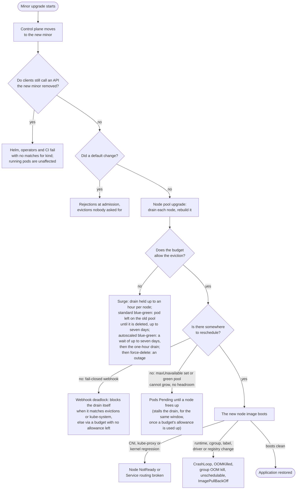

# Upgrade failure catalogue: what a GKE minor upgrade breaks, and the signal for each

**Status:** requirements. The checks this list feeds are specified, and credited where built, in
[`upgrade-readiness-checks.md`](upgrade-readiness-checks.md).

A GKE minor upgrade does two things to a running application. It replaces the API server with a
newer one that may refuse requests the old one accepted, and it drains and rebuilds every node, so
every pod is killed and rescheduled once. Nearly every upgrade outage is one of those two events
landing on something that assumed it would never happen. This document lists those failures, with
the read-only signal that predicts each one before the upgrade, the signal that confirms it
afterwards, and why it is on the list. The checks a scheduled run should perform are specified in
[`upgrade-readiness-checks.md`](upgrade-readiness-checks.md); this catalogue is the list those
checks are chosen from, and its
[public incidents](upgrade-readiness-checks.md#upgrades-that-went-wrong-in-public) are the evidence
cited below. Each entry except 15 was also planted on a throwaway GKE cluster and the cluster
upgraded; entry 15's symptom was produced on a cluster already on the new behaviour. What happened,
entry by entry, and the scripts that did it are in
[`bench/upgrade-scenarios/README.md`](../../bench/upgrade-scenarios/README.md), and
[`upgrade-failure-reproductions.md`](upgrade-failure-reproductions.md) lines each entry up with its script,
its verdict and what the seeded fleet holds for it.

## For a reader who does not run Kubernetes

A cluster is a group of rented computers, called nodes, that run an application in small pieces,
called pods, under a control program called the API server. An upgrade replaces the control
program with a newer edition and then rebuilds every computer, one at a time, while the
application keeps running. Each rebuild stops the application's pieces on that computer and starts
them again somewhere else. Almost every upgrade outage is one of two things: the newer control
program refuses a request the old one accepted, or the stop-and-restart lands on a piece that
cannot be stopped or restarted safely.

In plain words, here is what can go wrong. The numbers match the technical list further down, so
each item can be followed to its detail.

While the computers are being rebuilt:

1. A safety rule says "never stop this piece". GKE's default kind of rebuild waits an hour for
   it and then stops it anyway; the blue-green kind leaves it running on the old computer until
   the old computers are removed, up to a week later, and then stops it. Either way the
   application goes down.
2. Only if someone changed how GKE rebuilds, so that a computer may go away before its
   replacement exists or the replacements are only added on demand: then there may be no free
   computer to move a piece to, and it waits, offline, until one appears.
3. All copies of a piece live on the same computer or in the same building, so one rebuild takes
   them all down at once.
4. A piece kept data on the computer's own disk, and the rebuild wipes that disk.
5. The allowed maintenance hours are too short for the number of computers, so the fleet sits
   half-upgraded for days.

Once the newer control program is in charge:

6. Tools still speak an old dialect the new control program dropped, and fail with "I do not
   understand that request". The application itself keeps running; the tools that manage it do
   not. GKE holds the automatic upgrade back while it sees such tools; an upgrade started by hand,
   or the forced one when a version reaches the end of its support, does not wait.
7. A gatekeeper that inspects every change is offline, and it was set to "block everything if I
   cannot answer", so nothing new can start, including the pieces the rebuild is trying to move.
8. A rule that used to be off is now on by default, and it rejects or removes pieces that were
   fine yesterday.
9. A feature is marked "going away later". Nothing breaks yet, but it will if nobody moves off
   it in time.
10. Add-ons and tools are too old for the new control program and stop working.
11. On a single-location cluster the control program is unreachable for a few minutes during its
    swap, and automation that does not retry fails.

On the freshly rebuilt computers:

12. A label that pieces used to choose their computer is gone, so they can never be placed.
13. The engine that runs the pieces changed edition, and tools that talked to the old edition,
    or images built for it, stop working.
14. The new computers account for memory differently, and older programs misjudge how much they
    may use and are killed for using too much.
15. When one part of a piece runs out of memory, the system now kills the whole piece instead of
    that one part.
16. Network rules or name lookup behave differently, and some connections drop.
17. The networking helper on each computer fails on the new build, and traffic stops reaching
    the application.
18. The graphics-card driver on the new computers does not match what the application was built
    for.
19. Older storage attachments rely on a helper that is switched off, and the disks cannot be
    attached.
20. The new computers must download their software images from a source that has since closed,
    and cannot.

The rest of this document says, for each of these, how to see it coming, how to recognise it
afterwards, how to prevent or repair it, and whether Google's own advisor for GKE reports it.

## Status at a glance

One row per entry. The first three tables group the entries by the reader that covers the entry's
own failure on `main` today: a scheduled audit, one of the `fleet-upgrade-verification` skill's two
scripts, or the assistant answering a question; the fourth lists every entry against the two
scheduled readers, the daily readiness watch on `main` and the upgrade retrospective, whose collector and weekly job are on `main`, with the Saturday `upgrade-readiness-weekly-review` running the readiness rules over every cluster in scope and registering what they find on the findings queue. Every entry but 1 and 3, and entries 21 to 26, sit in the second group through a readiness rule,
entry 10 for both its halves; the third group is empty. Scenario links to the entry's
section below. Reason says in plain words why the upgrade breaks it. Detection says which reader
finds it and what a stock install ships for it: the cron jobs in `agents/platform/cron/jobs.json`
run the audits on a timer, each audit follows a procedure in `agents/platform/governance/` and
scores its checks with a script under `agents/platform/skills/fleet-audit/scripts/`, and the
`fleet-upgrade-verification` skill's two scripts run when someone asks: the readiness report (`upgrade_readiness.py`,
budgets, exclusions, skew, fail-closed webhooks and the per-entry rules the skill's `references/readiness-rules.md` lists), which the daily cron job `upgrade-readiness-watch` also runs
for a cluster below a version its release channel offers and the Saturday job `upgrade-readiness-weekly-review` runs for every cluster in scope, and the GitOps deprecation scan (`api_deprecation_scan.py`),
which no cron job runs. A skill is a written procedure the assistant follows; a script is code it runs.
The entry's own "Read today" line stays the full statement of what is read and unread; this column
is its summary. Mitigation is the shortest workaround; the entry's section has the full before and
after. Dev Progress names the file on `main` that reads the signal, the registered case or cases that grade it, and the pull request that carries it when it is in review; the
[Scope table](upgrade-readiness-checks.md#scope) in the readiness requirements is the canonical
record of what is built, and this column adds the case and the in-review item. The column is re-read
against `main` at each merge of `main` into a branch that edits it, because a pull request it lists as
in review can merge under the branch. Every entry has at least one
nightly evaluation case, registered where the column names one that grades the entry and planned otherwise, and the
tables under "How each failure is tested" say row by row whether its fixture exists, so the column
repeats neither. Two
parts of this section change as work merges: the column's in-review items, and the fourth table,
"Gap to scheduled coverage", whose cells say what the daily readiness watch (`upgrade-readiness-watch`, on `main`) and the
upgrade retrospective (its collector on `main`; the weekly job and SOP that run it in #3196, in review) cover before and after an upgrade and what is left to
build. The column and the table were last reconciled on 2026-10-22.

### A scheduled audit files it, without anyone asking

| Scenario                                                                                       | Reason                                                                                                                                                                    | Detection                                                                                                                                                                                                                                                                                                                                                                                                                                                                                                                                                                                                                                                                      | Mitigation                                                                                                                                                                                 | Dev Progress                                                                                                                                                                                                                                                                                                                                                                                                                                                                                                                                                                                                                                                                                                                                                                                   |
| ---------------------------------------------------------------------------------------------- | ------------------------------------------------------------------------------------------------------------------------------------------------------------------------- | ------------------------------------------------------------------------------------------------------------------------------------------------------------------------------------------------------------------------------------------------------------------------------------------------------------------------------------------------------------------------------------------------------------------------------------------------------------------------------------------------------------------------------------------------------------------------------------------------------------------------------------------------------------------------------ | ------------------------------------------------------------------------------------------------------------------------------------------------------------------------------------------ | ---------------------------------------------------------------------------------------------------------------------------------------------------------------------------------------------------------------------------------------------------------------------------------------------------------------------------------------------------------------------------------------------------------------------------------------------------------------------------------------------------------------------------------------------------------------------------------------------------------------------------------------------------------------------------------------------------------------------------------------------------------------------------------------------- |
| [1. A PodDisruptionBudget forbids the eviction](#1-a-poddisruptionbudget-forbids-the-eviction) | A protection rule says the application's only copy may never be taken down, so the machine it runs on cannot be emptied; the upgrade waits, then removes the copy anyway. | Daily obtainability audit files it as `blocking-pdb`; the on-request readiness report grades the cluster `blocked`. Out of the box: the cron job `obtainability-audit` (daily 06:50 UTC, `agents/platform/cron/jobs.json`) runs the `fleet-audit` skill, whose `collect.py` script computes `blocking-pdb`. The readiness report is the `fleet-upgrade-verification` skill's `upgrade_readiness.py` script, run when asked, by the daily cron job `upgrade-readiness-watch` for a cluster below a version its release channel offers, and by the Saturday job `upgrade-readiness-weekly-review` for every cluster in scope, which registers the finding on the findings queue. | Give the rule room: allow one copy to be unavailable or run a second copy; for a true singleton, take the outage inside a maintenance window or use a blue-green upgrade with a long soak. | Shipped: `agents/platform/skills/fleet-upgrade-verification/scripts/upgrade_readiness.py`, `agents/platform/governance/obtainability_audit_sop.md` §3.4, `agents/platform/skills/fleet-audit/scripts/patch_readiness.py` check 3.11 `upgrade-blocked` (`agents/platform/governance/security_patch_orchestrator_sop.md` §3.11, the weekly join of the readiness grade to the audit), case `bench/tasks/upgrades-fleet-readiness-exclusion` (nightly), which grades the drain-blocking budget alongside the exclusion, case `bench/tasks/upgrades-drain-blocking-budget-named` (nightly), which asks for the budget outright and grades its declared line, and case `bench/tasks/upgrades-audit-reports-upgrade-blocked` (nightly), which grades the weekly upgrade audit's issue in the ledger. |
| [3. Every replica in one zone or on one node](#3-every-replica-in-one-zone-or-on-one-node)     | Copies meant to back each other up sit on the same machine or in the same zone, so one rebuild takes all of them at once.                                                 | Daily obtainability audit (`rigid-scheduling`, `no-spread`, `spread-not-achieved`). Out of the box: the cron job `obtainability-audit` (daily 06:50 UTC) runs the `fleet-audit` skill's `collect.py`, which computes all three checks.                                                                                                                                                                                                                                                                                                                                                                                                                                         | Spread rules across zones and machines, plus a budget so the drain waits between copies.                                                                                                   | Shipped: `agents/platform/governance/obtainability_audit_sop.md` §3.7, §3.8, §3.19, and case `bench/tasks/upgrades-zonal-skew-replicas-warned` (nightly), asked in conversation.                                                                                                                                                                                                                                                                                                                                                                                                                                                                                                                                                                                                               |

### A script in the `fleet-upgrade-verification` skill covers it, in whole or in part, when someone asks about an upgrade

| Scenario                                                                                                                                                           | Reason                                                                                                                                                                                                            | Detection                                                                                                                                                                                                                                                                                                                                                                                                                                                                                                                                                                                                                                                                                                                                                                                                                                                                                                                                                                                                                                                                                                                |
| ------------------------------------------------------------------------------------------------------------------------------------------------------------------ | ----------------------------------------------------------------------------------------------------------------------------------------------------------------------------------------------------------------- | ------------------------------------------------------------------------------------------------------------------------------------------------------------------------------------------------------------------------------------------------------------------------------------------------------------------------------------------------------------------------------------------------------------------------------------------------------------------------------------------------------------------------------------------------------------------------------------------------------------------------------------------------------------------------------------------------------------------------------------------------------------------------------------------------------------------------------------------------------------------------------------------------------------------------------------------------------------------------------------------------------------------------------------------------------------------------------------------------------------------------ |
| [5. Maintenance window too short, or an exclusion ends mid-roll](#5-maintenance-window-too-short-or-an-exclusion-ends-mid-roll)                                    | The upgrade is only allowed in a short daily slot or is held by a calendar freeze, so a pool runs two versions for days, or the freeze ends in the middle of a planned change.                                    | The on-request readiness report grades the covering exclusion; the Monday security-patch audit reads the window and exclusions (`no-maintenance-window`, `blocking-exclusion`). Out of the box: the readiness report is the `fleet-upgrade-verification` skill's `upgrade_readiness.py`, run when asked and by the daily cron job `upgrade-readiness-watch` for a cluster below a version its release channel offers. The cron job `security-patch-orchestrator` (Monday 07:20 UTC) runs `patch_readiness.py`, which scripts both checks; its `blocking-exclusion` never flags `NO_MINOR_UPGRADES`, and flags a `NO_UPGRADES` or `NO_MINOR_OR_NODE_UPGRADES` freeze only when it ends more than 30 days out or the cluster already carries a version finding, so the readiness report is the one that grades the covering exclusion against the target.                                                                                                                                                                                                                                                                  |
| [6. A served API version is removed](#6-a-served-api-version-is-removed)                                                                                           | The new control program stops answering an old form of request; tools still asking the old way fail, while running applications are untouched.                                                                    | The readiness report's `removed-api-callers` rule (`readiness_rules/removed_api_callers.py`): a paged `gcloud logging read` per cluster over the last seven days of the audit log, writes only, for the `k8s.io/removed-release` stamps; an operator caller of an API the target removes that wrote in the last 48 hours blocks, named with its principal, user agent, API and release; one silent for longer, a provider caller and a removal after the target are risks. The GitOps scan (`api_deprecation_scan.py`) reads the manifests. GKE's deprecation insight is quoted as a command for a human because the agent's `gcloud` allowlist excludes it. Out of the box: the rule runs under the `fleet-upgrade-verification` skill's `--readiness`, on request and daily under the `upgrade-readiness-watch` cron job when a cluster is below a version its channel offers; the scan runs when asked over a linked GitOps repository, and no cron job runs it.                                                                                                                                                      |
| [7. A fail-closed webhook whose backend is not up](#7-a-fail-closed-webhook-whose-backend-is-not-up)                                                               | A gatekeeper rejects every request when it cannot be reached; during the rebuild it is unreachable, so replacement pieces are refused and the drain wedges.                                                       | The on-request readiness report grades it: a fail-closed webhook whose backend the API server cannot reach is `blocked` when its rules reach a write the node drain or join makes or a bootstrap RBAC write a new master reconciles, and a current outage otherwise. Out of the box: the readiness report is the `fleet-upgrade-verification` skill's `upgrade_readiness.py`, run when asked and by the daily cron job `upgrade-readiness-watch` for a cluster below a version its release channel offers; after the fact, the stuck-upgrade steps are prose in the `gke-upgrades` skill, no script.                                                                                                                                                                                                                                                                                                                                                                                                                                                                                                                     |
| [10. Add-on and client skew](#10-add-on-and-client-skew)                                                                                                           | Operators and command-line tools each support a range of server versions; the control program moves past that range and they stop working.                                                                        | The readiness report grades node-pool skew (`upgrade_readiness.py`) and, through its `client-addon-skew` rule (`readiness_rules/client_addon_skew.py`), kubectl clients from the audit log's user agents and from kubectl images against the target's one-minor window, and third-party add-on images against a sourced support table, an add-on with no table noted rather than graded; GKE-managed add-ons expose no version and are listed, not graded. The Monday audit (`pool-skew`) covers pools too far behind. Out of the box: both readiness rules run under `--readiness`, on request and daily under the `upgrade-readiness-watch` cron job when a cluster is below a version its channel offers; `patch_readiness.py` runs under the Monday `security-patch-orchestrator` cron job (`pool-skew`).                                                                                                                                                                                                                                                                                                            |
| [11. The control plane is unreachable for minutes on a zonal cluster](#11-the-control-plane-is-unreachable-for-minutes-on-a-zonal-cluster)                         | A single-zone cluster has one control program and it is replaced during the upgrade; anything that does not retry fails for those minutes.                                                                        | The on-request readiness report carries a zonal control plane as a risk on every member (`zonal-control-plane`), never a blocker, with the retry advice; the cluster inventory audit, run once per cluster by the onboarding sweep, records each control plane's location, and the `gke-upgrades` skill's prose recommends regional control planes when asked. Out of the box: `readiness_rules/zonal_control_plane.py` under the `fleet-upgrade-verification` skill, on request and daily under the `upgrade-readiness-watch` cron job when a cluster is below a version its channel offers.                                                                                                                                                                                                                                                                                                                                                                                                                                                                                                                            |
| [2. No spare capacity for the displaced pods](#2-no-spare-capacity-for-the-displaced-pods)                                                                         | The machine pool is set to remove a machine before its replacement exists, and there is no room elsewhere, so the moved pieces wait with nowhere to run.                                                          | The on-request readiness report grades the pool (`surge-capacity`): a pool whose upgrade settings remove a node before its replacement exists, measured by placing the pods of each of its nodes onto the nodes their selectors, affinity and tolerations admit, blocks when the pool cannot grow and a pod has no node to take it, is a risk when a pod is stranded but the pool keeps some surge or can grow, and is a note when every pod is placed; the same rule grades a pool with accelerators that surges with no reservation affinity a risk (the upgrade waits for the accelerator with the old node serving) and blocks a Pod range whose free per-node blocks are fewer than the surge nodes its pools need; the stockout audit reads quota and autoscaler ceilings (`quota-exhaustion-risk`, `single-zone-nodepool`). Out of the box: the readiness report is the `fleet-upgrade-verification` skill's `upgrade_readiness.py` with `readiness_rules/capacity.py`, on request and daily under the `upgrade-readiness-watch` cron job when a cluster is below a version its channel offers; the daily `stocko |
| [4. Data on the node is gone](#4-data-on-the-node-is-gone)                                                                                                         | A rebuilt machine is a new machine; anything kept only on its local disk is lost.                                                                                                                                 | The readiness report lists it as a risk. Its data-on-the-node rule reads every Deployment and StatefulSet outside the system namespaces for state rather than scratch: a StatefulSet's `emptyDir`, a writable `hostPath`, a Local SSD path or a claim on a local StorageClass is a risk, named with the workload and the volume; a Deployment's `emptyDir` is a note. Out of the box: `readiness_rules/node_local_state.py` under the `fleet-upgrade-verification` skill, on request and daily under the `upgrade-readiness-watch` cron job when a cluster is below a version its channel offers. The Monday `fleet-wide-cost-analysis` job's `fleet_waste.py` reads these volumes as scale-down blockers only.                                                                                                                                                                                                                                                                                                                                                                                                          |
| [8. A default changes in the new minor](#8-a-default-changes-in-the-new-minor)                                                                                     | The new version turns a rule on by default; a piece accepted yesterday is rejected today although nothing on your side changed.                                                                                   | The readiness report's `changed-defaults` rule (`readiness_rules/changed_defaults.py`): it reads each namespace's Pod Security Admission labels and flags a namespace at `enforce-version: latest`, or unpinned, whose level a crossed minor tightens, from the per-minor table in `upgrade_shape_tables.py`; workloads with `gitRepo` volumes the same way. A target past the table is graded on the minors the table covers, with a note. Out of the box: the rule runs under `--readiness`, on request and daily under the `upgrade-readiness-watch` cron job when a cluster is below a version its channel offers.                                                                                                                                                                                                                                                                                                                                                                                                                                                                                                   |
| [9. A feature is deprecated but still served](#9-a-feature-is-deprecated-but-still-served)                                                                         | Nothing breaks yet; the warning count is the early notice of a removal several versions away.                                                                                                                     | The readiness report's `deprecated-api-callers` rule (`readiness_rules/deprecated_api_callers.py`): its own paged `gcloud logging read` beside entry 6's, writes only, for the audit log's `k8s.io/deprecated` stamps; each operator caller is a risk named with its principal, user agent and API, and the provider's callers are excluded or counted, not filed. Out of the box: the rule runs under `--readiness`, on request and daily under the `upgrade-readiness-watch` cron job when a cluster is below a version its channel offers.                                                                                                                                                                                                                                                                                                                                                                                                                                                                                                                                                                            |
| [12. A node label is removed](#12-a-node-label-is-removed)                                                                                                         | An application insists on machines carrying a label the new machines no longer have, so it is never placed again.                                                                                                 | The readiness report grades it. Its removed-node-label rule reads every template's `nodeSelector` and node affinity against the Node list: a label whose drop a selected pool crosses in this upgrade blocks, a drop the pool passed already is a note, a label that no pool's configuration defines and no node carries today is a risk (a key GKE sets from the pool's configuration, the accelerator label among them, is a pool shape and never this rule's risk), and a deprecated beta label the kubelet still sets is a risk named with its GA replacement. Out of the box: `readiness_rules/removed_node_label.py` under the `fleet-upgrade-verification` skill, on request and daily under the `upgrade-readiness-watch` cron job when a cluster is below a version its channel offers.                                                                                                                                                                                                                                                                                                                         |
| [13. The container runtime changes](#13-the-container-runtime-changes)                                                                                             | The engine that runs containers moves a major version; agents wired to its old socket or API, and images in an old format, stop working.                                                                          | The on-request readiness report pairs the containerd major each pool's nodes report with the major the target's node image ships (`upgrade_shape_tables.py`) and the pods mounting the runtime socket (`container-runtime`): a risk when a pool's major changes under a socket client, a note otherwise; the Monday security-patch audit flags a stale image type (`stale-image-type`) and the compliance audit the socket mount as a security finding (`hostpath-mount`). Out of the box: `readiness_rules/container_runtime.py` on request and daily under the `upgrade-readiness-watch` cron job when a cluster is below a version its channel offers; `patch_readiness.py` under the Monday `security-patch-orchestrator` job and `collect.py` under the daily `compliance-audit` job (06:20 UTC). Image schemas and containerd configuration overrides have no script.                                                                                                                                                                                                                                              |
| [14. cgroup v2 under a runtime that cannot read it](#14-cgroup-v2-under-a-runtime-that-cannot-read-it)                                                             | Old Java and .NET read their memory limit from a path the new machines no longer have, see the whole machine's memory instead, and are killed for using too much.                                                 | The readiness report grades it. Its cgroup-v2-runtime rule reads each Java and .NET image tag against the cgroup v2 floors (JDK 8u372, 11.0.16, 15; .NET 5.0) and each pool's `effectiveCgroupMode` against the target: a runtime below the floor on a pool the target moves to cgroup v2 is a risk, a known runtime whose tag names no version is unknown on such a pool, and a pool already on cgroup v2 is a note. Out of the box: `readiness_rules/cgroup_v2_runtime.py` under the `fleet-upgrade-verification` skill, on request and daily under the `upgrade-readiness-watch` cron job when a cluster is below a version its channel offers.                                                                                                                                                                                                                                                                                                                                                                                                                                                                       |
| [15. The OOM killer starts killing the whole container](#15-the-oom-killer-starts-killing-the-whole-container)                                                     | Running out of memory now kills the whole container instead of the one worker that overran, so containers that used to shrug it off die outright.                                                                 | The readiness report grades it as a heuristic. Its group-oom-kill rule reads the command and the image for a supervisor, a forking shell script or a known multi-process base, and the pool for a move to cgroup v2 or a kubelet crossing 1.28: a risk, never a blocker, because the process count is not readable from the API. Out of the box: `readiness_rules/group_oom_kill.py` under the `fleet-upgrade-verification` skill, on request and daily under the `upgrade-readiness-watch` cron job when a cluster is below a version its channel offers.                                                                                                                                                                                                                                                                                                                                                                                                                                                                                                                                                               |
| [16. The network dataplane changes](#16-the-network-dataplane-changes)                                                                                             | How traffic rules, DNS or specific flows are handled changes; rules that were never enforced start blocking traffic.                                                                                              | The on-request readiness report flags NetworkPolicies no dataplane enforces (`network-dataplane`): a legacy-dataplane cluster with the network policy add-on off and policies in its namespaces is a risk naming the namespaces, the shape GKE's recommender files as `NETWORK_POLICIES_UNRECONCILED`; the Monday drift audit compares each cluster's dataplane and network-policy settings with its peers (`datapath-provider`), and the compliance audit flags namespaces with no policy (`netpol-missing`). Out of the box: `readiness_rules/dataplane.py` on request and daily under the `upgrade-readiness-watch` cron job when a cluster is below a version its channel offers; `fleet_drift.py` under the Monday `fleet-consistency-drift` job (08:20 UTC) and `collect.py` under the daily `compliance-audit` job. The DNS provider and how a policy behaves after a change have no script.                                                                                                                                                                                                                      |
| [17. A node networking agent fails on the new image](#17-a-node-networking-agent-fails-on-the-new-image)                                                           | The per-machine network plugin depends on the machine's labels or kernel; the new image changes them and traffic to services stops on rebuilt machines.                                                           | The readiness report lists it as a risk. Its node-image-coupled-agent rule reads every host-network DaemonSet outside the system and managed-agent namespaces for a selector on a node-image label, a mount of the kernel module tree or the network plugin's directories, or a command that loads a kernel module, and names the pools the target rebuilds. Out of the box: `readiness_rules/node_image_coupled_agent.py` under the `fleet-upgrade-verification` skill, on request and daily under the `upgrade-readiness-watch` cron job when a cluster is below a version its channel offers. The daily `compliance-audit` job's `collect.py` flags the host namespace and host-path mount (`host-namespace`, `hostpath-mount`) as security findings.                                                                                                                                                                                                                                                                                                                                                                 |
| [18. GPU driver mismatch](#18-gpu-driver-mismatch)                                                                                                                 | The new machine image ships a different GPU driver than the one the job's CUDA build needs, so the GPU cannot be opened.                                                                                          | The readiness report grades it. Its gpu-driver rule reads the CUDA version from each GPU workload's image tag or a CUDA-named env value, and the driver from the pools carrying the selected accelerator, at the target's minor in GKE's driver table: a target driver below the CUDA major's floor blocks when the pool's running node image serves the pin and is a risk when the pool already falls below it today, one below the toolkit's own minimum is a risk, and an unreadable driver is a risk or unknown with the reason. Out of the box: `readiness_rules/gpu_driver_mismatch.py` under the `fleet-upgrade-verification` skill, on request and daily under the `upgrade-readiness-watch` cron job when a cluster is below a version its channel offers. The `gke-upgrades` skill's prose still hands the forward-compatibility check to the operator.                                                                                                                                                                                                                                                        |
| [19. In-tree volumes lose their CSI path](#19-in-tree-volumes-lose-their-csi-path)                                                                                 | Disks attached the old way only work through a driver add-on; with the add-on off they stop attaching.                                                                                                            | The on-request readiness report reads every PersistentVolume with an in-tree `gcePersistentDisk` source against the cluster's PD CSI driver add-on (`in-tree-volumes`): with the add-on off a volume a workload mounts blocks, naming the volume and the workload, and an unmounted one is a risk; with the add-on on every in-tree volume is a risk. Out of the box: `readiness_rules/intree_volumes.py` on request and daily under the `upgrade-readiness-watch` cron job when a cluster is below a version its channel offers; the Monday `fleet-wide-cost-analysis` job's `fleet_waste.py` reads disks for cost only. StorageClasses naming the in-tree provisioner are unread.                                                                                                                                                                                                                                                                                                                                                                                                                                      |
| [20. Images on a retired registry](#20-images-on-a-retired-registry)                                                                                               | Old machines had the image cached; new machines must download it from a site that no longer publishes.                                                                                                            | The readiness report lists it as a risk: the hosts still answer a pull today, `k8s.gcr.io` by a redirect to registry.k8s.io. Its retired-registry rule reads every template's containers and init containers for an image on `k8s.gcr.io`, `gcr.io/google-containers`, `gcr.io/google_containers` or `gcr.io/kubernetes-helm`, and names the host, what it does today and the pools the target rebuilds. Out of the box: `readiness_rules/retired_registry.py` under the `fleet-upgrade-verification` skill, on request and daily under the `upgrade-readiness-watch` cron job when a cluster is below a version its channel offers. The daily `compliance-audit` job's `collect.py` reads image references for floating tags only (`image-floating-tag`).                                                                                                                                                                                                                                                                                                                                                               |
| [21. The load balancer's connection drain outlasts the node's deregistration wait](#21-the-load-balancers-connection-drain-outlasts-the-nodes-deregistration-wait) | The load balancer is told to let connections finish for longer than the platform waits before it removes the machine, so every machine's removal waits the whole wait and then times out.                         | The on-request readiness report grades it: `lb-connection-draining` files a blocker per backend service on the cluster's pools or NEGs whose draining timeout is above the 600-second wait, with the command that lowers it. Out of the box: `readiness_rules/lb_connection_draining.py` under the `fleet-upgrade-verification` skill, on request and daily under the `upgrade-readiness-watch` cron job when a cluster is below a version its channel offers.                                                                                                                                                                                                                                                                                                                                                                                                                                                                                                                                                                                                                                                           | A draining timeout at or under 600 seconds on every backend service in front of the pools.                                                                            | Shipped: `readiness_rules/l |
| [22. A Node object outlives its virtual machine](#22-a-node-object-outlives-its-virtual-machine)                                                                   | The cluster still lists a machine that no longer exists, and the upgrade waits for it.                                                                                                                            | The on-request readiness report grades it: `orphan-node-objects` joins the Nodes to the project's instances and files a blocker per Node with no instance behind it, with the delete command; its note counts nodes against instances on every member. Out of the box: `readiness_rules/orphan_node_objects.py` under the `fleet-upgrade-verification` skill, on request and daily under the `upgrade-readiness-watch` cron job when a cluster is below a version its channel offers.                                                                                                                                                                                                                                                                                                                                                                                                                                                                                                                                                                                                                                    | Delete the orphan Node object; nothing runs on it.                                                                                                                    | Shipped: `readiness_rules/o |
| [23. A control-plane upgrade or resize fails on regional compute capacity](#23-a-control-plane-upgrade-or-resize-fails-on-regional-compute-capacity)               | The provider needs free machines in the region at the moment an automatic control-plane upgrade, resize or repair fires, and does not check first, so the attempt fails and the control plane stays where it was. | The on-request readiness report grades it: `control-plane-upgrade-history` files each `UPGRADE_MASTER`, `UPGRADE_NODES` or `REPAIR_CLUSTER` operation on the cluster or its pools that failed on compute capacity in the last 90 days, with the operation's date and the cluster's maintenance window: a risk when the cluster has no window or its window opens in the region's busy hours (06:00 to 21:00 in the region's standard local time), a note asking for the retry in the window when it opens off-peak; its note counts the failures on every member. Out of the box: `readiness_rules/control_plane_upgrade_history.py` under the `fleet-upgrade-verification` skill, on request and daily under the `upgrade-readiness-watch` cron job when a cluster is below a version its channel offers.                                                                                                                                                                                                                                                                                                               | A maintenance window in an off-peak hour for the region, the upgrade retried in it, and upgrade notifications consumed so a failed attempt is a message the same day. | Shipped: `readiness_rules/c |
| [24. A cluster held in a long reconcile](#24-a-cluster-held-in-a-long-reconcile)                                                                                   | The cluster is still busy with an earlier change that never finished, and it takes no new change until that one ends.                                                                                             | The on-request readiness report grades it: `cluster-status-age` files a blocker for a cluster not `RUNNING` whose holding operation has run for more than four hours, naming the operation, or whose status stands with no operation of its own in flight, quoting its `statusMessage`; a younger holder is a note. Out of the box: `readiness_rules/cluster_status_age.py` under the `fleet-upgrade-verification` skill, on request and daily under the `upgrade-readiness-watch` cron job when a cluster is below a version its channel offers.                                                                                                                                                                                                                                                                                                                                                                                                                                                                                                                                                                        | Do not start the upgrade; freeze changes, open the support case quoting the operation id, and re-check once the status settles.                                       | Shipped: `readiness_rules/c |
| [25. The target patch is withdrawn before the window](#25-the-target-patch-is-withdrawn-before-the-window)                                                         | The version the plan named is no longer offered when the window opens, but it can still be asked for, and the move to it fails.                                                                                   | The on-request readiness report grades it: `target-patch-valid` blocks a target the cluster's channel no longer lists at the location (`validVersions`, and `validNodeVersions` for a pool move alone) and files a risk when the channel has moved past the running control-plane patch, naming the newest active patch of the minor. Out of the box: `readiness_rules/target_patch_valid.py` under the `fleet-upgrade-verification` skill, on request and daily under the `upgrade-readiness-watch` cron job when a cluster is below a version its channel offers.                                                                                                                                                                                                                                                                                                                                                                                                                                                                                                                                                      | Target the newest active patch of the minor on the channel, or hold when none is active.                                                                              | Shipped: `readiness_rules/t |
| [26. A known issue in an add-on at the target version](#26-a-known-issue-in-an-add-on-at-the-target-version)                                                       | The new version carries a bug the provider has already published, in one of the helper programs it runs on every cluster, and a fleet that moves all at once meets it everywhere at once.                         | The on-request readiness report grades it: `known-issues-matrix` inventories the managed add-ons (`kube-system` and `gmp-system` DaemonSets and Deployments by image and tag) and files a risk per published known issue at the running or the target patch, with the fix, and a risk when its table is more than thirty days old. Out of the box: `readiness_rules/known_issues_matrix.py` with `scripts/known_issues.json` under the `fleet-upgrade-verification` skill, on request and daily under the `upgrade-readiness-watch` cron job when a cluster is below a version its channel offers.                                                                                                                                                                                                                                                                                                                                                                                                                                                                                                                       | Upgrade the matched add-on to the fixed-in version before the window, or hold the cluster at a version the issue does not cover.                                      | Shipped: `readiness_rules/k |

### Only when someone asks about the cluster or the workload

No entry. Every entry has a reader on `main`: a scheduled audit for 1 and 3, a readiness rule for
the rest. An entry moves back here when its rule is removed.

### Gap to scheduled coverage

The goal is that every entry is caught without a request. Scheduled readers do that. The
Saturday job `upgrade-readiness-weekly-review` runs the readiness report over every cluster in scope
and registers each blocker and risk on the findings queue, which reminds until the user dismisses,
snoozes or accepts it. The daily
job `upgrade-readiness-watch` (`agents/platform/cron/jobs.json`, 10:10 UTC) runs the readiness report's rules before an
upgrade, for a cluster below a version its release channel offers. The weekly job `upgrade-retrospective` (its [design](upgrade-retrospective.md)) runs
after one; its collector matches symptoms to this list, and it also reads a set of risk shapes on
every cluster it reviews and writes them as guards for the readiness watch to print. "Rule" means a
rule in the readiness report, run daily with the target version known and every Saturday against each cluster's channel default; the entry's own section says
what such a rule reads (its "Before" line), the `fleet-upgrade-verification` skill's `references/readiness-rules.md` lists
the rules built, and the [Scope table](upgrade-readiness-checks.md#scope) credits them. "Signature"
means a row in the retrospective's symptom table ([its design](upgrade-retrospective.md#34-classification-by-signature-with-the-evidence-attached)). "Shape" means one of the
collector's static risk reads. The "To build" column names the reader an entry still lacks, with a
qualifier where one row needs it; the tables under "How each failure is tested" own which fixtures
exist.

| Entry | Before: daily readiness watch                                                                                           | After: upgrade retrospective                                                                                                                                                                                     | To build                                                                                                                                               |
| ----- | ----------------------------------------------------------------------------------------------------------------------- | ---------------------------------------------------------------------------------------------------------------------------------------------------------------------------------------------------------------- | ------------------------------------------------------------------------------------------------------------------------------------------------------ |
| 1     | Budget rule shipped; the watch runs it.                                                                                 | Signature: a budget with no allowance on a drained node.                                                                                                                                                         | The weekly job that runs the collector.                                                                                                                |
| 2     | Surge-capacity rule shipped; the watch runs it.                                                                         | Signature: Pending for capacity after a pool operation.                                                                                                                                                          | The weekly job that runs the collector.                                                                                                                |
| 3     | None; the daily obtainability audit files it on its own schedule.                                                       | Signature: every pod of a multi-replica workload on one drained pool, `Available=False` inside the operation ([§3.4](upgrade-retrospective.md#34-classification-by-signature-with-the-evidence-attached)).       | The weekly job that runs the collector.                                                                                                                |
| 4     | Data-on-the-node rule shipped; the watch runs it.                                                                       | No signature; shape: stateful `emptyDir` and local SSD volumes.                                                                                                                                                  | The weekly job that runs the collector, and the watch printing its guard.                                                                              |
| 5     | Maintenance rule shipped; the watch runs it.                                                                            | Signature: a pool more than one minor behind its control plane for seven days or longer, from the cluster describe ([§3.4](upgrade-retrospective.md#34-classification-by-signature-with-the-evidence-attached)). | The weekly job that runs the collector.                                                                                                                |
| 6     | Removed-API rule shipped; the watch runs it.                                                                            | Signature: `no matches for kind`, a removed API named.                                                                                                                                                           | The weekly job that runs the collector; the exception below: no fixture of its own can be standing.                                                    |
| 7     | Webhook rule shipped; the watch runs it.                                                                                | Signature: `failed calling webhook`.                                                                                                                                                                             | The weekly job that runs the collector.                                                                                                                |
| 8     | Changed-defaults rule shipped; the watch runs it.                                                                       | No signature.                                                                                                                                                                                                    | Nothing.                                                                                                                                               |
| 9     | Deprecated-API rule shipped; the watch runs it.                                                                         | No signature; nothing breaks yet.                                                                                                                                                                                | Nothing.                                                                                                                                               |
| 10    | Pool skew and client/add-on skew rules shipped; the watch runs them.                                                    | No signature.                                                                                                                                                                                                    | Nothing.                                                                                                                                               |
| 11    | Zonal rule shipped; the watch runs it.                                                                                  | No signature.                                                                                                                                                                                                    | Nothing.                                                                                                                                               |
| 12    | Removed-node-label rule shipped; the watch runs it.                                                                     | Signature: a selector miss; shape: deprecated label prefixes.                                                                                                                                                    | The weekly job that runs the collector.                                                                                                                |
| 13    | Container-runtime rule shipped; the watch runs it.                                                                      | No signature; shape: a DaemonSet mounting the container engine socket.                                                                                                                                           | The weekly job that runs the collector.                                                                                                                |
| 14    | cgroup-v2-runtime rule shipped; the watch runs it.                                                                      | Signature: `OOMKilled` on a cgroup v2 pool; shape: old runtime images.                                                                                                                                           | The weekly job that runs the collector.                                                                                                                |
| 15    | Group-OOM-kill rule shipped, a heuristic on the command and the image; the watch runs it.                               | Signature: `OOMKilled` on a cgroup v2 pool, reported as 14 or 15.                                                                                                                                                | The weekly job that runs the collector.                                                                                                                |
| 16    | Dataplane rule shipped; the watch runs it.                                                                              | No signature.                                                                                                                                                                                                    | Nothing.                                                                                                                                               |
| 17    | Node-image-coupled-agent rule shipped; the watch runs it; the compliance audit still flags host networking as security. | Signature: nodes `NotReady`; shape: `hostNetwork` DaemonSets.                                                                                                                                                    | The weekly job that runs the collector.                                                                                                                |
| 18    | GPU-driver rule shipped for a driver too old for the CUDA build; the watch runs it.                                     | Signature: driver and CUDA errors; shape: CUDA pins on GPU workloads.                                                                                                                                            | The weekly job that runs the collector; the other direction, forward-compatibility libraries under a newer driver, is not readable from the image tag. |
| 19    | In-tree volume rule shipped; the watch runs it.                                                                         | Signature: volume affinity, attach and mount errors; shape: in-tree PDs.                                                                                                                                         | The weekly job that runs the collector.                                                                                                                |
| 20    | Retired-registry rule shipped; the watch runs it.                                                                       | Signature: a pull failure on rebuilt nodes only; shape: retired hosts.                                                                                                                                           | The weekly job that runs the collector.                                                                                                                |
| 21    | Rule shipped (`lb-connection-draining`); the watch runs it.                                                             | No signature.                                                                                                                                                                                                    | Nothing.                                                                                                                                               |
| 22    | Rule shipped (`orphan-node-objects`); the watch runs it.                                                                | No signature.                                                                                                                                                                                                    | Nothing.                                                                                                                                               |
| 23    | Rule shipped (`control-plane-upgrade-history`); the watch runs it.                                                      | No signature.                                                                                                                                                                                                    | Nothing.                                                                                                                                               |
| 24    | Rule shipped (`cluster-status-age`); the watch runs it.                                                                 | No signature.                                                                                                                                                                                                    | Nothing.                                                                                                                                               |
| 25    | Rule shipped (`target-patch-valid`); the watch runs it.                                                                 | No signature.                                                                                                                                                                                                    | Nothing.                                                                                                                                               |
| 26    | Rule shipped (`known-issues-matrix`); the watch runs it.                                                                | No signature.                                                                                                                                                                                                    | Nothing.                                                                                                                                               |

Two things cross every row. The fact tables the rules and the collector's shapes both read (dropped
labels, runtime floors, retired hosts, driver and CUDA support) go in one module in the
`fleet-upgrade-verification` skill, built with the first rules. The watch reading the collector's guards is its own change,
to follow the weekly job that runs the collector. Every rule lands with unit tests and a nightly case graded on a declared
line. Entry 6 is the exception: no fixture of its own can be standing (its section says why), so its
rule is unit-tested on a captured audit-log sample and its live stand-in is entry 9's
`deprecated-api-caller`. As the work merges, a cell here becomes "Nothing" and the entry's row above moves
to the reader that files it.

## The list

A signal marked _before_ is something a read-only check can observe on the cluster, in the GKE
API or in the target version's release notes before any upgrade is scheduled. A signal marked
_after_ is what an operator watching the operation, the pods and a service probe sees when the
failure happens. The tag after each entry says where the before-signal is read: `GKE` is the GKE
and Compute Engine APIs and Recommender through `gcloud`, `k8s` is the Kubernetes API through `kubectl get`, `logs` is
Cloud Logging audit logs, `metrics` is the API server's own counters, `git` is the manifests and
charts a GitOps repository declares, `image` is what a container image contains (its runtime,
CUDA build or entrypoint), `notes` is the target version's release notes, node image notes and
vendor support matrices, and `node` is a read-only look inside a node or container. None of the
entries needs application source code. Each entry links to its own section, which names the
evidence: a public incident, the platform documentation that states the behaviour, or a
seeded-fleet fixture. An entry resting on documentation alone says that no public incident is
verified.

During the drain and reschedule:

1. [A PodDisruptionBudget forbids the eviction](#1-a-poddisruptionbudget-forbids-the-eviction):
   a surge upgrade waits an hour for the pod and a blue-green one leaves it on the old pool for up
   to about a week, then GKE deletes it anyway.
   `k8s, GKE`
2. [No spare capacity for the displaced pods](#2-no-spare-capacity-for-the-displaced-pods): on a
   pool configured to allow unavailability, or an autoscaled blue-green pool that cannot grow,
   pods sit Pending until a node frees up. `GKE, k8s`
3. [Every replica in one zone or on one node](#3-every-replica-in-one-zone-or-on-one-node): a
   redundant-looking application loses all replicas at once. `k8s`
4. [Data on the node is gone](#4-data-on-the-node-is-gone): Local SSD and `emptyDir` do not
   survive the rebuild. `k8s`
5. [Maintenance window too short, or an exclusion ends mid-roll](#5-maintenance-window-too-short-or-an-exclusion-ends-mid-roll):
   the pool runs two versions for days. `GKE`

Once the control plane moves:

6. [A served API version is removed](#6-a-served-api-version-is-removed): Helm, operators and CI
   fail with `no matches for kind`. `GKE, logs, metrics, git, k8s`
7. [A fail-closed webhook whose backend is not up](#7-a-fail-closed-webhook-whose-backend-is-not-up):
   nothing can be created or rescheduled where it matches. `k8s`
8. [A default changes in the new minor](#8-a-default-changes-in-the-new-minor): pods rejected or
   evicted by a rule that did not exist before. `notes, k8s`
9. [A feature is deprecated but still served](#9-a-feature-is-deprecated-but-still-served):
   nothing breaks yet; the count is what to track. `logs, k8s`
10. [Add-on and client skew](#10-add-on-and-client-skew): operators and tools that do not support
    the new server. `k8s, GKE, notes`
11. [The control plane is unreachable for minutes on a zonal cluster](#11-the-control-plane-is-unreachable-for-minutes-on-a-zonal-cluster):
    clients without retry fail during the control-plane step. `GKE`

On the new node image:

12. [A node label is removed](#12-a-node-label-is-removed): pods selecting on
    it never schedule. `k8s, notes`
13. [The container runtime changes](#13-the-container-runtime-changes): agents and images built
    for the old containerd stop working. `k8s, GKE`
14. [cgroup v2 under a runtime that cannot read it](#14-cgroup-v2-under-a-runtime-that-cannot-read-it):
    old Java and .NET size their heaps from the host and are OOM-killed. `GKE, node, image`
15. [The OOM killer starts killing the whole container](#15-the-oom-killer-starts-killing-the-whole-container):
    multi-process containers that used to lose one worker now die outright. `GKE, node, image`
16. [The network dataplane changes](#16-the-network-dataplane-changes): policy, DNS or specific
    flows behave differently. `GKE, k8s, notes`
17. [A node networking agent fails on the new image](#17-a-node-networking-agent-fails-on-the-new-image):
    Service routing stops on rebuilt nodes, or cluster-wide. `notes, k8s`
18. [GPU driver mismatch](#18-gpu-driver-mismatch): CUDA containers cannot open the device. `notes, image`
19. [In-tree volumes lose their CSI path](#19-in-tree-volumes-lose-their-csi-path): old
    PersistentVolumes stop attaching. `GKE, k8s`
20. [Images on a retired registry](#20-images-on-a-retired-registry): new nodes cannot pull what
    old nodes had cached. `k8s, git, GKE`

At the node's removal, read from the project's side:

21. [The load balancer's connection drain outlasts the node's deregistration wait](#21-the-load-balancers-connection-drain-outlasts-the-nodes-deregistration-wait):
    every node's removal waits the whole wait and times out. `GKE, k8s`
22. [A Node object outlives its virtual machine](#22-a-node-object-outlives-its-virtual-machine):
    the pool upgrade waits on a node that no longer exists. `k8s, GKE`

Before the window opens, read from the project's side:

23. [A control-plane upgrade or resize fails on regional compute capacity](#23-a-control-plane-upgrade-or-resize-fails-on-regional-compute-capacity):
    the attempt fails at once and the operations list keeps it. `GKE`
24. [A cluster held in a long reconcile](#24-a-cluster-held-in-a-long-reconcile): a cluster not
    `RUNNING` takes no change until the control plane settles. `GKE`
25. [The target patch is withdrawn before the window](#25-the-target-patch-is-withdrawn-before-the-window):
    the withdrawn patch stays selectable and the move to it fails. `GKE`
26. [A known issue in an add-on at the target version](#26-a-known-issue-in-an-add-on-at-the-target-version):
    every cluster that takes the patch meets the published bug at once. `k8s, GKE, notes`

## Where each failure lands in the upgrade

The list groups failures by moment. The diagram draws the paths an upgrade takes through them,
rather than one box per entry, with one fact the list cannot show: which failures hold GKE's drain,
and for how long. A refused eviction holds a surge drain for up to an hour per node; a standard
blue-green upgrade leaves the pod on the old pool until that pool is deleted, up to seven days
later; an autoscaled blue-green upgrade waits up to seven days and then drains under the same
one-hour limit. Every path then removes the pod, and three entries reach that: a budget with no allowance left (1), and
the two cases where replacements never become Ready, because there was nowhere to schedule them (2,
on a pool that allows unavailability or an autoscaled green pool that cannot grow) or a fail-closed
webhook rejected them (7); a budget counts those replacements unavailable, and once its allowance is
used up it refuses the next eviction. A webhook that matches the eviction call itself, or
`kube-system`, blocks the drain with no budget involved. A maintenance window that closes mid-roll
(5) pauses the operation between nodes, and the diagram leaves that case out. Two failures hold the
node's removal rather than its drain, and the diagram leaves them out too: a backend service whose
connection drain outlasts GKE's 600-second deregistration wait holds each node's removal for the
whole wait (21), and a Node object whose instance is gone stops the pool upgrade at that node until
the object is deleted (22). Four more never enter the diagram: a control-plane upgrade or resize
refused for regional capacity (23) and a cluster the API holds in a reconcile (24) stop the
operation before a node is drained, a target the channel withdrew (25) fails the move to it, and
a published add-on issue at the target patch (26) lands after the operation succeeds. Every other failure
lets the upgrade finish, and the break lands afterwards on an upgraded cluster, which is why the
post-upgrade signals are worth reading even when the operation reports success.

## The scenarios

Each section gives the mechanism, the signal before, where to look for it, the signal after, how
to mitigate before and after, what already reads the signal in this repository, what GKE's own
[recommender](https://docs.cloud.google.com/kubernetes-engine/docs/how-to/optimize-with-recommenders)
publishes for it, and why the entry is on the list. The recommender's insights all arrive through
one call, `google.container.DiagnosisInsight` per location, and the disruption-readiness family is
not shown in the console at all, so a check that reads them gets more than the console shows;
which entries it flagged when each was planted is in the reproductions' results table. One
mitigation is general to every after-signal on a node pool: the standard blue-green upgrade
strategy keeps the old nodes until a soak passes and can be rolled back until the blue pool's
deletion begins; an autoscaled blue-green upgrade skips the soak and cannot be rolled back. The
[Scope table](upgrade-readiness-checks.md#scope) in the readiness requirements is the record of
which audit or skill reads what; the "read today" lines here say which of those readers covers
each entry.

### 1. A PodDisruptionBudget forbids the eviction

A node drain evicts pods through the eviction API, and a budget whose `disruptionsAllowed` is 0
refuses every eviction. How long GKE honours that refusal depends on the node pool's upgrade
strategy, and every strategy ends by removing the pod anyway, so the application goes down after a
delay instead of after a clean handover. A surge upgrade respects the budget for up to one hour per
node, then force-evicts. A standard blue-green upgrade leaves the pods it could not evict running on
the cordoned blue pool through the remaining batch soaks and the node-pool soak (one hour by
default; the total is capped at seven days), then deletes them with the blue nodes without
consulting the budget. An autoscaled blue-green upgrade cordons the blue
pool and waits, three days by default and up to seven, while the cluster autoscaler removes the blue
nodes it can empty, then drains the rest, respecting the budget for up to one hour.

- Before: a budget whose `disruptionsAllowed` is 0 for a reason that will not clear, which is
  `maxUnavailable` 0, `minAvailable` equal to the replica count, or a single-replica workload
  behind a budget whose `minAvailable` demands its only pod.
- Where to look: the Kubernetes API: each budget's `spec` and `status`, and the owner's `.spec.replicas` behind it.
- After: on a surge upgrade, and in an autoscaled blue-green upgrade's final drain, the node sits
  `SchedulingDisabled` with the pod still on it, the audit log's `pods/eviction` calls from GKE's
  service agent answered 429, the `UPGRADE_NODES` operation running far longer than one node
  should take, then the pod deleted. On a standard
  blue-green upgrade the pod stays Running on a cordoned blue node through the soak and goes when
  the blue pool is deleted.
- Mitigate before: give the budget room: `maxUnavailable` at least 1 or `minAvailable` below the replica count, and a second replica so the budget can be honoured; for a true singleton, accept the outage inside a maintenance window, or choose a blue-green upgrade and set its soak or wait (up to seven days) long enough to fix the budget or move the workload before GKE deletes the pod; the longer window postpones the outage and does not avoid it. The autoscaled variant is in Preview, needs a control plane on 1.34.0-gke.2201000 or later with cluster autoscaling enabled, starts its green pool empty so it needs the quota to grow (entry 2), and a cancelled one cannot be rolled back.
- Mitigate after: on surge or an autoscaled drain, fix the budget and the stalled drain resumes at once; on a standard blue-green upgrade, fix the budget and evict the pod yourself before the soak ends so it starts on the green pool, or roll the upgrade back; never delete the budget without replacing it, since that trades a stall for an unprotected workload.
- Read today: the readiness mode of `fleet-upgrade-verification` grades it `blocked`, and the obtainability audit reports it as `blocking-pdb`.
- GKE recommender: `PDB_UNPERMISSIVE` flags a budget that allows zero evictions; `DEPLOYMENT_MISSING_PDB` and `PDB_UNPROTECTED_STATEFULSET` flag the opposite gap. All from the [disruption-readiness insights](https://docs.cloud.google.com/kubernetes-engine/docs/how-to/workload-disruption-readiness), reassessed daily.
- Why it is on the list: how long each strategy keeps the pod (an hour per node on surge; the
  soak, at most seven days in total, on standard blue-green; the wait of up to seven days and then
  an hour's drain on autoscaled blue-green) and the removal that ends it are in GKE's
  [node upgrade strategies](https://docs.cloud.google.com/kubernetes-engine/docs/concepts/node-pool-upgrade-strategies).
  The seeded fleet plants one: the `readiness-drain-blocked` role, a `maxUnavailable: 0` budget on
  the one-replica `pinned-batch-runner` Deployment.

### 2. No spare capacity for the displaced pods

This entry needs a pool whose upgrade settings let a node go away before its replacement exists,
`maxUnavailable` above 0, which GKE sets only on request, or an autoscaled blue-green upgrade,
whose green pool starts with no nodes. On GKE's default surge settings,
`maxSurge` 1 and `maxUnavailable` 0, the replacement node is created first, and if it cannot be
(quota, a stockout) the upgrade waits there with the old node still serving. On a pool that allows
unavailability, draining a node only works if the pods it carries can start somewhere else. With no
headroom, an autoscaler at its ceiling or exhausted accelerator quota, they wait for the node that
was just taken away, and a single-replica application has a guaranteed outage. On autoscaled
blue-green the green pool grows only as far as the cluster autoscaler can add nodes, so quota,
the autoscaler's limits or a stockout leave the displaced pods Pending, which GKE lists among that
strategy's limitations.

- Before: a pool whose `upgradeSettings` set `maxUnavailable` above 0 (with or without
  `maxSurge` 0) or that uses the autoscaled blue-green strategy, and then requests already close to
  allocatable minus one node, the autoscaler at its maximum, or accelerator quota exhausted.
- Where to look: the GKE API for the pool's `upgradeSettings`, autoscaler limits, accelerators and reservation affinity, the cluster's Pod range and Compute Engine for accelerator quota; the Kubernetes API for the sum of requests against allocatable and each node's `spec.podCIDR`.
- After: Pending pods with `Insufficient cpu` or `Insufficient nvidia.com/gpu`, autoscaler events
  citing quota.
- Mitigate before: leave the pool on GKE's default surge settings, or return it to them: `maxSurge` at least 1 and `maxUnavailable` 0, with one node of headroom, an autoscaler ceiling and accelerator quota that allow the extra node; for accelerator pools surge is the strategy that fits a small quota, since `maxSurge` 1 needs one extra node's quota while standard blue-green needs a whole second pool's.
- Mitigate after: add a node or raise the ceiling and the Pending pods schedule.
- Read today: the readiness mode of `fleet-upgrade-verification` grades a pool whose upgrade settings remove a node before its replacement exists by placing the pods of each of its nodes onto the nodes their selectors, affinity and tolerations admit, `blocked` when the pool cannot grow and a pod has no node to take it, a risk when a pod is stranded but the pool keeps some surge or can grow, a note when every pod is placed; the same rule blocks a pool with accelerators that surges with no reservation affinity, and a Pod range whose free per-node blocks are fewer than the surge nodes its pools need; the stockout-prevention audit flags regional GPU, TPU and CPU quota near exhaustion and pools near `autoscaling.maxNodeCount`; quota is unread by the readiness rule. A control-plane upgrade, resize or repair that failed on regional capacity is entry 23.
- GKE recommender: partial: `CLUSTER_UNDERPROVISIONED` from the [utilisation insights](https://docs.cloud.google.com/kubernetes-engine/docs/how-to/optimize-cluster-utilization); nothing reads `maxSurge` or quota. The Network Analyzer's separate `google.networkanalyzer.container.ipAddressInsight` covers pod IP exhaustion, which the readiness rule counts against the surge need.
- Why it is on the list: it follows from how a drain works on a pool configured to allow
  unavailability, not from an incident, and it does not arise on GKE's default settings. Measured
  on a test cluster whose GPU pool had `maxSurge` 0 and `maxUnavailable` 1: the only L4 node was
  destroyed, the zone had no L4 to replace it for eight minutes, and GKE reported the operation
  done while the pool was in error. No public story verified; the seeded fleet plants the shape as
  the `readiness-surge-blocked` role, a `maxSurge` 0 pool, with the `readiness-pinned-workload`
  role's one workload pinned to it. Accelerator pools
  are the common case because their quota is small.

### 3. Every replica in one zone or on one node

Replicas protect against losing one node only if they are on different nodes. When they share a
node, or a zone whose nodes roll together, the upgrade takes every replica at once.

- Before: replica placement per Deployment, by zone and by node; missing topology spread or
  anti-affinity.
- Where to look: the Kubernetes API: each pod's node and zone, and the owning Deployment's spread and affinity terms.
- After: availability falls to zero for a workload with more than one replica.
- Mitigate before: `topologySpreadConstraints` across zones and hosts, or pod anti-affinity, and a budget so the drain waits between replicas.
- Mitigate after: the next rollout re-spreads the pods once the constraints are in place.
- Read today: the obtainability audit's spread and pinning checks.
- GKE recommender: none.
- Why it is on the list: a consequence of scheduling, not an incident; no public story verified.
  The seeded fleet plants three shapes of it on its multi-zonal cluster (`zonal-skew-scheduling`,
  `zonal-skew-volume`, `zonal-skew-capacity`).

### 4. Data on the node is gone

A rebuilt node is a new machine. Local SSD and `emptyDir` contents do not come back.

- Before: pods mounting Local SSD or `emptyDir` for anything they cannot rebuild.
- Where to look: the Kubernetes API: volumes on Local SSD storage classes, `hostPath` and `emptyDir`.
- After: application errors reading state, empty caches or queues.
- Mitigate before: state on PersistentVolumes or object storage; Local SSD and `emptyDir` only for what the application can rebuild.
- Mitigate after: restore from the source of truth.
- Read today: the readiness report's data-on-the-node rule
  (`readiness_rules/node_local_state.py`), on every readiness run, as a risk; the fleet waste audit reads
  `emptyDir` and `hostPath` volumes only as scale-down blockers.
- GKE recommender: none.
- Why it is on the list: GKE's statement that Local SSD data does not survive a node upgrade is
  quoted at the end of the readiness requirements'
  [incidents section](upgrade-readiness-checks.md#upgrades-that-went-wrong-in-public); no public
  incident verified. The seeded fleet plants it on seeded-a as the `node-local-state` role.

### 5. Maintenance window too short, or an exclusion ends mid-roll

A surge upgrade pauses when the maintenance window closes and resumes at the next one, so a large
pool can run two versions for days. An exclusion whose scope covers the needed upgrade holds
back the automatic one, while a manual upgrade still runs, and one that ends inside a planned change lets an unplanned upgrade start.

- Before: window length against node count times drain time; an exclusion in effect whose scope
  covers the upgrade the target needs; exclusion end dates inside the planned change.
- Where to look: the GKE API: the cluster's `maintenancePolicy`, its exclusions with their scopes and end dates, and the pool's node count.
- After: the operation still open after the window closes, with mixed node versions in one pool.
  Surge upgrades pause this way; blue-green ones
  [run to completion](https://docs.cloud.google.com/kubernetes-engine/docs/concepts/node-pool-upgrade-strategies).
- Mitigate before: a window long enough for node count times drain time, exclusions that end outside the planned change, and blue-green upgrades where the window is tight.
- Mitigate after: extend the window or finish the upgrade manually so the pool stops running two versions.
- Read today: the readiness mode grades the covering exclusion; the security-patch orchestrator
  reads the window and the exclusions (`no-maintenance-window`, `blocking-exclusion`). A cluster
  held by an operation that has not ended, this entry's after-signal read before the window, is
  entry 24.
- GKE recommender: `CLUSTER_MAINTENANCE_WINDOW_AND_EXCLUSIONS` recommends configuring a window and `CLUSTER_RELEASE_CHANNEL_UNSPECIFIED` a channel; neither checks a window's length against the pool.
- Why it is on the list: a common support case; no single public story verified.

### 6. A served API version is removed

Kubernetes stops serving deprecated API versions on a schedule. Objects already stored survive,
because the server keeps serving them through the versions that remain, but every client still
asking for the removed version fails. The last minor that removed a served version is 1.32, which
dropped `flowcontrol.apiserver.k8s.io/v1beta3`. On GKE the automatic control-plane upgrade does
not take this step while GKE observes calls to an API the next minor removes; the entry stays
because two paths bypass that hold, an operator upgrading by hand past the insight and the forced
upgrade when a minor reaches the end of its support, and both happen.

- Before: GKE's deprecation insight for the target minor (`google.container.DiagnosisInsight`,
  subtypes `DEPRECATION_K8S_*` for API and feature removals and `DEPRECATION_CONTAINERD_*` for the
  runtime), the audit annotation `k8s.io/removed-release`, a label in Cloud Logging, the `apiserver_requested_deprecated_apis`
  metric, and a scan of Helm release manifests and stored CRD versions. GKE pauses the cluster's
  automatic upgrade while it sees the calls, so the pause itself is a signal.
- Where to look: the GKE Recommender for the insight; Cloud Logging for the audit entries labelled `k8s.io/removed-release`; the `apiserver_requested_deprecated_apis` metric; the GitOps repository's manifests and charts; the Kubernetes API for CRD `storedVersions`. Helm release state lives in Secrets, which this repository's agents may not read, so that part is a human's `helm get manifest` or a release storage driver other than Secrets.
- After: controller logs full of 404s, `helm upgrade` refusing, the objects invisible to old
  clients.
- Mitigate before: migrate the callers, not the objects: bump client libraries and `kubectl`, rewrite manifests to the new version, and rewrite Helm release state with `helm mapkubeapis` (from v0.4.0 it rewrites a removed version that has a successor and deletes the resources whose kind has none, which clears the PodSecurityPolicy case in the [incidents](upgrade-readiness-checks.md#upgrades-that-went-wrong-in-public)); GKE pauses the automatic upgrade for 30 days after the last call, so the pause clearing is the sign the migration is done.
- Mitigate after: the stored objects still exist; re-apply them through the new version and rewrite release state, and the clients recover.
- Read today: the readiness report's `removed-api-callers` rule reads each cluster's audit log for
  `k8s.io/removed-release` stamps (a paged `gcloud logging read`, seven days, writes only) and blocks
  on an operator caller of an API the target removes while it still writes; the deprecation scan
  in `fleet-upgrade-verification` reads the `apiVersion`s a linked GitOps repository declares in
  raw YAML and JSON, skipping Helm templates. The insights themselves are quoted by the skill as a
  command for a human, because the agent's `gcloud` allowlist excludes them; stored Helm release
  state and CRD `storedVersions` are unread.
- GKE recommender: the [deprecation insights](https://docs.cloud.google.com/kubernetes-engine/docs/deprecations/viewing-deprecation-insights-and-recommendations), one subtype per removal (`DEPRECATION_K8S_1_32_API` and its predecessors), generated from observed API calls and naming the calling user agents. Measured on a 1.31 test cluster with a caller writing through `flowcontrol/v1beta3` every ten minutes: six daily refreshes that evaluated the cluster published no deprecation insight, while the audit log carried every write from the first minute, so a check reads the audit log and treats the insight as a bonus.
- Why it is on the list: Helm and Spinnaker on 1.25 in the
  [incidents](upgrade-readiness-checks.md#upgrades-that-went-wrong-in-public); the 1.32 removal is
  in GKE's [deprecation notes](https://docs.cloud.google.com/kubernetes-engine/docs/deprecations/apis-1-32).
- Fixture: none in the seeded fleet, and none can be standing; `deprecated-api-caller`, stamped deprecated rather than removed, stands in. No minor after 1.32 removes a served
  API, and 1.31, the last minor that serves one, leaves GKE's Extended channel on 2026-10-22, so a
  caller of a removed API cannot be planted for longer than that. Measured on a test cluster built
  for it: a caller writing FlowSchemas through `flowcontrol/v1beta3` on 1.31 was audit-stamped
  `k8s.io/removed-release=1.32` on every write, and failed with a 404 on discovery within a minute
  of the control plane reaching 1.32 while the object it had written stayed readable through v1.
  The permanent stand-in the fleet plants instead writes `Endpoints`, deprecated in 1.33: each
  write is stamped `k8s.io/deprecated=true`, with no removal label and no Recommender insight.

### 7. A fail-closed webhook whose backend is not up

An admission webhook with `failurePolicy: Fail` rejects every matching request when its backend
does not answer. During a node upgrade the backend itself gets drained, and while it is down
nothing it matches can be created, including the replacement pods the drain needs, and in the worst
case `kube-system`.

- Before: webhooks with `failurePolicy: Fail`, a long timeout, a Service with no endpoints, and no
  `namespaceSelector` exempting `kube-system`.
- Where to look: the Kubernetes API: `ValidatingWebhookConfiguration` and `MutatingWebhookConfiguration` objects, the Services they name, and those Services' endpoints.
- After: `failed calling webhook` events, Pending pods, drains that never finish.
- Mitigate before: a `namespaceSelector` that excludes `kube-system`, a timeout of a few seconds, `failurePolicy: Ignore` for webhooks that are not security controls, at least two backend replicas behind a budget, and a valid backend certificate.
- Mitigate after: set `failurePolicy: Ignore` or remove the webhook configuration to unwedge the cluster, then restore it once the backend is up.
- Read today: the readiness mode of `fleet-upgrade-verification` grades a fail-closed webhook
  whose backend the API server cannot reach now, `blocked` when its rules reach the upgrade's
  path or a bootstrap RBAC write a new master reconciles (ClusterRoles and ClusterRoleBindings
  always; Roles and RoleBindings in `kube-system` or `kube-public` when its namespace selector
  admits that namespace), and an outage otherwise; the backend that would fail once drained, and the
  object selector, are unread ([the readiness checks](upgrade-readiness-checks.md)). After the fact, the upgrade
  skill's stuck-upgrade steps check whether webhooks are rejecting pod creation on new nodes.
- GKE recommender: `K8S_ADMISSION_WEBHOOK_UNAVAILABLE` flags a webhook whose Service has no endpoints and `K8S_ADMISSION_WEBHOOK_UNSAFE` one that intercepts `kube-system` or cluster-scoped system resources ([webhook insights](https://docs.cloud.google.com/kubernetes-engine/docs/how-to/optimize-webhooks)); the certificate subtypes (`DEPRECATION_K8S_1_23_CERTIFICATE`, `DEPRECATION_K8S_SHA_1_CERTIFICATE`) covered backend certificates the 1.23 and 1.29 removals rejected; `K8S_CRD_WITH_INVALID_CA_BUNDLE` flags CRDs with an invalid CA bundle.
- Why it is on the list: Jetstack's Open Policy Agent webhook outage in the incidents. The seeded
  fleet plants the shape as the `readiness-failclosed-webhook` role on seeded-b, a fail-closed
  webhook gating ConfigMaps whose Service does not exist.

### 8. A default changes in the new minor

Each minor turns some behaviour on by default. A pod admitted yesterday can be rejected today
without anyone changing it.

- Before: the target minor's release notes read against the cluster: Pod Security Admission
  enforcement, seccomp defaults, eviction thresholds, feature gates that flip on.
- Where to look: the target minor's release notes, then the Kubernetes API for the objects each changed default touches (namespace Pod Security labels, pod security contexts).
- After: rejections at admission, evictions nobody asked for.
- Mitigate before: read the target minor's notes, run Pod Security Admission in `warn` and `audit` before `enforce`, and rehearse on a staging cluster already at the target version.
- Mitigate after: the audit log names the rejecting rule; relabel the namespace or adjust the pod.
- Read today: the readiness report's `changed-defaults` rule reads each namespace's Pod Security
  Admission labels and flags a namespace at `latest` whose level a crossed minor tightens, and
  workloads with `gitRepo` volumes, from a per-minor table with sources; the rest of the
  compatibility check stays with the operator.
- GKE recommender: only where GKE files the default change as a removal, such as `DEPRECATION_K8S_1_25_PODSECURITYPOLICY`, or `EXEC_PROBE_TIMEOUT` for exec probes that overrun their timeout, which GKE enforces from 1.35.
- Why it is on the list: the PodSecurityPolicy removal in 1.25; the `gitRepo` volume, which the kubelet refuses by
  default from 1.33 (the reproduction's 1.33 node failed the mount) and
  [1.36](https://kubernetes.io/blog/2026/04/22/kubernetes-v1-36-release/) disables for good. The seeded fleet plants its shape on seeded-a as the `moving-admission-default` role.

### 9. A feature is deprecated but still served

A deprecation breaks nothing on the day it lands; the removal does, minors later. Tracking the
count across runs is what turns a future removal from a surprise into a plan.

- Before: warnings in the API server's response headers and audit logs for `Endpoints`
  (deprecated in 1.33), kube-proxy IPVS mode (1.35) and Service `externalIPs` (1.36, removal
  planned for 1.43).
- Where to look: Cloud Logging for audit entries carrying the `k8s.io/deprecated` annotation (a label there), or the `Warning` headers the API server returns to any client; the Kubernetes API for the objects still using the feature.
- After: none yet.
- Mitigate before: plan the migration while the feature still works: EndpointSlices for `Endpoints`, a LoadBalancer Service or the Gateway API for `externalIPs`.
- Mitigate after: none needed yet.
- Read today: the readiness report's `deprecated-api-callers` rule reads the audit log's
  `k8s.io/deprecated` stamps (a paged `gcloud logging read` per cluster, seven days, writes only),
  on request and under the daily readiness watch, and names each operator caller with its
  principal, user agent and API.
- GKE recommender: none; the insights start when the removal is in the next minor.
- Why it is on the list: the
  [1.36 externalIPs notice](https://kubernetes.io/blog/2026/05/14/kubernetes-v1-36-deprecation-and-removal-of-service-externalips/)
  is the current example of a deprecation with a removal date attached.

### 10. Add-on and client skew

Operators, `kubectl`, `client-go` builds, service meshes and GPU operators each support a range of
server versions. A control plane that moves past that range breaks them, and a node pool too far
behind the control plane breaks the kubelet's own contract.

- Before: installed versions of cert-manager, Istio, the NVIDIA operator, Argo and the like against
  their support matrices for the target minor; a node pool more minors behind the target control
  plane than the skew policy allows.
- Where to look: the Kubernetes API for the installed versions (image tags of the add-ons' Deployments) against each vendor's support matrix for the target minor; the GKE API for node-pool versions against the control plane.
- After: controller crash loops; reconciles that stop.
- Mitigate before: upgrade add-ons to a version whose matrix includes the target before the cluster moves; keep `kubectl` within one minor; keep node pools inside the skew window.
- Mitigate after: upgrade the add-on.
- Read today: the readiness mode grades node-pool skew, and the security-patch orchestrator's
  `pool-skew` check flags a pool too far behind its control plane every Monday; the readiness
  mode's `client-addon-skew` rule grades kubectl clients (audit-log user agents and kubectl images)
  against the one-minor window and third-party add-on images against a sourced support table;
  GKE-managed add-ons expose no version and are listed, not graded.
  A target or running patch the channel has withdrawn is entry 25, and a published issue in a
  managed add-on at the running or target patch is entry 26.
- GKE recommender: `CLUSTER_VERSION_SKEW_UNSUPPORTED` for node pools too far behind and `CLUSTER_VERSION_END_OF_LIFE` for a control plane past standard support ([versioning](https://docs.cloud.google.com/kubernetes-engine/versioning)); nothing for add-ons.
- Why it is on the list: the Calico teardown race on GKE 1.22 in the incidents, an add-on known
  issue. The seeded fleet plants its shape on seeded-a as the `stale-client-skew` role.

### 11. The control plane is unreachable for minutes on a zonal cluster

A zonal cluster has one control-plane replica, and it is replaced during the upgrade. Anything
that talks to the API without retrying fails for those minutes.

- Before: the cluster is zonal. Whether its clients retry is not readable from the cluster, so the check reports the exposure and the operator answers the rest.
- Where to look: the GKE API for the cluster's location type.
- After: API errors or timeouts while the replica is replaced, GitOps out of sync. The
  [reproduction](../../bench/upgrade-scenarios/README.md) polled a zonal cluster's API every two to four seconds through its
  control-plane upgrade and saw no failed read or write, so the gap can be shorter than a poll
  interval.
- Mitigate before: a regional cluster for anything automation depends on, and retries with backoff in the clients that cannot tolerate a few minutes of 5xx.
- Mitigate after: wait for the control plane; GitOps resyncs on its own.
- Read today: the readiness mode of `fleet-upgrade-verification` carries a zonal control plane as a
  risk on every report, never a blocker, with the retry advice; the cluster inventory audit, run
  once per cluster by the onboarding sweep, records each control plane's location, and the upgrade
  skill recommends regional control planes when asked.
- GKE recommender: none.
- Why it is on the list: GKE's
  [cluster availability types](https://docs.cloud.google.com/kubernetes-engine/docs/concepts/types-of-clusters)
  document the behaviour; no public incident verified; no fixture is needed, since every seeded cluster is zonal.

### 12. A node label is removed

A pod whose `nodeSelector` names a label the new kubelet or node image no longer sets can never
schedule again.

- Before: `nodeSelector` and affinity terms naming a label the target minor's kubelet or node
  image stops setting.
- Where to look: the Kubernetes API for every `nodeSelector` and affinity term in use, against the target minor's notes on labels dropped.
- After: Pending with `didn't match node selector`.
- Mitigate before: replace deprecated labels in selectors with their GA names (`kubernetes.io/arch`, `topology.kubernetes.io/zone`).
- Mitigate after: patch the selector; the pods schedule.
- Read today: the readiness report's removed-node-label rule
  (`readiness_rules/removed_node_label.py`), on every readiness run, against the Node list: a drop a pool
  crosses in this upgrade blocks, an uncarried or deprecated label is a risk.
- GKE recommender: none.
- Why it is on the list: no GKE label removal verified. The public case, Reddit's 1.24 outage, was
  a kubeadm label read by a CNI selector rather than a pod selector, and is entry 17's evidence. The seeded fleet plants it on seeded-a as the `deprecated-label-selector` role.

### 13. The container runtime changes

Every supported GKE version runs containerd, so the Docker-socket break of the 1.19 to 1.24
migration is history. What still changes with the node image is containerd itself: the major
version and the CRI surface it serves. Images in the Docker v1 schema stop pulling, clients pinned
to the `v1alpha2` CRI API stop working, and containerd 2.x drops configuration and plugins that 1.x
tolerated, which is the runtime change a node pool upgrade can carry.

- Before: node agents that talk to the CRI socket directly (monitoring, security and logging
  agents pinned to the `v1alpha2` API), images in the Docker v1 schema, and DaemonSets that read or
  ship containerd configuration in the 1.x layout.
- Where to look: the GKE API for the pool's node image type and the containerd the target version ships; the Kubernetes API for DaemonSets mounting the containerd socket or its configuration directory; the GKE recommender for the two containerd insights.
- After: crash loops in node agents; `ImagePullBackOff` on images the new runtime refuses.
- Mitigate before: move agents to the CRI `v1` API, rebuild v1-schema images, drop containerd 1.x configuration overrides.
- Mitigate after: the same changes, under pressure; a completed node pool can be downgraded in place while GKE still offers the previous version.
- Read today: the readiness mode of `fleet-upgrade-verification` pairs the containerd major each pool's nodes report with the major the target's node image ships (`upgrade_shape_tables.py`, by minor and image family) and the pods mounting the runtime socket, a risk when the major changes under such a pod; the security-patch orchestrator flags a pool whose `config.imageType` the location no longer offers or that names a pre-containerd variant, and the compliance audit's `hostpath-mount` check flags a pod mounting the containerd socket as a security finding; image schemas and containerd configuration are unread as an upgrade risk.
- GKE recommender: `DEPRECATION_CONTAINERD_V1_SCHEMA_IMAGES` and `DEPRECATION_CONTAINERD_V1ALPHA2_CRI_API`, the two transitions GKE has flagged on real clusters; `DEPRECATION_K8S_1_24_DOCKERSHIM` is the historical one.
- Why it is on the list: GKE's Linux nodes move to containerd 2.0 at 1.33 and Windows Server nodes at 1.35 ([containerd 2 migration](https://docs.cloud.google.com/kubernetes-engine/docs/deprecations/migrate-containerd-2)), and GKE's two containerd insights exist because both breaks happened on real clusters. The [reproduction](../../bench/upgrade-scenarios/README.md) saw a patch upgrade inside 1.31 move a node from containerd 1.7.34 to 2.0.10 and break a `v1alpha2` client, so the before-signal is the containerd version the target node image ships, not the minor. The seeded fleet plants it on seeded-a as the `containerd-socket-agent` role.

### 14. cgroup v2 under a runtime that cannot read it

Older Java, .NET and Go runtimes read their memory limit from cgroup v1 paths. On a cgroup v2 node
they see the host's memory instead, size their heaps from it, and are OOM-killed at the container
limit. On GKE the mode is per node pool: cgroup v2 has been the default for new nodes since 1.26,
and a pool still on v1 is
[migrated at 1.33 and loses v1 support at 1.35](https://docs.cloud.google.com/kubernetes-engine/docs/how-to/migrate-cgroupv2),
so for such a pool the flip does arrive with the minor.

- Before: the node pool's `effectiveCgroupMode` in the GKE API and `stat -fc %T /sys/fs/cgroup`
  on a node (`cgroup2fs`); container images with a JDK older than 8u372 or 11.0.16, the versions
  the [cgroup v2 page](https://kubernetes.io/docs/concepts/architecture/cgroups/) names.
- Where to look: the GKE API for each pool's `effectiveCgroupMode` and the target version; a read-only node check of the cgroup filesystem; the images for the runtime version they ship.
- After: `OOMKilled` with no code change, on the migrated nodes only.
- Mitigate before: a runtime that reads cgroup v2 (JDK 8u372 or 11.0.16 and later, and the other runtimes the cgroup v2 page names), or explicit heap flags; until 1.35 a pool can be pinned to cgroup v1 through its node system config to buy time.
- Mitigate after: the same, plus a temporary limit increase.
- Read today: the readiness report's cgroup-v2-runtime rule
  (`readiness_rules/cgroup_v2_runtime.py`), on every readiness run, from the image tag and the pool's
  `effectiveCgroupMode`; the node's cgroup filesystem and the heap flags stay unread.
- GKE recommender: none verified.
- Why it is on the list: the Kubernetes cgroup v2 documentation names the runtime versions; no
  public incident verified. The seeded fleet plants its shape on seeded-a as the `cgroup-blind-runtime` role.

### 15. The OOM killer starts killing the whole container

From Kubernetes 1.28 the kubelet sets `memory.oom.group` on every container on a cgroup v2 node,
so an out-of-memory event kills the whole container instead of the one process that overran. A
multi-process container that used to lose one worker and carry on (nginx, PHP-FPM, Postgres,
notebook servers, CI runners) now dies at exit 137. The
[`singleProcessOOMKill`](https://github.com/kubernetes/kubernetes/pull/126096) opt-out exists only
from 1.32. This is the one way an upgrade produces `OOMKilled` on its own, without a runtime that
misreads its limit.

- Before: a kubelet at 1.28 or later on a cgroup v2 node, reached by crossing 1.28 or, for a fleet
  already past it, by a v1 pool being migrated to cgroup v2, which GKE does at 1.33. Read
  `/sys/fs/cgroup/memory.oom.group` in a container (1 means group kill) and list containers
  running more than one process.
- Where to look: the GKE API for the kubelet version and cgroup mode of each pool; a read-only look at `memory.oom.group` in a container; the images for entrypoints that run more than one process.
- After: `OOMKilled` on containers whose logs previously showed worker restarts under the same
  load.
- Mitigate before: raise the limit for multi-process containers, split workers into their own containers or pods, or set `singleProcessOOMKill` in the pool's node system config, available from GKE 1.32.4-gke.1132000 and 1.33.0-gke.1748000.
- Mitigate after: the same; the container's own logs before the upgrade show which worker used to die.
- Read today: the readiness report's group-oom-kill rule (`readiness_rules/group_oom_kill.py`),
  on every readiness run, as a heuristic on the command and the image; `memory.oom.group` and the process
  list stay unread.
- GKE recommender: none.
- Why it is on the list:
  [kubernetes#117070](https://github.com/kubernetes/kubernetes/issues/117070) is the change, the
  [write-up by the opt-out's authors](https://tech.preferred.jp/en/blog/kubernetes-single-process-oom-kill/)
  the explanation, and 2i2c's
  [EKS 1.32 to 1.34 regression](https://2i2c.org/blog/kubernetes-cgroup-changes/), where a node
  image change turned cgroup v2 on under a kubelet already past 1.28, the incident. The seeded fleet plants its shape on seeded-a as the `multi-process-container` role.

### 16. The network dataplane changes

A new version can change how NetworkPolicy is enforced, which DNS serves the cluster, or how a
specific flow is handled.

- Before: dataplane and DNS provider, whether the cluster enforces NetworkPolicy today (`networkPolicy.enabled`, or Dataplane V2, which always enforces), the policies present where nothing enforces them, the known issues for the target version.
- Where to look: the GKE API for the dataplane, the DNS provider and the enforcement setting; the Kubernetes API for the NetworkPolicy objects per namespace; the target version's known-issue notes.
- After: connection resets, policy drops in flow logs, DNS timeouts.
- Mitigate before: rehearse the target version on a staging cluster with the same dataplane, and keep NetworkPolicy explicit rather than relying on defaults.
- Mitigate after: a completed node pool can be downgraded in place to the previous version while GKE still offers it; the control plane cannot go back.
- Read today: the readiness mode of `fleet-upgrade-verification` flags a legacy-dataplane cluster
  whose network policy add-on is off and whose namespaces carry NetworkPolicies, naming the
  namespaces whose policies take effect once enforcement does; the fleet-consistency drift
  audit reads each cluster's `datapathProvider` and its network-policy settings across the cohort,
  so a member whose dataplane differs from its peers is reported, and the compliance audit's
  `netpol-missing` check flags a namespace with no protecting policy without asking whether the
  cluster enforces any; how a policy behaves, and the DNS provider, are unread.
- GKE recommender: `NETWORK_POLICIES_UNRECONCILED` flags NetworkPolicy objects that exist but are not enforced, which are the ones that start blocking traffic when a dataplane change turns enforcement on; nothing covers DNS or how a specific flow is handled. The Network Analyzer's separate connectivity insight covers control-plane and node reachability.
- Why it is on the list: no public incident verified; the per-version known-issue notes are the
  signal.

### 17. A node networking agent fails on the new image

The CNI, `kube-proxy` and node-local DNS run on every node and depend on the node's labels,
kernel and packages. A change under them stops Service routing on the rebuilt nodes, and if the
CNI's own control components are hit, cluster-wide within minutes.

- Before: the target node image's release notes and known issues; the CNI's dependence on node
  labels or kernel modules the image changes.
- Where to look: the target node image's release notes and known issues; the Kubernetes API for what the CNI's components select on.
- After: nodes `NotReady` or `NetworkUnavailable`, CNI or `kube-proxy` pods crash-looping, Service
  VIP probes failing from inside the cluster.
- Mitigate before: upgrade a canary pool first and watch Service routing from inside the cluster before the rest; surge upgrades with `maxUnavailable` 0 so a broken node never takes capacity with it.
- Mitigate after: downgrade the pool to the previous version while it is offered, and fix whatever the CNI selected on.
- Read today: the readiness report's node-image-coupled-agent rule
  (`readiness_rules/node_image_coupled_agent.py`), on every readiness run, as a risk; the node image's
  release notes stay unread, and the compliance audit flags an agent's host networking and
  host-path mount as security findings.
- GKE recommender: none.
- Why it is on the list: Reddit's 1.24 outage was the CNI losing its route reflectors when a node
  label went away; the Datadog and Heroku outages in the incidents are the same shape, triggered by
  an OS update rather than an upgrade. The seeded fleet plants its shape on seeded-a as the `node-image-coupled-agent` role.

### 18. GPU driver mismatch

The node image ships a GPU driver; the containers ship a CUDA version. When the new image's driver
is older than what the CUDA build requires, the device cannot be opened. It also fails the other
way: an image that carries NVIDIA's CUDA forward-compatibility libraries, to run a newer CUDA on an
older driver, stops working once the node's driver is newer than those libraries.

- Before: the driver version the target node image ships against the CUDA version the images need, and whether the images put forward-compatibility libraries on the library path.
- Where to look: the GPU how-to page's table of driver versions per GKE version, for the target version, since the GKE API only records `DEFAULT` or `LATEST`; the images for the CUDA version they need.
- After: pods Pending on `nvidia.com/gpu`, crashing in `nvidia-smi`, or failing with
  `Error 803: system has unsupported display driver / cuda driver combination` when
  forward-compatibility libraries are older than the new driver.
- Mitigate before: match the driver to the images before the upgrade: the GPU how-to page's table gives the driver per GKE version, and NVIDIA's minimum-driver matrix per CUDA major gives the floor the images accept; upgrade a canary GPU pool first.
- Mitigate after: recreate the pool with the driver version the images need.
- Read today: the readiness report's gpu-driver rule (`readiness_rules/gpu_driver_mismatch.py`),
  on every readiness run, from the image tag and GKE's driver table; forward-compatibility libraries inside
  the image stay unread, and the upgrade plan still hands that check to the operator.
- GKE recommender: none.
- Why it is on the list: frequent on accelerator pools; no public incident verified. The
  [reproduction](../../bench/upgrade-scenarios/README.md) saw the second direction: the 1.34 node image moved the driver from
  R535 to R580 and both pods carrying forward-compatibility libraries failed with `Error 803`. The seeded fleet plants its shape on seeded-a as the `cuda-pinned-gpu-job` role.

### 19. In-tree volumes lose their CSI path

PersistentVolumes written against the in-tree `gce-pd` plugin attach only through CSI migration to
the PD CSI driver, which GKE switched on at 1.22. The minor upgrade that meets this entry is the
1.22 crossing on a Standard cluster with the driver add-on disabled; past that version the same
configuration breaks with or without an upgrade, and the entry stays because the pre-upgrade read
is the same.

- Before: PersistentVolumes with an in-tree `gcePersistentDisk` spec while the cluster's
  `gcePersistentDiskCsiDriverConfig` add-on is disabled; StorageClasses naming a provisioner that
  no longer exists.
- Where to look: the GKE API for the `gcePersistentDiskCsiDriverConfig` add-on; the Kubernetes API for PersistentVolume specs and StorageClass provisioners.
- After: attach errors, pods stuck `ContainerCreating`, or, as the [reproduction](../../bench/upgrade-scenarios/README.md) saw,
  a replacement pod `Pending` with `didn't match PersistentVolume's node affinity`.
- Mitigate before: enable the PD CSI driver add-on and move StorageClasses to `pd.csi.storage.gke.io`.
- Mitigate after: enable the add-on; the volumes attach.
- Read today: the readiness mode of `fleet-upgrade-verification` reads every in-tree
  `gcePersistentDisk` PersistentVolume against the PD CSI driver add-on, `blocked` for a volume a
  workload mounts while the add-on is off and a risk otherwise; the fleet waste audit reads disks
  for cost (orphaned volumes, unattached disks), not for how they are attached; StorageClass
  provisioners are unread.
- GKE recommender: none.
- Why it is on the list: the
  [1.25 CSI migration status](https://kubernetes.io/blog/2022/09/26/storage-in-tree-to-csi-migration-status-update-1.25/)
  and GKE's
  [PD CSI driver page](https://cloud.google.com/kubernetes-engine/docs/how-to/persistent-volumes/gce-pd-csi-driver);
  no public incident verified. The seeded fleet plants the volume on seeded-a as the `intree-pd-volume` role.

### 20. Images on a retired registry

Old nodes had the image cached; a rebuilt node has to pull it. If the registry hostname has
stopped publishing, or an egress allowlist admits only the old hostname, only the new nodes fail.

- Before: image references on a registry hostname that has stopped publishing or is being retired,
  such as `k8s.gcr.io`, and egress allowlists that admit only the old hostname.
- Where to look: the Kubernetes API for the image references in use and the GitOps repository for the ones declared; the egress policy for what it admits: NetworkPolicy CIDRs, GKE's FQDN network policy on Dataplane V2, and Compute Engine firewall rules.
- After: `ImagePullBackOff` only on new nodes.
- Mitigate before: mirror every image a default install pulls into a registry you own, which is what `images.json` and `make mirror-images` do in this repository, and keep egress allowlists in step.
- Mitigate after: retag or redirect the reference; the new nodes pull.
- Read today: the readiness report's retired-registry rule
  (`readiness_rules/retired_registry.py`), on every readiness run, as a risk for the image references in
  use, since the hosts still answer a pull; the GitOps repository and the egress allowlists stay
  unread, and the compliance audit reads image references for floating tags only.
- GKE recommender: none.
- Why it is on the list: the
  [`k8s.gcr.io` freeze](https://kubernetes.io/blog/2023/02/06/k8s-gcr-io-freeze-announcement/) and
  its [redirect](https://kubernetes.io/blog/2023/03/10/image-registry-redirect/): tags published
  after the freeze exist only on the new host, and allowlists naming only the old one broke. The seeded fleet plants it on seeded-a as the `retired-registry-image` role.

### 21. The load balancer's connection drain outlasts the node's deregistration wait

When a node pool upgrade removes a node that is a backend of a load balancer, GKE deregisters
the node from the backend service and waits for the service's connection draining, up to 600
seconds per node, before it deletes the node. A backend service whose
`connectionDraining.drainingTimeoutSec` is above that wait holds every node's removal for the
whole wait and then times out: the upgrade spends the wait on each surge node, and the node
leaves the pool with its drain unfinished.

- Before: a backend service whose backends are a node pool's instance groups, or a network
  endpoint group the cluster's Services annotate, with `connectionDraining.drainingTimeoutSec`
  above 600.
- Where to look: Compute Engine for the project's backend services (`gcloud compute backend-services list`, each backend's `group` and the service's `connectionDraining`), the GKE API for each pool's `instanceGroupUrls`, and the Kubernetes API for the Services' `cloud.google.com/neg-status` annotation.
- After: a node pool upgrade that spends the whole wait on each node, the operation's node steps
  timing out on the drain, and connections cut when the node goes.
- Mitigate before: set the backend service's connection draining timeout at or under the wait: `gcloud compute backend-services update <name> --global|--region <region> --connection-draining-timeout=600`.
- Mitigate after: the same command; the next node takes the shorter wait.
- Read today: the readiness report's `lb-connection-draining` rule (`readiness_rules/lb_connection_draining.py`) reads the project's backend services once per project, matches each backend to the cluster's pools by instance group and to its Services by NEG, and files a blocker per backend service above the wait, with the command; the unmanaged `k8s-ig--` groups GKE creates for an instance-group Service of type LoadBalancer carry the cluster's UID hash and are not matched.
- GKE recommender: none.
- Why it is on the list: one production fleet's support history, read for the design's Scope
  table: a node pool upgrade that waited the whole deregistration wait on each node behind a
  backend service whose draining timeout exceeded it. No public story verified. The seeded fleet
  plants it on seeded-b as the `readiness-lb-drain-timeout` role, a backend service on the
  default pool's instance group with a 720-second draining timeout and no forwarding rule.

### 22. A Node object outlives its virtual machine

When an operation that deletes a node's instance is interrupted and GKE's node lifecycle
controller does not collect the Node object, the object stays, usually `Ready` `Unknown` and
cordoned, and the next node pool upgrade waits on it.

- Before: a Node whose `spec.providerID` names an instance the project no longer has.
- Where to look: the Kubernetes API for the Nodes (`spec.providerID`, the Ready condition, `spec.unschedulable`) and Compute Engine for the project's instances (`gcloud compute instances list`).
- After: a node pool upgrade that does not progress past the ghost node, which `kubectl get nodes`
  shows `NotReady,SchedulingDisabled` or `Unknown` with no instance behind it.
- Mitigate before: delete the orphan Node object (`kubectl delete node <name>`); nothing runs on it.
- Mitigate after: the same; the upgrade proceeds.
- Read today: the readiness report's `orphan-node-objects` rule (`readiness_rules/orphan_node_objects.py`) joins the cluster's Nodes to the project's instances on the providerID's zone and instance name and files a blocker per orphan with the command; a Node created after the instance list's read time, whatever its readiness, and a `Ready`, uncordoned Node the list does not carry (the list is read once per project at its first graded member, minutes from any member's node read at most) are notes naming the instants, not blockers; its note counts nodes against instances on every member.
- GKE recommender: none.
- Why it is on the list: one production fleet's support history: a node pool upgrade hung on
  Nodes that stayed `Ready,SchedulingDisabled` after an earlier interrupted operation had deleted
  their instances, and deleting the Node objects unblocked it. No public story verified. On a
  healthy cluster the cloud controller deletes a fresh ghost Node within seconds, so the seeded
  fleet plants nothing; the rule's unit tests carry a recorded node list with the ghost appended.

### 23. A control-plane upgrade or resize fails on regional compute capacity

An automated control-plane upgrade, resize or repair needs compute capacity in the cluster's
location at the moment it fires. The provider does not check capacity first and the agent cannot
read it, so the failed attempt is the signal: the operations list keeps it, with `Google Compute
Engine does not have enough resources available to fulfill request` in its error. The signal lags
by nature: the finding explains the last failure and lowers the odds of the next.

- Before: a `DONE` `UPGRADE_MASTER`, `UPGRADE_NODES` or `REPAIR_CLUSTER` operation on the cluster
  or on one of its node pools in the last 90 days whose `error` or `statusMessage` names capacity
  (the Compute Engine phrasing, `resource_pool_exhausted`, `stockout`, `insufficient`), read
  against the cluster's maintenance window.
- Where to look: the GKE API for the project's operations (`gcloud container operations list`: each operation's type, status, target, start time and error) and for the cluster's `maintenancePolicy.window`.
- After: the operation `DONE` with the capacity error in its message and the control plane still
  on the old version.
- Mitigate before: set a maintenance window in an off-peak hour for the region (outside 06:00 to 21:00 in the region's standard local time, the working day and the early evening) and retry the upgrade in it; with a window already off-peak, retry the upgrade in it; keep upgrade notifications consumed so a failed attempt is a message the same day.
- Mitigate after: the same; the capacity is the provider's, and the retry in the window is the only move.
- Read today: the readiness report's `control-plane-upgrade-history` rule (`readiness_rules/control_plane_upgrade_history.py`) reads the project's operations once per project and files each capacity failure in the last 90 days on the cluster or on one of its node pools (an `UPGRADE_NODES` names the pool), with the operation's date, the location, the message and the cluster's window: a risk with the set-window action when the cluster has no window or its window opens in the region's busy hours (06:00 to 21:00 in the region's standard local time; the window's UTC opening is placed through the rule's table of the provider's regions and their standard offsets, with no daylight-saving shift), a note asking for the retry in the window when it opens off-peak, and a risk with one unknown naming the gap when the window cannot be placed (a region the table does not list, or a start the rule cannot read); never a blocker, and its note counts the failures against the upgrade and repair operations it considered on every member.
- GKE recommender: none; the `CLUSTER_MAINTENANCE_WINDOW_AND_EXCLUSIONS` recommendation (entry 5) asks for the window the mitigation needs, without reading the failures.
- Why it is on the list: one production fleet's support history, read for the design's Scope
  table: automatic control-plane upgrades that failed on regional capacity at the hour they fired,
  on clusters with no maintenance window. No public story verified. A capacity failure is the
  provider's and cannot be planted, so the seeded fleet carries nothing; the rule's unit tests carry
  a recorded operations list with one such failure.

### 24. A cluster held in a long reconcile

A cluster whose `status` is not `RUNNING` (`RECONCILING`, `DEGRADED`, `ERROR`) accepts no node
pool or cluster change, so every upgrade waits until the control plane settles. A reconcile that
an operation holds finishes well inside a few hours; one that has stood longer is wedged, and only
the provider can end it. The entry is entry 5's after-signal, an operation still open, read before
the window.

- Before: a cluster not `RUNNING` with an operation on it or on one of its node pools `RUNNING`
  for more than four hours, or not `RUNNING` with no operation of its own in flight.
- Where to look: the GKE API for the cluster's `status` and `statusMessage` (`gcloud container clusters describe`) and for the operations on the cluster and its node pools (`gcloud container operations list`; a pool upgrade, resize or repair names the pool).
- After: an upgrade the API refuses, or that never starts, while the status stands.
- Mitigate before: do not start the upgrade; freeze changes and, past a few hours, open the support case the rule names, quoting the operation id, or the status and its message when no operation holds the cluster (the `gke-upgrades` skill's Stuck operation procedure); re-check after the status settles.
- Mitigate after: the same; nothing on the cluster's side ends the operation.
- Read today: the readiness report's `cluster-status-age` rule (`readiness_rules/cluster_status_age.py`) reads the status and, from the project's operations list, the operations on the cluster and its pools; the holder is the newest `RUNNING` one. Older than four hours it is a blocker naming the operation, its type and pool, start and age; younger it is a note, a reconcile in progress. A cluster not `RUNNING` with no `RUNNING` operation in the project's list is read again, a `clusters describe` and then an `operations list` for the cluster alone (the project's lists may predate the operation's end, or its start): `RUNNING` now is a note, a `RUNNING` operation in the fresh list is graded against the threshold, a failed read is unknown, and nothing running with a status still not `RUNNING` is a blocker quoting the cluster's `statusMessage`. A `RUNNING` cluster is a note naming its newest operation.
- GKE recommender: none.
- Why it is on the list: one production fleet's support history: clusters that stood `RECONCILING`
  for days on an operation that never ended, on which every upgrade and node pool change failed
  until a support case closed the operation. No public story verified. A status other than
  `RUNNING` needs a real operation in flight or wedged, so the seeded fleet carries nothing; the
  rule's unit tests carry recorded operations.

### 25. The target patch is withdrawn before the window

A patch version can be withdrawn from a release channel between the plan and the window. The
withdrawn patch stays selectable: the channel refuses the control plane's move to it, and a node
pool upgrade to it fails on an image the provider no longer serves. The running patch can be
withdrawn too, and a pool upgrade to the cluster's own control-plane version then fails the same
way, whatever another channel still lists.

- Before: the target version absent from the cluster's channel's `validVersions` at the location
  (and from `validNodeVersions`, where only pools move); the running control-plane version absent
  from that `validVersions`.
- Where to look: the GKE API's server config for the location (`gcloud container get-server-config`: each channel's `validVersions`, the `validNodeVersions`, and `validMasterVersions` for a cluster on no channel) against the cluster's `releaseChannel` and `currentMasterVersion`.
- After: the control plane's upgrade refused by the channel, or a node pool upgrade that fails on
  the image.
- Mitigate before: target the newest active patch of the minor on the channel at or above the version, or the next active version the channel lists; hold when none is active.
- Mitigate after: the same; re-plan against the channel's list as it stands at the window.
- Read today: the readiness report's `target-patch-valid` rule (`readiness_rules/target_patch_valid.py`) reads the location's server config once per location and grades the member's target against its channel's `validVersions`: a blocker when the list does not carry it and the control plane has to move to it, or when neither that list nor `validNodeVersions` carries it and only pools move (a target given without its `-gke.` build is in a list when the list carries a build of it); the running control-plane version is a risk when the channel's list has moved past it, with no exemption for another channel or `validMasterVersions` still listing it (the exemption the Monday audit's `master-behind` check applies, which hid the incident); a cluster on no channel is graded against `validMasterVersions`. The action names the newest active patch of the minor on the channel.
- GKE recommender: none for a withdrawn patch; `CLUSTER_VERSION_END_OF_LIFE` (entry 10) covers a control plane past support.
- Why it is on the list: one production fleet's support history: a node pool upgrade to the
  cluster's own running patch failed once its channel had dropped the version, while another
  channel still listed it and the Monday audit's exemption read the cluster as supported. No
  public story verified. Which patches a channel lists is the provider's, so the seeded fleet
  plants no withdrawn target; its version laggard (`version-laggard`, seeded-b) holds its control
  plane at a patch the REGULAR channel has moved past, which is the rule's risk on that cluster.

### 26. A known issue in an add-on at the target version

A GKE patch can carry a provider bug in a managed add-on, published on the known-issues page with
the patch that fixes it, and a fleet that upgrades every cluster to that patch at once meets the
bug everywhere at once. A check that compares minor versions alone passes the cluster into it.

- Before: a published known issue whose GKE versions include the running or the target patch and
  whose add-on, at a listed tag or at any tag, is among the cluster's `kube-system` and
  `gmp-system` DaemonSets and Deployments (an issue naming no add-on matches by version alone).
- Where to look: the Kubernetes API for the add-ons' images and tags; GKE's known-issues page for the issues per version, their add-on and the patch that fixes each; the location's server config for the builds a target given without its build names.
- After: the add-on's failure as the page describes it, on every cluster that took the patch.
- Mitigate before: upgrade the matched add-on to the fixed-in version before the window, which for a managed add-on is the GKE patch the issue names as fixed, or hold the cluster at a version the issue does not cover; regenerate a stale table before trusting a clean matrix.
- Mitigate after: move to the fixed-in patch, or back to a version the issue does not cover while GKE still offers it.
- Read today: the readiness report's `known-issues-matrix` rule (`readiness_rules/known_issues_matrix.py`) inventories the managed add-ons from the reads the report makes (`addons` in each member's JSON, and a table after the readiness table) and reads them against `scripts/known_issues.json`, the page's rows naming a minor from 1.32 up with a machine reading of their versions: one risk per issue at the running version and one more per issue the target lands on, each with the add-on, the fix and the page anchor; a match through a version set with no upper bound is a note naming the open issue, not a risk; a target given without its build is graded against the builds of its patch the channel lists, a risk when the issue affects every one and a note naming the affected builds otherwise; a table older than thirty days is a risk of its own. Never a blocker. The operator add-ons and the clients are entry 10's and stay unread.
- GKE recommender: none; the known-issues page is the publication.
- Why it is on the list: one production fleet's support history: a fleet upgraded to one patch met
  a published add-on issue on every cluster at once, with the fix already named on the page. No
  public story verified; entry 10's Calico teardown race is the same shape in public. Which issues
  the page lists for a current patch is the provider's, so the seeded fleet carries nothing; the
  rule's unit tests carry a recorded add-on inventory.

## How each failure is tested

This section is written for a reader who has never seen the code. For each failure
it answers three questions: what sets the catch off on a real fleet today, which the grouping
answers and each entry's own "Read today" line details; what we set up on the test fleet to stand
in for it; and how the nightly test checks the assistant's answer. The entries are grouped by what
sets the catch off, because that is the difference that matters: a failure caught by a scheduled
audit is reported without anyone asking, and one caught only in conversation depends on someone
thinking to ask, even if a skill advises around it.

**How the test fleet works.** Four small clusters run all the time for testing. On them we set up
a harmless example of each failure: not a live outage, but the condition that would cause one,
such as a rule that forbids taking an application down, so the fleet stays healthy and the test
can run every night. The example has to survive the fleet's own machine replacements and its own
version upgrades, so it is a standing condition, the shape of a workload (its settings, its image,
its rule) or a setting of the cluster, never data on a machine. Some shapes are the dependency a
later version, machine image or registry change is designed to end. When that happens, the hourly
fixture-state scan reports the shape as drifted on every project at once, and the fleet README
names the exit: one change that retires the role and parks the tests that read it.

**How a nightly test checks the answer.** The test asks the assistant a question in chat, as an
operator would. The automatic check today is a search for exact phrases anywhere in the reply, with
a list of accepted spellings where a right answer can be worded two ways and a list of forbidden
phrases for a wrong verdict; the rest of the answer, the explanation and the advice, is scored by a
second model. The nightly tests this section plans, one per row, are the series; its first registered test is
graded that way, and a correct reply has failed it on phrasing; that test asks rows 5's and 1's questions together, grades the calendar hold by name and
leaves row 1's rule to the second model. The form the rest of the series uses, which the registered tests for every row but 7 ask for (row 1's ledger-graded audit test aside) and some tests
elsewhere in the harness asked for before them, narrows the automatic check: the question ends by asking
for one short line per cluster, or per object examined, in a fixed vocabulary, for example "cluster B:
protected application: yes; which: batch-runner", and the automatic check is a pattern anchored on the
cluster's name that accepts a right line and refuses any other word in a slot graded for its value, a hedge such as
"probably" included (a slot graded for its form alone, the exclusion's end date, refuses only a hedge mark; an ungraded slot, the `next minor` and `dataplane` tails among them, and an item's parenthetical in a list slot are the judge's to read); prose stays with the second model. Two guards
go with that form. A
test about a planted object carries a check on that object, so a run that
quietly repairs it fails rather than passes (among the readiness-report tests, `upgrades-readiness-surge-capacity` carries one on `pinned-batch-runner`, the entry 13 and 19 tests one each on the agent's socket volume and the volume's in-tree source, the seven `upgrades-fleet-readiness-*` tests one each on their `seeded-shapes` object, the entry 9 test one on the writer's suspend flag, the changed-defaults test one on the namespace's version label and the client-addon-skew test one on the job's image); the check reaches only objects in the cluster that the
example's entry in the fleet's fixture catalogue lists, so where the condition is a setting of the
cluster itself, the test carries no such check. For rows 5 and 11 the fleet's Terraform declares the
setting, so the fleet's own reconcile keeps it in place, and for row 5 a scheduled scan of the
fixture catalogue's recorded state reports a drift without acting on it; for row 16 nothing declares
or watches the setting today. The first registered test carries no check on row 1's rule
either, although the rule's catalogue entry lists it and could ground one, as the test's own header
records; the row 1 test registered since carries it. And a test that names the planted example's cluster on its checks records a broken environment rather
than a wrong answer when that cluster is missing, whether or not it carries the object check; one that
names none, as the first registered test does, fails as a wrong answer. For the
protection rule a second audit is to be tested as well: the morning reliability audit is the one that
files the rule today, and the Monday upgrade audit, which has no budget check yet, is to gain one; once
it exists, the issue it files must name the cluster whose upgrade would not complete.

**Where the examples stand.** The fixture column says _exists_ for an example on the fleet
today and _designed_ for one specified here and built next. The table is the plan the tests follow, not a
status board; engineers find what exists in the fleet's fixture catalogue
([`bench/tf/fleet/fixtures.json`](../../bench/tf/fleet/fixtures.json)), which tests run in the
two rosters under `hack/eval/`, how a test is written in the case format
([`bench-case-format.md`](bench-case-format.md)), and what each audit checks in the governance
SOPs. What reads each entry's signal today, and what is unread, is the entry's own "Read today"
line, which the failure column links to; the tables here do not repeat it, and the status table
above summarises it.
[`upgrade-failure-reproductions.md`](upgrade-failure-reproductions.md) records the one-off
reproduction and the fleet verdict behind every row; the tables summarise the fixture and the
test and send the reader there.

### Caught by a scheduled audit

A scheduled audit is a job that runs on a timer, follows a written procedure, runs a script over
every cluster, and files what it finds as an issue in the team's GitHub repository. A row is in
this table when one of those audits, run over the test fleet as it stands, files the planted
example as the upgrade failure the entry describes: the finding names the failure, not an object
the failure happens to share. Two do; the entry's "Read today" line names the audit and the check, under the audit's name in its
procedure document: the morning reliability audit of this section is the obtainability audit there,
and the Monday upgrade audit is the security-patch orchestrator.

| #   | The failure                                                                                  | What we set up on the test fleet                                                                                                                                                                                          | How the nightly test checks it                                                                                                                                                                                                                                                                                                                                                                                       |
| --- | -------------------------------------------------------------------------------------------- | ------------------------------------------------------------------------------------------------------------------------------------------------------------------------------------------------------------------------- | -------------------------------------------------------------------------------------------------------------------------------------------------------------------------------------------------------------------------------------------------------------------------------------------------------------------------------------------------------------------------------------------------------------------- |
| 1   | [A protection rule forbids taking a pod down](#1-a-poddisruptionbudget-forbids-the-eviction) | _Exists._ One small application on the second cluster whose rule says no copy may ever be unavailable, so the machine it runs on cannot be emptied cleanly for an upgrade; GKE waits, then removes the application anyway | Asked which clusters carry such a rule and which application; must name the cluster, the application and the rule. One registered test asks this beside row 5's question and grades the rule in the judged part only; a second asks it outright, grades the rule on its declared line and carries the check on the rule; a third, the weekly upgrade audit's, grades the audit's issue naming the rule in the ledger |
| 3   | [Every replica in one zone or on one node](#3-every-replica-in-one-zone-or-on-one-node)      | _Exists._ On the fourth cluster, three applications whose copies all sit in one zone, each for a different reason: a placement rule, a disk tied to that zone, no room in the other zone                                  | Asked which applications lose every copy when one zone is drained; must name the application the placement rule pins and why; the automatic check reads its line, and the judged part accepts the other two when named                                                                                                                                                                                               |

### Caught only in conversation today

No scheduled audit files the planted example of any entry below as the upgrade failure the entry
describes, except when the readiness report runs without a request: on a report day under the
daily `upgrade-readiness-watch`, and every Saturday under `upgrade-readiness-weekly-review`, whose
rules grade every entry but 3, entries 21 to 26 included, and register them on the findings queue. Some of these examples are read by an audit for a reason of its own, as a pool at its
autoscaling ceiling, a scale-down blocker, a security finding, or the other half of the entry's
signal, and the entry's "Read today" line says which. The assistant can still find each one when
asked, from what it can read in the cluster and what it knows, or, where the entry's line names
one, through a script in the upgrade skill, the written playbook it follows when asked to plan an
upgrade; the nightly test asks exactly that. Each row without a script is a candidate for one once
its test shows the assistant finds it reliably.

| #   | The failure                                                                                                                                                    | What we set up on the test fleet                                                                                                                                                                                                                                                                                                                                                                                                                                                                                       | How the nightly test checks it                                                                                                                                                                                                                                                                                                                                                                                                                    |
| --- | -------------------------------------------------------------------------------------------------------------------------------------------------------------- | ---------------------------------------------------------------------------------------------------------------------------------------------------------------------------------------------------------------------------------------------------------------------------------------------------------------------------------------------------------------------------------------------------------------------------------------------------------------------------------------------------------------------- | ------------------------------------------------------------------------------------------------------------------------------------------------------------------------------------------------------------------------------------------------------------------------------------------------------------------------------------------------------------------------------------------------------------------------------------------------- |
| 2   | [No spare capacity for the displaced pods](#2-no-spare-capacity-for-the-displaced-pods)                                                                        | _Exists._ A machine pool on the second cluster set to replace its only machine without adding a spare first, with one application pinned to it                                                                                                                                                                                                                                                                                                                                                                         | Asked which pools would take a node away before its replacement exists; must name the pool and say it blocks, the application left to the second model                                                                                                                                                                                                                                                                                            |
| 4   | [Data on the node is gone](#4-data-on-the-node-is-gone)                                                                                                        | _Exists._ An application on the first cluster that keeps its work queue in a scratch directory on the machine itself, which an upgrade wipes                                                                                                                                                                                                                                                                                                                                                                           | Asked which applications keep state on the machine; must name it                                                                                                                                                                                                                                                                                                                                                                                  |
| 5   | [Maintenance window too short, or an exclusion ends mid-roll](#5-maintenance-window-too-short-or-an-exclusion-ends-mid-roll)                                   | _Exists._ The second cluster is held back from upgrading by a calendar hold with an end date; a cluster setting, so the test carries no check on it and the fleet's reconcile keeps it in place                                                                                                                                                                                                                                                                                                                        | Asked which clusters are held and by what; must name the hold, its scope and its end as a date; whether the date is the real end is left to the judged part, because the fleet re-stamps it on every reconcile                                                                                                                                                                                                                                    |
| 6   | [A served API version is removed](#6-a-served-api-version-is-removed)                                                                                          | _Exists._ A scheduled job on the first cluster that still calls an old interface: one that is deprecated but still works, because a cluster would refuse an interface that is already removed; the readiness rule's own test needs a job that writes through an interface the next version stops serving, on a cluster built for the test at the last version that still serves one, which no standing cluster of the fleet can carry, so that test is parked                                                          | Asked which callers use removed interfaces and which merely deprecated ones; must put this job under deprecated and say nothing calls a removed one. The parked readiness test asks which interfaces the next version removes are still called, by what and in which version they go, and the rule is tested on a captured log sample until the job exists                                                                                        |
| 7   | [A fail-closed webhook whose backend is not up](#7-a-fail-closed-webhook-whose-backend-is-not-up)                                                              | _Exists._ A gatekeeper on the second cluster that rejects, whenever it cannot be reached, the fleet's own configuration objects created in one namespace, and points at a service that does not exist. It matches no pod, so it is an outage for what it matches and not what stops the upgrade                                                                                                                                                                                                                        | `upgrades-fleet-readiness-failclosed-webhook` (nightly): asked which clusters are ready for their next minor and what stops the rest, with one fixed-form line per object; the gate's line must carry `blocks the upgrade: no` beside `yes` for the budget and the exclusion, the reply must name the missing backend, and the worker's commands must carry the readiness run                                                                     |
| 8   | [A default changes in the new minor](#8-a-default-changes-in-the-new-minor)                                                                                    | _Exists._ A namespace on the first cluster whose admission policy is pinned to "latest", so the rule set applied to its workloads changes under them at every minor, with one compliant application in it. The pin is the condition; nothing is rejected today                                                                                                                                                                                                                                                         | Asked which namespaces would get a new rule set at the next minor without anyone changing them; must name the namespace and the pin. The readiness test asks for each cluster's upgrade readiness and which namespaces follow the running minor; it must count the namespace on its cluster's line, name the report's changed-defaults rule, quote its entry and not call it a blocker, and it carries the check on the namespace's version label |
| 9   | [A feature is deprecated but still served](#9-a-feature-is-deprecated-but-still-served)                                                                        | _Exists._ A scheduled job on the first cluster that still calls an interface that is deprecated but still works; the audit log stamps each of its writes as deprecated                                                                                                                                                                                                                                                                                                                                                 | Asked which workload on each cluster still calls deprecated interfaces, using the audit log; must name the job and the interface. The registered test asks it through the readiness report: a declared line per seeded cluster that counts the callers the report names, names the deprecated-api-callers rule and quotes its entry for the writer, with the check on the job's suspend flag                                                      |
| 10  | [Add-on and client skew](#10-add-on-and-client-skew)                                                                                                           | _Exists._ A scheduled job on the first cluster that runs a command-line client several versions older than the cluster it talks to                                                                                                                                                                                                                                                                                                                                                                                     | Asked which clients or add-ons are outside their supported version range; must name the job and the gap. The readiness test asks for one line per cluster carrying the rule's own entry; the first cluster's line must copy the report's client-addon-skew risk for the job, the others read none, and it carries the check on the job's image                                                                                                    |
| 11  | [The control plane is unreachable for minutes on a zonal cluster](#11-the-control-plane-is-unreachable-for-minutes-on-a-zonal-cluster)                         | _Exists._ Nothing extra: all four test clusters have a single-zone control plane, which is the condition; a cluster setting, so the test carries no check on it and the fleet's reconcile keeps it in place                                                                                                                                                                                                                                                                                                            | Asked whether each cluster's control plane stays reachable while it upgrades; must say no for every cluster and that running applications are unaffected                                                                                                                                                                                                                                                                                          |
| 12  | [A node label is removed](#12-a-node-label-is-removed)                                                                                                         | _Exists._ An application on the first cluster that insists on running only on machines carrying a label that has been deprecated for years but is still set today                                                                                                                                                                                                                                                                                                                                                      | Asked which applications depend on deprecated machine labels; must name it                                                                                                                                                                                                                                                                                                                                                                        |
| 13  | [The container runtime changes](#13-the-container-runtime-changes)                                                                                             | _Exists._ A per-machine agent on the first cluster that talks to the container engine directly through its socket                                                                                                                                                                                                                                                                                                                                                                                                      | Asked which agents talk to the container engine directly; must name it                                                                                                                                                                                                                                                                                                                                                                            |
| 14  | [cgroup v2 under a runtime that cannot read it](#14-cgroup-v2-under-a-runtime-that-cannot-read-it)                                                             | _Exists._ An application on the first cluster whose image carries a Java runtime from before Java learned to read the new memory accounting, under a memory limit; the process inside only sleeps, so the image is the condition                                                                                                                                                                                                                                                                                       | Asked which applications run a runtime that misreads memory on new machines; must name it and the runtime version                                                                                                                                                                                                                                                                                                                                 |
| 15  | [The OOM killer starts killing the whole container](#15-the-oom-killer-starts-killing-the-whole-container)                                                     | _Exists._ An application on the first cluster whose container runs several processes under one memory limit, the shape where the newer kernel behaviour kills all of them instead of one                                                                                                                                                                                                                                                                                                                               | Asked which containers run several processes under one memory limit; must name it                                                                                                                                                                                                                                                                                                                                                                 |
| 16  | [The network dataplane changes](#16-the-network-dataplane-changes)                                                                                             | _Exists._ Nothing extra: ten of the thirteen test namespaces carry a deny-all network rule, two carry none on purpose and one allows only calls to the control plane, and no test cluster enforces network rules today; nothing declares or watches the enforcement setting today: a fixture-catalogue entry that lists the rules and asserts the setting would put both under the test and the scheduled scan, and a declared network-policy block in the fleet's Terraform would put the setting under the reconcile | Asked whether each cluster enforces its network rules and what turning enforcement on would block; must say none enforces them and name what would start being blocked                                                                                                                                                                                                                                                                            |
| 17  | [A node networking agent fails on the new image](#17-a-node-networking-agent-fails-on-the-new-image)                                                           | _Exists._ A per-machine agent on the first cluster in the shape of a network plugin: it uses the machine's own network and mounts the network plugin's configuration directory from the machine                                                                                                                                                                                                                                                                                                                        | Asked which per-machine agents depend on the machine image; must name it                                                                                                                                                                                                                                                                                                                                                                          |
| 18  | [GPU driver mismatch](#18-gpu-driver-mismatch)                                                                                                                 | _Exists._ A training job on the first cluster that requests a GPU and pins a CUDA version, kept suspended so it never runs or waits for a GPU; its manifest is the condition                                                                                                                                                                                                                                                                                                                                           | Asked which GPU workloads pin a CUDA version the next machine image's driver may not serve; must name it and the version                                                                                                                                                                                                                                                                                                                          |
| 19  | [In-tree volumes lose their CSI path](#19-in-tree-volumes-lose-their-csi-path)                                                                                 | _Exists._ A disk on the first cluster attached the old way, with an application reading from it                                                                                                                                                                                                                                                                                                                                                                                                                        | Asked which volumes still use the old attachment path; must name it                                                                                                                                                                                                                                                                                                                                                                               |
| 20  | [Images on a retired registry](#20-images-on-a-retired-registry)                                                                                               | _Exists._ An application on the first cluster whose image comes from a download site that was retired and now only forwards requests                                                                                                                                                                                                                                                                                                                                                                                   | Asked which images come from retired download sites; must name it                                                                                                                                                                                                                                                                                                                                                                                 |
| 21  | [The load balancer's connection drain outlasts the node's deregistration wait](#21-the-load-balancers-connection-drain-outlasts-the-nodes-deregistration-wait) | _Designed._ A backend service on the second cluster's default pool whose connection draining timeout is 720 seconds, a fifth over the wait, with no forwarding rule in front of it                                                                                                                                                                                                                                                                                                                                     | `upgrades-readiness-lb-drain-timeout`: asked for the readiness report with one fixed-form line per cluster; the second cluster's line must name the backend service, its 720-second timeout and the pool, the others `none`                                                                                                                                                                                                                       |
| 22  | [A Node object outlives its virtual machine](#22-a-node-object-outlives-its-virtual-machine)                                                                   | _Nothing planted._ A ghost Node cannot stand on a healthy cluster: the cloud controller deletes it within seconds                                                                                                                                                                                                                                                                                                                                                                                                      | `upgrades-readiness-orphan-node`: asked for the readiness report with one fixed-form line per cluster; each line must carry the rule's count, zero orphans against the nodes and instances it read; the detection itself is a unit test on a recorded node list with the ghost appended                                                                                                                                                           |
| 23  | [A control-plane upgrade or resize fails on regional compute capacity](#23-a-control-plane-upgrade-or-resize-fails-on-regional-compute-capacity)               | _Nothing planted._ A capacity failure is the provider's and cannot be planted on a healthy cluster                                                                                                                                                                                                                                                                                                                                                                                                                     | `upgrades-audit-control-plane-capacity`: asked for the readiness report with one fixed-form line per cluster; each line must carry the rule's count of capacity failures among the upgrade and repair operations of the last 90 days, and the maintenance window; the detection itself is a unit test on a recorded operations list                                                                                                               |
| 24  | [A cluster held in a long reconcile](#24-a-cluster-held-in-a-long-reconcile)                                                                                   | _Nothing planted._ A status other than `RUNNING` needs a real operation in flight or wedged                                                                                                                                                                                                                                                                                                                                                                                                                            | `upgrades-readiness-cluster-status-age`: asked for the readiness report with one fixed-form line per cluster; each line must carry the rule's note copied as printed, the status and the newest operation with its age; the detection itself is a unit test on recorded operations                                                                                                                                                                |
| 25  | [The target patch is withdrawn before the window](#25-the-target-patch-is-withdrawn-before-the-window)                                                         | _Exists._ The second cluster's control plane is held one minor behind, at a patch the REGULAR channel has moved past (the version laggard); a cluster setting, so the test carries no check on it and the fleet's reconcile keeps it in place. No withdrawn target is planted, since which patches a channel lists is the provider's                                                                                                                                                                                   | `upgrades-readiness-target-patch-valid`: asked for the readiness report with one fixed-form line per cluster; the second cluster's line must carry the rule's risk naming the next active version, the others its note, each copied as printed; a withdrawn target is a unit test on a recorded server config                                                                                                                                     |
| 26  | [A known issue in an add-on at the target version](#26-a-known-issue-in-an-add-on-at-the-target-version)                                                       | _Nothing planted._ Which issues the page lists for a current patch is the provider's                                                                                                                                                                                                                                                                                                                                                                                                                                   | `upgrades-readiness-known-issues`: asked for the readiness report with one fixed-form line per cluster; each line must carry the rule's count of add-ons inventoried and of issues matched, the table's date and whether it is fresh; the detection itself is a unit test on a recorded add-on inventory                                                                                                                                          |

## The order to add checks

An entry's own section says what its check reads, and the gap table above says which entries still
lack a scheduled reader; this section records only the order and why. The order is by how often
each failure appears in the public record and how cheap its signal is to read. GKE's recommender comes first, because one call per location returns the deprecation insights
(6) together with the budget (1), webhook (7), skew (10), runtime (13) and network-policy (16)
insights and the maintenance-window recommendation (5); the readiness requirements'
[deprecation-insights section](upgrade-readiness-checks.md#gke-deprecation-insights) says what else
the pause the deprecation family puts on automatic upgrades explains. Fail-closed webhooks (7) are
read, and so is capacity headroom (2), surge settings and headroom against allocatable, bar
accelerator quota. Replica placement (3) is already read. The node-image entries (12 to 20)
follow, which need the target version to be known before they mean anything; each has a rule, as
their "Read today" lines say, and 18's second direction, forward-compatibility libraries under a
newer driver, is the one read still to build. After an upgrade, two reads divide the work: the readiness requirements'
[rollout section](upgrade-readiness-checks.md#rollout-and-verification) specifies the generic one,
watch the operation and compare Pending and crash-looping pod counts and a live service probe
against the same measurements taken before the upgrade started, which says that something broke;
the retrospective's per-entry signatures (the gap table's "After" column) say which entry it was. The [upgrade retrospective](upgrade-retrospective.md) is the scheduled form of the
pod-count half of that mechanism: it compares pod and node state and events after an operation
against what was there before it, runs no service probe, and classifies each failure it finds
against this list.
