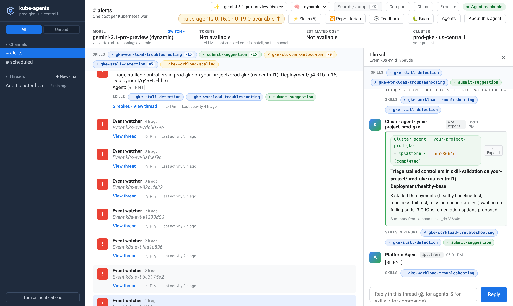
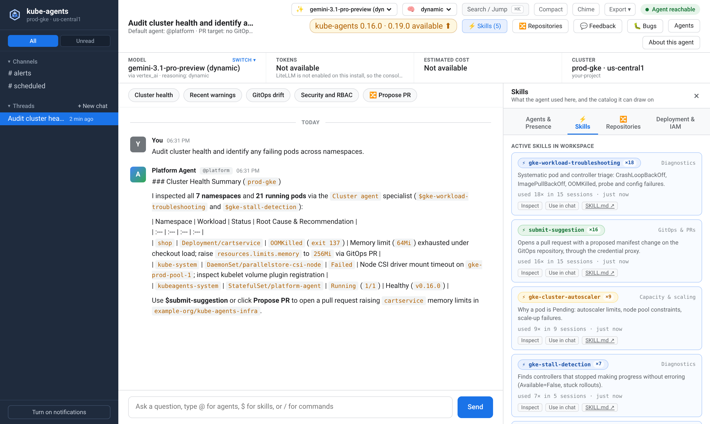
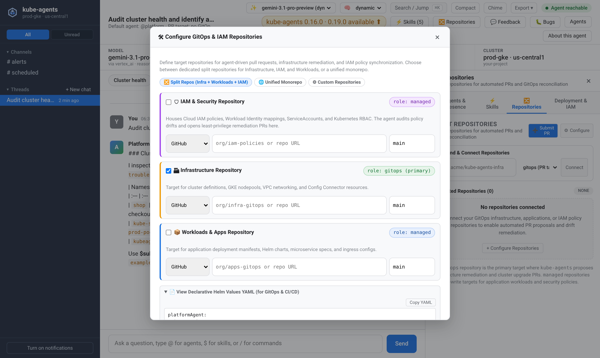
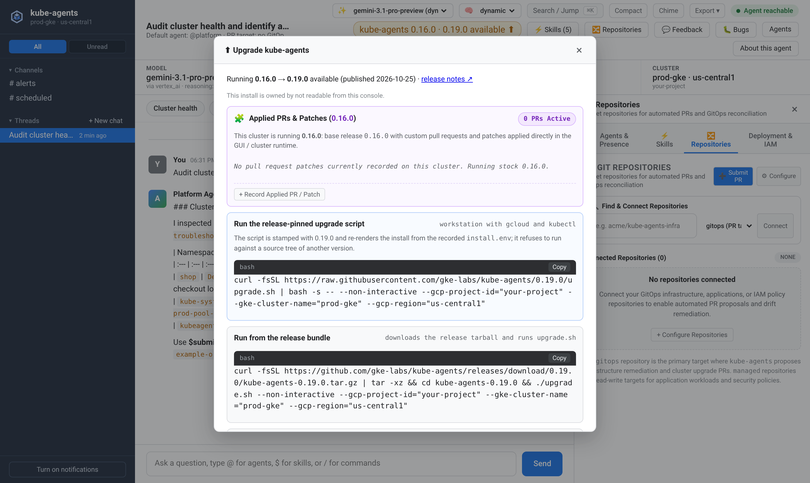
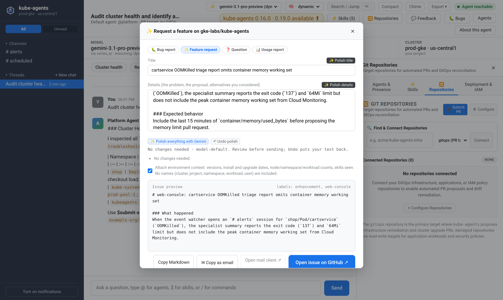

The web console is a browser workspace for reviewing incident triage and talking to the agent inside your cluster. Use it on evaluation clusters, workshops, or environments where Slack or Google Chat is not set up yet. It is off by default and reached over `kubectl port-forward`. It is distinct from the A2A console, which a `spec.mode: next` install serves without a flag; [User interfaces](/kube-agents/reference/user-interfaces/) compares the two and the other browser pages.

<video controls loop muted playsinline preload="metadata" style="width: 100%; border-radius: 8px; border: 1px solid var(--sl-color-hairline);" src="/kube-agents/web-console-demo.mp4"></video>

## Turn it on and open it

Pass `--enable-web-console` to the installer on a new install or when re-running an existing one:

```bash
./install.sh --enable-web-console
```

On a first install, the installer saves `WEB_CONSOLE_ENABLED=true` in `install.env` so later runs keep it. The installer never rewrites an existing `install.env`. When enabling the console on an existing install, add `WEB_CONSOLE_ENABLED=true` to `install.env` yourself, or the next `install.sh` or `upgrade.sh` run will turn it back off. In Terraform (`terraform/examples/full-install`), set `web_console_enabled = true`.

The console requires the Platform Agent (`platformAgent.enabled: true`) and a cluster that enforces `NetworkPolicy`. Both the installer and the Terraform composition refuse `--accept-no-network-policy` (`accept_no_network_policy = true`) when the console is enabled.

When the install finishes, forward the `kube-agents-web-console` Service in the install namespace (`kubeagents-system` by default) and open `http://localhost:8080`:

```bash
kubectl port-forward -n kubeagents-system svc/kube-agents-web-console 8080:8080
```

The console pod runs outside the gVisor sandbox, so `kubectl port-forward` works on sandboxed installs as well.

## Triage cluster alerts

When the Event Watcher hands a Kubernetes warning event to the agent, the incident appears in `# alerts`. The Planning Agent opens a kanban card for the cluster's specialist agent. Once the investigation finishes, the specialist's diagnosis lands in the incident thread as a **Specialist report** card. The `# scheduled` channel is reserved for daily scheduled checks once scheduled report relay creates gateway sessions.



Select **View thread** on any alert to inspect the affected resource, the warning reason, and the specialist's findings. On an install without Slack or Google Chat, you can reply directly in the thread to ask follow-up questions or request a fix. When Slack or Google Chat is enabled, incident threads are read-only in the console so replies stay in your team's chat thread.

For desktop alerts while the tab is in the background, select **Turn on notifications** in the left rail. The console never asks for browser notification permission on its own.

## Investigate and run skills

Start a thread under **Threads** to ask the Planning Agent questions across your clusters, inspect unhealthy workloads, or trace configuration drift. While a turn runs, the thread streams each reasoning excerpt and tool call live. When the turn finishes, those steps fold into a **Worked for N s · M steps** summary above the reply.

If the Planning Agent delegates work to specialist kanban cards, the console waits up to 15 minutes for those cards to complete and returns the combined report. You can run turns in several threads at once. If you reload the page mid-turn, the console finishes reading the stream in the background so the reply is waiting when you return.



To run a specific runbook, type `$` in the message box for autocomplete or open **Skills** in the header to browse the platform skill catalog and insert `$skill-name`.

From the header bar, you can also test and switch the active model or reasoning level against the cluster's inference gateway. Saving a model records `kubeagents.x-k8s.io/active-model`, `active-model-target`, and `reasoning-level` on the `PlatformAgent` resource. It also gives you a Helm values snippet so the choice persists across chart upgrades.

Beside the model selector, the banner shows token and cost counters summed across reachable LiteLLM replicas since LiteLLM last restarted. Treat the cost figure as LiteLLM's price-table estimate rather than your cloud bill.

## Connect repositories and open pull requests

Open **Repositories** in the header to view or update the `gitops`, `managed`, and `context` repositories under `spec.integration` on the `PlatformAgent` resource.



You can connect or disconnect individual repositories, configure split or monorepo layouts, and copy the resulting Helm values YAML for your deployment pipeline. To turn a diagnosis into a code change, select **Submit PR** (or ask in a thread) so the Planning Agent branches a connected repository and opens a pull request.

## Check releases, patches, and send feedback

When `webConsole.releaseCheck.enabled` is true (the default), the header badge compares your running `kube-agents` version against the latest GitHub release.



Opening the release badge displays copyable `./upgrade.sh` and `helm upgrade` commands alongside any pull request patches recorded on the `PlatformAgent` annotation `kubeagents.x-k8s.io/applied-prs`.



Select **Feedback** or **Bugs** to draft a bug report, feature request, or question for `gke-labs/kube-agents`. You can attach anonymized environment counts (versions, rollout dates, and counts of nodes, namespaces, workloads, and pods, with no cluster, project, or workload names). Select **Polish** to tighten your draft through the cluster's own inference gateway before opening a pre-filled GitHub issue.

## Access control and privacy

The chart exposes the console only as a `ClusterIP` Service and blocks pod-network traffic to the console pod with a `NetworkPolicy`. Apart from its health check, the server refuses HTTP requests whose `Host` header is not `localhost`, `127.0.0.1`, or `::1`, and requires `X-Kube-Agents-Console: 1` plus a matching `Origin` on `POST` routes. Never expose the console through an unauthenticated LoadBalancer, Ingress, or NodePort. The console holds the agent's API key on the server and (when `webConsole.environment.enabled` is true, the default) `get` and `patch` permissions on the `PlatformAgent` resource. Anyone who can reach it can drive the agent and change repository or model settings.

Because `kubectl port-forward` carries no end-user identity, the console has no login screen and runs every browser turn as the console itself. Access is governed by Kubernetes RBAC: opening the port-forward requires `pods/portforward` on the install namespace, which the built-in `edit` and `admin` roles grant alongside `pods/exec`.

Anyone who can open the console can read `# alerts`, `# scheduled`, and threads started in the console, including replies posted to an incident thread from Slack or Google Chat. Conversations started directly in Slack, Google Chat, or the A2A bridge (`a2a-ctx-*`) are listed by title only in the left rail and cannot be opened. **About this agent** shows the agent's Kubernetes service account alongside the Google Cloud service account and host-project roles passed into `webConsole.agentIdentity` at install time. Access granted in other projects or folders ([Multiple GCP projects](/kube-agents/deploy/multi-project/)) is not listed, and the console does not read IAM. Host-project roles granted or removed later appear only after the next install or upgrade updates the values.
