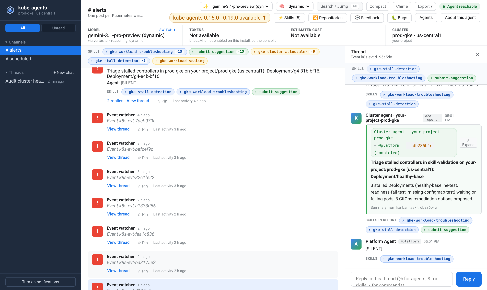
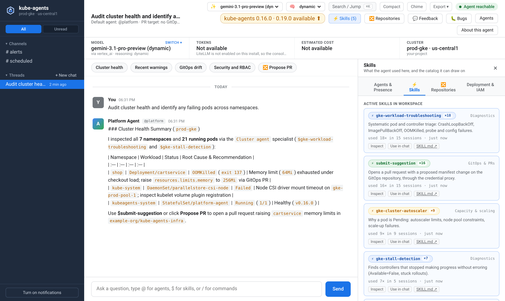
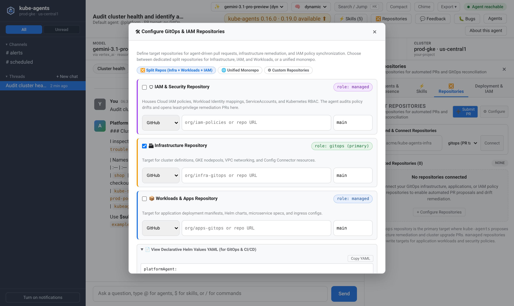
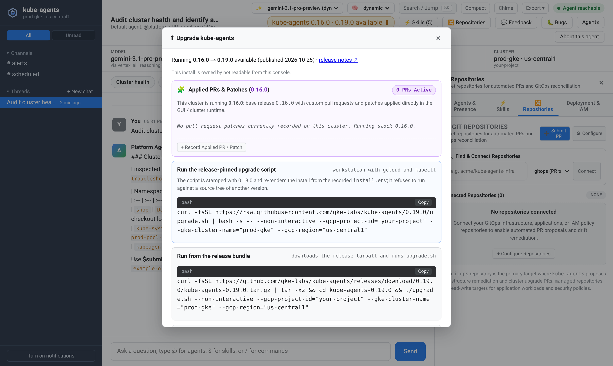
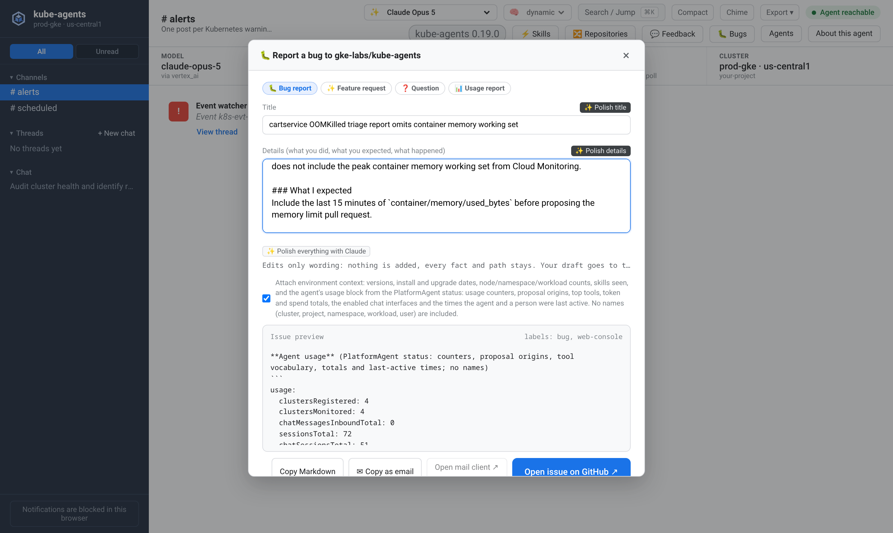

import { Tabs, TabItem } from "@astrojs/starlight/components";

The web console is a browser workspace for reviewing incident triage and talking to the agent inside your cluster. Use it on evaluation clusters, workshops, or environments where Slack or Google Chat is not set up yet. It is off by default and reached over `kubectl port-forward`.

:::note
The web console is distinct from the A2A console, which every install serves without a flag. See [User interfaces](/kube-agents/reference/user-interfaces/) for a comparison of the browser pages.
:::

## Examples in action

Each snippet below runs through a diagnosis, pre-fix state, pull request merge, and post-merge verification in about 40 seconds. These clips were recorded on an earlier console theme; current installs render the layout shown in the screenshots below.

<Tabs>
  <TabItem label="Reliability">
    <p>
      Diagnose stalled <code>config-syncer</code> pods and a blocking{" "}
      <code>PodDisruptionBudget</code>, merge a fallback image and PDB fix PR,
      and verify Argo CD reaches Healthy and Synced.
    </p>
    <video
      controls
      loop
      muted
      playsinline
      preload="metadata"
      style="width: 100%; border-radius: 8px; border: 1px solid var(--sl-color-hairline);"
      src="/kube-agents/web-console-demo-reliability.mp4"
    ></video>
  </TabItem>
  <TabItem label="Capacity">
    <p>
      Pinpoint <code>CrdMisconfigured</code> blocking pending pods on an HPC
      ComputeClass, merge a PR enabling node pool auto-creation, and confirm
      Argo CD sync.
    </p>
    <video
      controls
      loop
      muted
      playsinline
      preload="metadata"
      style="width: 100%; border-radius: 8px; border: 1px solid var(--sl-color-hairline);"
      src="/kube-agents/web-console-demo-capacity.mp4"
    ></video>
  </TabItem>
  <TabItem label="Security">
    <p>
      Audit NetworkPolicy, RBAC, Pod Security Standards, and Workload Identity
      boundaries, merge a default-deny NetworkPolicy PR, and confirm Healthy and
      Synced.
    </p>
    <video
      controls
      loop
      muted
      playsinline
      preload="metadata"
      style="width: 100%; border-radius: 8px; border: 1px solid var(--sl-color-hairline);"
      src="/kube-agents/web-console-demo-security.mp4"
    ></video>
  </TabItem>
  <TabItem label="Upgrades">
    <p>
      Run GKE 1.35 to 1.36 upgrade readiness checks, catch a PodDisruptionBudget
      holding zero disruptions, and merge a PR allowing node drains.
    </p>
    <video
      controls
      loop
      muted
      playsinline
      preload="metadata"
      style="width: 100%; border-radius: 8px; border: 1px solid var(--sl-color-hairline);"
      src="/kube-agents/web-console-demo-upgrades.mp4"
    ></video>
  </TabItem>
  <TabItem label="Cost">
    <p>
      Surface over-provisioned cluster nodes using under 7% CPU and 30% memory,
      merge a right-sizing PR, and verify the downscaled node pool live.
    </p>
    <video
      controls
      loop
      muted
      playsinline
      preload="metadata"
      style="width: 100%; border-radius: 8px; border: 1px solid var(--sl-color-hairline);"
      src="/kube-agents/web-console-demo-cost.mp4"
    ></video>
  </TabItem>
  <TabItem label="Rollback">
    <p>
      Spot a Degraded canary deployment in Argo CD, roll it back to the last
      working image through a pull request, and confirm Argo CD recovers.
    </p>
    <video
      controls
      loop
      muted
      playsinline
      preload="metadata"
      style="width: 100%; border-radius: 8px; border: 1px solid var(--sl-color-hairline);"
      src="/kube-agents/web-console-demo-rollback.mp4"
    ></video>
  </TabItem>
</Tabs>

## Turn it on and open it

Pass `--enable-web-console` to the installer on a new install or when re-running an existing one:

```bash
./install.sh --enable-web-console
```

On a first install, the installer saves `WEB_CONSOLE_ENABLED=true` in `install.env` so later runs keep it. The installer never rewrites an existing `install.env`. When enabling the console on an existing install, add `WEB_CONSOLE_ENABLED=true` to `install.env` yourself, or the next `install.sh` or `upgrade.sh` run will turn it back off. In Terraform (`terraform/examples/full-install`), set `web_console_enabled = true`.

The console requires the Platform Agent (`platformAgent.enabled: true`) and a cluster that enforces `NetworkPolicy`. Both the installer and the Terraform composition refuse `--accept-no-network-policy` (`accept_no_network_policy = true`) when the console is enabled.

When the install finishes, forward the `kube-agents-web-console` Service in the install namespace (`kubeagents-system` by default) and open `http://localhost:8080`:

```bash
kubectl port-forward -n kubeagents-system svc/kube-agents-web-console 8080:8080
```

The console pod runs outside the gVisor sandbox, so `kubectl port-forward` works on sandboxed installs as well.

## Triage cluster alerts

When the Event Watcher hands a Kubernetes warning event to the agent, the incident appears in `# alerts`. The Planning Agent opens a kanban card for the cluster's specialist agent. Once the investigation finishes, the diagnosis lands in the incident thread with an **`A2A report`** card tag (live delegated replies in **Threads** first appear as **`Specialist report`**, and render as **`A2A report`** on reload).

When `# alerts` has no open incidents, the empty state shows **Kubernetes Event Watcher** readiness and the next scheduled daily fleet audit run time (`06:20`–`09:20 UTC`). Select **Run on-demand health check now** to start an immediate posture check in **Threads**. The `# scheduled` channel is reserved for daily scheduled checks once scheduled report relay creates gateway sessions.



Select **View thread** on any alert to inspect the affected resource, the warning reason, and the specialist's findings. On an install without Slack or Google Chat, you can reply directly in the thread to ask follow-up questions or request a fix. When Slack or Google Chat is enabled, incident threads are read-only in the console so replies stay in your team's chat thread.

For desktop alerts while the tab is in the background, select **Turn on notifications** in the left rail. The console never asks for browser notification permission on its own. From the header, you can also toggle **Compact** density, enable the **Chime** alert sound, or jump across threads and channels with **Search / Jump** (`⌘K`).

## Investigate and run skills

Start a thread under **Threads** to ask the Planning Agent questions across your clusters, inspect unhealthy workloads, or trace configuration drift. While a turn runs, the thread streams each reasoning excerpt and tool call live. When the turn finishes, those steps fold into a **Worked for N s · M steps** summary above the reply.

If the Planning Agent delegates work to specialist kanban cards, the console waits up to 15 minutes for those cards to complete and returns the combined report. You can run turns in several threads at once, and local slash commands (`/feedback`, `/help`) still respond while a thread turn is busy. If you reload the page mid-turn, the console finishes reading the stream in the background so the reply is waiting when you return.



To run a specific runbook, type `$` in the message box for autocomplete or open **Skills** in the header to browse the platform skill catalog and insert `$skill-name`. Open **Agents** in the header to inspect `@platform` turn status, the install cluster, built-in components, and specialists seen in opened threads. That drawer also lists the **Scoped Projects & Clusters** connectivity roster (`ok`, `denied`, `unreachable`, `api-disabled`, `over-cap`), per-cluster profile readiness, and per-cluster Event Watcher activity; `@cluster-<name>` turn activity itself is not tracked. Use **Export** to save or copy a conversation transcript.

From the header bar, you can also test a model against the cluster's inference gateway and record a preferred model or reasoning level. Saving updates the console banner and writes `kubeagents.x-k8s.io/active-model`, `kubeagents.x-k8s.io/active-model-target`, and `kubeagents.x-k8s.io/reasoning-level` on the `PlatformAgent` resource.

Beside the model selector, the banner shows token and cost totals since install, read from the counters the operator keeps on the `PlatformAgent` status across LiteLLM restarts. The note beneath says so as of the operator's last poll, with the answering LiteLLM replica count in its hover tooltip. The operator refreshes those totals every few minutes, so the live LiteLLM figure can run ahead of them between polls.

That status reading needs the console's `PlatformAgent` read, which `webConsole.environment.enabled` (the default) grants. Without it, or while the status carries no totals yet, the banner shows the counters summed across reachable LiteLLM replicas since each last restarted, and the note says that instead. Treat the cost figure as LiteLLM's price-table estimate rather than your cloud bill.

## Connect repositories and open pull requests

Open **Repositories** in the header to view or update the `gitops`, `managed`, and `context` repositories under `spec.integration` on the `PlatformAgent` resource.



You can connect or disconnect individual repositories, configure split or monorepo layouts, and copy the resulting Helm values YAML for your deployment pipeline. To turn a diagnosis into a code change, select **Propose PR** at the top of a **Threads** conversation or ask directly in chat. You can also select **Submit PR** in the **Repositories** drawer so the Planning Agent delegates a proposal to the Platform Agent to branch a connected repository and open a pull request.

## Check releases, patches, and send feedback

When `webConsole.releaseCheck.enabled` is true (the default), the header badge compares your running `kube-agents` version against the latest GitHub release.



When a newer release is available, opening the release badge shows copyable `upgrade.sh` script and release-bundle commands (or lets you ask the agent for an upgrade pull request) alongside any patches recorded on `kubeagents.x-k8s.io/applied-prs`.



Select **Feedback** or **Bugs** to draft a bug report, feature request, question, or usage report for `gke-labs/kube-agents`. You can attach anonymized environment counts (versions, rollout dates, and counts of nodes, namespaces, workloads, and pods) with no cluster, project, or workload names.

The attachment also carries the usage, tools and performance sections of the block the chat's [`/feedback summary`](/kube-agents/concepts/chatops/#feedback-summary) prints, read from the `PlatformAgent` status. Those sections hold usage counters, proposal origins, the top tools by tool name, token and spend totals since install, and the agent's and a person's last-active times. Enabled chat interfaces are listed with the versions. Use **Polish title**, **Polish details**, or the full-draft polish button (`Polish everything with <model>`) to tighten your draft through the inference gateway. Bug reports, feature requests, and questions can open a pre-filled GitHub issue; usage reports export as Markdown or email only.

## Access control and privacy

The chart exposes the console only as a `ClusterIP` Service and blocks pod-network traffic to the console pod with a `NetworkPolicy`. Apart from its health check, the server refuses HTTP requests whose `Host` header is not `localhost`, `127.0.0.1`, or `::1`, and requires `X-Kube-Agents-Console: 1` plus a matching `Origin` header when present on `POST` routes. Never expose the console through an unauthenticated LoadBalancer, Ingress, or NodePort. The console holds the agent's API key on the server and (when `webConsole.environment.enabled` is true, the default) `get` and `patch` permissions on the `PlatformAgent` resource. Anyone who can reach it can drive the agent and change repository or model settings.

On Kubernetes 1.30 and later, with `admissionPolicy.enabled` (the default), an admission policy holds the console to those settings. It may change only its own annotations and `spec.integration.forges`, `repositories` and `github`, and any other change it makes to the resource is refused. Inside `forges`, it may not change where an existing forge's credential goes or the account it acts as, add a forge with a credential, or change the install's GitHub host. While the resource has a forge the operator refuses, the console may not add, remove or reorder forges until an administrator fixes it.

Because `kubectl port-forward` carries no end-user identity, the console has no login screen and runs every browser turn as the console itself. Access is governed by Kubernetes RBAC: opening the port-forward requires `pods/portforward` on the install namespace, which the built-in `edit` and `admin` roles grant alongside `pods/exec`.

Anyone who can open the console can read `# alerts`, `# scheduled`, and threads started in the console, including replies posted to an incident thread from Slack or Google Chat. Conversations started directly in Slack, Google Chat, or the A2A bridge (`a2a-ctx-*`) are listed by title only in the left rail and cannot be opened.

**About this agent** shows the agent's Kubernetes service account alongside the Google Cloud service account and host-project roles passed into `webConsole.agentIdentity` at install time. It also renders the **Scoped Projects & Clusters** section from `/api/scope`, showing each project's discovery source, reconcile outcome, and onboarding remediation hints. The console does not read Cloud IAM policy bindings directly; host-project roles granted or removed later appear in the identity card only after the next install or upgrade updates the values.
