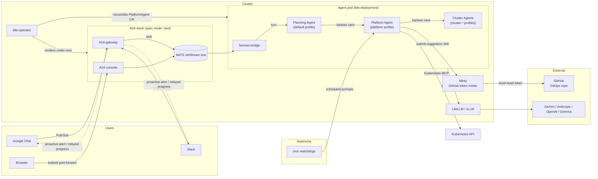

import { Aside, CardGrid, LinkCard } from "@astrojs/starlight/components";
import ChatDemo from "../../components/ChatDemo.astro";

<ChatDemo />

## What it is

`kube-agents` runs autonomous agents inside your Kubernetes cluster: a **Planning Agent** front door that listens on Google Chat (and optionally Slack) and turns what you ask for into work, a **Platform Agent** specialist it delegates that work to over a shared kanban board, and read-only per-cluster **Cluster Agents** the Platform Agent creates for the clusters it manages. The Platform Agent executes a growing library of Kubernetes skills on demand, and on its own schedule runs background watchdogs that audit the fleet and propose the mergeable fixes as GitHub pull requests you review.

It ships as a small set of components:

- A **Kubernetes operator** (`k8s-operator`, Go / Kubebuilder) that reconciles a `PlatformAgent` custom resource.
- An **agent Deployment** (running the [Hermes runtime](https://github.com/NousResearch/hermes-agent), `nousresearch/hermes-agent`) hosting co-located profiles: the Planning Agent (chat ingress, planning, and delegation), the Platform Agent (an opinionated persona, an MCP-based Kubernetes toolset, and a library of skills), and per-cluster Cluster Agents scaffolded on demand.
- An **inference gateway** — [LiteLLM](https://litellm.ai) for hosted models (Gemini, Anthropic, OpenAI) or [vLLM](https://vllm.ai) for local models on GPU nodes.
- The **A2A stack**, which `spec.mode: next`, the first-install default, puts in front of the agent: a NATS JetStream message bus, the A2A gateway that holds the chat backend, and the [A2A console](/kube-agents/reference/user-interfaces/#a2a-console), a browser page reached through `kubectl port-forward`. A chart or Terraform install that sets no mode runs `today`, the previous layout, which stays as the rollback ([Switching back to `today`](/kube-agents/install/upgrade/#switching-back-to-today)).

<Aside type="note">
  Today's shipping skills, install path, and MCP integrations target GKE. The
  Platform Agent architecture — the agent Deployment, operator, inference
  gateway, ChatOps ingress — is not GKE-specific and can extend to other
  Kubernetes distributions as skills and toolsets are added.
</Aside>

## Two ways to think about it

<CardGrid>
  <LinkCard
    title="Proactive autonomy"
    description="Scheduled watchdogs (blueprint sync, compliance audit, security patches, cost analysis, capacity orchestration…) run without prompting. Findings become a standing ledger issue on your GitOps repo and PRs you review."
    href="/kube-agents/overview/proactive-autonomy/"
  />
  <LinkCard
    title="ChatOps interface"
    description="Ask the agent things in Google Chat or Slack. The Planning Agent works out what your request needs and hands it to the Platform Agent, which runs skills, inspects clusters through the Kubernetes MCP server, and reports back."
    href="/kube-agents/concepts/chatops/"
  />
</CardGrid>

## What the agent can do out of the box

The [skill catalog](/kube-agents/skills/) lists every skill the Platform, Cluster and GKE Support Agents ship, grouped by area, with its description and a link to its source.

## Architecture at a glance



The diagram shows a `spec.mode: next` install, the first-install default ([the quick start](/kube-agents/install/quickstart-gke/#verify-a-specmode-next-install)). With both chat platforms enabled, Slack stays on the agent pod's own listener, as under `today`; a `today` install has no A2A stack, and chat reaches the Planning Agent directly. Full walkthrough on the [Architecture](/kube-agents/overview/architecture/) page.

## Install

The fastest way to install `kube-agents` is from an official release:

```bash
curl -fsSL https://raw.githubusercontent.com/gke-labs/kube-agents/<RELEASE_VERSION>/install.sh | bash
```

_Substitute `<RELEASE_VERSION>` with the desired version tag from [GitHub Releases](https://github.com/gke-labs/kube-agents/releases) (for example, `0.19.0`)._

To install from an unpacked release archive (recommended):

```bash
curl -fsSL https://github.com/gke-labs/kube-agents/releases/download/<RELEASE_VERSION>/kube-agents-<RELEASE_VERSION>.tar.gz | tar -xz
cd kube-agents-<RELEASE_VERSION>
./install.sh
```

Alternatively, if you require a Git checkout, clone pinned to an official release tag:

```bash
git clone --branch <RELEASE_VERSION> https://github.com/gke-labs/kube-agents.git
cd kube-agents
./install.sh
```

The installer bootstraps a GKE cluster, the operator CRDs, IAM bindings, Google Chat Pub/Sub, Kubernetes secrets, and the Platform Agent itself, on `spec.mode: next` by default — one `terraform apply` through `terraform/examples/full-install`. See the [Quick start](/kube-agents/install/quickstart-gke/) for a step-by-step breakdown.

## Disclaimer

This is not an officially supported Google product.
