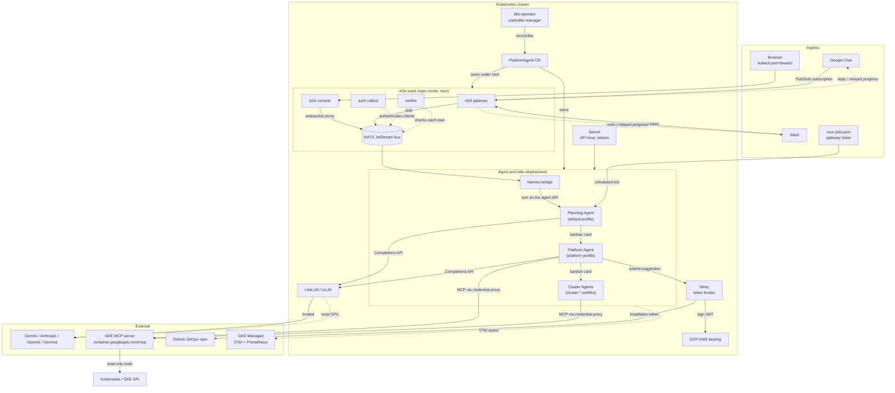

import { Aside } from "@astrojs/starlight/components";

Ingress paths converge on the agent pod: user chat, scheduled cron, and the operator itself. Under `spec.mode: next`, the first-install default ([the quick start](/kube-agents/install/quickstart-gke/#verify-a-specmode-next-install)), chat enters through the **A2A gateway** and a message bus, and a `hermes-bridge` container in the agent pod turns each bus task into an agent turn. Under `today`, the previous layout kept as the rollback, the Planning Agent's own chat adapters listen instead ([Switching back to `today`](/kube-agents/install/upgrade/#switching-back-to-today)).

Inside the pod, one Hermes gateway hosts co-located profiles: the **Planning Agent** (the `default` profile — the conversational front door and the only chat ingress), the **Platform Agent** (the `platform` profile — the privileged specialist that does the infrastructure work), and read-only per-cluster **[Cluster Agents](/kube-agents/concepts/cluster-agents/)** (`cluster-*` profiles the Platform Agent scaffolds, one per managed GKE cluster). They coordinate through a shared kanban board: the Planning Agent files a card, the gateway's dispatcher spawns the assigned specialist as a worker, and the completion is relayed back into the originating chat thread.

## Component map

The map is a `spec.mode: next` install. The gateway holds Google Chat when it is enabled and Slack otherwise; with both enabled, Slack stays on the Planning Agent's own listener, as every chat platform does under `today`, where the A2A stack is not rendered. [Deployment topology](#deployment-topology) lists the pods each mode runs.

## The request flows

### 1. Chat request → reply

<Aside type="note">
  Google Chat is fully wired and end-to-end tested. Slack is opt-in via the
  installer's chat menu; see [ChatOps](/kube-agents/concepts/chatops/).
</Aside>

1. A user posts in a Google Chat space (or DMs the Slack app).
2. Google Chat publishes the event to a Pub/Sub topic; Slack routes via Socket Mode. The install's [`chat-pubsub` module](https://github.com/gke-labs/kube-agents/tree/main/terraform/modules/chat-pubsub) sets up the topic and subscription.
3. Under `spec.mode: next`, the **A2A gateway** consumes the event, posts a status line in the thread (on Google Chat; on Slack the Working… status and the reaction stand in for it), and publishes the message as a task on the bus. The `hermes-bridge` container in the agent pod takes the task and runs it as a turn on the agent's API server, under the **Planning Agent** (the pod's `default` Hermes profile). [How a chat question is answered under `next`](/kube-agents/concepts/chatops/#how-a-chat-question-is-answered-under-next) walks through each hop. Under `today`, and for Slack when Google Chat is also enabled, the Planning Agent consumes the event itself through Hermes' bundled adapter, patched for credential-free operation by `google_chat_relay_patch.py` (Slack uses `slack_relay_patch.py` in Socket Mode).
4. The Planning Agent holds no infrastructure tools. It reads the available specialists from the roster block injected into each turn (descriptions from each agent's `CAPABILITIES.md`; `list_agents` re-reads it) and files a kanban card with the full request context (`kanban_create`). The originating chat session is auto-subscribed to the card. The two questions the roster answers itself, which GCP projects are in scope and where the host cluster is, get a direct reply and no card.
5. The gateway's kanban dispatcher spawns the **Platform Agent** (`hermes -p platform chat -q "work kanban task <id>"`), which runs the tool-calling loop: system prompt (`SOUL.md`) + card body + available tools. Cluster reads go through the `gke` MCP server; mutations that touch infra route through the `submit-suggestion` skill (see flow 3) rather than direct `kubectl`. Work scoped to one cluster's live runtime is delegated onward as a nested kanban card to that cluster's read-only [Cluster Agent](/kube-agents/concepts/cluster-agents/) (`SOUL.md §6`).
6. The worker's `kanban_complete` posts its full `result` back into the same Chat thread (its one-line `summary` only when the `result` adds nothing to it), plus one message for each staged sub-card completion along the way. The gateway delivers those directly rather than through the Planning Agent, so the answer arrives verbatim; under `next` the A2A gateway posts them, each progress note as a message of its own. Console links are built from the shared templates in `agents/platform/docs/gcp-console-links.md` (inlined in `SOUL.md §5`).

### 2. Cron tick → autonomous run

1. The Planning Agent profile's gateway — the only ticking one, since cron ticking belongs to a running gateway — evaluates its own `jobs.json` on schedule. Its `profile-cron-tick` job runs `hermes cron tick` against every named profile with work due, once a minute, which is what makes the Platform Agent's own roster live (see [What fires the schedule](/kube-agents/concepts/autonomous-watchdogs/#what-fires-the-schedule)).
2. The governance watchdogs live on that roster, `agents/platform/cron/jobs.json`. A due one runs in its own process with the Platform Agent's persona and toolsets and its own `skills` and `max_turns` — no kanban card involved. The prompt is usually "read `governance/<sop>.md` in your profile home and execute"; the path is relative to the profile home, where `profile_scaffold.py` overlays the baked `/opt/platform-template/governance/` directory.
3. The agent reads the SOP, executes the diagnostic queries, produces findings.
4. The ten fleet audits hand their findings to the `fleet-audit` skill, which renders and maintains one GitHub **issue** per audit stream — the ledger; the upgrade retrospective also keeps its report on the shell sandbox's volume, its record where no repository is linked — and promotes findings with a mergeable manifest into narrow per-finding remediation PRs linked back to it. A scheduled run with no findings closes the ledger as completed and returns `[SILENT]`. It speaks when it could not read the whole fleet and the gaps are new or changed (the ledger then stays open), when it resolved findings, or when an on-demand run changed the findings since the last scheduled run.

The Planning Agent profile's own job file — [`agents/chat/defaults/cron/jobs.json`](https://github.com/gke-labs/kube-agents/blob/main/agents/chat/defaults/cron/jobs.json) — holds nothing but `no_agent` script jobs: plain subprocesses, no LLM turn, since that profile's toolsets are stripped to `mcp-router`, `kanban` and `memory`. Five ship: `profile-cron-tick` above; the hourly `cluster-agent-reconcile` sweep that keeps Cluster Agent profiles aligned with the live GKE fleet; `oobe`, which runs [first-run onboarding](/kube-agents/concepts/chatops/#first-run-onboarding): it delivers the inventory report, runs the inventory scan, and runs four of the fleet audits and then the upgrade retrospective once, one after another, when the scan settles; and the old `bootstrap-inventory-scan` and `bootstrap-inventory-delivery` entries, which ship disabled.

### 3. Remediation → GitHub PR

1. The agent invokes `submit-suggestion` with a proposed diff (usually a YAML patch generated from an SOP).
2. `submit-suggestion` writes the file(s) and commits them to a topic branch, then asks the credential broker to publish it. Nothing in the agent's container holds a token.
3. The broker calls Minty, which signs a JWT with a KMS-held private key and exchanges it for a short-lived GitHub App token.
4. The broker pushes the branch and opens a PR against the configured GitOps repo; `submit-suggestion` gets back the PR's URL.
5. The agent posts a Chat message with the PR link.

## Deployment topology

Everything except the LLM (and, for hosted providers, the LLM API endpoint) runs inside your Kubernetes cluster:

- **Namespace**: `kubeagents-system`.
- **The agent**: three pods, the gateway (`<name>-gateway`, running Hermes), the shell sandbox and the credential broker ([Credential isolation](/kube-agents/reference/credential-isolation/#pod-anatomy)).
- **The A2A stack**, under `spec.mode: next`, the first-install default: the bus StatefulSet (`<name>-a2a-nats`), two auth callout and two verifier replicas, the A2A gateway, the A2A console, a provisioning Job, and a session pod per `/session` conversation. `hermes-bridge` is a container of the gateway pod rather than a pod. A chart or Terraform install that sets no mode runs `today` and has none of them. [Verify a `spec.mode: next` install](/kube-agents/install/quickstart-gke/#verify-a-specmode-next-install) lists each pod with its expected state.
- **Node pools**: Autopilot, the shape a fresh install creates, has none to size — Google schedules the operator, Platform Agent, LiteLLM, and Minty, and the sandbox costs no extra nodes. On Standard the default node pool runs everything except the Platform Agent, which runs on the gVisor pool below; `--enable-gvisor=false` puts it back with the others. If you use vLLM, provision a GPU node pool separately.
- **gVisor node pool** for sandboxed skill execution, Standard only (the `gke-cluster` module's `enable_gvisor_node_pool`). The sandbox is on unless the installer's `--enable-gvisor=false` turns it off, so a Standard install gets this pool; Autopilot ships the `gvisor` RuntimeClass and needs no pool.
- **Workload Identity** bindings are pre-provisioned by the [`kube-agents-iam` module](https://github.com/gke-labs/kube-agents/tree/main/terraform/modules/kube-agents-iam) — the Platform Agent gets a configurable permission set (`read-only` or `custom`). See [Security & IAM](/kube-agents/reference/security-and-iam/).

### Capacity and isolation

The hub footprint (operator, Platform Agent, LiteLLM, Minty) is small and roughly fixed — it doesn't grow with the number of clusters the agent manages, since those are read remotely through the GKE MCP server. Under `next` the A2A stack adds a few small pods to it. What actually drives node capacity:

- **vLLM.** Local inference needs a GPU node pool; hosted LiteLLM does not.
- **gVisor.** Sandboxed skill execution puts the agent pod under the `gvisor` RuntimeClass, which is the default (`--enable-gvisor=false` turns it off). On Autopilot, the default cluster shape, it costs no extra capacity. On Standard it means a `gvisor-pool` to run the pod on: one `e2-standard-4` per zone, so three nodes on a regional cluster, with no autoscaling.

For production, prefer a **dedicated cluster** for the harness. The agent GSA can still be given broad GKE permissions through the `custom` permission set, so a hard cluster boundary limits blast radius if the execution sandbox is ever compromised. A shared cluster (with the `kubeagents-system` namespace for logical isolation) is fine for development.

## Failure modes worth knowing

- **LLM outage.** LiteLLM proxies retries and can fall back to a secondary provider if configured. `SOUL.md §4` retries via the recovery ladder; the agent will report the failure in Chat rather than hang.
- **Silent kanban workers.** A delegated card only reaches the chat thread on completion, block, or a failure. The Platform Agent is instructed (`SOUL.md §0`) to report progress on long jobs with `kanban_heartbeat` notes, and any sub-card it creates inherits the chat subscription, so progress stays visible. A worker must end with `kanban_complete` or `kanban_block`. One that ends its turn with a plain-text answer is nudged up to twice to close the card; if it still does not, the card is charged a `timed_out` failure whose error opens `model replied in text and made no terminal kanban call` and reports how many nudges it got. It shows in the thread as a timed-out line, but no clock expired, and the answer was not delivered: the card was not closed and nothing was saved as its result. The dispatcher runs the card again. A second failure in a row blocks the card; `hermes kanban show <id>` lists each attempt's error, and unblocking the card runs it again. Exits that exhaust a turn or retry limit are charged the same way; [`spec.harness.tuning`](/kube-agents/operator/platformagent-crd/#specharnesstuning) covers those.
- **Cron overlap.** A long-running fleet audit can still be going when the next job fires — the original seven audits start thirty minutes apart, the two GCP audits land between them with the closest pair five minutes apart, and `github-repo-watcher` ticks every 10 minutes regardless. Each dispatcher tick is its own `hermes cron tick` process, and each job holds a per-job lock while it runs, so a job never overlaps itself but different jobs do run concurrently; what a slow audit costs the others is at most a one-minute delay of the dispatcher tick behind it. The watcher is a script rather than a model run, so it waits on nothing. [Autonomous watchdogs](/kube-agents/concepts/autonomous-watchdogs/#what-fires-the-schedule) has the detail.
- **Minty token exhaustion.** GitHub App installation tokens are 1-hour scoped. Minty caches and re-mints as needed; if the token refresher fails, `submit-suggestion` will surface it and route through the recovery ladder. `github-repo-watcher` has no ladder to route through — it is a script, not a model run — so a broker that refuses surfaces in the room as a reason code: `FORGE_UNAUTHENTICATED` when the forge would not accept this install's credential, `BROKER_UNREACHABLE` or `SANDBOX_UNREACHABLE` when the call never got that far, `FORGE_NOT_FOUND` or `FORGE_RATE_LIMITED` for the forge's own answers, `BROKER_ROUTE_UNSUPPORTED` for a broker that answered and does not serve these routes, and `REPO_UNREACHABLE` when every managed repository refused and their codes disagreed, so the per-repository codes are the ones to read. A refusal carrying no code at all falls to `BROKER_UNREACHABLE`. Which of those it is distinguishes a credential the forge rejected from a transport that is down — a distinction the operator needs, because only the first is about the token. It does not distinguish a fresh token the forge rejected from a refresh that never ran: a failed mint is logged and not raised, the verb goes ahead on whatever the broker already held, and the forge's 401 is the same either way. The proxy container's log below is what separates them. Why the forge rejected it is not carried with the code: it is rendered into a chat room, so it stays detail-free. The refusal itself is logged by the `envoy-credential-proxy` container, which runs the refresh helper and records its stderr with token-shaped substrings redacted; read that, or Minty's own logs.
- **Pub/Sub subscription drift.** If the GChat Pub/Sub subscription is deleted out of band, no chat messages reach the Planning Agent and no error surfaces automatically. Cron-driven runs still work, and the `kube-agents-observability` skill helps triage.

## Where to go next

- [Platform Agent](/kube-agents/concepts/platform-agent/) — the persona, safety rails, and MCP wiring.
- [ChatOps](/kube-agents/concepts/chatops/) — Google Chat and Slack ingress details.
- [Declarative workflow](/kube-agents/concepts/declarative-workflow/) — how PR-based remediation is enforced.
- [`docs/designs/agent-communication.md`](https://github.com/gke-labs/kube-agents/blob/main/docs/designs/agent-communication.md) — the design of record for inter-agent coordination: a file-based handover channel as its primary topic, still a proposal, and the kanban delegation the profiles use today.
- [`docs/designs/spec-mode-switch.md`](https://github.com/gke-labs/kube-agents/blob/main/docs/designs/spec-mode-switch.md) — the `spec.mode` switch, and what a switch between the modes changes; [Deployment topology](#deployment-topology) above is the inventory of what `next` runs.
