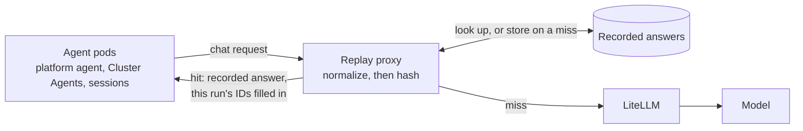
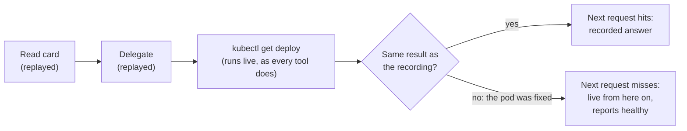
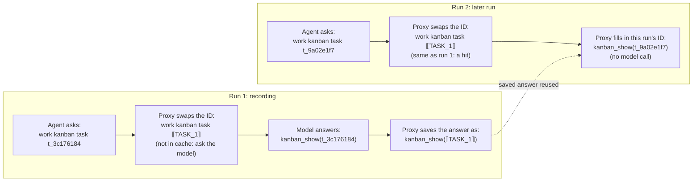
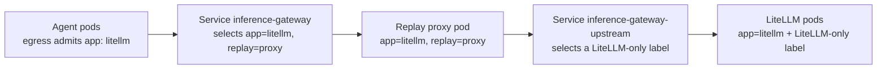
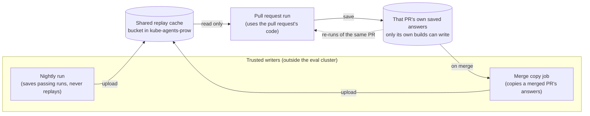
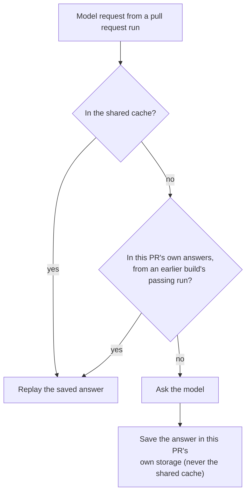

# Inference replay for evals

> **STATUS — proposal; measured; shadow mode and the replay lane's record and replay modes built,
> not deployed.** A prototype proxy was run against a dev install on 2026-10-31 to 2026-11-02, and
> the replay lane's modes on 2026-11-04 and 05 (see "Replay lane trials").
> [`hack/replay-proxy/`](../../hack/replay-proxy/README.md) has the proxy with its shadow, record
> and replay modes, its fingerprint log, the scrubbed request store, the hit-rate script and the
> lane's report; the join with run verdicts and the collision report (Rollout step 1) are not built
> yet. Nothing here is wired into `hack/ci-deploy.sh`, `hack/ci-eval-pr.sh` or the chart. Shadow
> mode changes no verdict.

**Scope:** serving recorded model answers to eval runs whose model input has not changed, so a
presubmit pays for inference only from the first point where a run differs from one already graded.
**Owns:** the cache key and its normalization rules, where the proxy sits, which recordings may be
served, and the rollout stages. The gate's ladder and roster stay in
[`testing-strategy.md`](../../docs/designs/testing-strategy.md) §4.2; the eval transport stays in
[`eval-next-transport.md`](../../docs/designs/eval-next-transport.md). The example proxy in this
directory ([`README.md`](README.md)) is the starting point and is superseded by the design here
for eval use. The kustomize integration under `k8s-operator/config/integrations/inference-replay/`
labels its proxy `app: standalone-replay`, which the worker pods' egress policies (A2A sessions and
Cluster Agents) do not admit under `spec.mode: next` (see "Where the proxy runs"), so it is not a
base for this either.

## The problem

Most of a presubmit's inference repeats work the eval suite has already done. A pull request
that changes nothing a case depends on still pays for every model call in every repetition of that
case. One 36-run presubmit build measured on 2026-10-20 sent 48.6M prompt tokens against 311k
output tokens; agent spend was $46–82 per build at list price, and the fan-out cases dominate it.
Model time is at most 73% of a run's wall clock (agent execution including its tool calls); the
remainder is tool time, the dispatcher, and the judge.

## How replay works

A proxy sits between the agents and LiteLLM. Every `/v1/chat/completions` request is normalized
(next section) and hashed. On a miss the request goes to the model, the answer is streamed back,
and the answer is stored under the hash. On a hit the stored answer is returned without a model
call.

Three properties make this sound for grading:

- **A hit means the model saw the same input.** The key covers the whole request: system prompt,
  tool schemas, the model alias, and every message so far, including every tool result, with one
  exception (the recent-work digest, below). That includes settings like temperature, max tokens,
  reasoning settings and tool choice; only fields that change how the answer is delivered
  (`stream`) or who is asking (`user`, `metadata`) are left out. A stored answer is a real sample from the model for
  that exact input. What serving it loses is independence between samples, and under pass-only
  recordings (below) it is also a sample drawn only from runs that passed, which biases a replayed
  run towards passing.
- **Tools still run.** Only model calls are replayed. `kubectl`, `gcloud`, scripts and GitHub
  writes execute live, and the verifiers grade the live state and the delivered report. A tool
  result that differs from the recording changes the next request, which misses, and from there
  the run is live.
- **A change under test misses.** A pull request that edits a prompt, a skill the run reads, a
  script's output, or a tool schema changes a request, and the run is graded live from that point.
  A pull request that changes nothing in a case's path replays it.

A run therefore replays up to its first tool result that differs from the recording, and is live
from the next request on. This is the safety run from "Measurements": the pod was fixed between the
recording and the replay.

## Normalization

Raw requests never repeat. Kanban task IDs, pod name suffixes, UIDs, timestamps, ages, process and
row IDs, and scratch file names differ every run, and one difference poisons every later request
in the conversation, because each request embeds the ones before it. Hashing near-raw bodies (only a
per-message `timestamp` stripped), as the example proxy does, gave 5–7% token-weighted hits in a two-run measurement on a dev install on 2026-09-04.

The normalizer replaces each identifier with a placeholder numbered by first appearance in the
request (`⟦TASK_1⟧`, `⟦POD_2⟧`, `⟦AGEm_1⟧`), and the mapping works both ways. A stored answer
is kept with placeholders; on a hit the placeholders are filled from the current request's
values, so a replayed `kanban_show` names this run's card, not the recording's. An answer that
names a placeholder the current request does not bind is not served.

The rules that keep this safe:

- **Identifiers only, never state.** Counts, statuses, restart numbers, versions, scores and
  zones stay literal; they are what the agent reasons about. A crashlooping pod's restart count
  rises between runs, so cases with a live defect replay less, and that is correct.
- **Only real ages are treated as ages, and they keep their unit.** `5m` and `3d` get different
  placeholders, because a pod being minutes old instead of days old can be the whole finding. And
  something only counts as an age when it clearly is one: in an `AGE` column, an `age:` or
  `lastSeen` field, or "… ago". Kubernetes writes CPU the same way (`120m` means 0.12 of a core),
  and cases get graded on CPU and memory numbers, so those are never touched. (The prototype
  swapped any number ending in `m`; this rule replaces that.)
- **Times and IP addresses keep what they mean.** A timestamp isn't just an ID: whether it's in the
  past or the future can be the whole finding (an expired certificate, a CronJob that hasn't run for
  a month). So timestamps, both dates and epoch seconds, become a token for roughly how far from now
  they are ("minutes ago", "days ago", "in the future", and so on), and an expired certificate never
  matches a valid one. Anything in the last hour is one token and anything in the next hour
  another, so run-to-run timing jitter (a card read 50 or 70 seconds after it was claimed) doesn't change the
  key. Epoch seconds count only under a key that names a time (`created_at`, `ts`,
  `timestamp`); any other 10-digit number, like `memory: 1717986918`, isn't read as a time. IP
  addresses stay as they are whenever the request mentions a network range (like `10.0.0.0/16`),
  because then which range an IP falls in can matter.
- **Opaque fields are never edited.** Fields named for signatures, `provider_specific_fields`,
  and the `id`/`tool_call_id` of tool calls: LiteLLM embeds Gemini's thought signature in
  tool-call ids (`call_…__thought__<base64>`), and rewriting a digit inside it corrupts the
  signature. The prototype did exactly this before it was fixed. In the key, each of these
  becomes one placeholder for the whole value, numbered by first appearance, so a tool result
  still points at the same call. Live runs get new signatures every time, so keeping them as they
  are would stop almost every match after the first tool call. The cost is that two requests that
  differ only in a signature count as the same. Only the `id` of an entry in a message's
  `tool_calls` list is treated this way, whatever its prefix (`call_…` from Gemini, `toolu_…` from
  Claude); any other `id` field, like a card or a cluster, goes through the normal rules.
- **Answers are rewritten by whole token only, and never for bare numbers.** An unrelated `99`
  in an answer must not become this run's row id.
- **An answer that repeats a number we swapped isn't saved.** Some values are swapped in the
  request but can't safely be put back in an answer: bare numbers like a `pid`, a row `id`,
  `resourceVersion` or `generation`, and epoch timestamps, which become an unnumbered
  how-far-from-now time token. If the model's answer repeats one of those values (say it answers
  `kill 4821` after reading `pid 4821`), a later run would get the old number back. So the proxy checks each answer before
  saving it, and if it repeats any of those values, it doesn't save it. That request just goes to
  the model next time, which is always safe. A short swapped number (under 4 digits, like
  `generation: 1` or a kanban `run_id: 190`) only counts as repeated next to its key
  (`generation=1`, "the run_id is 190"): the dev-install dry run showed that counting any bare `1`
  (`2>&1`, "revision 1") marked about one answer in seven unsaveable.
- **Hermes' recent-work digest is dropped from the key.** Every card view ends with
  `## Recent work by @<assignee>`, the assignee's last five runs on other cards, so the first
  card read differs between otherwise identical runs. The same block leaks earlier repetitions'
  answers into later ones, live or replayed (#1730). Stripping it is a stopgap; fixing #1730 removes
  the need.
- **Where a warning line lands doesn't change the key.** The shell tool mixes a command's errors
  and its normal output in whatever order they arrive. So the same `gcloud` command, with the same
  output, put its `WARNING:` line before the JSON in one run and after it in the next, and that one
  difference cost the obtainability case the rest of its conversation in the replay lane. The key treats any line starting `WARNING: ` as if it were at the end of its text. The text the agent sees isn't touched.

Classes the prototype maps: UUID, Hermes session id, ISO timestamp, kanban task id, A2A task id,
inject message id, GKE node name, pod name with ReplicaSet hash, IP, `pid`/`run_id`/numeric `id`/
`resourceVersion`/`generation`, scratch file `_<epoch>_<pid>` suffixes, and ages. Epoch seconds
become an unnumbered how-far-from-now time token rather than a numbered placeholder, because two
events in one second would otherwise shift every later number. Known gaps from the measurements:
`ls -l` dates (`Nov  2 04:13`) and Hermes' terminal-output cache file suffixes (`…-89b0.log`). The
rules above change two of these classes: timestamps get a how-far-from-now token, and IPs stay as
they are when a network range is in the request.

## Measurements

All on one dev install, `spec.mode: next`, Gemini 3.1 Pro via LiteLLM. Each row is one recording
followed by replays of that same recording minutes later; "tokens" is the share of prompt tokens
served from the cache.

| Run                                                            | Tokens replayed  | Model time     | Verdicts               |
| -------------------------------------------------------------- | ---------------- | -------------- | ---------------------- |
| Fleet version table (platform agent only), card-driven         | 100%             | 43 s → 1 s     | —                      |
| Health check fanned out to three Cluster Agents, card-driven   | 54%              | 144 s → 62 s   | —                      |
| `chat-routing-own-cluster-namespaces`, devops-bench, ×3        | 100%, 100%, 100% | 51 s → 0 s     | pass ×4                |
| `obtainability-design-quota-vs-capacity`, devops-bench, ×3     | 59%, 46%, 58%    | 96 s → 53–76 s | pass ×4                |
| `provisioning-cluster-request-never-creates`, devops-bench, ×3 | 46%, 53%, 57%    | 98 s → 33–50 s | fail, fail, pass, pass |

A replay stopped reusing recorded answers only when a tool returned something different from the
recording. That happened in three ways:

- the GCP capacity advisor returned a different score and zone (real data that changes);
- a `sleep 60` in a polling loop timed out in one run and finished normally in another;
- `ls -l` printed different file timestamps (a normalizer gap, listed above).

The provisioning case's verdict flipped because of the third one. Every replay of it reached the
same `ls -la`, ran live from there, and so finished as an ordinary live run, and that case passes
only about half the time when run live. None of the verdict differences came from replay itself.

We also checked that replay stops reusing recorded answers when something real has changed.

- **The cluster changed.** For the recording, a test Deployment was crashlooping. Before the
  replay, we fixed it. The Cluster Agent reused its recorded answers until it ran
  `kubectl get deploy -o yaml`, which now showed the fixed pod. From there it ran live and
  correctly reported the pod as healthy. The platform agent's earlier steps (reading the card,
  delegating) didn't depend on the pod, so they were still reused: 74% of tokens.
- **The prompt changed.** We added one line to the Cluster Agent's `SOUL.md`. Every one of its
  requests then missed the cache, starting with the first, and its answer followed the new line.
  The platform agent's prompt hadn't changed, so its steps were still reused.

Editing a skill only matters for runs that open that skill (with `skill_view`); in our test the
agent never opened the edited skill, so that edit showed nothing.

In those minutes-later replays, wall clock barely moved (1–2 minutes a run): sandboxed tool calls, the dispatcher, the fan-out
`sleep` loop and the judge are not model calls. The win is tokens, model time and rate-limit
pressure.

An earlier offline estimate from nightly trajectories (56–70% if prompts are unchanged) compared
kanban results on status fields only, which hid the recent-work digest; the live numbers above
replace it.

### Replay lane trials

The table above replays a recording minutes later. To test what the replay lane would do, we ran
the lane's record and replay modes on the same dev install (2026-11-04 and 05, `gemini-4-argon`, the
inject door, as the presubmit runs). Four cases were recorded once, the way the nightly would, and
then each was replayed three times. "Reused" is the share of prompt tokens served from saved
answers instead of the model.

| Case (share reused)                          | First trial | After the answer-variant fix |
| -------------------------------------------- | ----------- | ---------------------------- |
| `chat-routing-own-cluster-namespaces`        | 88%         | 85%                          |
| `obtainability-design-quota-vs-capacity`     | 32–45%      | 31%                          |
| `provisioning-cluster-request-never-creates` | 12–19%      | 66%                          |
| A health check fanned out to every cluster   | 10–12%      | 80%                          |
| **All four together**                        | **23%**     | **63%**                      |

The second column is the first replay pass of the second trial. Its other two passes reused
nothing, for the midnight reason below.

Every run passed, recordings and replays. And every replayed conversation that was served saved
answers got the same pass or fail as the run it reused them from: 33 of 33 conversations in the
first trial and 11 of 11 in the second (the second counts only its first pass, the one before
midnight). A run holds several conversations, one per agent. A pass of the four cases also took about 24 minutes replayed against 42 recorded. That includes
the trial's own waits between cases, so it's an upper bound on the time saved, not a measurement.

What the trials taught us:

- **A miss spreads between agents.** When one agent's request misses, the model writes fresh text,
  and every agent that reads it (a Cluster Agent reading the card the platform agent wrote) misses
  from its first step. Most of the first trial's loss was this.
- **The model answers the same request in different words.** Every worker's opening request is the
  same once IDs are swapped ("work kanban task ⟦TASK⟧"), and the model sometimes looked its card up
  with no arguments and sometimes with the task id. The cache kept the first answer and served it to
  every worker, so a case whose recording took the other answer never matched again. Treating recorded
  answers to the same request as interchangeable ("What goes into the cache key") took the fleet
  case from 10% to 80%.
- **The day changes the key.** Every system prompt says which day the conversation started. The
  second trial's last two passes ran after midnight UTC and reused nothing, because every request
  now said Thursday where the recording said Wednesday. In CI the nightly records one day and
  presubmits run the next, so this would have stopped almost every hit. The fix is to key the date
  by how many days it is from the request's own day, not by its name; that rule comes with the
  date fix, not this change.
- **Small output differences matter.** A `gcloud` warning that landed before the JSON in one run and
  after it in the next ended a conversation (fixed in "Normalization").

## Design for CI

### Where the proxy runs

The proxy runs only on eval installs; customer installs never get it. `hack/ci-deploy.sh` adds it
after its last Helm upgrade (the switch to next mode), because a Helm upgrade can undo the change
to the `inference-gateway` Service.

How traffic reaches it:

- **Agents → proxy.** The worker pods (A2A sessions and Cluster Agents) are only allowed to talk to
  pods labelled `app: litellm`. (The Platform Agent's own pod is also allowed to talk to the older
  `app: standalone-replay` label.) So the proxy pod gets the `app: litellm` label too, plus a second
  label, `replay: proxy`. The `inference-gateway` Service is pointed at pods with both labels, which
  means only the proxy.
- **Proxy → LiteLLM.** A second Service, `inference-gateway-upstream`, points at the real LiteLLM
  pods, and one extra network policy lets the proxy reach them.

**The tricky part is the upstream Service.** The real LiteLLM pods only carry `app: litellm`, the
same label the proxy has. A Service that picks pods by that label would pick the proxy too, and
the proxy would end up sending requests to itself. The prototype got around this with a label that
only the current LiteLLM pods have (`pod-template-hash`), but that label changes whenever LiteLLM
restarts with a new version. CI needs a fixed label on the LiteLLM pods (set through the chart)
that the proxy doesn't have.

**Side effects of sharing the `app: litellm` label.** The proxy also gets counted as a LiteLLM pod
by LiteLLM's disruption budget, its pod spreading rule, its metrics scraping, and the console's
metrics. The metrics matter most: those tools add up `/metrics` from every `app: litellm` pod. If
the proxy forwarded `/metrics` to LiteLLM, one LiteLLM pod's numbers would be counted twice. So the
proxy answers `/metrics` itself, with its own numbers or nothing. Two more: the LiteLLM Deployment
picks its pods by `app: litellm` alone, so it overlaps with the proxy pod, and the operator's
LiteLLM network policy applies to the proxy too (which is why the proxy needs its own extra policy
to reach LiteLLM).

### One shared cache for all eval projects

CI runs evals in a small pool of GCP projects. We keep one cache for all of them instead of one per
project.

Splitting it by project wouldn't make replay any safer. A saved answer is only reused when the
whole request matches, including every tool result. So if two projects really differ (different
cluster versions, different planted problems), their requests differ and the cache misses anyway. A
cache per project would only lose hits we could have had, and every time a prompt changes we'd have
to refill it once per project instead of once.

The cache lives in a bucket in `kube-agents-prow`, the project that holds the eval system's
permanent pieces, not in one of the eval-pool projects (the presubmit's account is an admin on all of
those). It's never shared with dev installs or customer installs, because the saved answers contain
details about our test clusters.

**The proxy has to remove secrets itself.** It sees every request before anything is cleaned up.
LiteLLM does have a redaction plugin, but it's off by default and CI doesn't turn it on. So before
the proxy stores anything, it runs the same cleanup that `worker_trajectory.py` already uses (the
install's `AuditRedactor`, then the rules in `worker_transcript.py`). That cleanup already runs on the
full tool output in today's eval records, but only the first 2,000 characters of each result are
kept, so nobody has looked at what it leaves in the rest. We need to check it on full-length output,
like a Secret dump or a token, before storing any request text. And if the cleanup would mask a
credential in an answer, that answer isn't saved: replaying it would put `[REDACTED]` into a tool
call, and saving it uncleaned would put a secret in the bucket. Reformatting, or masking an email or
an IP, doesn't count.

### Who can write to the cache

The eval run on a pull request (the presubmit) runs that pull request's code. If that run could
write to the shared cache, someone could change the scripts in their pull request to save fake
"passing" answers, and every pull request after it would be graded with them. We already have a
rule against this for the evidence store, in
[`testing-strategy.md`](../../docs/designs/testing-strategy.md) §4.2: a pull request must not be able
to change what it's compared against.

We can't fix this with permissions inside the eval cluster. The presubmit's account
(`prowjob-default-sa`) is an admin on every eval-pool project, with control over storage, service
accounts and permissions (see `docs/ci-pool-projects.md`). So anything that can write from inside
the cluster, a pull request can write too. The evidence store solves this by having the trusted
writer be a different account that runs outside the cluster: the nightly uploads as
`eval-baseline-recorder`, and presubmits can only read. We do the same. The proxy keeps answers
inside the cluster, the job copies them out while it runs, and only these two can put them in the
shared cache:

- **The nightly.** It runs `main`'s code as `eval-baseline-recorder` and uploads answers from runs
  that passed. It streams them out of the cluster as it goes, the way it already streams its
  results, instead of keeping them there until the end. Its eval cluster is a pool project too, so a
  pull request job could reach in and change answers left sitting there for hours.
- **A copy job that runs when a pull request merges.** It runs as a trusted account and copies the
  merged pull request's answers into the shared cache, but only from a presubmit that ran the full
  eval matrix on the exact code that merged. That's safe because by then that code has been
  reviewed, approved and merged. If the merged version only went green through an admin
  `/override`, or by reusing an earlier version's result (the presubmit then logs `REVALIDATED` and
  writes `step0_reused_override` in `finished.json`), no run of the merged code exists, so nothing
  is copied and the nightly fills those cases in. It only
  copies files and doesn't run any evals, so it doesn't have the cost problem that made the scorer
  design turn down running evals after every merge (`docs/designs/eval-scorer.md`, "Why nightly and
  not per-merge"). It also keeps the cache fresh: right after a prompt change merges, that pull
  request's answers already use the new prompt.

A pull request can also **reuse its own answers** when it's re-run (a `/retest`, or a new push that
doesn't touch a case). Lots of the 150–290 presubmit builds a weekday are re-runs of the same pull
request.

**The tricky part is keeping a pull request's answers safe until it merges.** The merge copy and a
pull request's own re-runs both read answers that a presubmit saved. Every presubmit runs as the
same account, so if they all saved into one bucket, a bad pull request could write into another
pull request's folder, and the merge copy would then carry those answers into the shared cache.
Only a pull request's own builds should be able to write its answers. Two ways we could do that,
which need checking before we build:

- Keep them in that build's own Prow artifacts folder, encrypted with a Cloud KMS key. The
  encryption is only there to keep the public out, since anyone can read Prow artifacts through the
  Prow website. Presubmits can both encrypt and decrypt, so a re-run can still read its own earlier
  answers. Another pull request being able to read them doesn't expose anything new, because every
  presubmit already runs as the same account with admin on the same eval clusters. What stops
  tampering is where the files live: this only works if Prow's uploader is the only thing that can
  write into a build's folder, and we haven't checked whether a job's own code can write there too.
- A staging bucket where builds can add files but not overwrite them, with each build also saving a
  list of what it wrote for the copy job to check.

Pull requests read the shared cache through a dedicated account that can only read that one bucket.
Its key ends up inside the eval cluster, where a pull request's code could use it, but all it can do
is read.

### The proxy can't come from the pull request

Protecting writes isn't enough. The proxy decides when two requests match, so whoever controls it
controls what gets replayed. If a pull request could change the normalizer, it could make its
requests match `main`'s passing recordings, by accident or on purpose (say, by swapping every tool
result for the same placeholder). The old passing answers would be replayed, and a broken pull
request would pass without anything being written to the cache. So:

- the proxy and its normalizer are built from the base branch (`PULL_BASE_SHA`), the same way the
  scorer and judge are pinned today ([`testing-strategy.md`](../../docs/designs/testing-strategy.md),
  "Pinning and baselines");
- the key includes a version hash of the normalizer, so answers saved by a different normalizer
  never match;
- the proxy's files, in `hack/replay-proxy/`, need eval-crew approval in `hack/OWNERS`.

Like the scorer's pin, this still relies on review of changes to the deploy scripts that do the
pinning, since those run from the pull request's code: a root approver's approval (self-approval on
their own change) and one `lgtm` from anyone `OWNERS` lists.

### What goes into the cache key

Agents don't ask for a specific model. They send the name
`model-default`, and LiteLLM decides which model that means and how hard it thinks. LiteLLM also
edits requests with a few plugins (for example, one that strips old thinking text). So a pull
request that changes any of that sends exactly the same requests as before, and without extra care
it would get answers from the old setup. To stop that, the key also includes LiteLLM's config
fingerprint (the chart already keeps one, in the `checksum/config` annotation), the LiteLLM image
version, and the normalizer's version hash.

**Backup-model answers are never saved.** LiteLLM can be set up with a backup it uses when the main
model fails. The backup is the same model with less thinking, so the model name in the reply looks
the same either way. But LiteLLM adds headers to each reply saying what happened:
`x-litellm-model-group` says which setup answered, and `x-litellm-attempted-fallbacks` says whether
it fell back (see [the gateway page](../../docs/site/src/content/docs/concepts/inference-gateway.md)).
The proxy only saves an answer when it came from the main setup with no fallback. Our prototype
didn't check these headers, so this part hasn't been tested yet.

**Different words for the same answer.** The model doesn't always answer the same request the same
way. A worker opening its card might call `kanban_show()` in one run and `kanban_show(task_id=…)` in
the next. Both fetch the same card. The cache keeps one answer per request, so if a case's recording took the other answer, the next request (which includes that answer) never matches its
recording, and the agents after it miss too.

So the proxy also files each saved answer under a second key, where the model's own earlier
answers are left as blanks. A request that misses on the exact key can still be served from the
second one, but only if:

- every earlier answer in it is one the model really gave to that same point in a recording, never
  a made-up one;
- everything the tools returned still matches exactly, since tool results stay in the key. If the
  two answers led to different tool output, it's still a miss;
- every value the saved answer names (a pod, a card) also appears outside the model's own earlier
  answers. Otherwise that value's placeholder could point at something else in this run.

Each served line says which key it matched, so the lane reports how much of the reuse came from
this.

### How a pull request run finds an answer

For every model request, a pull request run (including a `/retest` or a new push) does this:

1. **Check the shared cache.** If the fingerprint is there, replay that answer.
2. **If not, check that pull request's own saved answers.** If the fingerprint is there, replay it.
3. **If not, ask the model.** Save the new answer into the pull request's own storage, never the
   shared cache.

The order of 1 and 2 doesn't really matter. Both use the same fingerprint of the full normalized
request, so a match in either is an answer to exactly the same input.

**Answers saved during a build are never used by that same build.** The three runs of a case happen
at the same time. If run 1 saved an answer and runs 2 and 3 replayed it moments later, a case the
pull request changed would get one sample counted three times. So step 2 only looks at answers from
earlier builds of the pull request, once those builds have finished and their runs are known.

**A pull request's own answers only count if they came from a passing run.** People usually type
`/retest` because a run failed by bad luck. If the retest replayed that run's answers, it would
just repeat the same failure. So before a re-run uses the pull request's own answers, they're
matched to their runs (by card and task ID, as in "Telling the runs in a build apart" below), and
an answer is only used if at least one passing run produced that same fingerprint. Early steps,
like reading the card and delegating, are often the same in a passing and a failing run, so those
still get reused; only the steps that belong to the failed run go back to the model.

### Only save answers from runs that passed

A replayed answer leads to the same result as the run it came from. If we saved answers from a run
that failed by bad luck, every pull request that hit those answers would fail too, until a prompt
change cleared them. So we only keep answers from runs that passed. That way a pull request that
doesn't touch a case replays a passing run, and a pull request that does touch it changes the
requests and runs live. The writers above apply that rule: the nightly uploads only passing runs,
and the merge copy takes only the merged pull request's last passing presubmit.

**Telling the runs in a build apart.** One presubmit build isn't one run. It's about 45 runs (around
15 cases, three times each) going at the same time on the same install, and a build can pass while
some of those runs fail. Requests don't say which run they belong to, but we can work it out after
the run with data we already have. Every request names the kanban card it's working on (a worker's
first message is "work kanban task t\_…"), or the A2A task ID for the front door. Each run's
`results.json` already lists the cards and task IDs that run used, and whether it passed. So the
copy job can match each saved answer to its card, the card to its run, and the run to pass or fail,
and copy only the passing ones.

Each case runs three times. Ideally each of the three would replay its own recording, so we still
get three different samples instead of one sample three times. That needs the proxy to know the run
while it's happening, not afterwards. It could follow the same chain live: the harness tells the
proxy which case and run each front-door task ID is, and every card after that was created by an
answer the proxy already saw. That's more work, so it comes later. Until then all three runs of a
case replay the same recording, which is also how our measurements were done.

### Prompts change often

On weekdays, 1 to 9 commits a day change something that goes into the agents' system prompt
(`SOUL.md`, a profile's `AGENTS.md` or config, or a skill's description). Each one makes every
request from the affected agents miss. If only the nightly saved answers, the cache would be out of
date for most of the day. The merge copy fixes that: the pull request that changed the prompt has
already run the affected cases on the new prompt, so its answers go into the cache the moment it
merges, and the pull requests after it get hits. The nightly fills in cases no recent pull request
ran.

### How we keep testing the model's randomness

The same case doesn't always do the same thing: the model can pick a different tool, word its
answer differently, or take another path. That randomness is part of what our evals test. A case
that passes 2 out of 3 times on `main` is telling us something real. Replay hides it, because a
replayed run repeats what the recording did.

**Our plan: the nightly always runs live, and presubmits replay.** The nightly never replays. It
measures each case's real pass rate every night, which the dashboard and the blocking roster rely
on. Replay would make those numbers look better than they are. Presubmits replay what they can,
because what a presubmit asks is narrower: did this pull request break something? A case the pull
request touches (its prompt, its skill, its code path) misses the cache and runs live anyway. A
case it doesn't touch replays, and that's the point: its flakiness isn't this pull request's
fault, and today it's what makes unrelated pull requests go red.

The alternatives we looked at:

- **Presubmits replay, plus a new live eval at merge time.** Every merged change would get a live
  run of the cases, in the merge queue or right after merge.
  - Pros: a change that makes a case flaky is caught on that change, not up to a day later in the
    nightly; and the blame is clear.
  - Cons: a second full eval for every merge, which is about what replay saves. In the merge queue
    it adds 1.5 to 3.5 hours to every merge; after merge it only finds problems once they're on
    `main`, which is what the nightly already does. It also takes more eval projects from the pool,
    which is already the bottleneck.
- **Keep one of the three presubmit runs live.** Each case would run once live and twice from
  replay.
  - Pros: every pull request still samples the real model, so a pull request that changes how the
    model behaves on a case it didn't touch still has a chance to show it.
  - Cons: it saves only about two thirds of what full replay saves, and the live run brings back
    the flake reds replay is meant to remove. The gate's "all three runs failed" rule would mean
    something different for that run.

We chose the nightly because it's already there, it costs nothing extra, and it already answers
"how random is this case on `main`?". The price is that a change which makes the model's behaviour
flakier on cases it didn't touch shows up the next morning instead of on the pull request. If
shadow mode or the lane shows that happens often, keeping one run live is the cheapest fix.

## What changes for the gate

When runs replay, the three runs of a case are no longer independent. And because we only save
passing runs, a case a pull request didn't touch will pass on replay. So the "all three runs failed"
rule can only be triggered by the parts of a run that ran live. That's what we want for a pull
request that didn't cause the failure. But it raises three things the eval crew needs to decide
before stage 3 of the rollout (turning replay on):

- **Comparisons with `main` get biased.** Two checks compare a pull request with `main`'s numbers
  from the nightly: the overall pass rate (advisory for now, until `EVAL_AGGREGATE_ARMED` is set),
  and rung 6, which compares judged scores. Replayed passes make the pull request look better in
  both. One option is to count only runs that went live before the part of the case that gets
  checked; another is to compare against a `main` baseline that was also replayed. Caching the judge
  (open questions) would make this worse.
- **Flaky cases look stable.** A case that's flaky on `main` stops showing its flakiness on unrelated
  pull requests. The nightly still shows it.
- **Token counts look like the model ran.** A replayed answer comes with the token counts from the
  original run. So the eval record's token numbers, and rung 3's check that the run really called a
  model, both act as if the model was called. To show real savings per run, we match the proxy's log
  to runs the same way as above (card and task IDs) and add the replayed-token count to each run's
  record afterwards.

## Rollout

1. **Shadow mode (logs only, no cache).** The proxy runs in the presubmit and the nightly but still
   calls the model for every request, so no pass or fail changes. For each request it logs a
   fingerprint (a hash of the normalized request), the prompt tokens and how long the model took.
   The fingerprint log and the cleaned-up request text both go to a private, eval-only bucket, never
   to Prow artifacts, which anyone can read through the public Prow website: the log holds no text,
   but a hash of request content can be guessed against. Both are copied out while the job runs, not
   at the end, because the last two nightlies ran into Prow's 14-hour timeout and by the time the
   end-of-run step ran, LiteLLM was already gone. After a week, a script goes through all the logs
   in time order and checks, for each request, whether the same fingerprint showed up earlier.
   Matches against nightly fingerprints give us a low estimate (those can be a day old). Adding
   matches against the same pull request's earlier finished builds, and against a merged pull
   request's last build once it merged, gives a high one. How many matches came from a different
   project tells us whether one shared cache makes sense. For normalizer fixes, the script compares
   each miss with the closest earlier request, and since we kept the cleaned-up text, we can test a
   new normalizer rule on the same week of data without redeploying anything.

   Shadow mode's numbers are a floor, not the answer. In shadow mode every model answer is a fresh
   live answer, while under replay it would be the saved one. That changes more than the answer
   itself:
   - the next request contains the live answer, so exact matches stop after the model's first
     reply. The **simulated** estimate ignores the model's own replies to get past this;
   - in a multi-agent run, one agent's answer becomes another agent's input: the card text the
     platform agent writes is what the Cluster Agent reads. Under replay that text would match;
     in shadow mode it's worded differently every run;
   - an agent's live answer can pick a different action (open a different skill, call a different
     tool), and the result of that action differs too. Under replay the saved action would run
     and return the same result.

   The dev-install dry run (2026-11-04, `gemini-4-argon`, four phases standing in for a nightly,
   two builds of one pull request and a second pull request) showed how big the gap is: the
   simulated estimate was 12%, ignoring other agents' kanban text as well raised it to 22%, and most
   of the remaining misses were tool results after a differently chosen action. Real record and replay, in "Measurements", reused 46–100% when replayed minutes later and 23% then
   63% in the replay lane trials. So the deciding measurement comes
   from real replay, in the replay lane below. Shadow mode stays for what only it can measure: how
   often pull requests start on a saved recording at all (prompt changes, project rotation), and the
   stored text for normalizer work.

   Shadow mode also checks that hits would be safe, not just how many there are. For each request
   it logs a hash of the model's live answer, and once the run is done, whether that run passed. For
   every match, the script compares the two cleaned-up requests and lists what the normalizer
   swapped to make them match, by type. If two matching requests got answers that led to different
   results, or a swap hid something that looks like real state, that's a collision. A reviewed
   collision report is a bar for stage 3. This stage needs no shared cache and no new permissions
   inside the cluster.

2. **A replay lane that gates nothing.** Real replay can't run in the presubmit or the nightly
   without changing their results, so it gets its own job: a periodic, non-blocking job that runs a
   set of cases on `main`'s code with replay on, served from the nightly's recordings. Its results
   don't block anything and aren't written to the evidence store. For this the nightly saves its
   answers, keyed by fingerprint, as the trusted writer in "Who can write to the cache"; the lane
   only reads them. For each conversation it records
   how many messages and tokens were replayed before the first miss, what caused that miss (the proxy has the cache, so it logs the closest saved request, which message first differed, and
   short cleaned-up snippets of both sides), and whether the run's verdict matched the live nightly's. Every miss here is real: a
   normalizer gap to fix, or a real difference in the cluster or the code. Because a conversation
   runs live after its first miss, each one tells us its first miss only, which is what replay would
   actually save.

   Run it on a dev install first, with a few cases recorded and replayed several times, to check the
   mechanics; then as the periodic job for the measurement week. The estimate the decision rests on
   combines both: what replay saves per conversation (this lane) times how often pull request
   conversations start on a saved recording (shadow mode).

3. **Turn on replay for pull requests**, once the replay lane shows it's worth it and its verdicts
   match the live ones, the collision report
   from shadow mode has been reviewed, the eval crew has decided the three gate questions above, and
   #1730 is fixed (or they're happy with stripping the recent-work section from the key).
4. **Look at polling.** If shadow mode shows most of the remaining misses come from the `sleep 60`
   polling loop, fix the polling rather than the cache.

### Why a staged rollout and not an A/B test

Another way to roll out would be an A/B test: turn replay on for, say, 30% of presubmits, leave the
rest live, and compare the two groups.

- Pros: it measures real pull request traffic, not a test job; both groups run at the same time,
  against the same model and the same flaky cases, so the comparison is fair; and only 30% of pull
  requests carry the risk.
- Cons:
  - Whether a pull request replays would be a coin flip, so the same change could pass in one group
    and fail in the other. Authors would see the gate behave differently for no reason they can see.
  - Different pull requests change different things, so the two groups never run the same work.
    Evals are noisy and slow, so telling a real difference from noise would take weeks.
  - It doesn't save any work: before even 30% of presubmits can replay, we need everything stage 3
    needs (the shared cache, who can write to it, and the gate rules).

Our staged plan answers the same questions without touching anyone's pull request until we know:
shadow mode measures how often pull requests could hit, at no risk; the replay lane replays the nightly's own recordings of the same cases on `main`'s code, which is the like-for-like comparison an A/B test
can't give; and only then do presubmits turn on. Its weakness is that the lane isn't real pull
request traffic, and stage 3 turns replay on for everyone at once. If we want a ramp at stage 3, we
would turn replay on case by case rather than by coin flip: the same cases replay for every pull
request, so the gate stays fair, and we add cases as each one's lane results hold up.

## Open questions

- **Following runs live, for one recording per run.** Working out which run an answer came from
  after the fact is covered above. Doing it live, so each of the three runs gets its own recording,
  means the harness telling the proxy which case and run each front-door task is, and the proxy
  following the cards from there. Worth doing only if shadow mode shows replay is worth turning on.
- **Should the judge be cached too?** When a whole run is replayed, the judge gets exactly the same
  input as before. The judge takes 11 to 19% of a run's time. The same key rules would apply.
- **How do we keep a pull request's answers safe until it merges?** See "The tricky part" above. We
  need to check the two options and pick one before stage 3.
- **Answers that quote a full timestamp.** About 1 in 8 saved answers in the replay lane trials
  quote a timestamp from a tool's output ("As of 2026-11-04T23:37:32Z"). The key treats timestamps
  as "how long ago", so a replayed answer keeps the recording's time. None of the trials' verdicts
  changed, but it puts a stale "as of" in reports. Refusing to save those answers would throw away
  about 1 in 8 saved answers; the better fix is to make timestamps restorable, so a served answer gets this run's time.
- **Why does the obtainability case reuse so little?** It stayed at 31–45% in both trials while the
  others improved. There is likely another fork or normalizer gap like the ones above.
- **How big does the cache get, and when do entries expire?** Answers recorded for an old version of
  a prompt can never be hit again, so entries should expire by age. Expiry also limits one thing the
  key can't see: a model update on the provider's side (Vertex) doesn't change our requests or our
  config, so only the live nightly would notice it.
