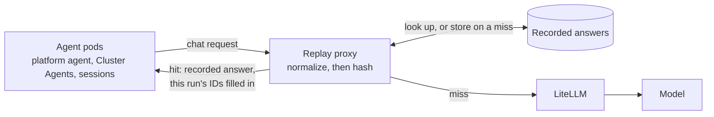
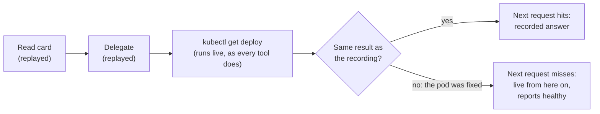
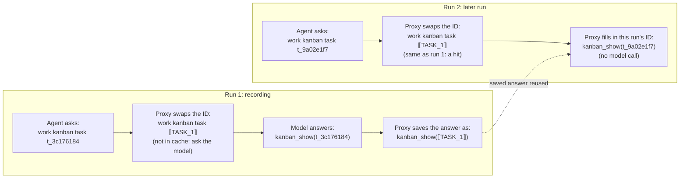
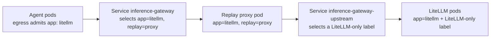
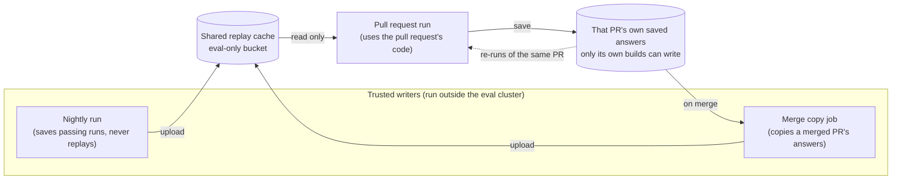

# Inference replay for evals

> **STATUS — proposal; measured, not built.** A prototype proxy was run against a dev install on
> 2026-10-31 to 2026-11-02. Nothing here is wired into `hack/ci-deploy.sh`, `hack/ci-eval-pr.sh` or
> the chart. The first stage proposed is shadow mode, which changes no verdict.

**Scope:** serving recorded model answers to eval runs whose model input has not changed, so a
presubmit pays for inference only from the first point where a run differs from one already graded.
**Owns:** the cache key and its normalization rules, where the proxy sits, which recordings may be
served, and the rollout stages. The gate's ladder and roster stay in
[`testing-strategy.md`](../../docs/designs/testing-strategy.md) §4.2; the eval transport stays in
[`eval-next-transport.md`](../../docs/designs/eval-next-transport.md). The example proxy in this
directory ([`README.md`](README.md)) is the starting point and is superseded by the design here
for eval use. The kustomize integration under `k8s-operator/config/integrations/inference-replay/`
labels its proxy `app: standalone-replay`, which the worker pods' egress policies (A2A sessions and
Cluster Agents) do not admit under `spec.mode: next` (see "Where the proxy runs"), so it is not a
base for this either.

## The problem

Most of a presubmit's inference repeats work the eval suite has already done. A pull request
that changes nothing a case depends on still pays for every model call in every repetition of that
case. One 36-run presubmit build measured on 2026-10-20 sent 48.6M prompt tokens against 311k
output tokens; agent spend was $46–82 per build at list price, and the fan-out cases dominate it.
Model time is at most 73% of a run's wall clock (agent execution including its tool calls); the
remainder is tool time, the dispatcher, and the judge.

## How replay works

A proxy sits between the agents and LiteLLM. Every `/v1/chat/completions` request is normalized
(next section) and hashed. On a miss the request goes to the model, the answer is streamed back,
and the answer is stored under the hash. On a hit the stored answer is returned without a model
call.

Three properties make this sound for grading:

- **A hit means the model saw the same input.** The key covers the whole request: system prompt,
  tool schemas, the model alias, and every message so far, including every tool result, with one
  exception (the recent-work digest, below). A stored answer is a real sample from the model for
  that exact input. What serving it loses is independence between samples, and under pass-only
  recordings (below) it is also a sample drawn only from runs that passed, which biases a replayed
  run towards passing.
- **Tools still run.** Only model calls are replayed. `kubectl`, `gcloud`, scripts and GitHub
  writes execute live, and the verifiers grade the live state and the delivered report. A tool
  result that differs from the recording changes the next request, which misses, and from there
  the run is live.
- **A change under test misses.** A pull request that edits a prompt, a skill the run reads, a
  script's output, or a tool schema changes a request, and the run is graded live from that point.
  A pull request that changes nothing in a case's path replays it.

A run therefore replays up to its first tool result that differs from the recording, and is live
from the next request on. This is the safety run from "Measurements": the pod was fixed between the
recording and the replay.

## Normalization

Raw requests never repeat. Kanban task IDs, pod name suffixes, UIDs, timestamps, ages, process and
row IDs, and scratch file names differ every run, and one difference poisons every later request
in the conversation, because each request embeds the ones before it. Hashing near-raw bodies (only a
per-message `timestamp` stripped), as the example proxy does, gave 5–7% token-weighted hits in a two-run measurement on a dev install on 2026-09-04.

The normalizer replaces each identifier with a placeholder numbered by first appearance in the
request (`⟦TASK_1⟧`, `⟦POD_2⟧`, `⟦AGEm_1⟧`), and the mapping works both ways. A stored answer
is kept with placeholders; on a hit the placeholders are filled from the current request's
values, so a replayed `kanban_show` names this run's card, not the recording's. An answer that
names a placeholder the current request does not bind is not served.

The rules that keep this safe:

- **Identifiers only, never state.** Counts, statuses, restart numbers, versions, scores and
  zones stay literal; they are what the agent reasons about. A crashlooping pod's restart count
  rises between runs, so cases with a live defect replay less, and that is correct.
- **Ages keep their unit, and only ages count as ages.** `5m` and `3d` get different placeholder
  classes, because a pod's age in minutes against days can be the finding. A value is treated as an
  age only where it is clearly one: an `AGE` column, an `age:` or `lastSeen` field, or "… ago".
  Kubernetes writes CPU the same way (`120m` is 0.12 of a core), and CPU and memory amounts are
  state that cases are graded on, so they always stay literal. The prototype matched any
  `<digits>m`, which this rule replaces.
- **Opaque fields are never touched.** Fields named for signatures, `provider_specific_fields`,
  and the `id`/`tool_call_id` of tool calls: LiteLLM embeds Gemini's thought signature in
  tool-call ids (`call_…__thought__<base64>`), and rewriting a digit inside it corrupts the
  signature. The prototype did exactly this before it was fixed.
- **Answers are rewritten by whole token only, and never for bare numbers.** An unrelated `99`
  in an answer must not become this run's row id.
- **Hermes' recent-work digest is dropped from the key.** Every card view ends with
  `## Recent work by @<assignee>`, the assignee's last five runs on other cards, so the first
  card read differs between otherwise identical runs. The same block leaks earlier repetitions'
  answers into later ones, live or replayed (#1730). Stripping it is a stopgap; fixing #1730 removes
  the need.

Classes the prototype maps: UUID, Hermes session id, ISO timestamp, kanban task id, A2A task id,
inject message id, GKE node name, pod name with ReplicaSet hash, IP, `pid`/`run_id`/numeric `id`/
`resourceVersion`/`generation`, scratch file `_<epoch>_<pid>` suffixes, and ages. Epoch seconds are
replaced by a fixed token, because two events in one second would otherwise shift every later
number. Known gaps from the measurements: `ls -l` dates (`Nov  2 04:13`) and Hermes'
terminal-output cache file suffixes (`…-89b0.log`).

## Measurements

All on one dev install, `spec.mode: next`, Gemini 3.1 Pro via LiteLLM. Each row is one recording
followed by replays of that same recording minutes later; "tokens" is the share of prompt tokens
served from the cache.

| Run                                                            | Tokens replayed  | Model time     | Verdicts               |
| -------------------------------------------------------------- | ---------------- | -------------- | ---------------------- |
| Fleet version table (platform agent only), card-driven         | 100%             | 43 s → 1 s     | —                      |
| Health check fanned out to three Cluster Agents, card-driven   | 54%              | 144 s → 62 s   | —                      |
| `chat-routing-own-cluster-namespaces`, devops-bench, ×3        | 100%, 100%, 100% | 51 s → 0 s     | pass ×4                |
| `obtainability-design-quota-vs-capacity`, devops-bench, ×3     | 59%, 46%, 58%    | 96 s → 53–76 s | pass ×4                |
| `provisioning-cluster-request-never-creates`, devops-bench, ×3 | 46%, 53%, 57%    | 98 s → 33–50 s | fail, fail, pass, pass |

A replay stopped reusing recorded answers only when a tool returned something different from the
recording. That happened in three ways:

- the GCP capacity advisor returned a different score and zone (real data that changes);
- a `sleep 60` in a polling loop timed out in one run and finished normally in another;
- `ls -l` printed different file timestamps (a normalizer gap, listed above).

The provisioning case's verdict flipped because of the third one. Every replay of it reached the
same `ls -la`, ran live from there, and so finished as an ordinary live run, and that case passes
only about half the time when run live. None of the verdict differences came from replay itself.

We also checked that replay stops reusing recorded answers when something real has changed.

- **The cluster changed.** For the recording, a test Deployment was crashlooping. Before the
  replay, we fixed it. The Cluster Agent reused its recorded answers until it ran
  `kubectl get deploy -o yaml`, which now showed the fixed pod. From there it ran live and
  correctly reported the pod as healthy. The platform agent's earlier steps (reading the card,
  delegating) didn't depend on the pod, so they were still reused: 74% of tokens.
- **The prompt changed.** We added one line to the Cluster Agent's `SOUL.md`. Every one of its
  requests then missed the cache, starting with the first, and its answer followed the new line.
  The platform agent's prompt hadn't changed, so its steps were still reused.

Editing a skill only matters for runs that open that skill (with `skill_view`); in our test the
agent never opened the edited skill, so that edit showed nothing.

Wall clock barely moved (1–2 minutes a run): sandboxed tool calls, the dispatcher, the fan-out
`sleep` loop and the judge are not model calls. The win is tokens, model time and rate-limit
pressure.

An earlier offline estimate from nightly trajectories (56–70% if prompts are unchanged) compared
kanban results on status fields only, which hid the recent-work digest; the live numbers above
replace it.

## Design for CI

### Where the proxy runs

The proxy runs only on eval installs; customer installs never get it. `hack/ci-deploy.sh` adds it
after its last Helm upgrade (the switch to next mode), because a Helm upgrade can undo the change
to the `inference-gateway` Service.

How traffic reaches it:

- **Agents → proxy.** The worker pods' network policies (A2A sessions and Cluster Agents) only let
  them talk to pods labelled `app: litellm` (the Platform Agent's own pod also allows the older
  `app: standalone-replay`). So the proxy pod carries that label too, plus a second label, `replay: proxy`.
  The `inference-gateway` Service is pointed at pods with both labels, which means only the proxy.
- **Proxy → LiteLLM.** A second Service, `inference-gateway-upstream`, points at the real LiteLLM
  pods, and one extra network policy lets the proxy reach them.

**The tricky part is the upstream Service.** The real LiteLLM pods only carry `app: litellm`, the
same label the proxy has. A Service that picks pods by that label would pick the proxy too, and
the proxy would end up sending requests to itself. The prototype got around this with a label that
only the current LiteLLM pods have (`pod-template-hash`), but that label changes whenever LiteLLM
restarts with a new version. CI needs a fixed label on the LiteLLM pods (set through the chart)
that the proxy doesn't have.

**Side effects of sharing the `app: litellm` label.** The proxy also gets counted as a LiteLLM pod
by LiteLLM's disruption budget, its pod spreading rule, its metrics scraping, and the console's
metrics. The metrics matter most: those tools add up `/metrics` from every `app: litellm` pod. If
the proxy forwarded `/metrics` to LiteLLM, one LiteLLM pod's numbers would be counted twice. So the
proxy answers `/metrics` itself, with its own numbers or nothing.

### One shared cache for all eval projects

CI runs evals in a small pool of GCP projects. We keep one cache for all of them instead of one per
project.

Splitting it by project wouldn't make replay any safer. A saved answer is only reused when the
whole request matches, including every tool result. So if two projects really differ (different
cluster versions, different planted problems), their requests differ and the cache misses anyway. A
cache per project would only lose hits we could have had, and every time a prompt changes we'd have
to refill it once per project instead of once.

The cache lives in a storage bucket that only the eval projects use. It's never shared with dev
installs or customer installs, because the saved answers contain details about our test clusters.

**Requests are scrubbed in the proxy.** The proxy sees every request before any redaction:
LiteLLM's redaction plugin runs inside LiteLLM, is off by default, and CI doesn't turn it on. So
before anything is stored, the proxy runs the same scrubbers `worker_trajectory.py` uses (the
install's `AuditRedactor`, then the `worker_transcript.py` rules). Those have only been tested on
2,000-character snippets, so full-length tool output (a Secret dump, a minted token) needs its own
check before any request text is stored.

### Who can write to the cache

The eval run on a pull request (the presubmit) uses that pull request's code. If that run could
write to the shared cache, a pull request could change its scripts to save made-up "passing"
answers under `main`'s requests, and every pull request after it would be graded with them. The
evidence store already has a rule against this in
[`testing-strategy.md`](../../docs/designs/testing-strategy.md) §4.2: a pull request must not be able
to change what it's compared against.

Permissions inside the eval cluster can't enforce that. The presubmit's own account
(`prowjob-default-sa`) is an admin on every eval-pool project (storage, service accounts and IAM,
per `docs/ci-pool-projects.md`), so anything a process in the cluster can write, a pull request can
write too. The evidence store gets around this the only way that works: the trusted writer is a
different account that runs outside the cluster. The nightly uploads as `eval-baseline-recorder`,
and presubmits only get read access. The cache works the same way. The proxy keeps each run's
answers inside the cluster, and the job copies them out as it runs. They only reach the shared
cache through one of these writers:

- **The nightly.** It runs `main`'s code as `eval-baseline-recorder`, and uploads the answers from
  runs that passed.
- **A copy job when a pull request merges.** A small job, triggered by the merge and running as a
  trusted account, copies the merged pull request's answers from its last passing presubmit into
  the shared cache. That's safe because the code that produced them has now been reviewed,
  approved and merged. It's only a file copy, not an eval run, so the cost that made the scorer
  design reject an after-merge eval run (`docs/designs/eval-scorer.md`, "Why nightly and not
  per-merge") doesn't apply. It's also what keeps the cache fresh: right after a prompt change
  merges, the merged pull request's own answers already match the new prompt.

A pull request can also **reuse its own answers** when it's re-run (a `/retest`, or a new push that
doesn't touch a case). A lot of the 150–290 presubmit builds a weekday are re-runs of the same pull
request.

**The hard part is keeping a pull request's answers safe until it merges.** Both the merge copy and
a pull request's own re-runs read answers a presubmit saved. All presubmits run as the same account,
so if they all wrote into one bucket, a bad pull request could write into another pull request's
folder, and the merge copy would carry its answers into the shared cache. Only a pull request's own
builds may be able to write its answers. Two candidates, to be checked before building:

- Store them in the build's own Prow artifacts folder, encrypted with a Cloud KMS key that
  presubmits can encrypt with but only the copy job can decrypt. That needs Prow's uploader to be
  the only thing that can write into a build's folder; whether a job's own code can write there
  isn't verified.
- A staging bucket with create-only access (no overwrite), where each build writes a list of what
  it saved and the copy job checks it.

Pull requests read the shared cache through the runner's own read-only token, refreshed into the
cluster, rather than through an account that lives in the cluster.

**What goes into the cache key.** Agents don't ask for a specific model. They send the name
`model-default`, and LiteLLM decides which model that means and how hard it thinks. LiteLLM also
edits requests with a few plugins (for example, one that strips old thinking text). So a pull
request that changes any of that sends exactly the same requests as before, and without extra care
it would get answers from the old setup. To stop that, the key also includes LiteLLM's config
fingerprint (the chart already keeps one, in the `checksum/config` annotation) and the LiteLLM image
version.

**Backup-model answers are never saved.** LiteLLM can be set up with a backup it uses when the main
model fails. The backup is the same model with less thinking, so the model name in the reply looks
the same either way. But LiteLLM adds headers to each reply saying what happened:
`x-litellm-model-group` says which setup answered, and `x-litellm-attempted-fallbacks` says whether
it fell back (see [the gateway page](../../docs/site/src/content/docs/concepts/inference-gateway.md)).
The proxy only saves an answer when it came from the main setup with no fallback. Our prototype
didn't check these headers, so this part hasn't been tested yet.

### Only save answers from runs that passed

A replayed answer leads to the same result as the run it came from. If we saved answers from a run
that failed by bad luck, every pull request that hit those answers would fail too, until a prompt
change cleared them. So we only keep answers from runs that passed. That way a pull request that
doesn't touch a case replays a passing run, and a pull request that does touch it changes the
requests and runs live. The writers above apply that rule: the nightly uploads only passing runs,
and the merge copy takes only the merged pull request's last passing presubmit.

Each case runs three times on a pull request. Ideally each of those three would replay its own
recording, so we still get three different samples instead of the same one three times. For that,
the proxy needs to know which run a request belongs to, and today requests don't carry that (see
open questions). Until then, all three runs of a case replay the same recording. That's also how
our measurements were done: one recording, replayed three times.

### Prompts change often

On weekdays, 1 to 9 commits a day change something that goes into the agents' system prompt
(`SOUL.md`, a profile's `AGENTS.md` or config, or a skill's description). Each one makes every
request from the affected agents miss. If only the nightly saved answers, the cache would be out of
date for most of the day. The merge copy fixes that: the pull request that changed the prompt has
already run the affected cases on the new prompt, so its answers go into the cache the moment it
merges, and the pull requests after it get hits. The nightly fills in cases no recent pull request
ran.

### The nightly stays live

The nightly never replays. It's what measures each case's real pass rate, which the dashboard and
the blocking roster rely on, and replay would make those numbers look better than they are.

## What changes for the gate

When runs replay, the three runs of a case are no longer independent. And because we only save
passing runs, a case a pull request didn't touch will pass on replay. So the "all three runs failed"
rule can only be triggered by the parts of a run that ran live. That's what we want for a pull
request that didn't cause the failure. But it raises three things the eval crew needs to decide
before stage 2 of the rollout:

- **Comparisons with `main` get biased.** Two checks compare a pull request with `main`'s numbers
  from the nightly: the overall pass rate (advisory for now, until `EVAL_AGGREGATE_ARMED` is set),
  and rung 6, which compares judged scores. Replayed passes make the pull request look better in
  both. One option is to count only runs that went live before the part of the case that gets
  checked; another is to compare against a `main` baseline that was also replayed. Caching the judge
  (open questions) would make this worse.
- **Flaky cases look stable.** A case that's flaky on `main` stops showing its flakiness on unrelated
  pull requests. The nightly still shows it.
- **Token counts look like the model ran.** A replayed answer comes with the token counts from the
  original run. So the eval record's token numbers, and rung 3's check that the run really called a
  model, both act as if the model was called. To count replayed tokens separately, the proxy has to
  tell the eval record which answers were replayed, and that needs the same "which run is this"
  information as above. Until then, we read the savings from the proxy's own log.

## Rollout

1. **Shadow mode (logs only, no cache).** The proxy runs in the presubmit and the nightly and
   calls the model for every request, so nothing about pass or fail changes. For each request it
   logs a fingerprint (the hash of the normalized request), the prompt tokens and the model time.
   The fingerprints carry nothing sensitive, so they go into the job's normal Prow artifacts. The
   scrubbed request text goes to a private, eval-only bucket instead, because Prow artifacts can be
   read by anyone through the public Prow web UI. The job streams both out while it runs, not at the
   end: the last two nightlies hit Prow's 14-hour timeout, and their end-of-run collection found
   LiteLLM already deleted. After a week, an offline script goes through the logs in time order and,
   for each request, asks whether the same fingerprint appeared earlier. Hits on nightly
   fingerprints give a low estimate (up to a day old), hits on pull request fingerprints a high one,
   and the share of hits from another project answers whether one shared cache is right. For
   normalizer work, the script diffs each miss against the closest earlier request, and because the
   scrubbed text is kept, a new normalizer rule can be re-run over the same week without redeploying.
   No shared cache and no new in-cluster permissions are needed for this stage.
2. **Turn on replay for pull requests**, once the eval crew has decided the three gate questions above
   and #1730 is fixed (or they're happy with stripping the recent-work section from the key).
3. **Look at polling.** If shadow mode shows most of the remaining misses come from the `sleep 60`
   polling loop, fix the polling rather than the cache.

## Open questions

- **How does the proxy know which run a request belongs to?** We need this to save only passing runs
  and to give each of the three runs its own recording. Requests from many agents and many cases
  arrive at the same time with nothing saying which run they're from. Two ideas: pass a run tag from
  the eval harness through the gateway and Hermes into each request's `metadata`, or link requests
  together by conversation (each worker's first request names its card, and the card's text came
  from the parent's recorded answer).
- **Should the judge be cached too?** When a whole run is replayed, the judge gets exactly the same
  input as before. The judge takes 11 to 19% of a run's time. The same key rules would apply.
- **How are a pull request's answers kept safe until it merges?** See "The hard part" above; one of
  the two candidates has to be checked and picked before stage 2.
- **How big does the cache get, and when do entries expire?** Answers recorded for an old version of
  a prompt can never be hit again, so entries should expire by age.
