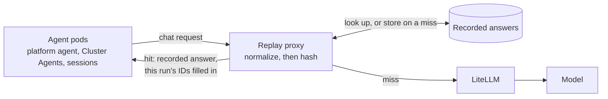
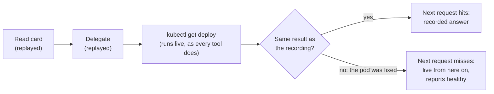
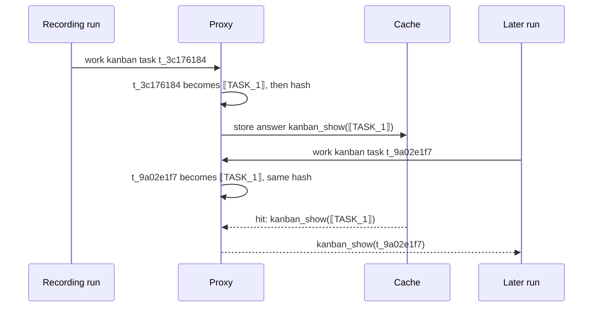
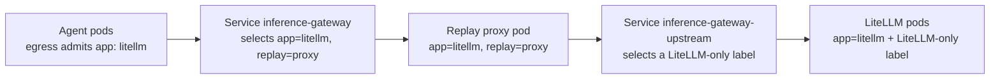
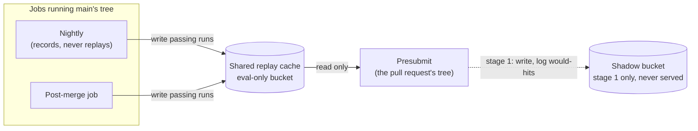

# Inference replay for evals

> **STATUS — proposal; measured, not built.** A prototype proxy was run against a dev install on
> 2026-10-31 to 2026-11-02. Nothing here is wired into `hack/ci-deploy.sh`, `hack/ci-eval-pr.sh` or
> the chart. The first stage proposed is shadow mode, which changes no verdict.

**Scope:** serving recorded model answers to eval runs whose model input has not changed, so a
presubmit pays for inference only from the first point where a run differs from one already graded.
**Owns:** the cache key and its normalization rules, where the proxy sits, which recordings may be
served, and the rollout stages. The gate's ladder and roster stay in
[`testing-strategy.md`](../../docs/designs/testing-strategy.md) §4.2; the eval transport stays in
[`eval-next-transport.md`](../../docs/designs/eval-next-transport.md). The example proxy in this
directory ([`README.md`](README.md)) is the starting point and is superseded by the design here
for eval use. The kustomize integration under `k8s-operator/config/integrations/inference-replay/`
labels its proxy `app: standalone-replay`, which the worker pods' egress policies (A2A sessions and
Cluster Agents) do not admit under `spec.mode: next` (see "Where the proxy runs"), so it is not a
base for this either.

## The problem

Most of a presubmit's inference repeats work the eval suite has already done. A pull request
that changes nothing a case depends on still pays for every model call in every repetition of that
case. One 36-run presubmit build measured on 2026-10-20 sent 48.6M prompt tokens against 311k
output tokens; agent spend was $46–82 per build at list price, and the fan-out cases dominate it.
Model time is at most 73% of a run's wall clock (agent execution including its tool calls); the
remainder is tool time, the dispatcher, and the judge.

## How replay works

A proxy sits between the agents and LiteLLM. Every `/v1/chat/completions` request is normalized
(next section) and hashed. On a miss the request goes to the model, the answer is streamed back,
and the answer is stored under the hash. On a hit the stored answer is returned without a model
call.

Three properties make this sound for grading:

- **A hit means the model saw the same input.** The key covers the whole request: system prompt,
  tool schemas, the model alias, and every message so far, including every tool result, with one
  exception (the recent-work digest, below). A stored answer is a real sample from the model for
  that exact input. What serving it loses is independence between samples, and under pass-only
  recordings (below) it is also a sample drawn only from runs that passed, which biases a replayed
  run towards passing.
- **Tools still run.** Only model calls are replayed. `kubectl`, `gcloud`, scripts and GitHub
  writes execute live, and the verifiers grade the live state and the delivered report. A tool
  result that differs from the recording changes the next request, which misses, and from there
  the run is live.
- **A change under test misses.** A pull request that edits a prompt, a skill the run reads, a
  script's output, or a tool schema changes a request, and the run is graded live from that point.
  A pull request that changes nothing in a case's path replays it.

A run therefore replays up to its first tool result that differs from the recording, and is live
from the next request on. This is the safety run from "Measurements": the pod was fixed between the
recording and the replay.

## Normalization

Raw requests never repeat. Kanban task IDs, pod name suffixes, UIDs, timestamps, ages, process and
row IDs, and scratch file names differ every run, and one difference poisons every later request
in the conversation, because each request embeds the ones before it. Hashing near-raw bodies (only a
per-message `timestamp` stripped), as the example proxy does, gave 5–7% token-weighted hits in a two-run measurement on a dev install on 2026-09-04.

The normalizer replaces each identifier with a placeholder numbered by first appearance in the
request (`⟦TASK_1⟧`, `⟦POD_2⟧`, `⟦AGEm_1⟧`), and the mapping works both ways. A stored answer
is kept with placeholders; on a hit the placeholders are filled from the current request's
values, so a replayed `kanban_show` names this run's card, not the recording's. An answer that
names a placeholder the current request does not bind is not served.

The rules that keep this safe:

- **Identifiers only, never state.** Counts, statuses, restart numbers, versions, scores and
  zones stay literal; they are what the agent reasons about. A crashlooping pod's restart count
  rises between runs, so cases with a live defect replay less, and that is correct.
- **Ages keep their unit.** `5m` and `3d` get different placeholder classes, because a pod's age
  in minutes against days can be the finding.
- **Opaque fields are never touched.** Fields named for signatures, `provider_specific_fields`,
  and the `id`/`tool_call_id` of tool calls: LiteLLM embeds Gemini's thought signature in
  tool-call ids (`call_…__thought__<base64>`), and rewriting a digit inside it corrupts the
  signature. The prototype did exactly this before it was fixed.
- **Answers are rewritten by whole token only, and never for bare numbers.** An unrelated `99`
  in an answer must not become this run's row id.
- **Hermes' recent-work digest is dropped from the key.** Every card view ends with
  `## Recent work by @<assignee>`, the assignee's last five runs on other cards, so the first
  card read differs between otherwise identical runs. The same block leaks earlier repetitions'
  answers into later ones, live or replayed (#1730). Stripping it is a stopgap; fixing #1730 removes
  the need.

Classes the prototype maps: UUID, Hermes session id, ISO timestamp, kanban task id, A2A task id,
inject message id, GKE node name, pod name with ReplicaSet hash, IP, `pid`/`run_id`/numeric `id`/
`resourceVersion`/`generation`, scratch file `_<epoch>_<pid>` suffixes, and ages. Epoch seconds are
replaced by a fixed token, because two events in one second would otherwise shift every later
number. Known gaps from the measurements: `ls -l` dates (`Nov  2 04:13`) and Hermes'
terminal-output cache file suffixes (`…-89b0.log`).

## Measurements

All on one dev install, `spec.mode: next`, Gemini 3.1 Pro via LiteLLM. Each row is one recording
followed by replays of that same recording minutes later; "tokens" is the share of prompt tokens
served from the cache.

| Run                                                            | Tokens replayed  | Model time     | Verdicts               |
| -------------------------------------------------------------- | ---------------- | -------------- | ---------------------- |
| Fleet version table (platform agent only), card-driven         | 100%             | 43 s → 1 s     | —                      |
| Health check fanned out to three Cluster Agents, card-driven   | 54%              | 144 s → 62 s   | —                      |
| `chat-routing-own-cluster-namespaces`, devops-bench, ×3        | 100%, 100%, 100% | 51 s → 0 s     | pass ×4                |
| `obtainability-design-quota-vs-capacity`, devops-bench, ×3     | 59%, 46%, 58%    | 96 s → 53–76 s | pass ×4                |
| `provisioning-cluster-request-never-creates`, devops-bench, ×3 | 46%, 53%, 57%    | 98 s → 33–50 s | fail, fail, pass, pass |

Every replay that left the recording did so at a tool result: the capacity advisor's live
obtainability score and zone, a fan-out poll's `sleep 60` timing out instead of completing, and the
`ls -l` dates above. The provisioning case's verdict flip is that last one: each replay went live
at the same `ls -la` and finished as a fresh live run of a case that passes about half the time.
No verdict difference traced to replay itself.

A safety run checked that replay misses when it must. A Deployment on a Cluster Agent's cluster
was crashlooping for the recording, then fixed: the replay left the recording at the Cluster Agent's
`kubectl get deploy -o yaml` and reported it healthy, while the platform agent's card reading and
delegation still replayed (74% of tokens). Appending one line to the Cluster Agent's `SOUL.md` made
every one of its requests miss from the first, and it followed the new line; the platform agent's
unchanged prompt still replayed. A skill-body edit proves nothing unless the run calls `skill_view`
on that skill.

Wall clock barely moved (1–2 minutes a run): sandboxed tool calls, the dispatcher, the fan-out
`sleep` loop and the judge are not model calls. The win is tokens, model time and rate-limit
pressure.

An earlier offline estimate from nightly trajectories (56–70% if prompts are unchanged) compared
kanban results on status fields only, which hid the recent-work digest; the live numbers above
replace it.

## Design for CI

### Where the proxy runs

Eval installs only. `hack/ci-deploy.sh` renders the proxy beside LiteLLM after its last Helm
upgrade (the next-mode flip) and points `inference-gateway` at it, since a Helm upgrade can revert
the Service; customer installs never carry it. The proxy pod has to carry `app: litellm`, because
that is the label the agents' and Cluster Agents' egress policies admit for the model gateway. A second label (`replay: proxy`)
selects it for `inference-gateway`, an `inference-gateway-upstream` Service selects the real LiteLLM
pods, and one extra NetworkPolicy lets the proxy reach them. The upstream selector is the hard part:
the chart's LiteLLM pods carry only `app: litellm`, so a Service selecting that also selects the
proxy and loops. The prototype selected on the LiteLLM ReplicaSet's `pod-template-hash`, which breaks
on the next LiteLLM roll; CI needs a stable label on the LiteLLM pods (a chart value) that the proxy
does not carry. The shared label also enrols the proxy in LiteLLM's PodDisruptionBudget, its topology spread, its
`PodMonitoring` scrape and the console's metrics Service. The scrape and the console sum
`/metrics` across every `app: litellm` address, so the proxy must answer `/metrics` itself (its own
counters, or empty) rather than pass it through to a LiteLLM replica, which would count that
replica twice.

### One shared cache for the evaluation pool

The cache is shared across the pool's projects, not split per project. A hit requires the full
normalized request to match, tool results included, so two projects whose fleets differ in a way
that matters miss anyway; a per-project split only removes hits whose inputs were the same, and it
multiplies the live runs needed to warm the cache after each prompt change by the pool size. The
cache lives in an eval-owned bucket and is never shared with dev or customer installs, because
recorded answers carry cluster details.

**Presubmits read it; only jobs running `main`'s tree write it.** A presubmit runs the pull
request's tree, including `hack/ci-deploy.sh` and whatever pins the proxy, so code pinning cannot
stop a presubmit holding write access from putting any answer under `main`'s keys, and every later
pull request would be graded from it. That breaks the rule
[`testing-strategy.md`](../../docs/designs/testing-strategy.md) §4.2 states for the evidence store
(a pull request cannot move the baseline it is judged against), and the evidence store holds that
rule structurally: the presubmit's identity has read access only. The cache does the same. The
presubmit identity gets object read on the bucket and nothing else; the nightly and a post-merge
job, which run `main`'s tree, are the only writers. The cost is freshness: after a prompt change
merges, presubmits miss until the post-merge job has run the affected cases.

**The key includes what the request does not show.** Agents send the alias `model-default`; LiteLLM
resolves the real model, `reasoning_effort` and thinking on its side, and rewrites requests through
callback modules mounted beside it (the thinking-replay hook, redaction), so a pull request that
changes any of those sends byte-identical requests. The chart already hashes all of it into the
LiteLLM Deployment's `checksum/config` annotation; the key includes that checksum and the LiteLLM
image. Fallbacks cannot be keyed: the chart's fallback alias is the same upstream model at a lower
`reasoning_effort`, and the response's `model` field does not tell them apart. Eval installs run
without `litellm.fallback` until a response field names the alias that answered.

### Which recordings may be served

Only recordings from runs that passed. A hit replays its recording's outcome, so one flaky failure
in the cache would red every pull request on that prompt version until the prompt changes. With
pass-only recordings a pull request that does not touch a case replays a pass, and one that does
touches a request and is graded live. New entries are held per run and committed when the run's
verdict is in.

Ideally each repetition replays its own recording, with the repetition index in the key, so the
three repetitions keep three samples rather than one served three times. That needs a run's
requests to carry its identity, which they do not today (open questions). Without it, all three
repetitions of a case replay the same recording. The measurements above were taken that way: one
recording, served to three replays.

### Prompt churn

On weekdays 1–9 commits a day change system-prompt content (`SOUL.md`, profile `AGENTS.md`,
profile config, skill descriptions), and each one misses every request of every profile it
touches. A recording made only by the nightly would be stale for most presubmits, which is why a
post-merge job writes too: the first merge after a prompt change pays for the live runs, and the
presubmits after it hit. Whether that job runs every case or only those whose requests the merge
changed is a cost question for shadow mode to answer; there were 150–290 presubmit builds a weekday
in late October, cancelled ones included, so even a full post-merge run is amortised quickly.

### What stays live

The nightly. It measures each case's true pass rate, which is what admission and the dashboard
read, and replay would bias it towards the recordings.

## What changes for the gate

Repetitions stop being independent where they replay. With pass-only recordings an untouched case
passes on replay, so collapse (all three repetitions failing) can only come from the live part of a
run. That is the intent for a pull request that did not cause the failure. These consequences need
the eval crew's decision before stage 2 of the rollout below:

- Every comparison against `main`'s baseline is skewed the same way. The aggregate rule compares a
  pull request's pass rate with `main`'s from the evidence store, which the live nightly writes; it
  is advisory until `EVAL_AGGREGATE_ARMED` is set, but it is what arming would make block. Rung 6
  compares judged scores with the same baseline, and caching the judge (open questions) would add
  to it. Replayed passes inflate the pull request's side of both. Either they count only
  repetitions that went live before the case's first verifier-relevant call, or they read a
  replayed baseline.
- A case that is flaky on `main` stops showing its flakiness on unrelated pull requests. The nightly
  still reports it.
- Token accounting. A hit returns the recorded answer's `usage`, so the record's token counts, and
  rung 3's check that a run billed a model call, behave as if the model ran. Splitting replayed
  tokens from billed ones in the record needs the proxy's hit or miss to reach it, which goes
  through the same run identity as attribution (open questions); until then the saving is read
  from the proxy's own log, not the eval records.

## Rollout

1. **Shadow mode.** The proxy records every presubmit's answers to a shadow bucket that nothing is
   served from, checks whether each request would have hit, logs it with the recording's project and
   whether a presubmit or a `main` job wrote it, and always calls the model. Only hits on
   `main`-written entries count towards the design's hit rate; the rest show what the freshness
   cost of read-only presubmits is. No verdict changes. A week of it gives the real hit rate under prompt
   churn and project rotation, the token and cost saving per build, and the misses worth
   normalizing. Cheap and reversible.
2. **Replay on the presubmit**, after the eval crew settles the gate questions above and #1730
   is fixed or the digest stripping is accepted.
3. **Polling.** If shadow mode shows the fan-out `sleep` loop is where most remaining misses fall,
   look at the poll, not the cache.

## Open questions

- **How a run's entries are attributed.** Pass-only commit needs to know which cached entries a
  run produced. Requests reach LiteLLM from several agents and concurrent cases with no run
  identity. Candidates: carry a run tag from the inject message through the gateway and Hermes into
  the request's `metadata`; or link entries by conversation, since each worker's first request
  names its card, whose body the parent's recorded answer wrote.
- **Whether the judge is cached.** On a fully replayed run the judge's input is identical too; the
  judge is 11–19% of a run's time. Same key rules apply.
- **Cache size and expiry.** Entries for a superseded prompt version are dead; expire by age.
